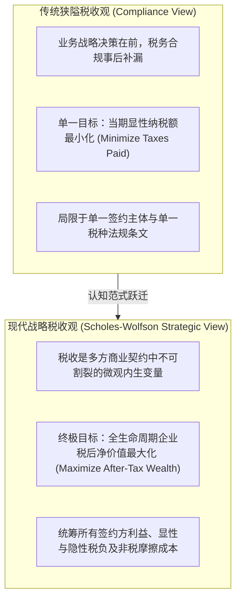
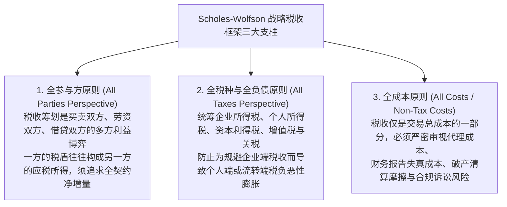
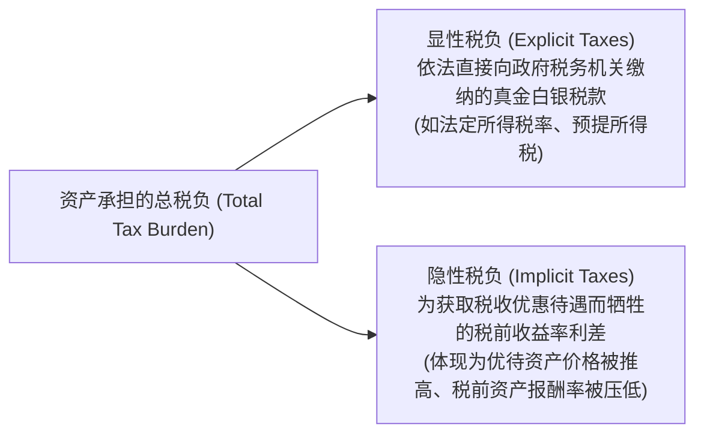
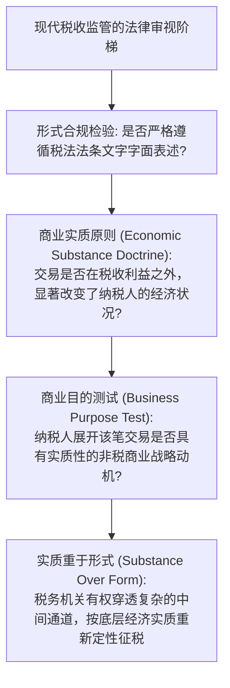

# Lec 01 商业中的税收角色与税后收益最大化哲学 (Introduction: The Role of Taxes in Business and Value Maximization)

> MIT Sloan School of Management · 15.518 Taxes and Business Strategy · 讲义 01

## TL;DR

- 战略税收筹划追求企业税后净财富最大化，而非片面追求应纳税额最小化。
- 斯科尔斯-沃尔夫森框架确立“多方契约、全税制、全成本”三维统筹审视原则。
- 显性税负是直接向税务机关缴纳的税款，而隐性税负表现为税收优待资产的较低税前收益率。
- 任何忽视非税摩擦成本的激进避税，都可能反向摧毁企业商业价值与委托代理治理。

## 传统合规税收观 vs 现代战略税收观

在传统商科教育与企业管理实务中，税收常常被视为一种纯粹事后的、被动的行政合规负担（Administrative Compliance）。企业高管制定商业战略、设计投资方案、确定跨国供应链与资本结构，然后将财务账册移交给税务合规部门或会计师事务所，要求其“寻找一切减税法条，将企业本期向税务局缴纳的支票金额降至最低”。

然而，诺贝尔经济学奖得主迈伦·斯科尔斯（Myron Scholes）与马克·沃尔夫森（Mark Wolfson）在麻省理工学院斯隆管理学院共同创立的**战略税收筹划理论（Taxes and Business Strategy, Scholes-Wolfson Framework）**彻底颠覆了这一狭隘视角。

战略税收筹划的核心哲学公理在于：**税收最小化并不等同于税后价值最大化**。如果为了节省 100 万美元的所得税，企业必须改变最优生产工艺、承担高达 150 万美元的额外物流成本，或者将研发资产置于产权保护薄弱的避税天堂导致核心技术泄密，那么这项“成功减税”的方案在商业上是一场彻头彻尾的价值毁灭灾难。

::: definition [战略税收筹划 (Strategic Tax Planning)]
战略税收筹划是指在制定企业投融资决策、组织架构设计、高管薪酬激励及并购重组时，将税法规则内生化为多方契约谈判的关键约束条件，系统权衡显性税负、隐性税负与非税成本，以实现相关所有参与方税后期望净现值（NPV）最大化的系统工程。
:::

## 斯科尔斯-沃尔夫森框架的三大公理支柱

要穿透复杂商业交易中的税务迷雾，必须建立在斯科尔斯-沃尔夫森（Scholes-Wolfson）框架所确立的**三大全景审视支柱**之上：

### 1. 全参与方原则（All Parties Perspective）

商业交易本质上是一份多边契约。在雇佣关系中存在企业与雇员；在借贷交易中存在借款人与债权人；在股权交易中存在买方与卖方。
一项聪明的税收筹划，绝不能仅仅计算自身主体省下了多少税，而必须考量交易对手方的税负变动。如果一项结构设计能为买方节税 30 万美元，但导致卖方增税 50 万美元，理性卖方必然要求大幅提高交易对价作为补偿，最终买方的税后利益反而受损。只有当筹划能够在**所有签约主体组成的联合系统中创造净税收盈余**时，交易双方才能通过对价再分配实现双赢。

### 2. 全税种原则（All Taxes Perspective）

税收法典由错综复杂的不同税种编织而成。企业管理层容易犯下的错误是“按图索骥”地仅盯住企业所得税（Corporate Income Tax）。
例如，将企业利润以股利形式分配给创始人，在企业端无法抵扣税款，同时在个人端面临股利税（Dividend Tax）；若将利润以超额工资形式发放，企业端虽然获得了所得税前扣除，但个人端可能面临高额边际累进个人所得税与自雇工薪税。战略分析师必须穿透全部税种，计算资金最终落入终极投资者口袋时的综合有效税率。

### 3. 全成本原则（All Costs Perspective）

税收成本从来不是孤立存在的，它与企业的**非税成本（Non-tax Costs）**时刻处于激烈的动态权衡中。
最为典型的非税成本包括：
- **财务报告成本（Financial Reporting Costs）**：为了少缴税，企业倾向于在税务报表上加速确认费用、延迟确认收入；但这可能导致披露给资本市场的财务报表利润腰斩，引发股价暴跌并推高股权融资成本。
- **委托代理成本（Agency Costs）**：设立复杂的离岸壳公司网络避税，会导致企业内部控制链条过长，给职业经理人侵吞公款、转移资产提供隐秘暗道。
- **交易与法务成本（Transaction and Restructuring Costs）**：聘请顶尖投行、税务律师及搭建离岸信托架构的刚性中介费用。

## 显性税负（Explicit Taxes）与隐性税负（Implicit Taxes）

初学者最容易陷入的认知盲区，是将税务局开具的缴税凭证上的金额视为纳税的全部代价。在一般均衡资产定价理论中，税收的影响早已通过价格机制深深刻入了资产的预期收益率之中。

::: theorem [隐性税负与总有效税率方程]
设全市场存在两类风险与期限完全一致的资产：
- 基准完全应税资产（如高评级企业债），其税前收益率为 $R_b$，适用显性税率为 $t_b$，税后收益率为 $R_b(1 - t_b)$。
- 享受完全免税优惠的资产（如地方政府市政债券），其显性税率 $t_a = 0$，市场均衡税前收益率为 $R_a$。

根据无套利原则，边际投资者的税后收益率必须相等：
$$R_a = R_b(1 - t_I)$$
其中 $t_I$ 即为免税资产所承担的**隐性税率（Implicit Tax Rate）**：
$$t_I = \frac{R_b - R_a}{R_b}$$
投资于免税资产的实际投资者，其承担的总有效税率定义为显性税率与隐性税率之和：
$$t_{\text{total}} = t_E + t_I$$
:::

::: example
某大型商业银行面临两个固定收益投资备选方案：
1. 风险调整后的高等级企业债券，年化税前收益率 $R_b = 8.0\%$，法定企业所得税率 $t = 25\%$。
   - 银行投资企业债的税后净收益率为：$8.0\% \times (1 - 25\%) = 6.0\%$。
2. 免征企业所得税的地方政府基础设施市政债券，年化税前收益率 $R_a = 6.2\%$，显性税率 $t_E = 0\%$。

对比两类资产的税收负担：
- 市政债券虽然显性税率为 0，但投资者每投资 100 元，税前收益较企业债少拿了 $8.0\% - 6.2\% = 1.8\%$。
- 市政债券承担的**隐性税率**为：
  $$t_I = \frac{8.0\% - 6.2\%}{8.0\%} = 22.5\%$$
- 银行投资市政债券虽然向税务局缴纳了 0 元显性税，但其通过接受较低的市场回报率，实质性向地方政府间接上缴了相当于 22.5% 的隐性税负！
- 由于银行自身的法定边际税率（25%）高于市政债券隐含的市场隐性税率（22.5%），银行投资市政债的净税后收益率（6.2%）仍然高于企业债（6.0%），因而是理性的商业决策。
:::

::: pitfall [将“免税资产”等同于“无税成本”]
许多不成熟的财务主管仅仅因为某类资产（如绿色能源补贴项目、离岸免税债券）“无需向税务局缴税”就盲目全仓配置。
如果由于大量免税资金涌入，导致该资产的价格被过度炒高，其税前收益率跌至极低水平（例如 $R_a = 5.5\%$，隐性税率高达 $31.25\%$），那么对于边际税率仅为 25% 的企业而言，配置该资产不仅没有套利，反而因为多承担了 6.25% 的隐性税负而蒙受净亏损。
:::

## 商业实质原则与反避税监管边界

在探索税后价值最大化的道路上，战略分析师必须始终清晰地识别合规筹划与非法逃避税之间的法律红线。全球主要税务司法管辖区（如美国国税局 IRS、英国 HMRC 及中国国家税务总局）均已确立了强有力的反避税法理工具箱。

如果一项精巧的交易结构（例如通过多层离岸通道循环转账）除了创造巨额纸面税收亏损外，对企业的真实运营、现金流风险没有任何实质性改变，法庭将直接依据**经济实质原则（Economic Substance Doctrine, IRC Section 7701(o)）**判定该交易为无效避税，不仅全额追缴税款并加计惩罚性利息，甚至可能将管理层推向刑事指控。

## 我的理解

::: insight [税收战略的底层认知：在制度刚性中寻找优雅的帕累托改进]
在世俗的眼光中，税收往往被赋予了某种道德对抗色彩：政府被视为财富的掠夺者，而企业则是想方设法隐藏利润的守财奴。然而，从现代微观经济学与信息经济学的维度审视，税收是现代商业文明维系产权保护、司法公正与公共基础设施所必需的“社会订阅费”。

斯科尔斯-沃尔夫森框架之所以能荣膺诺贝尔经济学奖的桂冠，正是因为它彻底终结了那种“偷鸡摸狗式”的记账避税思维。它向世界揭示了一个极其深刻的真理：**税法不仅是一张收款单，它更是一套由国家精心设计的微观激励相容机制**。

政府通过对特定资产给予税收优待（如研发加计扣除、绿色能源税收抵免、市政债免税），引导全社会的资本流向具有外部正效应的领域。而资本市场通过价格机制形成的“隐性税收”，正是市场先生在无形中对这些优待政策进行的一般均衡定价。

真正的税收战略家，绝不满足于在资产负债表的角落里玩弄文字游戏。他们是顶级的契约架构师——他们懂得在多方谈判中精准识别税率不对称的断层带，懂得用隐性税收的尺子衡量资产的真实含金量，更懂得在不破坏企业治理与非税竞争力的前提下，将税法激励优雅地编织进企业的长周期商业帝国之中。
:::
