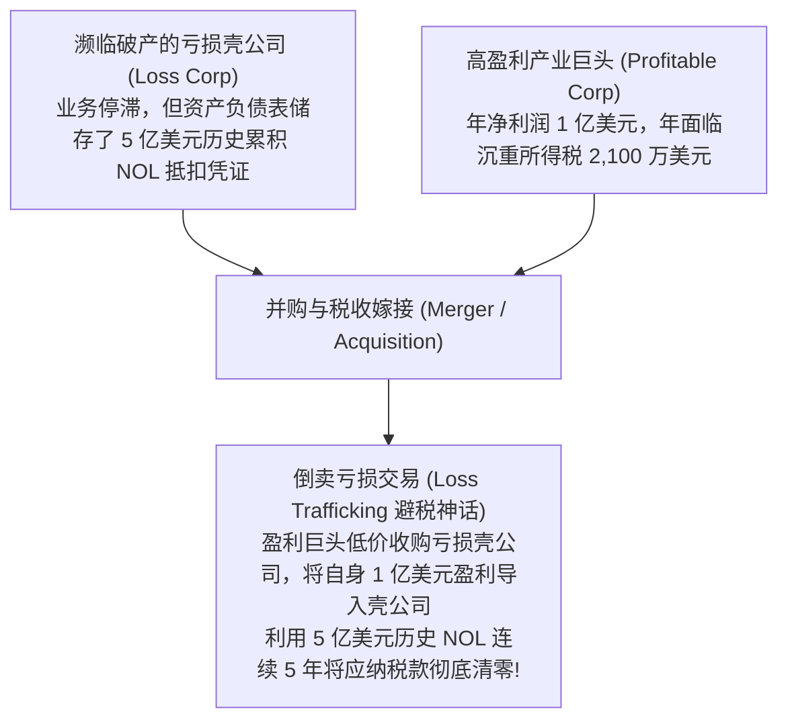
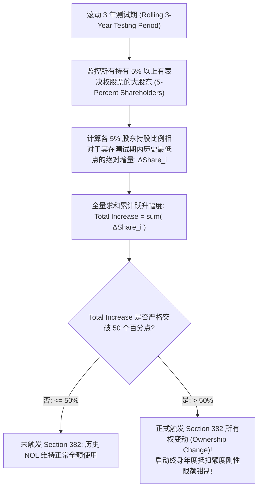
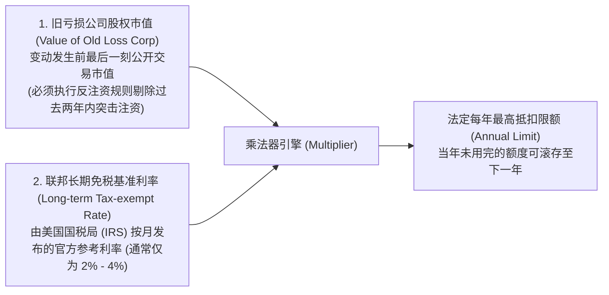
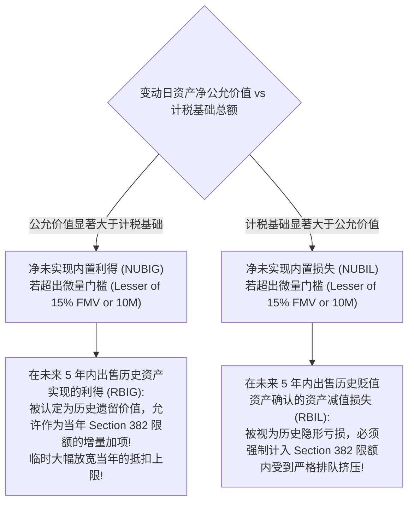

# Lec 10 亏损利用与反转让限制：Section 382 全景穿透 (Net Operating Losses and Section 382 Ownership Change)

> MIT Sloan School of Management · 15.518 Taxes and Business Strategy · 讲义 10

## TL;DR

- 净经营亏损（NOL）具备显著的未来现金流税盾价值，构成企业战略性隐形税收资产。
- 历史上严重的“倒卖亏损”投机催生了美国税法最为复杂的反避税大杀器 Section 382。
- 三年测试期内 5% 以上大股东持股累计跃升超过 50 个百分点，即触发法定所有权变动。
- 触发后年度可用亏损额度被严格锁定为企业变动前股权公允价值与联邦长期免税利率的乘积。

## 净经营亏损（NOL）的资产属性与买壳避税狂潮

在传统会计观念中，“亏损”代表着商业运作的挫败与资产负债表的侵蚀。然而，在战略税收筹划的透镜下，**累积净经营亏损（Net Operating Loss, NOL）是一项极具金融价值的无形资产**。

企业持有的每一块钱有效 NOL，都意味着未来当企业实现盈利时，可以免缴相当于边际税率 $t_c$（例如 21%）的现金税款。从现金流折现（DCF）模型来看，NOL 的公允价值等于其在未来各期被实际吸收利用所节省的税收现金流贴现现值：

$$PV(\text{NOL}) = \sum_{t=1}^{\infty} \frac{t_c \times \text{NOL Utilized}_t}{(1 + r)^t}$$

在 20 世纪 70 至 80 年代，华尔街爆发了猖獗的**“倒卖亏损（Loss Trafficking）”**交易潮。大量投行与私募基金专门搜寻仅剩一具法律空壳、但拥有数十亿美元历史亏损的破产制造企业或铁路公司，将其作为“税收吸血鬼”卖给盈利丰厚的大财阀。这种纯粹以避税为目的的空转并购，严重侵蚀了国家财政税基，引发了立法机构前所未有的雷霆反击。

::: definition [净经营亏损 (Net Operating Loss, NOL)]
净经营亏损是指企业在特定纳税年度内，依法可扣除的经营性费用总额超过了应税主营业务收入总额所形成的净负额。税法允许纳税人将该亏损作为一种法定递延税盾，向后结转（Carryforward）用于抵扣未来年度的应纳税所得额。
:::

## Section 382 触发引擎：所有权变动（Ownership Change）

为了彻底终结“买壳避税”的狂欢，美国国会出台了税法史上逻辑最严密、计算最繁复的法条——**IRC Section 382**。

Section 382 的核心立法哲学是：**亏损应当且仅应当用于庇护“产生该亏损的原有业务与原有股东”；一旦企业的终极所有权结构发生了颠覆性异动，该历史亏损的使用速度必须受到极其严苛的法定刚性限额压制！**

::: theorem [Section 382 所有权变动判定公理]
在任何一个**测试日（Testing Date）**往前追溯的滚动 3 年测试期（Testing Period）内，如果一个或多个**持有 5% 以上股权的股东（5-Percent Shareholders）**其持股百分比，相对于这些股东在测试期内的**历史最低持股百分比（Lowest Percentage）**的累计增量总和，**超过了 50 个百分点**，则企业被判定为正式发生了**所有权变动（Ownership Change）**：
$$\sum_{i \in \text{5% Shareholders}} \left( \text{Current Ownership}_i - \text{Lowest Ownership}_i \right) > 50\%$$
:::

在实务中，不仅单一大股东协议转让股权会触发测试，高成长科技初创公司进行的多轮风险投资（Series A, B, C 增发稀释）、公开发行股票（IPO）、以及在破产重组中债权人实施的“债转股”，都会被税法精密的聚合与分离规则（Aggregation and Segregation Rules）自动折算为股东持股比例异动，极其容易在不经意间引爆 50% 红线。

## 年度可用额度法定限制方程（The Annual Limitation Formula）

一旦企业触发了 Section 382 所有权变动，其账面上数亿美元的历史累积 NOL 并没有被直接作废销毁，而是被关进了一个极其狭窄的**“滴灌阀门”**——企业在变动日之后，每年允许从历史 NOL 中提取出来抵扣未来盈利的最高限额，严格受限于以下法定公式：

$$\text{Annual Section 382 Limitation} = \text{旧亏损公司发生变动前夕的股权公允价值} \times \text{联邦长期免税利率 (AFR)}$$

### 反注资惩罚规则（Anti-Stuffing Rule, IRC 382(l)(1)）

为了防止收购方在触发所有权变动前夕，故意向亏损企业突击注资注入 1 亿美元现金以人为吹大“股权公允价值”进而提高每年的抵扣额度，税法规定了严厉的**反注资规则**：
**在所有权变动发生日前 2 年内，股东向亏损企业投入的任何资本公积或资产注资，在计算该公式中的企业股权价值时，必须被强制 100% 全额扣减剥离！**

::: example
某生物医药研发企业累计拥有 **3.0 亿美元的历史累积 NOL**。
由于核心管线研发迟滞，该企业陷入财务绝境，其在纳斯达克交易的普通股总市值在并购交割前夕已跌至 **2,000 万美元**。
某跨国制药巨头以 2,000 万美元全资收购该企业 100% 股权，准备利用其厂房生产自身年盈利 1 亿美元的重磅药。
交割当日，IRS 官方公布的长期免税基准利率（AFR）为 **3.0%**。

纳税后果严密推导：
1. 本次收购属于 100% 股权易手，远超 50% 门槛，**无可争议触发 Section 382**；
2. 测算制药巨头未来每年允许利用该企业历史 NOL 冲抵利润的**法定最高年限额**：
   $$\text{Annual Section 382 Limit} = 2,000 \text{ 万美元 (股权价值)} \times 3.0\% \text{ (AFR)} = 60 \text{ 万美元 / 年}！$$
3. 即使制药巨头每年赚取 1 亿美元利润，其每年**最多只能拿这笔历史亏损中的 60 万美元来抵税**（每年仅能节省现金税款 $60 \times 21\% = 12.6$ 万美元）；
4. 消耗完 3.0 亿美元亏损所需的时间理论上高达：
   $$\frac{30,000 \text{ 万美元}}{60 \text{ 万美元/年}} = 500 \text{ 年}！$$
这笔原本账面看似价值高达 6,300 万美元（$3亿 \times 21\%$）的巨额税收资产，在 Section 382 滴灌阀门的无情锁死下，其实际贴现现值被直接打压至不足 **150 万美元**，买壳避税的神话彻底沦为废纸！
:::

## 内置利得与损失（NUBIG vs NUBIL）的五年前瞻调节

税法的精密性不仅体现在表内现金流与显性损益，更深刻延伸至资产负债表存量资产的公允价值与历史计税基础之间的隐性剪刀差。在所有权变动发生日，评估机构必须对亏损公司的所有底层资产进行全面公允评估，测算其**净未实现内置利得（Net Unrealized Built-in Gain, NUBIG）**或**净未实现内置损失（Net Unrealized Built-in Loss, NUBIL）**。

### 五年前瞻窗口内的双向平衡机制

税法设定了自变动日起算长达 **5 年的法定确认期（5-Year Recognition Period）**，在此期间资产的处置损益将动态重塑 Section 382 的限制额度：

1. **NUBIG 缓冲释放（Recognized Built-in Gain, RBIG）**：
   若变动日企业资产总市值高于总计税基础且超过法定微量门槛（De Minimis Threshold，即超出资产总市值的 15% 或 1,000 万美元两者较低者），该企业被认定为处于 NUBIG 状态。在随后的 5 年内，企业若处置变动前已持有的增值资产并确认实际利得（RBIG），**该笔利得被认定为老股东创造的历史经济成果，允许在发生当年 1:1 临时调增 Section 382 的年度抵扣限额**，使得企业能借机突击消化大额历史 NOL。
2. **NUBIL 延后限制（Recognized Built-in Loss, RBIL）**：
   反之，若亏损企业在变动日持有大量账面严重贬值但尚未计提减值的“暗坑资产”（例如严重滞销的积压存货或过时专利），其整体处于 NUBIL 状态。在随后 5 年内，企业因处置该资产或计提折旧减值而确认的任何已实现损失（RBIL），**被税法视同所有权变动前就已存在的隐性 NOL，必须强制纳入当年的 Section 382 极小年度配额中排队扣除**，防止收购方通过延迟确认资产减值来绕过反避税监管。

## 破产重整中的特许豁免：Section 382(l)(5) 与 (l)(6)

对于在破产法庭 Chapter 11 程序中浴火重生的困境企业，为了避免 Section 382 将绝望的企业彻底推向死亡，国会特别开辟了两道破产豁免通道：
1. **Section 382(l)(5) 破产重组特权**：若破产重整出壳后，**历史老股东与合格老债权人（持有合格债券至少 18 个月以上）在新公司中持有至少 50% 的投票权与股权**，则企业完全豁免 Section 382 的年度限额限制！历史 NOL 可以 100% 保留全额使用（但需扣除过去三年转股债务的利息）。然而代价是：若出壳后 2 年内再次发生所有权变动，年度限额直接永久归零。
2. **Section 382(l)(6) 价值重估模式**：企业若选择放弃 (l)(5)，则适用 (l)(6)——允许在计算年度限额公式时，**以破产重整出壳并完成债务注销后的全新增值股权价值（Value After Debt Discharge）**作为基数，这使得年度可用额度较破产前的残值通常能够放大数倍乃至数十倍。

## 我的理解

::: insight [亏损利用的制度深意：斩断寄生套利，守护创新元气]
在资本市场的幽暗角落里，曾几何时，“失败”竟然可以被包装成一种最昂贵的金融商品。一家没有任何真实技术、解雇了所有员工、厂房杂草丛生的僵尸企业，仅仅因为其营业执照上残留着几个由亏损数字构成的印章，就能在兼并收购的拍卖场上奇货可居。

这种“倒卖亏损”的猖獗，不仅是对诚信纳税企业的残酷惩罚，更是对真正从事颠覆性科技创新的侮辱——它诱导资本流向废墟中的套利暗渠，而非流向星辰大海的前沿实验室。

Section 382 的立法构架，堪称现代法学与公司金融学最精巧的“反寄生疫苗”。

那道优雅而冷峻的年度限制方程，就像一台安装在资本阀门上的精密节流器：它没有粗暴地没收企业的历史亏损，它依然耐心地允许新所有者在未来数百年内慢慢使用，但它用“股权价值乘上基准免税利率”这一纯粹的经济学尺子，将每年的使用速率严格限制在“亏损资产在正常无风险投资下本该产生的收益水平”之内。

它向整个金融界宣告了一个颠扑不破的铁律：**税收资产的价值，永远不能超越创造该资产的真实商业资本本身**。斩断了买壳避税的捷径，资本才不得不收起侥幸的獠牙，老老实实回到技术研发与企业内生增长的坚实轨道中去。
:::
