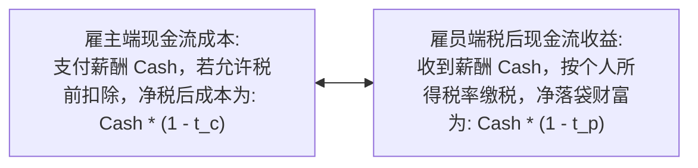
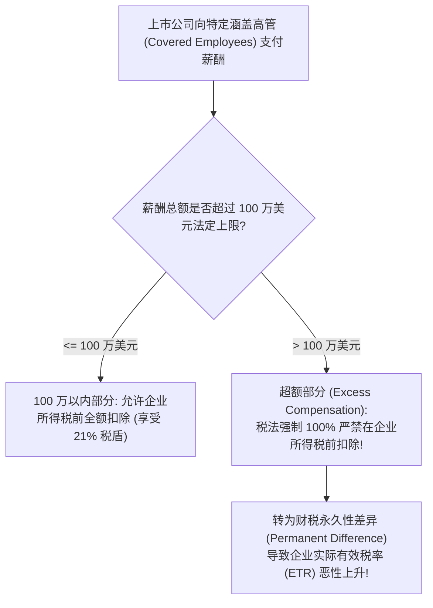
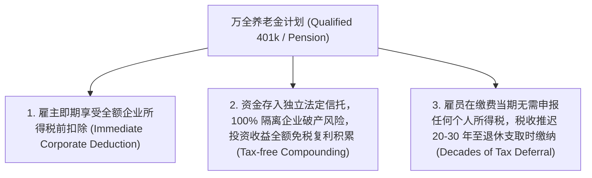

# Lec 11 高管薪酬税收筹划：现金薪资、递延薪酬与万全养老金 (Executive Compensation: Cash, Deferred Comp, and Qualified Plans)

> MIT Sloan School of Management · 15.518 Taxes and Business Strategy · 讲义 11

## TL;DR

- 薪酬契约遵循雇主税前抵扣与雇员个人纳税的多方契约对称性法则。
- 税法 Section 162(m) 确立 100 万美元高管薪资税前抵扣刚性上限，超额部分转为不可扣除永久性差异。
- 非万全递延薪酬（NQDC）受制于 Section 409A 严苛限制，旨在利用跨期个税税率落差实现增量财富积累。
- 万全养老金（Qualified Plans）通过雇主即期扣除、信托免税复利与退休支取征税，创造三重税收红利。

## 薪酬契约的多方对称性原理与微观博弈

在现代企业治理中，高管薪酬（Executive Compensation）不仅是解决股东与职业经理人委托代理冲突的核心激励契约，更是企业财务总监与人力资源主管开展战略税收筹划的主战场。

根据斯科尔斯-沃尔夫森框架的“全参与方原则”，薪酬方案的设计绝不能仅仅局限于雇员个人能省多少税，而必须立足于**雇主（公司）与雇员（个人）组成的联合契约系统**。

在标准的即期现金薪酬（Current Cash Salary）下，税法遵循严格的**契约对称性（Contractual Symmetry）**：
- **雇主端**：在支付薪酬的纳税年度，允许作为合理的经营费用全额进行企业所得税前扣除，为企业创造相当于 $t_c \times \text{Salary}$ 的现金税盾；
- **雇员端**：在收到现金的纳税年度，必须将全额款项作为“普通收入（Ordinary Income）”申报个人所得税，适用最高边际税率 $t_p$ 并缴纳 FICA 薪资税。

如果雇主的企业所得税率 $t_c$ 高于雇员的个人边际税率 $t_p$（$t_c > t_p$），由公司支付现金薪酬能够创造正向的联合税收红利；然而，在现代税制环境下，个人最高边际税率（37% 叠加州税与附加税可达 45%+）往往远超企业所得税率（21%），这迫使薪酬架构师必须超越简单的现金工资，探索**跨期递延（Deferred Compensation）**与**性质转换（Equity Compensation）**等高级筹划形态。

::: definition [薪酬契约对称性 (Compensation Symmetry)]
薪酬契约对称性是指税法普遍遵循的一项基本原则：企业在所得税前扣除薪酬开支的时点与金额，必须与该笔薪酬计入雇员应税收入申报表的时点与金额保持严格镜像匹配。打破这种对称性（如企业提早扣除而个人推迟纳税）是所有税优薪酬设计的核心追逐目标。
:::

## Section 162(m) 100 万美元薪酬扣除上限演进

为了限制华尔街与上市公司 CEO 天文数字般的现金薪酬，美国国会于 1993 年在税法典中加入了著名的 **IRC Section 162(m) 条款**。

### TCJA 税改对 162(m) 的毁灭性收紧

在 2017 年《减税与就业法案》（TCJA）之前，162(m) 存在一个巨大的合法豁免后门——**“合格绩效工资豁免（Qualified Performance-based Compensation Exception）”**。只要高管薪酬与独立董事委员会设定的客观绩效指标（如 ROE、EPS 增长率）挂钩并经股东大会批准，股票期权、绩效奖金（Performance Bonuses）不受 100 万美元扣除限制！这直接诱导了 90 年代末至 2010 年代美股高管薪酬全面转向期权与限制性股票（RSU）。

**2017 年 TCJA 全面废除了这一游戏规则**：
1. **彻底取消绩效工资豁免**：自 2018 年起，无论是固定基本工资、年度绩效奖金、还是股票期权行权所得，凡支付给涵盖高管的总薪酬，**超出 100 万美元的部分一律严禁抵税**；
2. **涵盖高管范围永久化**：涵盖人员包括首席执行官（CEO）、首席财务官（CFO）以及三位薪酬最高的高管。更严苛的是确立了“一日涵盖、终身涵盖（Once a covered employee, always covered）”原则，哪怕高管离职、退休或去世，其后续领取的任何离职补偿或递延福利依然受 100 万美元上限钳制。

## 非万全递延薪酬（NQDC）与 Section 409A 严苛限制

对于薪酬早已突破 100 万美元的顶尖高管，企业常采用**非万全递延薪酬计划（Non-Qualified Deferred Compensation, NQDC）**。

其经济学机理在于跨期税率套利：
高管在职业生涯巅峰期面临极高的边际税率 $t_{p0} = 40\%$；通过与企业签署具有法律效力的不可撤销协议，将当期 100 万美元奖金推迟至 15 年后退休时领取。假定高管退休后不再有巨额收入，个人边际税率降至 $t_{pn} = 25\%$。

然而，这里存在一个重大的非税信用风险：**为了获得税收递延资格，这笔资金在法律上不能存入雇员个人的独立信托账户，它必须作为企业的一般无担保资产（General Unsecured Assets），时刻面临企业破产被债权人瓜分的风险！**

### Section 409A 反滥用铁律

在安然（Enron）丑闻中，安然高管在公司申请破产保护前夕，突击利用内部管理特权提前支取了数千万美元的递延薪酬逃之夭夭。为此，国会颁布了具有严酷惩罚效力的 **IRC Section 409A**：

::: theorem [IRC Section 409A 核心刚性约束]
1. **事前不可撤销选择（Timely Election）**：递延薪酬的选择必须在**提供劳务的纳税年度开始之前**做出（即在赚取收入的前一年年底前锁定）；
2. **严禁加速支取（No Acceleration）**：严禁高管根据个人意愿随时提前提款；
3. **严格限定分配触发事件**：仅允许在以下客观事件发生时按预定时间表分发：离职退休、死亡、完全伤残、不可预见之紧急重大财务困难、或公司控制权变更（Change in Control）；
4. **关键高管 6 个月冻结期**：上市公司的关键雇员（Key Employees）离职时，递延薪酬的分发必须强制冻结至少 6 个月。

**违规代价**：一旦被税务机关判定违反 409A，所有已递延的薪酬立即全额并入当期收入征税，按法定基准加收利息，并额外加处高达 **20% 的惩罚性惩戒附加税（20% Penalty Tax）**！
:::

## 万全养老金计划（Qualified Plans）的三重税收红利

与充满破产风险的 NQDC 相比，符合 ERISA 规范的**万全养老金计划（Qualified Retirement Plans，如 401(k) 计划、确定给付型 DB 计划）**是税法体系中给予的最完美的制度恩惠。

万全计划彻底打破了前文所述的“薪酬契约对称性”，创造了**三重全额税收红利（Triple Tax Advantage）**：

### 万全养老金复利价值数学证明

设企业为员工缴纳 1 美元税前养老金，在免税信托中以税前年化回报率 $R$ 复利增长 $N$ 年。在退休时，员工按届时的个人所得税率 $t_{pn}$ 提取：

$$W_{\text{Qualified}} = (1 - t_{pn}) (1 + R)^N$$

而若企业将该 1 美元作为即期薪资发放给员工，扣除即期个税 $t_{p0}$ 后由员工自行在应税经纪账户中投资（每年对投资收益按税率 $t_e$ 扣缴所得税）：

$$W_{\text{Taxable}} = (1 - t_{p0}) \left[ 1 + R(1 - t_e) \right]^N$$

::: example
假定企业投入 10,000 美元薪酬，投资期限 $N = 30$ 年，年化投资回报率 $R = 8.0\%$。
员工当前与退休期税率均为 $t_{p0} = t_{pn} = 35\%$，应税投资收益适用的年均税率 $t_e = 25\%$。

1. **若存入万全 401(k) 计划**：
   $$W = (1 - 0.35) \times 10,000 \times (1.08)^{30} = 6,500 \times 10.0627 \approx 65,407 \text{ 美元}$$
2. **若以普通现金工资发放并自行投资**：
   期初税后本金：$10,000 \times (1 - 0.35) = 6,500$ 美元。
   税后年化收益率：$8.0\% \times (1 - 0.25) = 6.0\%$。
   $$W = 6,500 \times (1.06)^{30} = 6,500 \times 5.7435 \approx 37,333 \text{ 美元}$$
万全养老金计划凭借免税信托内部不受摩擦的纯粹复利滚存，在 30 年后为员工多创造了高达 **75.2% 的增量净财富**！
:::

::: pitfall [高管试图通过万全计划进行“超级注资”的法律死胡同]
万全计划如此完美，为什么企业不把高管数百万美元薪酬全部注入 401(k)？
税法设立了严格的**反歧视测试（Non-Discrimination Rules）**与严苛的法定缴费上限（如 401(k) 个人年缴费上限通常在 2 万多美元，涵盖雇主配比的总上限在 6 万多美元）。企业若要给高管多交养老金，必须按比例给底层普通工人同等缴纳，否则整个计划的免税资质将被全额剥夺。
:::

## 我的理解

::: insight [薪酬税收的契约博弈：在制度约束下平衡当下与未来]
薪酬是劳动力市场上最直观的价值度量衡，但当它穿过税法的棱镜时，每一张钞票都被折射成了不同颜色的光线。

现代高管薪酬的设计史，本质上是一部**顶尖商业智慧与税法监管相互追逐、螺旋上升的博弈史**。

国会出台 162(m) 试图用 100 万美元的红线遏制 CEO 天文数字的薪资，却意外催生了整个 90 年代华尔街对股票期权与股权激励的疯狂追捧；企业试图通过非万全递延薪酬在时间的长河中隐藏利润，国会就用严苛的 409A 铁律在时间的堤坝上焊死阀门。

然而，所有复杂的薪酬金融工程，最终都必须回归到一个质朴的常识：**钱永远不仅仅是数字，更是流动性与控制权的度量**。

万全养老金给出了最无懈可击的三重免税复利，但它要求你将财富锁定三十年并与全公司普通员工利益均沾；非万全递延薪酬提供了跨期避税的可能，但它要求你以个人的身家性命去承担雇主长达数十年的信用风险。

卓越的商业领袖与首席人力官，从不盲目推崇某一种“税收最优”的极端方案。他们深刻洞察高管在不同人生阶段对现金流动性、税后复利积累与资产安全隔离的深层心理诉求，在 162(m) 的刚性约束与 409A 的合规钢丝之间，编织出既能穿透税收迷雾、又能深度绑定组织灵魂的卓越契约。
:::
