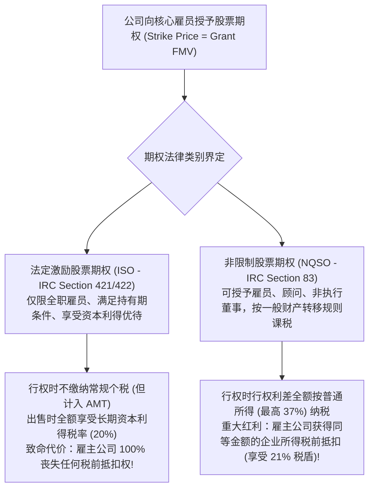

# Lec 12 股权激励税收深水区：ISO、NQSO 与 Section 83(b) (Equity Incentives: ISO, NQSO, and Section 83(b))

> MIT Sloan School of Management · 15.518 Taxes and Business Strategy · 讲义 12

## TL;DR

- 激励股票期权（ISO）为雇员锁定资本利得待遇，但行权利差面临替代最低税（AMT）吞噬且雇主丧失税收抵扣。
- 非限制股票期权（NQSO）在行权时按普通所得征税，但赋予雇主等额的企业所得税前抵扣权。
- 联合税收效率模型证明，当企业所得税率高于个税与资本利得税剪刀差时，NQSO 综合价值更优。
- Section 83(b) 选举权是初创期以微额纳税启动资本利得时钟的核武器，但具有不可撤销的没收风险。

## 股票期权的双轨世界：ISO vs NQSO

在硅谷高科技企业与华尔街金融机构的薪酬包中，股票期权（Stock Options）是点燃员工创业激情、实现财富自由的核心引擎。然而，在税法底层，美国国内税收法典（IRC）依据严格的合规门槛，将股票期权割裂为两大税收待遇截然相反的阵营：**法定激励股票期权（Incentive Stock Options, ISO）**与**非限制股票期权（Non-Qualified Stock Options, NQSO）**。



许多年轻工程师在面对两类期权时，往往想当然地认为“能按低税率资本利得纳税的 ISO 绝对优于按高税率普通工资纳税的 NQSO”。这种片面的雇员单边视角，严重忽视了**雇主端税盾丧失对企业整体价值的毁灭性削弱**。

::: definition [激励股票期权 (ISO) vs 非限制股票期权 (NQSO)]
- **ISO（Incentive Stock Options）**：符合 IRC Section 422 严格法定条件的员工期权。雇员在授予日和行权日均无需缴纳常规个人所得税；若满足法定持有期限要求，在最终出售股票时，全部增值均按较低的长期资本利得税率纳税。但雇主公司在任何环节均不得计提税收抵扣。
- **NQSO（Non-Qualified Stock Options）**：不满足或未选择 ISO 待遇的期权。在行权日，标的股票市场公允价值超过行权价的差额（Spread），必须立即作为普通工资薪金全额缴纳个人所得税与 FICA 薪资税；雇主公司在行权当期获得完全等额的企业所得税前扣除。
:::

## 全生命周期纳税时点与全参与方净效率模型

为了彻底解构两类期权的底层价值，我们对期权从授予、行权到最终变现的全生命周期现金流进行严格推导。

设期权行权价为 $K$。行权日股票市场公允价格为 $P_{\text{exercise}}$，最终二级市场出售价格为 $P_{\text{sale}}$。
雇员适用的最高普通边际所得税率为 $t_p$，长期资本利得税率为 $t_{\text{cg}}$；雇主公司的企业所得税率为 $t_c$。

### 两种期权全流程税收处理矩阵

| 交易生命周期时点 | 法定激励期权 (ISO) 税收处理 | 非限制期权 (NQSO) 税收处理 |
| :--- | :--- | :--- |
| **1. 授予日 (Grant Date)** | 无任何常规税收事件 | 无任何常规税收事件 |
| **2. 行权日 (Exercise Date)** | **常规所得税：0 元**<br/>**重大暗礁**：行权利差 $(P_{\text{exercise}} - K)$ 计入**替代最低税（AMT）**偏好项！<br/>**雇主公司抵扣额：0 元** | **雇员端**：行权利差 $(P_{\text{exercise}} - K)$ 全额作为普通所得缴纳个税：<br/>$\text{Tax} = t_p \times (P_{\text{exercise}} - K)$<br/>**雇主端**：获得完全等额的税前扣除，产生税盾：<br/>$\text{Tax Shield} = t_c \times (P_{\text{exercise}} - K)$ |
| **3. 出售变现日 (Sale Date)** | 若满足持有期（授予满 2 年且行权满 1 年）：<br/>总收益 $(P_{\text{sale}} - K)$ 全额缴纳长期资本利得税：<br/>$\text{Tax} = t_{\text{cg}} \times (P_{\text{sale}} - K)$ | 股票后续二次增值部分 $(P_{\text{sale}} - P_{\text{exercise}})$ 确认为资本利得：<br/>$\text{Tax} = t_{\text{cg}} \times (P_{\text{sale}} - P_{\text{exercise}})$ |

```mermaid
flowchart LR
    subgraph NetComparison["联合税收净财富创造判别准则"]
        DirectCompare{"对比雇主税盾与雇员税差"}
        DirectCompare -->|t_c > (t_p - t_cg)| NQSO_Wins["NQSO 在联合系统层面创造更高税后总价值!<br/>公司多拿到的企业税盾 (t_c)，足以在现金上全额补偿雇员因普通个税多缴的税负还有剩余!"]
        DirectCompare -->|t_c < (t_p - t_cg)| ISO_Wins["ISO 胜出 (通常仅在企业深陷长期零税率 NOL 耗竭时成立)"]
    end
```

::: theorem [斯科尔斯-沃尔夫森期权契约最优性定理]
在企业与雇员构成的联合契约系统中，若企业可以通过发放额外现金奖金（Cash Bonus）完全弥补雇员因 NQSO 普通个税相比资本利得税多承担的税负剪刀差，则 **NQSO 优于 ISO 的充分必要条件为**：
$$t_c > t_p - t_{\text{cg}}$$

- 在现行美国税制基准下：$t_p = 37\%$，长期资本利得税率 $t_{\text{cg}} = 20\%$，雇员端的税率剪刀差为：
  $$t_p - t_{\text{cg}} = 37\% - 20\% = 17\%$$
- 若雇主公司是一家处于正常盈利状态的成熟企业，其面临的联邦与州企业所得税综合税率通常为 $t_c \approx 25\%$。
- **由于 $25\% (t_c) > 17\% (t_p - t_{\text{cg}})$，NQSO 在系统层面的税收净效率显著压倒 ISO！**
:::

::: example
某高成长科技公司向副总裁授予 10,000 股期权，行权价 $K = 10$ 美元。
行权日股票公允价 $P_{\text{exercise}} = 60$ 美元（每股利差 50 美元，总利差 50 万美元）。
随后副总裁以 $P_{\text{sale}} = 60$ 美元原价出售套现。
税率假设：$t_p = 40\%$，$t_{\text{cg}} = 20\%$，$t_c = 25\%$。

1. **若采用 ISO 模式**：
   - 雇员纳税：缴纳长期资本利得税 $50 \text{ 万} \times 20\% = 10$ 万美元；雇员净落袋 **40 万美元**；
   - 雇主公司：获得 0 元抵扣；
   - **全系统税后净总财富：40 万美元**。
2. **若采用 NQSO 模式**：
   - 雇员纳税：按普通所得缴纳 $50 \text{ 万} \times 40\% = 20$ 万美元；雇员净落袋 30 万美元；
   - 雇主公司：获得 50 万美元税前抵扣，节省现金企业税 $50 \text{ 万} \times 25\% = 12.5$ 万美元；
   - **全系统税后净总财富：$30 + 12.5 = 42.5$ 万美元！**
3. **帕累托改进方案**：
   公司将节省下来的 12.5 万美元现金税款中的 10 万美元作为“纳税补偿奖金（Gross-up Bonus）”发放给副总裁。
   - 副总裁净落袋现金恢复至 40 万美元（与 ISO 毫无差异）；
   - 公司在全额补偿员工后，账上依然净多留存了 2.5 万美元现金自由现金流！
:::

::: pitfall [2000 年互联网泡沫中踩中 ISO 替代最低税（AMT）的破产悲剧]
在 2000 年互联网泡沫顶峰，大量初创科技公司的工程师行权了浮盈数百万美元的 ISO，并在手头继续持有股票未变现（以为能享受 1 年后的资本利得待遇）。
灾难发生：**税法规定，ISO 行权当年的纸面未实现利差必须全额计入替代最低税（AMT）！**
工程师被要求在次年 4 月向 IRS 缴纳高达上百万美元的真实真金白银 AMT 税款。然而此时互联网泡沫破裂，公司股票在二级市场暴跌 99% 沦为废纸。由于股票已无法变现套现，且税法严禁因后续股价暴跌撤销历史已产生的 AMT 税负，成百上千名硅谷核心工程师在账面财富归零的同时，背负了终身无法偿还的数百万美元个人破产税务债务！
:::

## 限制性股票与 Section 83(b) 终极核武器

对于在初创期进入企业、获得**受限制股票（Restricted Stock）**的创始人与早期核心员工，税法典第 83 条构成了其一生命运的分水岭。

受限制股票通常附带服务归属期约束（Vesting Period，如 4 年归属，每年 25%）。若员工离职，未归属股份将被公司原价收回。

```mermaid
flowchart TD
    GrantStock["员工在初创期以象征性价格 (如 0.001 美元) 获得受限制股票"] --> PathChoice{"是否在收到股票后 30 天内向 IRS 递交 Section 83(b) 选举声明?"}
    
    PathChoice -->|未提交: 适用默认 Section 83(a)| DefaultRule["默认规则 (Section 83(a)):<br/>在未来每年股权解禁归属时，按归属当日的公允市值 (FMV)<br/>扣除成本后，全额作为普通工资收入按最高 37% 缴纳个税!"]
    DefaultRule --> Disaster["估值暴涨噩梦：若公司 4 年后估值飙升<br/>员工在归属日必须为无法变现的纸面高估值全额缴纳巨额现金所得税!"]
    
    PathChoice -->|提交: 触发 Section 83(b) 特权| ElectionRule["Section 83(b) 选举规则:<br/>强制在授予日按当前未解禁时的公允价值 (FMV) 一次性提前纳税!"]
    ElectionRule --> Glory["神级红利：由于初创期估值极低 (每股 0.001 美元)，当期应纳税额仅为几块钱!<br/>未来 4 年内无论估值暴涨几万倍，归属日税负永久为 0!<br/>长期资本利得持有时间时钟从第一天启动，未来套现全额享受 20% 资本利得税!"]
```

::: theorem [IRC Section 83(b) 选举生效的三大刚性要件]
1. **绝对时间死线（30-Day Hard Deadline）**：83(b) 选举声明书必须在**股票转让给员工之日起严格 30 天内**，以书面形式挂号邮寄至美国国税局（IRS）主管税务中心，**没有任何逾期宽限补救程序**；
2. **不可撤销性（Irrevocability）**：一旦递交，除发生极罕见的行政重大错误外，纳税人**绝对严禁单方面撤销**；
3. **没收无退税惩罚（No Deduction on Forfeiture）**：若员工在后续服务期内离职导致未归属股票被公司强制没收，或者初创公司中途倒闭清算，**员工在当年为该股票缴纳的任何税款，税法严禁退还，亦严禁确认为普通经营亏损！**
:::

## 我的理解

::: insight [股权激励的制度美学：用规则的确定性对冲未来的无限狂野]
在现代资本主义商业传奇中，股权激励往往被蒙上了一层近乎浪漫主义的英雄色彩——车库里的年轻极客通宵达旦地编写代码，换取几张薄薄的期权纸，并在数年后随着钟声敲响化身亿万富翁。

然而，翻开税法典的精密注脚，你会发现：**这场造富神话的每一寸轨道，都被税收规则以极其冰冷而精密的方式精准卡死**。

ISO 与 NQSO 的博弈，揭示了经济学中最永恒的真理：没有哪一种优惠是纯粹的天赐恩惠。为了追求个人端那点资本利得的幻影，企业在背后默默放弃了数以亿计的真金白银税盾；而 2000 年那些在 AMT 屠刀下家破人亡的工程师，更是用血淋淋的悲剧向后人证明了忽视规则隐藏代价的毁灭性后果。

而在所有的税法条文中，再没有哪一个法条能像 **Section 83(b)** 一样，将“对未来的无畏豪赌”体现得如此淋漓尽致。

在企业创立最荒芜的黎明时刻，在那个股份一文不值的当下，在短短三十天的严苛窗口里，签下那份不可撤销的契约——这意味着你自愿将未来数年的命运全额押注在自己的双手之上。你放弃了所有退路，换来的是在制度的重力场中将巨额财富的增值完全锁定在长期资本利得的庇护所内。

这不仅是一项财务技术，这更是一名商业拓荒者在制度的汪洋中，向不确定的未来投掷出的最决绝、最优雅的一柄标枪。
:::
