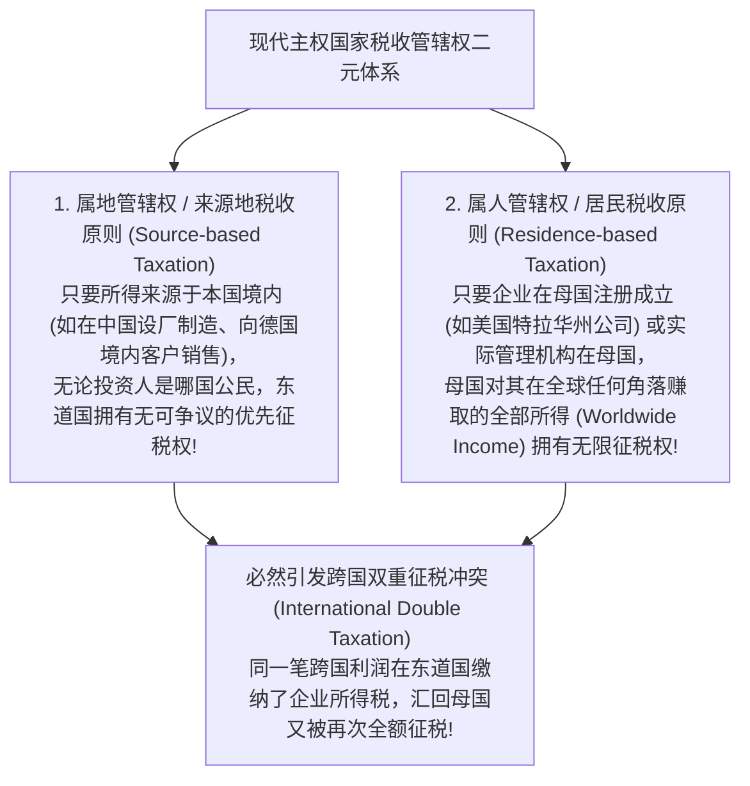
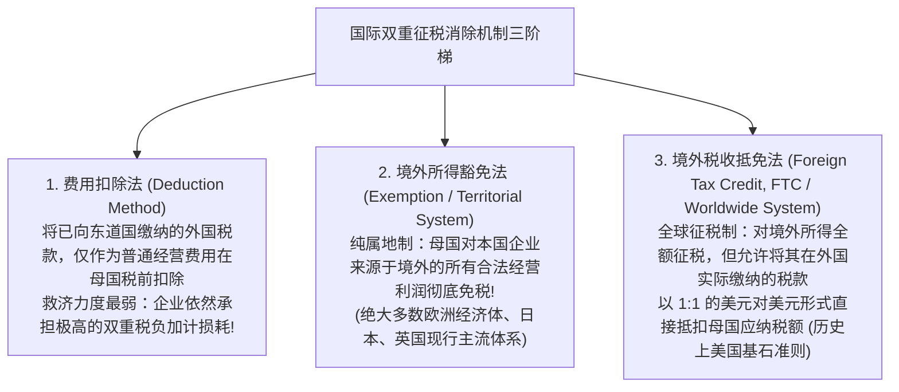
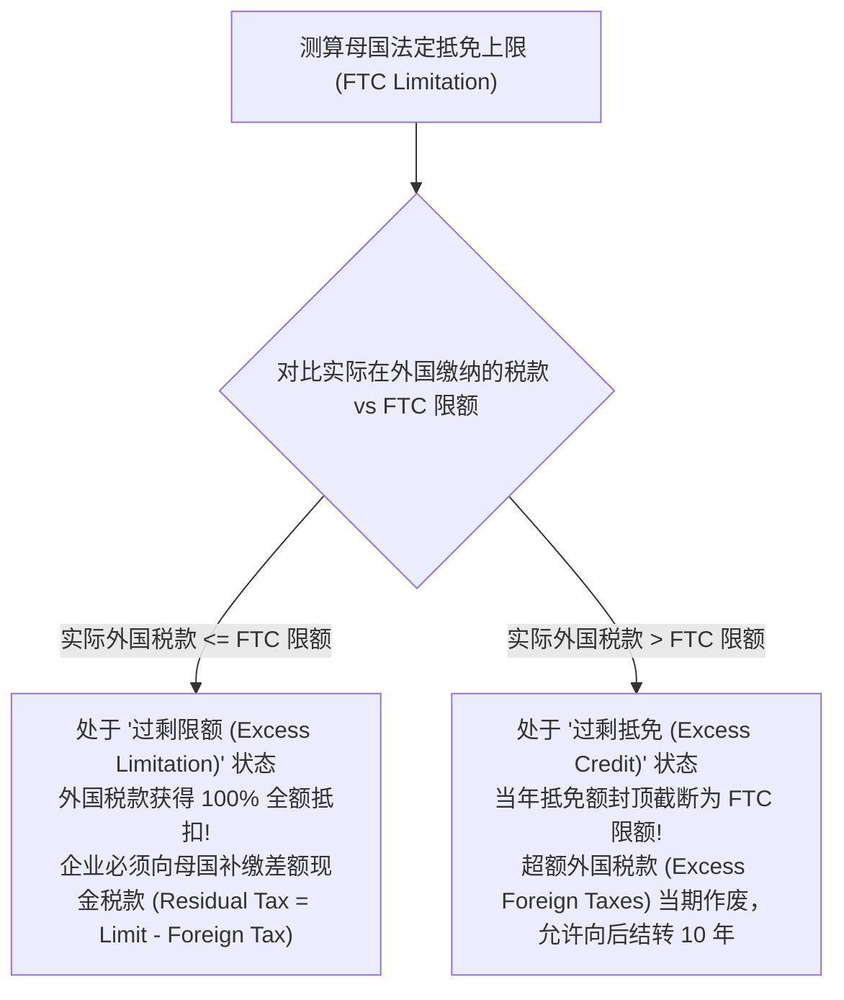
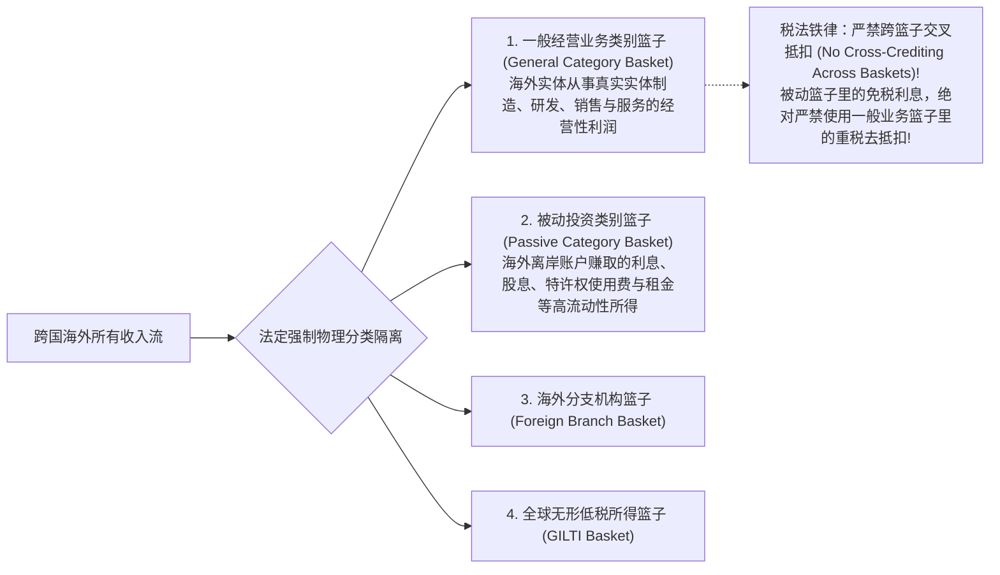

# Lec 13 跨国税收架构基石：属人制 vs 属地制与境外税收抵免 (Multinational Taxation: Worldwide vs Territorial and FTC)

> MIT Sloan School of Management · 15.518 Taxes and Business Strategy · 讲义 13

## TL;DR

- 跨国企业面临东道国“属地管辖权”与母国“属人管辖权”不可避免的双重征税冲突。
- 解决双重征税的三大路径包括费用扣除法、境外所得豁免法与境外税收抵免法（FTC）。
- 境外税收抵免限额公式将母国实际抵扣额严格约束在该所得对应的母国理论税负上限内。
- 纳税人被分流为过剩抵免与过剩限额两大阵营，隔离篮子体系严禁跨类别混合避税。

## 跨国商业的双重征税困境与税收管辖权冲突

在经济全球化与跨国直接投资（FDI）的格局下，跨国企业（Multinational Enterprises, MNEs）设立遍布全球的分支机构、研发中心与销售网络。然而，当资本跨越国界流动时，首当其冲遭遇的就是现代主权国家在税收管辖权（Tax Jurisdiction）上的哲学与法理冲突。

国际税收体系中并立着两大最核心的管辖权原则：

如果国际社会不建立协调机制，跨国企业的一笔跨境经营所得在东道国被征收 30% 所得税后，汇回母国再被征收 35% 所得税，其综合税负将高达 65% 乃至更高，跨境贸易与跨国投资将被彻底摧毁。

::: definition [国际双重征税 (International Double Taxation)]
国际双重征税是指两个或两个以上具有独立主权的国家或税收司法管辖区，在同一纳税期间内，基于不同的税收管辖权原则，对同一个跨国纳税主体的同一笔跨境应税事实或跨国所得，重复征收性质相同或类似的所得税的现象。
:::

## 双重征税消除机制：扣除法、豁免法与抵免法

为了消弭国际双重征税的破坏性阻力，全球各国在双边税收协定（Tax Treaties）与国内税法中确立了三大不同力度的单边与双边救济机制：

### 三大方法税后财富测算对比

设跨国企业在外国分支机构赚取 100 万美元税前利润，外国当地所得税率为 $t_f$；母国法定企业所得税率为 $t_d$。假定外国税率低于母国（$t_f < t_d$）。

::: theorem [三大双重征税消除方法有效税负模型]
1. **费用扣除法（Deduction）**：
   在东道国缴纳税款 $100 \times t_f$。汇回母国的净所得为 $100(1 - t_f)$。母国以此净额为基数征税 $100(1 - t_f) t_d$。
   - **全球总税负**：$t_{\text{total}} = t_f + t_d - t_f t_d$。
2. **境外所得豁免法（Exemption / 纯属地制）**：
   母国分文不取，全额豁免。
   - **全球总税负**：$t_{\text{total}} = t_f$（税负完全取决于东道国税率）。
3. **境外税收抵免法（FTC / 全球征税制）**：
   母国计算理论应纳税额 $100 \times t_d$，然后直接以已缴外国税款 $100 \times t_f$ 进行抵减，母国仅补缴利差税（Residual Tax）：$100(t_d - t_f)$。
   - **全球总税负**：$t_{\text{total}} = t_f + (t_d - t_f) = t_d$（全球总税负被强行拉平至母国税率）。
:::

## 境外税收抵免限额（FTC Limitation）代数模型

在境外税收抵免法（FTC）下，企业最容易产生的幻想是：是不是所有在外国缴纳的税款，母国财政部都会“实报实销”提供 100% 抵免？

答案是否定的。如果某高税率国家（如特定重税国）的所得税率高达 45%，而母国税率仅为 21%，如果母国允许全额抵扣，企业就可以拿在外国多交的税款去抵消其在母国本土业务所本应缴纳的税收，变相让母国国库去补贴外国财政部！
为此，税法典 IRC Section 904 确立了刚性的**境外税收抵免限额公式（FTC Limitation Formula）**：

$$\text{FTC Limitation} = \text{未抵免前母国理论应纳税总额} \times \left( \frac{\text{境外来源应税所得 (Foreign Source Income)}}{\text{全球总应税所得 (Worldwide Income)}} \right)$$

::: theorem [实际允许抵免税额决策方程]
跨国企业当期在母国实际被允许抵减的境外税款为：
$$\text{Allowable FTC} = \min\left( \text{实际缴纳的外国税款总额}, \text{FTC Limitation} \right)$$
- **过剩抵免状态（Excess Credit Position: $t_f > t_d$）**：企业境外实际税率高于母国，抵免额封顶，多交的税款沦为“沉没税收凭证”；
- **过剩限额状态（Excess Limitation Position: $t_f < t_d$）**：企业境外实际税率低于母国，抵免完全，母国征收剩余补缴税。
:::

::: example
某美国跨国集团在某纳税年度内实现全球应税利润 1,000 万美元，其中本土美国业务利润 600 万美元，设在英国的海外子公司贡献境外利润 400 万美元。
美国法定所得税率 $t_d = 21\%$；英国子公司在当地按 25% 的英国公司税实际缴纳了 $400 \times 25\% = 100$ 万美元外国所得税。

抵免与税负推导：
1. 计算未抵免前美国应纳税总额：$1,000 \text{ 万美元} \times 21\% = 210$ 万美元。
2. 境外所得占比：$400 / 1,000 = 40\%$。
3. 计算法定 FTC 抵免上限：
   $$\text{FTC Limitation} = 210 \text{ 万美元} \times 40\% = 84 \text{ 万美元}$$
4. 判定实际抵免额：
   $$\text{Allowable FTC} = \min(100 \text{ 万实际英国税}, 84 \text{ 万限额}) = 84 \text{ 万美元}$$
5. 当年最终向美国国税局缴纳的现金税款：
   $$\text{US Cash Taxes Paid} = 210 - 84 = 126 \text{ 万美元}$$
6. 结果分析：企业处于 **Excess Credit（过剩抵免）** 状态，有 $100 - 84 = 16$ 万美元的英国税款在当年未能抵扣，被结转至未来年度。
:::

## 跨国跨境混合与隔离篮子体系（FTC Baskets）

跨国企业在面对单一国家的抵免限额时，曾发明出极其精妙的**“跨国交叉混合抵税（Cross-Crediting / Blending）”**手法：
若一家跨国公司在德国的制造子公司面临高达 30% 的所得税率（产生巨额过剩抵免，在德国多交了税款）；同时，该集团在百慕大群岛设立离岸资金池，将闲置数十亿美元资金存入银行赚取年化 5% 的高额利息，在当地适用 0% 税率。
在没有限制的规则下，企业只要将德国子公司的重税制造所得与百慕大的免税利息混合打包申报，德国多缴纳的外国税款就能直接用于抵消百慕大利息本应向美国母国补缴的利息所得税，从而在不增加任何本土真实就业的情况下，实现了离岸资金利息的完全免税汇回！

为了彻底粉碎这种利用高流动性被动资金进行套利的行径，美国税法典 Section 904(d) 确立了刚性的**“隔离篮子体系（FTC Basket System）”**：

### 四大核心隔离篮子的法律界限与实务穿透

1. **一般业务类别篮子（General Category Basket）**：
   涵盖海外受控子公司在东道国开展真实商业运营、实体工厂装配、主动批发零售与本地技术支持所产生的活跃经营所得。该篮子产生的过剩抵免只能在同一篮子内部的不同年份之间向后结转 10 年或向前结转 1 年。
2. **被动投资类别篮子（Passive Category Basket）**：
   专门收纳股息、利息、特许权使用费、年金、不动产净租金以及大宗商品期货交易收益等极易通过电汇在跨国账户间转移的高流动性资产收益。税法铁律规定：**严禁任何跨篮子交叉抵扣！**被动篮子里的低税利息，必须按其所属类别独立计算 FTC 限额并全额向母国补缴利差税，绝不允许被一般业务篮子中的制造重税所稀释。
3. **海外分支机构篮子（Foreign Branch Basket）**：
   由 2017 年 TCJA 新设，专门用于隔离美国公司直接在境外以分支机构（Branch，非独立法人）形式开展业务所取得的损益，防止其与母公司子公司的境外股利收益产生混合冲抵。
4. **全球无形低税所得篮子（GILTI Basket）**：
   对依据 Section 951A 穿透计入美国母公司的 GILTI 境外无形收益单独设立专属篮子，且税法做出极其苛刻的规定：**GILTI 篮子中的外国税款仅允许按 80% 比例进行抵免，且严禁任何形式的跨年度结转（No Carryforward or Carryback）！**当年未用完的抵免额在期末直接作废清零。

## 我的理解

::: insight [跨国税收的威斯特伐利亚秩序：在主权边界与资本无疆之间摆渡]
跨国税收分析，是整个现代商科体系中最具宏大叙事感的领域。在这里，微观的借贷记账法与宏观的地缘政治、主权博弈发生了最剧烈的碰撞。

1648 年《威斯特伐利亚和约》确立了主权国家的地理边界，但过去五十年全球化与互联网算力的爆发，却让资本、代码与知识产权变成了可以在全球光缆间毫秒迁徙的“无疆幽灵”。

属人原则是母国主权的法律执念——“无论你走到天涯海角，你都是我庇护下的孩子，你必须为本土国防与法律体系买单”；而属地原则则是东道国地缘的现实主权——“你动用了我境内的工人、踩踏了我铺设的柏油公路，你就必须在我的海关与税所前纳贡”。

境外税收抵免（FTC）限额公式与隔离篮子体系，正是国际法为了弥补这一制度裂隙而搭建的一套极其脆弱而精巧的力学平衡机。

它在冷酷地告诫每一家跨国战略家：**税收筹划从来不是在真空中自由翱翔，它时刻受到主权国家利益天平的刚性牵引**。懂得跨国税制的底层逻辑，意味着你不仅看懂了一张跨国损益表，更看懂了全球资本在不同大洲的税率断层带上如何寻找最低阻力的地心引力，在主权与资本的博弈夹缝中，构建出兼具韧性与效率的全球商业版图。
:::
