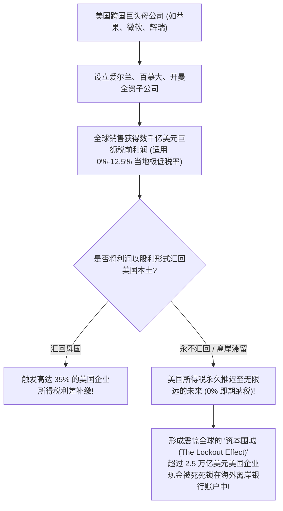
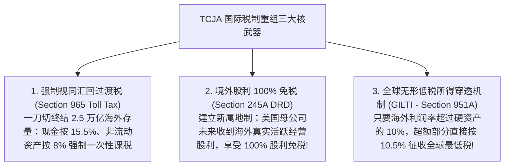
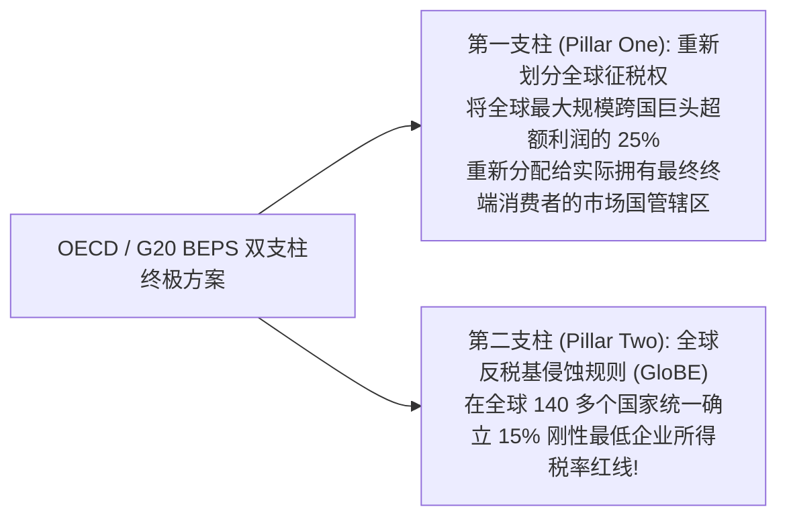

# Lec 14 跨国反避税与离岸利润递延：Subpart F、GILTI 与 BEPS (Subpart F, GILTI, and Controlled Foreign Corporations)

> MIT Sloan School of Management · 15.518 Taxes and Business Strategy · 讲义 14

## TL;DR

- 受控外国企业（CFC）曾通过“离岸利润无限期递延”特权，在海外滞留了数万亿美元现金。
- Subpart F 条款穿透离岸空壳，强制将被动投资所得与基地公司销售利润视同当年股利即期课税。
- 美国 TCJA 税改通过过渡税清空历史存量，并设立 GILTI 与 BEAT 全球最低税机制防范税基侵蚀。
- 经合组织（OECD）BEPS 第二支柱确立 15% 全球最低企业所得税率，彻底重塑国际税收秩序。

## 离岸递延特权与万亿美元“资本围城”（The Lockout Effect）

在 2017 年美国世纪税改（TCJA）之前，跨国公司财务管理中最核心的战略词汇莫过于**境外利润递延（Tax Deferral Privilege）**。

在传统美国全球征税制下，税法遵循一条基础法理：**只要境外的合法子公司没有正式向美国母公司派发纸面现金股利（Dividend Repatriation），这笔在境外赚取的实体经营利润在税法上就被视为“未实现利润”，美国国税局（IRS）无权提前征税**。

这一“资本围城”扭曲了全球资本配置：跨国科技巨头在海外坐拥数千亿美元富可敌国的闲置现金，却在本土由于缺乏流动性而不得不发行数十亿美元的公司债券用于向股东分红与回购股票，催生了惊人的制度套利异象。

::: definition [受控外国企业 (Controlled Foreign Corporation, CFC)]
根据美国国内税收法典 IRC Section 957，受控外国企业是指设立在外国的法人公司，其总投票权或总市场价值的 **超过 50%**，由特定的**“美国大股东（United States Shareholders）”**所持有。其中，“美国大股东”被严密界定为直接、间接或推定持有该外国实体至少 10% 以上表决权或价值的美国公民、居民或法人实体。
:::

## 穿透反避税利刃：Subpart F 规则体系

为了防止跨国巨头将极易流动的资金随意转移至无税小岛（如百慕大、开曼）无限期递延纳税，肯尼迪政府早在 1962 年就在税法典中加入了闻名全球的**反避税重锤——Subpart F 规则（IRC Section 951-964）**。

Subpart F 的核心杀伤力在于**“实质穿透征税（Anti-deferral Deemed Dividend）”**：无论海外子公司是否真实宣布分红，税法直接拟制该笔收入已在当年全额分配回母公司，强制并入美国母公司的当年应税所得征税！

```mermaid
flowchart TD
    CFCEarnings["受控外国企业 (CFC) 当期取得的全部收入"] --> Classify{"收入性质精准定性"}
    Classify --> Active["1. 真实实体经营业务所得 (Active Business Income)<br/>在东道国本土拥有真实厂房、员工并从事制造与本地服务"]
    Classify --> SubpartF["2. 受到 Subpart F 监管的高流动性所得 (Subpart F Income)"]
    
    Active --> KeepDeferral["继续享受离岸递延纳税特权 (历史传统规则)"]
    
    SubpartF --> F1["外国个人控股公司所得 (FPHCI)<br/>离岸账户收取的股息、利息、特许权使用费、大宗商品投机收益"]
    SubpartF --> F2["外国基地公司销售与劳务所得 (FBCSI)<br/>利用无税中转实体开展的三角虚假中转贸易"]
    F1 & F2 --> DeemedDiv["在发生当期直接穿透并入母公司利润表征税 (Deemed Dividend)!"]
```

### 经典反三角中转贸易案例（Foreign Base Company Sales Income）

跨国企业最常用的避税手法是“人造三角贸易”：
美国母公司在瑞士设厂生产医疗器械，并在开曼群岛设立一家没有任何生产能力的纸面基地公司（CFC）；瑞士工厂将器械按 100 美元成本价卖给开曼 CFC，开曼 CFC 转手以 500 美元市价卖给法国客户。400 美元的巨额商业暴利全额截留在开曼的 0% 税率账户中。
**Subpart F 的精准打击**：
税法规定，只要交易**同时满足货物由关联方制造、由关联方转售、且生产地与最终消费地均不在该 CFC 所在国境内**，该笔 400 万美元利润直接被判定为基地公司销售收入，**取消递延资格，当年全额穿透回母公司征税！**

## 2017 年 TCJA 税改大地震：从全球制向混合属地制的范式跃迁

2017 年颁布的《减税与就业法案》（TCJA）彻底终结了长达半个世纪的“离岸递延”时代，引领美国国际税制完成了向**“混合参与豁免属地制（Quasi-Territorial System）”**的历史性跃迁。

### 1. 全球无形低税所得（GILTI - Section 951A）

为了防止跨国科技与制药巨头在新属地制下变本加厉地将专利转移到零税岛国，TCJA 创立了全新的**全球无形低税所得（GILTI）税种**：

::: theorem [GILTI 课税数学模型]
税法假定海外实体依靠厂房、机械等有形资产只能获得 **10% 的常规合理投资回报（Routine Return）**；超出 10% 常规回报的全部超额利润，被税法自动推定为利用专利、算法与商标等“无形资产”转移的暴利：
$$GILTI = \text{Net CFC Tested Income} - 10\% \times \text{QBAI} + \text{Specified Interest Expense}$$
其中 $\text{QBAI}$（Qualified Business Asset Investment）为海外实体持有的折旧性有形商业资产季度平均计税净值。

- 对计算出的 GILTI 所得，税法通过 Section 250 提供 50% 的特别法定扣除；
- 扣除后，在现行 21% 企业所得税率下，其实际有效最低税率为：
  $$t_{\text{effective, GILTI}} = 21\% \times (1 - 50\%) = 10.5\%$$
（注：自 2026 年起扣除率将降至 37.5%，有效税率上升至 13.125%）。
:::

这意味着：**任何把知识产权放在开曼等 0% 税率空壳公司的跨国巨头，即使海外一分钱股利都不汇回，美国国税局每年也将强制直接征收至少 10.5% 的即期现金税！**

### 2. 税基侵蚀与反滥用税（BEAT - Section 59A）

针对外资跨国企业通过向境外关联母公司支付高额“管理费”、“利息”或“特许权使用费”将美国境内应税利润淘空的手段，税法增设了 **BEAT 替代最低税**——如果一家大型跨国企业向境外关联方的可抵扣支付额度超过其总费用的 3%，税法强制将这些跨境扣除项全额加回，并按 10% 的最低税率征税。

## 经合组织（OECD）BEPS 双支柱方案与全球最低税统一战线

随着数字化商业跨越物理国界，单边国家的国内税改已无法完全遏制跨国套利。由 20 国集团（G20）委托**经济合作与发展组织（OECD）主导的“税基侵蚀与利润转移（BEPS）”**多边谈判，催生了百年一遇的全球税制大重构：

::: theorem [BEPS 第二支柱补足税（Top-up Tax）触发机制]
在第二支柱框架下，若一家年营收超过 7.5 亿欧元的跨国企业集团，在某一司法管辖区（如百慕大或爱尔兰）计算出的实质有效税率（ETR）低于 **15%**：
1. **国内最低补足税（QDMTT）**：允许东道国优先将税率补足至 15%；
2. **收入纳入规则（IIR）**：若东道国不补税，跨国企业的终极母公司所在国拥有法定权力，强制按 15% 的差额直接向母公司征收“补足税（Top-up Tax）”！
:::

第二支柱的全球落地，宣告了自 20 世纪中叶以来以“零税率避税天堂（Tax Havens）”为核心的传统跨国离岸税收筹划模式走向终局死亡。

## 我的理解

::: insight [国际反避税的终局博弈：零和竞底的终结与主权财税联盟]
翻开二十世纪末跨国巨头的财务报表，那是一段令人目眩神迷的“数字炼金术”时代。

苹果的工程师在库比蒂诺研发芯片，富士康的工人在郑州组装流水线，全美与欧洲的用户用真金白银刷卡购买，但在全球税收的世界里，数百亿美元的商业奇迹却被虚构为是两家注册在加勒比海小岛、连一间像样办公室都没有的离岸空壳“独立创造”的。

这种荒诞景象，是全球化狂飙突进背后主权国家“税收竞底（Race to the Bottom）”的必然恶果。每一个国家都试图用更低的税率、更宽松的裁决去窃取别国的税基，最终导致实体经济的税负被不公正地全额转嫁到了无法移动的普通工薪阶层与中小本土企业身上。

从肯尼迪的 Subpart F，到特朗普的 GILTI，再到 140 国签署的 OECD 第二支柱 15% 最低税联盟，我们正在亲眼目睹一场**全球主权财税秩序的大一统反击**。

那条 15% 的全球最低税红线，是一道划在资本狂欢面前的绝对底线。它庄严地向全球跨国资本宣告：**技术的无疆界绝不意味着商业责任的虚无化**。未来的跨国战略家必须彻底抛弃那种在离岸法条夹缝中偷税的旧思维，唯有将商业模式的扎根深度与全球实体经济的正向价值创造融为一体，才能在阳光普照的合规新世界中行稳致远。
:::
