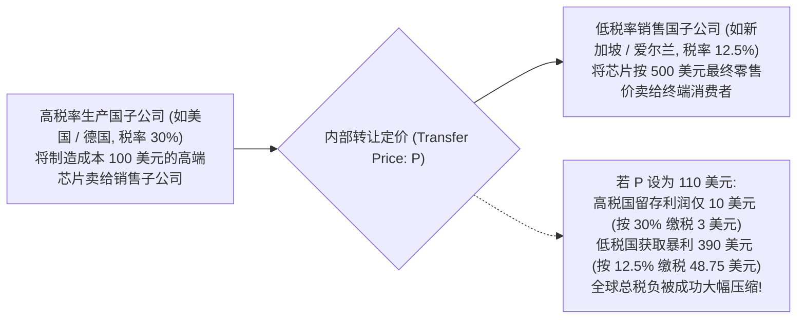
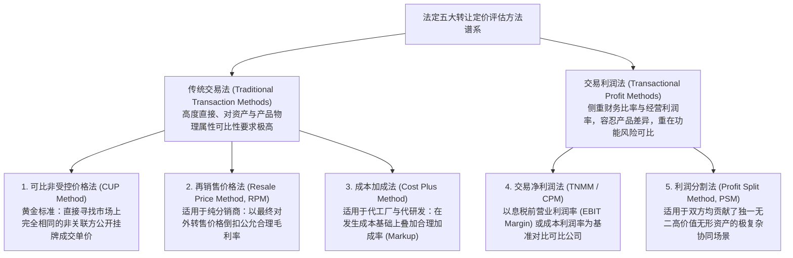
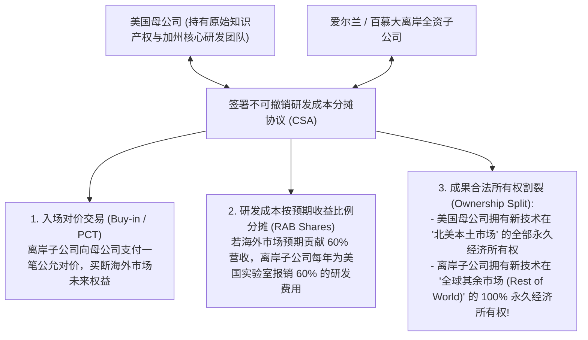
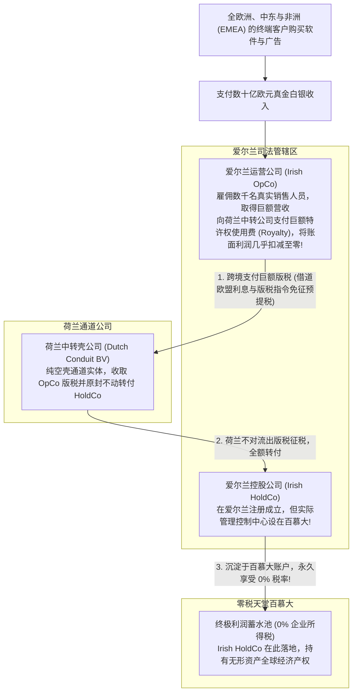

# Lec 15 跨国转让定价、无形资产迁移与双层爱尔兰架构 (Transfer Pricing, Intangibles Migration, and Tax Havens)

> MIT Sloan School of Management · 15.518 Taxes and Business Strategy · 讲义 15

## TL;DR

- 转让定价是跨国企业通过内部关联交易重新分配全球利润池的核心商业与税务机制。
- 独立交易原则（ALP）要求受控交易定价必须完全模拟非关联第三方在公开市场上的公允博弈。
- 研发成本分摊协议（CSA）为跨国巨头将高增值知识产权合规迁移至海外低税区提供了合法通道。
- 经典“双层爱尔兰与荷兰三明治”利用两国内部税法冲突与欧盟指令，构筑了近乎零税率的避税迷宫。

## 转让定价的微观本质与独立交易原则（ALP）

在跨国企业的全球商业版图中，超过 60% 的跨境贸易并非发生在独立的外部买卖双方之间，而是发生在该企业集团自身庞大组织网络内部的不同法律实体之间——这涵盖了母子公司之间零部件的买卖、技术专利的跨境授权许可（Licensing）、集团内部资金融通借贷、以及跨国人力 IT 共享服务的结算。

这些发生在集团内部受控实体之间的内部结算价格，统称为**转让定价（Transfer Pricing）**。

由于转让定价直接决定了数十亿美元的商业利润究竟沉淀在高税率国家还是低税率管辖区，全球所有主要经济体均确立了规制转让定价的国际法最高准绳——**独立交易原则（Arm's Length Principle, ALP，美国税法典 IRC Section 482 / OECD 转让定价指南第 9 条）**。

::: definition [独立交易原则 (Arm's Length Principle, ALP)]
独立交易原则是指在处理受控关联企业之间的商业或财务往来时，必须假定这些关联企业是彼此完全独立、互不隶属且在公开市场上追求自身利益最大化的独立第三方；受控交易的定价、条款与条件，必须与完全非关联的独立第三方在同等商业环境、同等交易规模与同等风险特征下所达成的交易价格保持完全一致。
:::

## 五大经典转让定价测算方法论

为了在现实极其复杂的内部代工、特许经营与定制软件服务中找到那把“公允市场尺子”，税法和经合组织（OECD）确立了**五大标准法定转让定价方法**：

### 五大测算方法的经济学机理与实操边界

1. **可比非受控价格法（CUP Method）**：
   转让定价层级中的“黄金标准”。它直接寻找独立第三方在同等市场上买卖完全相同产品的公开成交价格。其要求极度苛刻，仅适用于石油、大豆、贵金属等具有公开大宗商品牌价的均质化实物交易。若商品带有微小的专利或品牌溢价，CUP 方法将立即失效。
2. **再销售价格法（Resale Price Method, RPM）**：
   主要适用于跨国集团内部的商品分销实体（Distributor）。它以分销商将商品最终转售给外部独立客户的实际成交价格为起点，扣除同行业独立可比分销商在类似商业活动中赚取的公允毛利（Gross Margin）及必要费用，倒推算出合理的内部采购进货价格。
3. **成本加成法（Cost Plus Method）**：
   主要适用于从事低风险合同加工（Contract Manufacturing）或代工研发（Contract R&D）的海外代工实体。以该代工实体实际发生的全部直接制造与运营成本为基础，叠加一个与可比独立制造商赚取的成本毛利率（Markup）相匹配的公允加成比例（如成本加成 5% 至 8%）。
4. **交易净利润法（TNMM / CPM）**：
   全球跨国审计中使用频率最高的通用方法。当无法获得公开毛利率细节时，该方法以营业利润率（EBIT Margin）、总资产报酬率或贝里比率（Berry Ratio: 毛利润 / 营业费用）等净利润财务指标为基准，将受控实体的盈利水平拉平至同行业可比独立企业的四分位区间（Interquartile Range）之内。
5. **利润分割法（Profit Split Method, PSM）**：
   针对高度一体化全球业务的终极解决方案。当交易双方均在研发、品牌或算法上投入了高度定制化、在市场上根本找不到任何参照物的独特无形资产时，税法强制先向双方分配常规基准回报，再根据双方在无形资产研发投入、核心员工人力与关键商业风险承担中的贡献权重，对剩余超额利润进行按比例分割。

在跨国审计中，税务机关如果判定企业的内部转移价格违背了独立交易原则，拥有法定权力**直接推翻原始发票，强制向上调增企业的应纳税所得额，全额追缴税款并加征惩罚性利息**。

## 无形资产迁移与成本分摊协议（CSA）

在传统重工业时代，利润与实体厂房设备紧密绑定。但在硅谷高科技巨头（如谷歌、苹果、Meta）与跨国制药企业（如辉瑞）的轻资产商业模式中，**全球超过 80% 的超额垄断利润并非来自组装芯片的工厂，而是深深蕴藏在软件源代码、搜索算法核心专利、药物分子式以及全球品牌声誉等“无形资产（Intangible Assets）”之中**。

为了将这些创造金山的无形资产合法迁移至低税区，跨国巨头最核心的税务工程是搭建**合格成本分摊协议（Cost Sharing Agreements, CSA）**。

一旦 CSA 协议落地，当未来这项技术在全球爆发商业奇迹时，欧洲、亚洲、拉美成百上千亿美元的软件订阅费与特许权使用费，在法律上全部直接归属于离岸子公司，无需向美国母公司分润一分钱，从而完成了无形资产经济所有权的完美离岸大逃亡。

## 经典世纪避税神话：“双层爱尔兰与荷兰三明治”全景解密

在二十一世纪前二十年里，全球避税史上最令人叹为观止的杰作莫过于**“双层爱尔兰与荷兰三明治（Double Irish with a Dutch Sandwich）”**。科技巨头利用该架构，将数十亿美元欧洲零售利润的实际有效税率奇迹般地压低至 **2% 到 4%**。

这一结构巧夺天工之处，在于**完美利用了两套主权税法体系在“企业税收居民身份认定”上的制度冲突，并借助欧盟内部免税指令穿透了所有预提所得税关卡**。

### 破解“双层爱尔兰”的四大制度漏洞

1. **税收居民身份冲突（Dual Residency Loophole）**：
   - **爱尔兰旧税法**：以“实际管理和控制中心所在地（Place of Effective Management）”认定税收居民。由于 Irish HoldCo 的董事会在百慕大开会，爱尔兰税法判定其属于百慕大税收居民，在爱尔兰无需纳税；
   - **美国税法**：以“公司注册登记地（Place of Incorporation）”认定税收居民。由于该实体在爱尔兰注册，美国国税局将其认定为一家“外国爱尔兰公司”，依据传统属人规则，只要其不在美国本土运营，美国无权征税；
   - **结果：这家公司在两个大国眼中互为对方居民，最终在全世界任何一个国家都无需缴纳一分钱企业所得税！**
2. **“荷兰三明治”规避预提所得税（Withholding Tax Bypass）**：
   若爱尔兰 OpCo 直接向百慕大的 HoldCo 汇出版税，爱尔兰税法将强行扣缴 20% 的跨境特许权预提税；
   然而，若通过在荷兰设立一家没有任何实质业务的空壳公司（Dutch BV）借道：根据欧盟《利息与特许权使用费指令》，欧盟成员国之间（爱尔兰至荷兰）免征任何预提税；而荷兰税法对向境外支付特许权使用费在当时亦不征收预提税。资金如水流般畅通无阻地穿透欧洲，未被留下哪怕一滴税款。

## 避税迷宫的黄昏与专利盒（Patent Box）新纪元

面对欧盟委员会（EC）的反垄断非法国家补贴指控以及全球公众舆论的轩然大波，爱尔兰政府于 2014 年被迫宣布修改税法定义（确立“只要在爱尔兰注册即为爱尔兰税收居民”），并于 **2020 年 1 月 1 日彻底废除了双层爱尔兰架构**。

在“双层爱尔兰”坍塌后，跨国无形资产筹划进入了**“单层爱尔兰 + 知识开发盒（Knowledge Development Box, KDB）”**的新纪元。
经合组织通过 BEPS 第 5 项行动计划确立了**“修正关联度方法（Modified Nexus Approach）”**——唯有在企业于东道国本土真实雇佣了研发科学家、实际支付了核心研发成本的前提下，该知识产权创造的利润才被允许享受低至 6.25% 至 10% 的**专利盒优惠税率（Patent Box Rates）**。

::: pitfall [将“缺乏经济实质的离岸无形资产”误判为“高枕无忧的税收资产”]
许多跨国初创公司试图模仿苹果早期做法，草率在开曼或维尔京群岛注册一家由名义中介代持的空壳公司并宣称其拥有核心专利。
在现代国际税收反洗钱（AML）与 CRS / BEPS 严密监控下，如果离岸实体缺乏实质办公场地、没有专职高级决策员工，税务机关将直接撕毁其转让定价合同，依据**“主要受惠目的测试（Principal Purpose Test, PPT）”**全额否定其交易有效性，并处以巨额补税与欺诈罚金。
:::

## 我的理解

::: insight [无形资产的数字游牧：重构知识与权力的地理学]
转让定价与无形资产迁移的演变史，是整个人类经济思想史上最精彩的一部“现代炼金术传奇”。

如果说工业革命建立在煤炭、钢铁与工厂等无法移动的重型资产之上，那么数字经济革命则彻底将人类财富的载体化为了一串串看不见摸不着的字符与公式。一段由加州工程师编写的智能推荐代码，究竟价值几何？它在全球数亿台智能手机上流淌时，究竟是在哪里完成了价值的创造？

没有哪位经济学大师能给出一个绝对精确的客观公允答案。而正是这种价值认定的模糊性与主观弹性，赋予了跨国大厂构建“双层爱尔兰与荷兰三明治”的无尽想象力。

投行与税务律师们化身为顶尖的“数字游牧筑桥师”——他们在爱尔兰与百慕大的法律缝隙中寻找跳板，在欧盟指令的免税回廊中铺设管道，将原本属于全球数十个民主社会用于修筑学校与医院的数千亿公共税基，近乎神迹般地吸纳进了离岸小岛的数字金库。

然而，所有脱离了实体劳动的数字幻象，终有破灭的时刻。经合组织 BEPS 框架与“修正关联度方法”的强硬推行，标志着国际社会对这种纯粹法律文字游戏的终极审判。

它向未来的商业领袖发出了最清晰的信号：**真正的商业智慧，不再是去充当穿梭在离岸暗道里的避税硕鼠；唯有在真实的世界里建立研发根基、尊重每一个价值创造所在地的社会契约，企业积累的知识资产才能转化为经得起时代淬炼的永恒壁垒**。
:::
