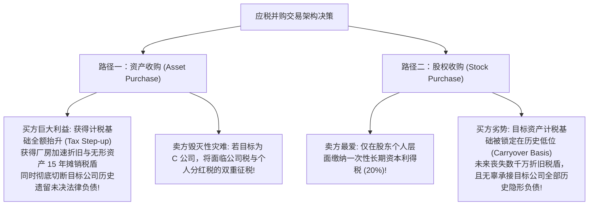
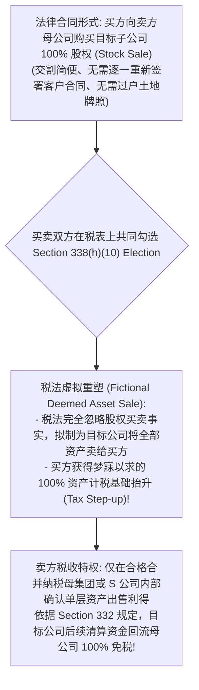
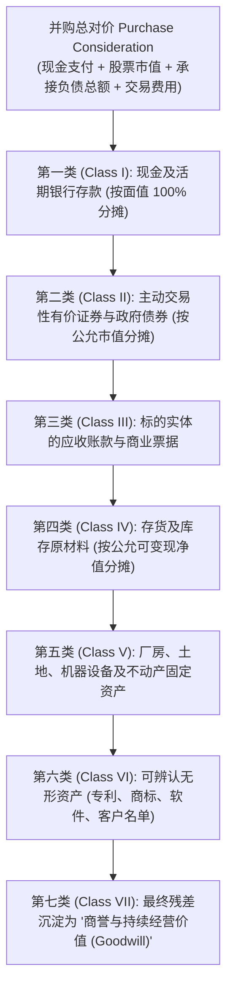

# Lec 16 应税并购全景：资产收购 vs 股权收购与 Section 338 选举 (Taxable Acquisitions: Asset vs Stock Purchase and Section 338)

> MIT Sloan School of Management · 15.518 Taxes and Business Strategy · 讲义 16

## TL;DR

- 应税并购的核心博弈在于买方渴望资产收购抬升计税基础与卖方追求股权收购单层课税。
- 资产收购使买方获得无形资产 15 年摊销税盾，但会导致 C 公司卖方承担毁灭性的双重征税。
- Section 338(h)(10) 拟制资产出售选举权为合并纳税母子公司与 S 公司提供了双赢解决通道。
- Section 1060 残差法严格按七类资产层级进行对价分摊，商誉作为最终残差沉淀。

## 并购交易中的买卖双方天然税收利益对立

在企业兼并与收购（M&A）交易中，并购对价的支付形式主要分为应税交易（以现金、承接债务或本票为主）与免税重组（以买方股票为主）。在**应税并购（Taxable Acquisitions）**领域，买卖双方在交易法律架构的选择上存在着不可调和的天然税收对立。

这构成了并购谈判中最经典的死结：**买方天然偏好“资产收购（Asset Purchase）”，而卖方天然偏好“股权收购（Stock Purchase）”**。

::: definition [计税基础抬升 (Tax Step-up)]
计税基础抬升是指在并购交易中，买方对标的资产的计税成本基础（Tax Basis），被税法允许从历史较低的折余账面净值，全额调整并提升至本次交易实际支付的公允收购价格。抬升出的增量基础，允许买方在未来各期计提巨额的税前折旧与资产摊销，产生庞大的现金节税收益。
:::

## 两种交易形式的数学推导与税负剪刀差

我们通过严格的代数模型，量化资产收购与股权收购在 C 公司层面的财富分配。

设买方支付的收购总对价为 $P$。标的公司持有的净资产原始计税基础为 $B_{\text{inside}}$；股东持有标的公司股票的计税基础为 $B_{\text{outside}}$。
企业所得税率为 $t_c$；股东适用的长期资本利得与股利税率统称为 $t_{\text{cg}}$。

### 1. 股权收购模式（Stock Purchase）

卖方股东直接将股票转让给买方，交易完全发生在股东个人层面，标的公司法人不动：
- 卖方股东税后净现金流入（单层资本利得税）：
  $$\text{Net Proceeds}_{\text{Stock}} = P - t_{\text{cg}} (P - B_{\text{outside}})$$
- 买方承担后果：买方对目标公司资产的计税基础维持历史原值 $B_{\text{inside}}$（无任何 Step-up），未来无增量折旧税盾。

### 2. 资产收购模式（Asset Purchase）

买方直接向标的公司购买各项资产与业务，标的公司收到现金对价后进行清算并将现金派发给股东：
- **第一层课税（企业层面）**：标的公司必须就资产出售利得缴纳企业所得税：
  $$\text{Corporate Tax} = t_c (P - B_{\text{inside}})$$
- **第二层课税（股东层面）**：标的公司扣税后的净现金为 $P - t_c(P - B_{\text{inside}})$。将该资金清算分配给股东，股东扣除股票原值 $B_{\text{outside}}$ 后缴纳清算资本利得税：
  $$\text{Shareholder Tax} = t_{\text{cg}} \left[ P - t_c(P - B_{\text{inside}}) - B_{\text{outside}} \right]$$
- **卖方股东最终税后净到手现金**：
  $$\text{Net Proceeds}_{\text{Asset}} = \left[ P - t_c(P - B_{\text{inside}}) \right] \left( 1 - t_{\text{cg}} \right) + t_{\text{cg}} B_{\text{outside}}$$

::: example
某 C 公司持有的核心工业地产与专利历史计税基础仅为 $B_{\text{inside}} = 1,000$ 万美元。
创始人当年设立公司时的出资基础为 $B_{\text{outside}} = 100$ 万美元。
买方拟出资 $P = 5,000$ 万美元进行收购。
税率假设：$t_c = 21\%$，$t_{\text{cg}} = 23.8\%$。

1. **若按卖方要求的股权收购（Stock Sale）**：
   - 股东应税利得：$5,000 - 100 = 4,900$ 万美元；
   - 个人资本利得税：$4,900 \times 23.8\% = 1,166.2$ 万美元；
   - **卖方净落袋现金：$5,000 - 1,166.2 = 3,833.8$ 万美元**。
2. **若按买方要求的直接资产收购（Asset Sale）**：
   - 企业层面资产出售利得：$5,000 - 1,000 = 4,000$ 万美元；
   - 企业缴纳所得税：$4,000 \times 21\% = 840$ 万美元；
   - 企业税后剩余现金：$5,000 - 840 = 4,160$ 万美元；
   - 股东清算分配个税：$(4,160 - 100) \times 23.8\% = 966.28$ 万美元；
   - **卖方净落袋现金：$4,160 - 966.28 = 3,193.72$ 万美元**。
结论震撼人心：在资产收购下，由于双重征税的绞杀，卖方净现金直接蒸发了高达 **640 万美元**（税负恶化近 20%）！卖方在此情景下绝对坚决拒绝签署资产收购协议。
:::

## 破局利器：Section 338(h)(10) 拟制资产出售选举权

为了打破上述并购僵局，税法典设计了一项极其精巧的“法律形式与税收实质割裂”工具——**IRC Section 338(h)(10) 联合选举权**。

::: theorem [Section 338(h)(10) 适用范围与核心红利]
Section 338(h)(10) 仅允许在以下两类标的实体交易中由买卖双方联合签署生效：
1. 目标公司是**某企业集团合并申报纳税的子公司（Subsidiary in an Affiliated Group）**；或
2. 目标公司是一家**S 公司（S-Corporation）**。

**双赢经济学结果**：
- **买方**：按收购价格将所有资产的计税基础直接抬升至公允对价，在未来 15 年内享受 Section 197 无形资产与商誉的线性摊销税盾；
- **卖方母公司**：完全豁免了子公司分红的第二层税负（单层纳税），双方通过在收购价格中增加适度溢价（Gross-up），达成了皆大欢喜的帕累托改进。
:::

## Section 1060 残差法与对价分摊矩阵（The Residual Method）

在资产收购（或 338(h)(10) 拟制资产收购）确立后，双方在向税务局申报 Form 8594 时，必须将收购总对价（Purchase Price 加上承接的负债）分摊到具体各项资产上。

美国税法 IRC Section 1060 强制规定必须采用**残差法（The Residual Method）**，按七大资产层级从流动性高到低逐级灌水式分摊：

::: theorem [IRC Section 197 无形资产 15 年法宝]
在 1993 年前，税法严禁对商誉进行摊销。1993 年国会颁布的 **IRC Section 197** 确立了现代 M&A 税收的超级红利：
**在应税资产收购中分摊至第六类（可辨认无形资产）与第七类（商誉 Goodwill）的全部资金，税法一律强制允许按 15 年（180 个月）在企业所得税前进行直线法全额摊销（Straight-line Amortization）！**
:::

这笔长达 15 年的商誉税前摊销，构成了私募股权（PE）杠杆收购中冲抵标的企业巨额 EBITDA、实现税收庇护的核心现金流底牌。

## 我的理解

::: insight [并购税收的博弈博弈：价格是所有制度税负的镜子]
在投资银行与并购律师的狂欢世界里，新闻通稿总是充斥着“战略协同”、“市场份额”与“商业版图整合”的宏大叙事。然而，当大门紧闭、买卖双方的首席谈判代表坐下来修改并购买卖协议（SPA）时，谈判桌上最真实的刀光剑影，几乎全部聚焦于“资产收购还是股权收购”那几行看似枯燥的税法选择条款。

资产收购与股权收购的战争，本质上是一场**关于“谁来为历史与未来的税收买单”的零和利益拔河**。

买方每多争来一分钱的计税基础抬升（Step-up），就意味着自己未来可以凭借无形资产摊销从国库里合法支取十五年的现金红包，但代价是把卖方推向双重征税的绞肉机；而卖方每坚持一次纯股权转让，就是试图把历史未决的税务暗雷包装成礼盒原封不动地塞给买方。

Section 338(h)(10) 的发明，展现了人类制度契约设计的极致灵动——它巧妙地利用母子公司合并纳税的单层属性，用一张虚拟的“税法拟制支票”，同时满足了买方对资产抬升的贪婪与卖方对单层纳税的执念。

卓越的交易战略家从不把税务问题留给交割后的会计师去头疼。他们懂得将每一笔可摊销商誉的现值、每一笔不可扣除的双重税负，毫厘不差地折算进报价模型，在合同对价的毫厘腾挪之间，将潜在的税收冲突化解为实实在在的商业交易胜势。
:::
