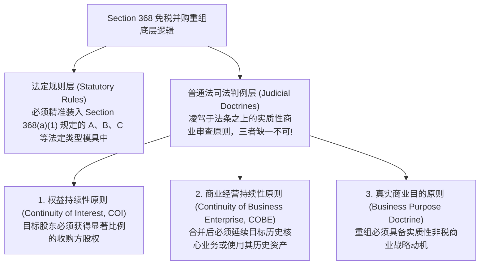
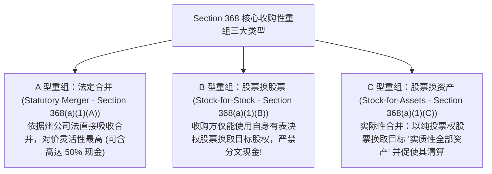
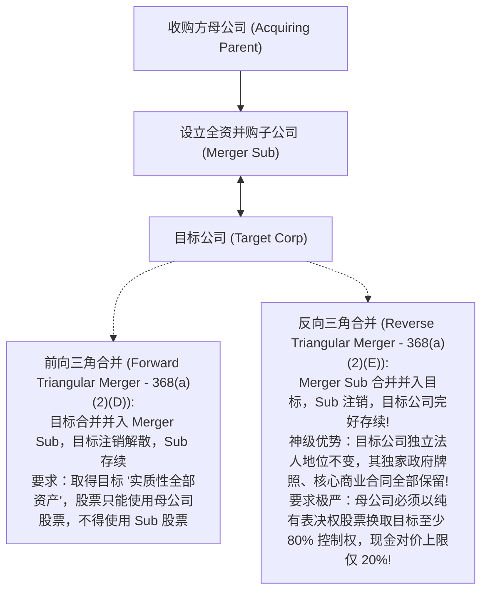
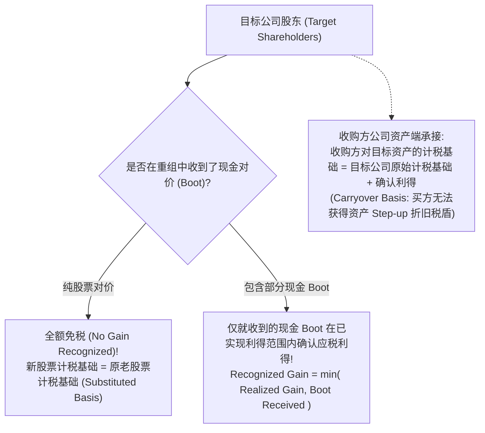

# Lec 17 免税并购重组三部曲：A、B、C 型重组的法定条件 (Tax-Free Reorganizations: Type A, Type B, and Type C Mergers)

> MIT Sloan School of Management · 15.518 Taxes and Business Strategy · 讲义 17

## TL;DR

- 美国税法 Section 368 免税并购重组是建立在“商业所有权连续性”法理之上的免税避风港。
- 权益持续性（COI）与商业经营持续性（COBE）三大司法判例原则统领所有重组类型。
- A 型法定合并对价灵活性最高，反向三角合并在保护牌照与合同完整性上备受青睐。
- B 型股权换股权与 C 型资产重组对对价纯粹性要求极严，“唯一纯投票权股票”是不可逾越的红线。

## 免税重组的法理基石：所有权连续性而非变现退出

在大型跨国并购与行业寡头整合中，交易规模动辄高达数十亿乃至上千亿美元（如迪士尼收购福克斯、辉瑞合并艾尔建）。如果这类巨额并购被一刀切定性为应税交易，被收购方股东将面临天文数字般的现金资本利得税负，这在宏观上将彻底冻结资本市场的产业重组与资源优化配置。

美国国内税收法典 **IRC Section 368** 构成了免税并购重组（Tax-Free Reorganizations）的圣殿。其底层法理在于：**当目标公司的股东将其持有的股票置换为收购方的股票时，他们并没有实现财富的“现金套现变现（Cashing Out）”，而只是将其在原有商业资产中的所有权份额，连续地延续到了一个合并后的更大规模商业实体之中（A Mere Readjustment of Continuing Interest）**。

::: definition [免税企业重组 (Tax-Free Reorganization)]
免税企业重组是指两个或两个以上独立公司之间的合并、换股或资产转移交易，完全满足 IRC Section 368 规定的法定形态与司法判例要件。在重组中，目标公司股东收到收购方合格股票对价的部分**不确认任何应税利得或损失**，其历史股票计税基础顺延结转至新股票中；收购方承接目标公司资产的历史计税基础，实现跨主体的税收中性延续。
:::

## 三大普通法司法判例原则（Judicial Doctrines）

任何免税重组方案，无论在合同法条文上设计得多么天衣无缝，都必须首先通过联邦税务法院三大司法判例原则的严苛检验：

### 1. 权益持续性原则（Continuity of Interest, COI）

目标公司的老股东必须在合并后的新企业中保留重大的所有权利益。
根据美国财政部税务条例（Treas. Reg. Section 1.368-1(e)）以及最高法院历史判例确立的行业通行标准：**在并购总对价中，收购方的股票（普通股或优先股）公允市值占比，通常必须达到至少 40% 至 50% 以上！**
如果收购方支付了 80% 的现金，仅支付 20% 的股票，则被认定为目标股东实质上已经完成现金套现退出，整笔重组将被全额剥夺免税资格。

### 2. 商业经营持续性原则（Continuity of Business Enterprise, COBE）

收购方在交割后，必须满足以下两项标准之一：
- **历史业务延续（Historic Business）**：继续运营目标公司的一项重要历史业务线；或者
- **历史资产使用（Historic Assets）**：在自身业务中继续使用目标公司相当大比例（Significant Portion）的历史商业资产。
如果收购方在交割次日便将目标公司的全部研发资产与厂房在市场上直接变卖清仓、仅保留一具空壳，该交易将被事后判定违背 COBE 原则而退化为全额应税清盘。

### 3. 商业目的原则（Business Purpose）与步步交易原则（Step Transaction）

交易必须拥有真实的商业经营动机（如实现技术互补、扩大销售网络）。税务法庭有权依据**步步交易原则**，将一系列在时间上前后相继、互为因果的法律步骤合并审视，撕毁以避税为唯一目的人工步骤。

## 经典重组三部曲：A 型、B 型与 C 型重组全景解构

### 1. A 型重组：法定合并（Statutory Merger）及其三角演进

A 型重组是直接依据特拉华州等美国各州公司法实施的吸收合并（Merger or Consolidation）。目标公司在交割时依法注销解散，其全部资产与负债由存续的收购方全盘继承。

- **最大优势**：对价灵活性极高。只要满足 COI 原则（如 50% 对价为股票），**剩余 50% 对价可以自由使用现金、借款本票或债券（作为 Boot）**！
- **致命缺陷**：收购方在法律上无条件、全额承担了目标公司历史上的所有隐性未决法律诉讼与环保负债；且通常必须召开收购方股东大会进行投票批准。

为了规避全额承接未知负债的法律风险，现代 M&A 演化出了**三角合并（Triangular Mergers）**：

反向三角合并因能完美保护目标公司的专有客户合同与技术特许权，成为了全球科技巨头收购初创公司的首选王道结构。

### 2. B 型重组：股票换股票（Stock-for-Stock Reorganization）

在 B 型重组中，收购方直接向目标公司的全体股东发行自身（或其直接母公司）的**有表决权普通股（Voting Stock）**，以换取目标公司的股票。交易完成后，目标公司成为收购方的控股子公司。

::: theorem [B 型重组的“绝对纯粹性（Solely Rule）”铁律]
B 型重组的法条中包含严苛的词汇：“**Solely for all or a part of its voting stock**”。
这意味着：**收购方支付的对价必须 100% 全部是有表决权股票，税法绝对严禁哪怕一美元的现金启动对价（Boot）存在！**
哪怕收购方向目标股东支付了 9,999 万美元的投票权股票，外加区区 100 美元现金以凑齐零头，这 100 美元现金将导致整笔 1 亿美元的 B 型重组全盘覆灭，直接沦为 100% 立即全额征税的应税交易！
同时，收购方在交易完成后必须立即对目标公司拥有**至少 80% 的法定控制权**。
:::

### 3. C 型重组：股票换资产（Stock-for-Assets Reorganization）

C 型重组被称为“实践中的合并（Practical Merger）”。收购方绕过股权，直接向目标公司发行自身投票权股票，换取目标公司的**“实质性全部财产（Substantially All the Properties）”**；交易完成后，目标公司必须在法定期限内依法注销清算，将获得的收购方股票全额分发给自身股东。

- **实质性全部财产标准（IRS 安全港准则）**：收购方取得的资产净值必须占目标净资产的至少 **90%**，且占目标资产总额的至少 **70%**；
- **微量对价放宽规则（Boot Relaxation Rule）**：税法允许至多 20% 的对价可以使用现金或承接负债，但在计算这 20% 限额时，收购方承接的所有负债金额必须强制计入对价统计，使得这一放宽在实务中极其难以利用。

## 免税重组中的纳税后果与计税基础守恒

在合格的免税重组中，各方当事人享受法定免税特权的同时，税法通过计税基础（Basis）的精确传承，建立了严密的双向守恒机制，确保潜在税基未曾消失，仅仅是推迟了实现时点。

### 三大参与方主体的税收处理法则

1. **目标公司股东端（Target Shareholders - Section 354/356）**：
   - 股东仅收到合格股票时，**确认利得严格为 0 元**；其换取的新股票计税基础完全继承其交出的老股票历史成本（$\text{Basis}_{\text{new}} = \text{Basis}_{\text{old}}$，替代计税基础 Substituted Basis）。
   - 若股东在股票之外还收到了现金等启动对价（Boot），则依据 Section 356 规则，在已实现总利得范围内就收到的现金部分确认应税利得（$\text{Recognized Gain} = \min(\text{Realized Gain}, \text{Boot})$）；若该现金分配具有类似分红的经济实质，甚至可能被判定按股利征税。新股票计税基础调整为：原基础加上确认利得减去收到的 Boot 现金。
2. **目标公司法人端（Target Corporation - Section 361）**：
   目标公司因将资产转让给收购方以换取股票，全额免征企业所得税；其向自身股东分配收购方股票亦不触发公司层面的清算利得。
3. **收购方企业端（Acquiring Corporation - Section 362）**：
   收购方发行自身股票换取资产或股权，免征企业所得税。在资产端，**收购方对受让资产的计税基础全盘继承目标公司的历史折余计税原值（Carryover Basis）**，买方无法获得任何计税基础抬升（No Step-up），未来只能继续按历史低位基数计提折旧，这是买方为换取免税并购所付出的内在代价。

## 我的理解

::: insight [免税重组的契约美学：在所有权的变与不变中锚定永恒]
免税重组是整个现代公司法与税法交融的最璀璨结晶。在这里，法律展现出了它最温情、也最深刻的一面。

如果说应税并购是一场冰冷的“货币清算”，买方带着钞票入场，卖方拿钱离场、两不相欠；那么 Section 368 免税重组则更像是一场庄严的“商业联姻”。

权益持续性（COI）原则是这场联姻中最坚定的婚约誓词——税法在拷问收购方与被收购方：“你们是真的相信合并后的全新远景，愿意把彼此的命运绑定在同一张股票上同甘共苦？还是仅仅在借道进行一场披着股权外衣的隐秘套现？”

A 型合并的宽厚包容、反向三角合并对商业契约完好性的精巧呵护，以及 B 型重组对“纯粹投票权股票”近乎偏执的洁癖，无一不是税法在试图精准测量那份“所有权连续性”的纯度。

顶级的并购架构师永远懂得：**免税重组的最高境界，不是把税率降至零的那张纸面批复，而是通过股权的无缝纽带，在不惊动任何一笔资本沉没税负的前提下，将两股原本独立的商业洪流完美汇聚成浩瀚的时代汪洋**。
:::
