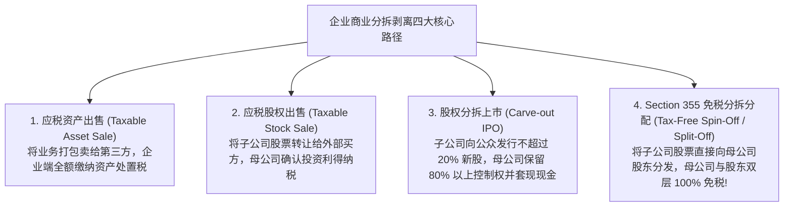
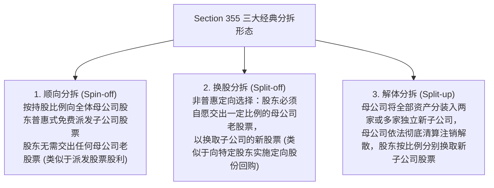
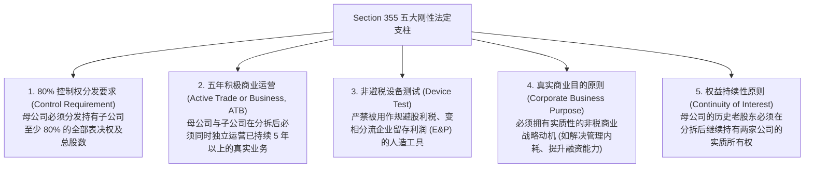
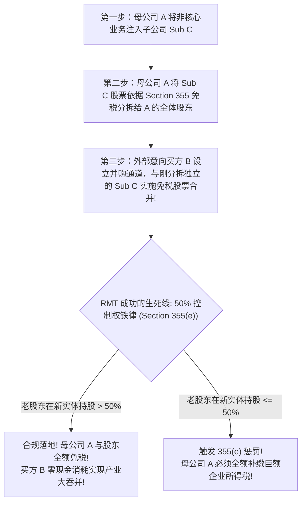

# Lec 18 企业分拆剥离的免税圣杯：Section 355 全面穿透 (Corporate Divestitures and Tax-Free Spin-Offs: Section 355)

> MIT Sloan School of Management · 15.518 Taxes and Business Strategy · 讲义 18

## TL;DR

- 企业分拆剥离旨在消除多元化折价与反垄断摩擦，释放独立业务的资本估值潜能。
- 美国税法 Section 355 是实现母公司与股东双层完全免税分拆的“终极免税圣杯”。
- 五大刚性法定支柱涵盖 80% 控制权分发、5 年积极商业运营（ATB）与反避税设备测试。
- 反向莫里斯信托（RMT）通过精准设计控制权比例，实现了分拆与后续并购重组的无缝免税闭环。

## 商业分拆剥离的战略动因与交易全谱系

在企业经过长年累月的兼并收购构建起庞大的产业帝国后，资本市场往往会对其施加残酷的**“多元化折价（Conglomerate Discount）”**——横跨传媒、通信、制造与金融的混合巨头，其整体市值往往显著低于各项独立业务分部加总的估值总和（SOTP, Sum of the Parts）。

为了精简主业、聚焦核心赛道、应对反垄断监管审查、并为高成长业务独立开辟股权融资通道，企业董事会常常做出战略剥离（Divestiture）决策。

在资本市场实务中，企业分拆剥离呈现四种核心路径：

在第四条路径中，若不借助特殊的税法通道，母公司向股东分发子公司股票在一般税法规则下将被认定为两笔重税交易：**母公司层面按股票公允价值减去计税基础确认巨额企业所得税；股东层面全额被认定为应税现金股利分红！**

美国税法典 **IRC Section 355** 是打破这一双重税收枷锁的唯一金钥匙，被华尔街投行与税务律师公认为**“企业重组领域的免税圣杯”**。

::: definition [IRC Section 355 免税分拆]
IRC Section 355 规定：母公司（Distributing Corporation）将其控制的全资或控股子公司（Controlled Corporation）的股票或有价证券，分发给母公司的现有股东时，只要严格满足税法设定的各项积极与消极门槛，无论是母公司还是接收股票的股东，在分拆发生当日均**不确认任何应税利得或股利收入**。
:::

## Section 355 三大分拆形态：Spin-off、Split-off 与 Split-up

根据股东是否需要交出母公司原有股票，Section 355 在实操中精准演化为三种形态：

最为引人入胜的是**换股分拆（Split-off）**。例如巴菲特的伯克希尔·哈撒韦公司（Berkshire Hathaway）曾持有大量宝洁公司（P&G）股票。宝洁为了剥离金霸王电池业务（Duracell），设立了子公司承接金霸王资产，并向伯克希尔发起 Split-off：巴菲特将手中价值数十亿美元的宝洁老股票全额退还给宝洁注销，换取了金霸王公司的 100% 独立股权。**整笔跨国剥离涉及数百亿美元增值，买卖双方未向美国国税局缴纳哪怕一美元税款！**

## 踏入免税圣殿的五大刚性法定支柱

Section 355 之所以被称为圣殿，正是因为其准入门槛之严苛在全球税法中首屈一指。一项分拆方案必须**同时、完全满足以下五大支柱条件**：

### 五年积极商业运营原则（The ATB Requirement）的实战深度

税法严密防范企业通过“分拆”手段将闲置现金或被动投资资产转移给股东。
因此，ATB 规则确立了两道绝对红线：
1. **真实活跃运营（Active Conduct）**：必须拥有自身专职管理层与生产员工，直接从事商品制造、销售或专业服务。单纯持有不动产并对外出租（Triple Net Lease）、或仅持有股票债券投资组合，直接被判定为“被动投资”，不满足 ATB 条件；
2. **五年时间淬炼与无应税取得（5-Year Clean History）**：该业务在分拆发生日之前，必须已经**连续不间断运营了至少 5 年以上**；且该业务在过去 5 年内，**严禁是通过应税并购直接花钱买来的！**

::: pitfall [将“高估值新孵化业务”仓促分拆引发的全面补税灾难]
某大型互联网企业设立了一个云原生 AI 研发部门，经过 2 年高强度孵化估值暴涨至 100 亿美元。董事会为了追求市值最大化，计划在第 3 年将该 AI 业务通过 Section 355 分拆给全体股东并单独挂牌上市。
**灾难发生**：
- 该 AI 业务实际开展商业运营的历史仅有 2 年，**未能满足 5 年 ATB 的法定时间红线**！
- 导致整笔 100 亿美元的分拆全部被剥夺 Section 355 免税特权：母公司被强制就 100 亿美元增值全额缴纳 21 亿美元企业所得税，全体股东被强制按 100 亿美元公允价值计入普通股利所得缴纳数十亿美元个人所得税！
:::

## 世纪并购法宝：反向莫里斯信托架构（Reverse Morris Trust, RMT）

在商业史上，最棘手的战略难题是：**母公司想彻底卖掉旗下的某块亏损或非核心成熟业务给外部竞争对手，但如果直接以现金出售，母公司必须缴纳数十亿美元的资产出售税**。

能否将业务“先免税分拆、再免税合并”？
国会在 1997 年通过反莫里斯信托法案（Anti-Morris Trust Rule, Section 355(e)），规定：如果分拆前后发生了预谋的所有权转移，将触发惩罚性征税。**然而，这一法案为真正的战略家留下了一条合法通道——反向莫里斯信托（Reverse Morris Trust, RMT）**。

::: theorem [反向莫里斯信托 (RMT) 控制权守恒定律]
RMT 成功的核心在于：**在第三步合并完成后，母公司 A 的原有老股东，在合并后的全新联合实体（Merged Entity）中，必须持有超过 50% 的投票权与股权公允价值（Voting Power and Value）！**
为了满足该 50% 铁律，标的业务的体量通常必须在商业估值上**大于外部收购方 B 的自身体量**，或者通过精巧的资本结构重组稀释买方股份。
:::

### 经典实战案例：AT&T 分拆华纳传媒与探索公司合并（Warner Bros. Discovery）

2022 年，美国电信巨头 AT&T 决定剥离其此前耗资数百亿美元收购的媒体巨无霸华纳传媒（WarnerMedia），并与探索传播（Discovery）进行世纪大合并。
AT&T 完美运用了 RMT 架构：
1. AT&T 先将华纳传媒资产注入子公司 SpinCo；
2. SpinCo 依据 Section 355 实施免税分拆，将股权全额分配给 AT&T 现有股东；
3. SpinCo 随即与探索公司合并为全新的纳斯达克上市公司——**华纳兄弟探索（Warner Bros. Discovery, WBD）**；
4. 合并后的全新股权结构中：**AT&T 的历史股东严格持有新公司 71% 的绝对控股股权，探索公司原有股东持有剩余 29% 股权**。
由于 71% 远超 50% 的红线，AT&T 在完全剥离 430 亿美元巨额债务与亏损传媒业务的同时，**整个交易闭环未触发一分钱的企业所得税与资本利得税**，成为商学院案头顶礼膜拜的教科书级杰作。

## 我的理解

::: insight [Section 355 的建筑学魅力：在资本的拆解中释放自由]
在人类商业的宏大叙事中，人们总是在歌颂聚合、兼并与帝国的扩张；但老子的《道德经》早就道破了智慧的真谛：“大音希声，大象无形……合抱之木，生于毫末；九层之台，起于累土。”

**商业的最高境界，不仅在于懂得如何将不同的资产粘合在一起，更在于懂得在适当时机将庞大臃肿的机体优雅地拆解开来**。

Section 355 与反向莫里斯信托（RMT），是当代税法建筑学中难度最高、结构最精巧的悬索大桥。

它要求架构师像一名顶尖的心脏外科医生一样，在跳动的商业巨兽体内精准分离组织——既要满足苛刻的五年活跃运营（ATB）生命体征，又要通过控制权百分比的毫厘测算，避开 Section 355(e) 潜伏在暗礁处的反避税鱼雷。

当那道 50% 的 RMT 临界线被精准跨越，庞大的母体卸下了包袱，新生的独立子公司重获了资本配置的自由，而股东们在未曾损耗分文税负的前提下，手握两张代表不同未来的船票。这不仅是一场税法技术的终极胜利，这是商业理性冲破多元化迷雾、实现组织基因迭代重生的至高艺术。
:::
