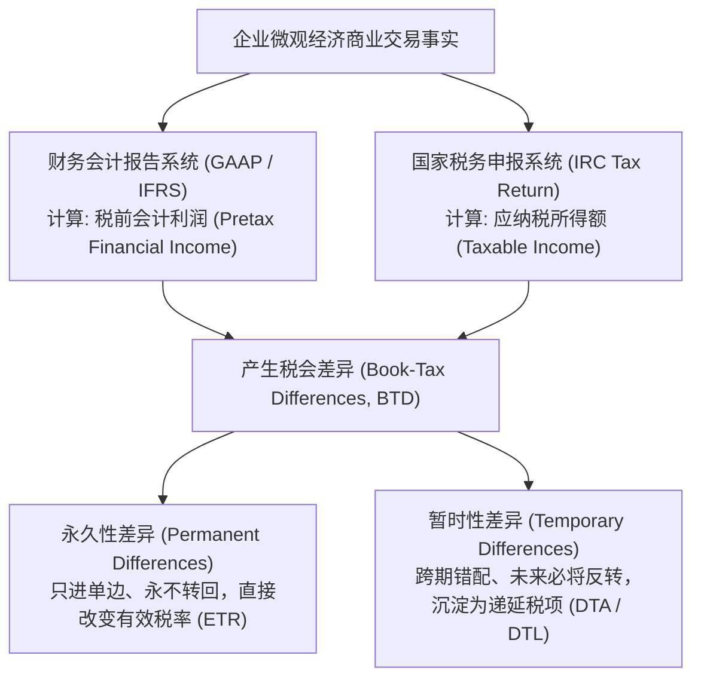
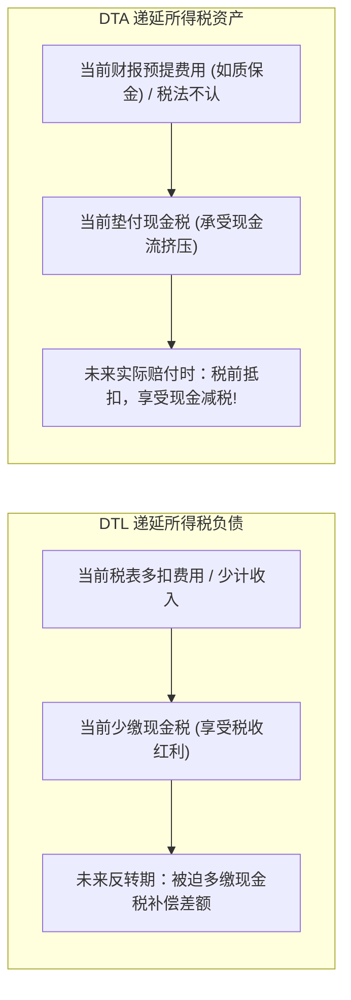
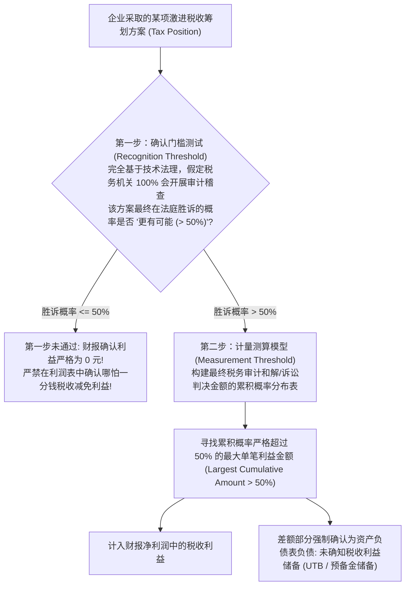

# Lec 19 财务报表中的税收：ASC 740、未确知税收地位与税收保护伞 (Accounting for Income Taxes: ASC 740 and FIN 48)

> MIT Sloan School of Management · 15.518 Taxes and Business Strategy · 讲义 19

## TL;DR

- 所得税会计（ASC 740）以资产负债表债务法为核心，系统记录税会暂时性差异与跨期转回。
- 永久性差异直接改变企业财务有效税率（ETR），而暂时性差异沉淀为递延所得税资产与负债。
- 递延所得税资产估值备抵（Valuation Allowance）受制于三年累计亏损负面证据，常沦为盈余管理工具。
- 未确知税收地位（FIN 48 / ASC 740-10）通过两步法确认计量模型，为激进避税方案设立风险拨备。

## 财税分离原则与资产负债表债务法框架

在成熟市场经济体中，企业面对着两个拥有完全不同诉求的外部信息使用者：
- **资本市场投资者（SEC / FASB）**：依据公认会计原则（GAAP / ASC 740）编制财务报表，目标是**真实、公允、权责发生制地反映企业的盈利能力与财务状况**；
- **国家税务机关（IRS）**：依据国家税法典（IRC）申报纳税申报表（Form 1120），目标是**依法足额征收国家财政收入、实施宏观产业调控并防范税基流失**。

这两套体系在收入确认时点、费用抵扣标准与资产折旧规则上的根本分歧，催生了庞大的**税会差异（Book-Tax Differences, BTDs）**。

现代所得税会计统一遵循**资产负债表债务法（Asset and Liability Method, ASC 740 / IAS 12）**。其核心哲学在于：**资产负债表上的资产和负债，未来必将通过收回或清偿转化为现金流；如果其账面价值（Book Value）与计税基础（Tax Basis）存在差异，这种差异在未来变现时必然会产生增量应纳税或可抵扣后果，必须在当前确认为递延所得税负债（DTL）或递延所得税资产（DTA）**。

::: definition [所得税会计准则 (ASC 740)]
ASC 740 是美国公认会计原则中关于企业所得税确认与计量的核心会计准则。它强制要求企业采用资产负债表债务法，根据资产和负债的账面价值与其计税基础之间的暂时性差异，以及经营亏损和税收抵免的结转额，采用预计转回期间适用的已颁布法定税率，全额计量递延所得税资产（DTA）和递延所得税负债（DTL）。
:::

## 永久性差异 vs 暂时性差异深度解构

分析师审视 10-K 年报中的所得税附注时，首要任务就是将两类性质截然不同的差异严格剥离开来：

### 1. 永久性差异（Permanent Differences）

永久性差异是指某一交易事项计入税前会计利润但永远不计入应税所得（或反之），且**在未来任何会计期间均不会发生跨期转回（Never Reverse）**。
- **永久免税加项**：购买地方政府市政债券获得的利息收入（财报计入利润，税法永久免税）；
- **永久不可抵扣减项**：政府行政罚款与惩罚性赔偿、超过法定 50% 限额的业务招待费、以及前文所述 Section 162(m) 超出 100 万美元的高管薪酬。

::: theorem [永久性差异对有效税率（ETR）的直接重构公式]
永久性差异直接改变了企业的**财务报告有效税率（GAAP Effective Tax Rate）**：
$$ETR = \frac{\text{所得税总费用 (Total Tax Expense)}}{\text{税前会计利润 (Pretax Book Income)}} = \frac{t_c \times (\text{Pretax Income} \pm \text{Permanent Differences})}{\text{Pretax Income}}$$
任何不可抵扣的永久性差异（如 162(m) 惩罚），都会直接在分子端推高税费，导致 ETR 恶性上升；而免税市政债利息则会拉低 ETR。
:::

### 2. 暂时性差异（Temporary Differences）与递延税项

暂时性差异纯粹由于权责发生制下会计确认时点与税法收付实现制（或法定特殊时点）的不一致引起，**未来必定随着时间流逝而发生刚性反转（Future Reversal）**。

| 递延税项类别 | 经济实质与产生机理 | 典型商业场景 | 资产负债表角色 |
| :--- | :--- | :--- | :--- |
| **递延所得税负债 (DTL)** | **税款推迟缴纳**：资产账面价值 $>$ 资产计税基础，或负债账面价值 $<$ 负债计税基础。未来将产生增量应纳税现金流。 | 机器设备在税务上采用 MACRS 加速折旧（前期少缴税），而财报采用直线折旧。 | 确认为**非流动负债**（欠政府的递延税款） |
| **递延所得税资产 (DTA)** | **税款提前垫付**：资产账面价值 $<$ 资产计税基础，或负债账面价值 $>$ 负债计税基础。未来将产生增量可抵扣税盾。 | 产品质保准备金（Warranty Reserves）、应收账款坏账准备、未利用的巨额 NOL 结转。 | 确认为**非流动资产**（未来可少缴税的权利） |

## 估值备抵（Valuation Allowance）与管理层盈余操作

在资产负债表上，确认了一笔 1 亿美元的“递延所得税资产（DTA）”，意味着企业宣称自己未来有权少交 1 亿美元现金税。然而，这里存在一个致命的逻辑前提：**企业在未来必须能够赚取足够的应税利润，这笔 DTA 才有被吸收利用的可能！**如果企业在未来持续亏损倒闭，DTA 将彻底沦为无法兑现的废纸。

为此，ASC 740 确立了严厉的**估值备抵（Valuation Allowance, VA）规则**：

::: theorem [DTA 估值备抵确认门槛]
如果根据所有可获得的正面证据（Positive Evidence）与负面证据（Negative Evidence），企业被判定为**“更有可能（More Likely Than Not，即客观概率 $> 50\%$）”无法完全实现部分或全部 DTA**，则企业必须计提估值备抵以冲减 DTA 账面价值：
$$\text{Net DTA on Balance Sheet} = \text{Gross DTA} - \text{Valuation Allowance}$$
计提估值备抵的借方直接计入当期利润表的**“所得税费用（Income Tax Expense）”**，导致净利润暴跌。
:::

### “三年累计亏损（3-Year Cumulative Loss Rule）”客观负面证据

准则明确规定：管理层对未来盈利的主观乐观预测，在面对客观历史亏损时具有极弱的证明力。
**如果企业在过去连续三年处于累计税前亏损状态，这一事实被视为压倒性的重大负面证据（Significant Negative Evidence）**。除非企业持有充足的应税暂时性差异（DTL）可供未来转回对冲，否则审计师将强制要求企业对所有 DTA **计提 100% 全额估值备抵**！

::: pitfall [利用估值备抵转回（VA Release）实施“合法利润操纵”]
估值备抵常常沦为管理层操控财报 EPS 的隐秘蓄水池。
当新 CEO 上任或企业经营触底时，管理层往往进行“大清洗（Big Bath）”，借口行业前景暗淡，一次性对数亿美元 DTA 计提全额估值备抵，将当期利润砸向深渊。
随后，在第二年某个需要达成华尔街分析师盈利预期的关键财季，管理层突然宣称“市场信心恢复、新产品扭亏为盈证据确凿”，合法将历史估值备抵予以转回（Release）。这笔转回直接冲减利润表的所得税费用，凭空为企业创造出数千万乃至数亿美元的**纸面纯净利润**！
:::

## 未确知税收地位评估：FIN 48（ASC 740-10）两步法模型

跨国企业在日常运营中常常采取极其激进的避税筹划（如激进的研发加计扣除、前沿的转让定价结构）。这些方案在向税务局申报时可能并未被税务稽查发现，但随时面临未来被 IRS 审计推翻并追缴税款的巨大风险。

企业能否在财务报表上提前把这些“未经税务局最终认可的避税红利”确认为当期利润？
美国财务会计准则委员会出台的 **FIN 48（现编入 ASC 740-10）**彻底堵死了这种掩耳盗铃的做法，创立了严格的**两步确认与计量模型（Two-Step Evaluation）**。

::: example
某跨国高科技公司在一项复杂的境外软件研发项目中，申报了 1,000 万美元的税收抵减。
公司法务与税务顾问出具法律意见书：该项技术在法理上具有充分抗辩理由，胜诉概率超过 50%（通过第一步测试）。
经投行与法务团队构建该项目未来在税务稽查和解中的金额概率分布如下：

| 最终被税务局核准认可的可能金额 | 单独概率 | 累积概率 (从大到小排序) | 决策判定 |
| :--- | :--- | :--- | :--- |
| **1,000 万美元 (全额获胜)** | 20% | 20% | 累积概率 $\le 50\%$，不可确认 |
| **800 万美元 (部分妥协)** | 25% | $20\% + 25\% = 45\%$ | 累积概率 $\le 50\%$，不可确认 |
| **600 万美元 (典型和解点)** | **30%** | **$45\% + 30\% = 75\%$** | **首次突破 50% 门槛！**（符合标准） |
| 400 万美元 (极度悲观) | 15% | $75\% + 15\% = 90\%$ | — |
| 0 元 (全盘溃败) | 10% | 100% | — |

**会计处理决策**：
- 累积概率首次超过 50% 的最大利益金额为 **600 万美元**；
- 因此，企业在当期财务报表中，**最多仅允许确认 600 万美元的节税收益计入利润表**；
- 申报的 1,000 万与确认的 600 万之间的 **400 万美元差额**，必须作为一笔隐性负债确认为**未确认税收利益（Unrecognized Tax Benefits, UTB / 税收保护伞储备）**，并在资产负债表中计提利息拨备！
:::

## 破译 10-K 所得税附注：税率调节表逆向工程

卓越的商业分析师能够从 10-K 年报附注中的**所得税税率调节表（Effective Tax Rate Reconciliation Table）**中，逆向还原出企业的真实税务体魄与利润脆弱性。该调节表以法定名义税率（21%）为起点，逐项列示各项调节因子如何将名义税率拉升或压降至财报实际公布的 GAAP 有效税率。

### 四大关键调节因子的穿透排查法则

1. **跨国税率剪刀差（Foreign Tax Rate Differential）**：
   调节表中最大体量的调减项通常来自“外国子公司不同税率的影响（Foreign Earnings at Different Rates）”。如果一家跨国巨头（如高通、辉瑞）通过该项目将有效税率压降了 7 到 10 个百分点，表明其大量利润高度依赖爱尔兰、瑞士或新加坡等离岸低税中心的避税通道。分析师应评估 OECD 15% 最低税对这部分核心利润的侵蚀幅度。
2. **法定研发与绿色税收抵免（Tax Credits）**：
   研发税收抵免（R&D Tax Credit）直接以美元对美元形式冲减企业所得税，属于高确定性的优质节税项。核验该抵免额与研发费用总额的比率是否处于同行业合理区间（通常为研发支出的 4% 至 7%）。
3. **不可扣除的高管超额薪酬与罚金（Non-deductible Expenses）**：
   该项目反映了企业因触碰 Section 162(m) 100 万美元薪资扣除上限、反海外腐败法（FCPA）罚款或诉讼惩罚金而产生的不可逆税收损耗，直接推高当期有效税率。
4. **估值备抵净变动（Valuation Allowance Changes）**：
   审视调节表中是否存在异常大额的“估值备抵设立”或“估值备抵转回”。若某季度 GAAP ETR 突然骤降至不可思议的负数或个位数，且主要贡献项为估值备抵释放，表明该季度的超额 EPS 增长纯属非现金会计调节，并非底层主营商业造血能力改善。

如果一家跨国巨头的 GAAP ETR 远低于法定税率（例如仅为 12%），且其核心调减项全部来自“海外低税率实体利润差异”，分析师应立即提高警惕：一旦全球经合组织 15% 最低税（Pillar Two）落地，该企业的净利润将面临显著的不可逆下修压力。

## 我的理解

::: insight [所得税会计的辩证法：在虚实两张账本间称量企业的诚信]
在所有企业财务报表附注中，所得税附注（Income Tax Note）无疑是文字最晦涩、专业术语最密集、也最容易被普通散户直接跳过的深水区。

然而，对于顶尖的财务侦探而言，这里恰恰是全套年报中**信息纯度最高、最无法隐藏管理层底层动机的“诚实之镜”**。

在利润表的主表上，管理层可以依靠激进的收入确认和费用资本化包装出惊艳的净利润与 EPS；但所得税会计的存在，无情地逼迫企业把“呈报给投资者的面具”与“呈报给税务局的底牌”同时摊在阳光之下。

递延所得税负债（DTL）记录了企业在顺周期从政策夹缝中透支的未来现金；递延所得税资产（DTA）丈量着企业对自身扭亏为盈能力的信任极限；而未确知税收地位（FIN 48）的计提，更是将管理层在税务法庭门前颤抖的真实心理概率，一笔笔诚实地折算成了资产负债表上的预备金。

学会阅读所得税附注，就是学会倾听企业在狂欢背后的心跳。看懂了暂时性差异的潮起潮落，看透了估值备抵的翻云覆雨，你才算真正刺破了华尔街盈余数字的迷雾，触碰到了商业文明最底层那座由税法刚性筑起的真实基石。
:::
