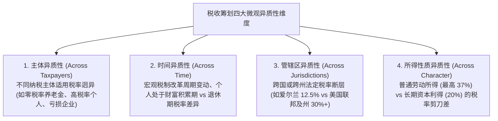
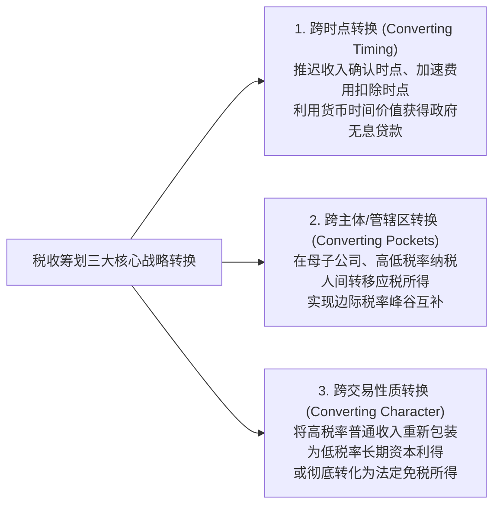
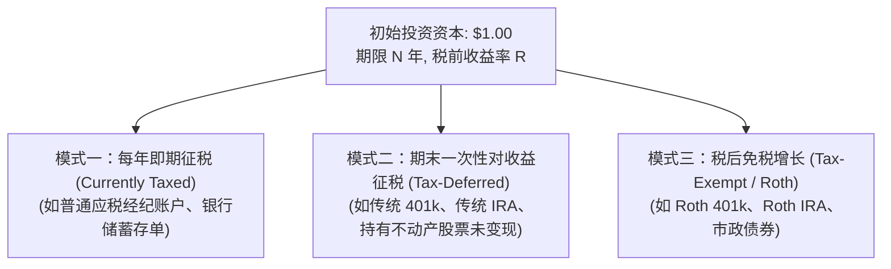

# Lec 02 战略税收筹划微观经济学框架 (A Microeconomic Framework for Tax Planning)

> MIT Sloan School of Management · 15.535 Taxes and Business Strategy · 讲义 02

## TL;DR

- 税收筹划的微观经济学基石源于纳税主体间、时间维度上以及收入性质上的税率异质性。
- 战略税收筹划三大经典转换维度包括跨时点转换、跨管辖区转换与跨性质转换。
- 税收递延在本质上等于企业向政府获得了一笔长周期的无息无担保信用借款。
- 比较税收工具时，必须联立分析即期纳税、期末递延纳税与税后免税工具的财富增长函数。

## 税收筹划存在的微观经济学前提：异质性空间

如果在一个假想的纯理论经济体中，所有市场主体在所有时间、所有地域面对完全相同且恒定不变的单一比例税率，且所有商业回报（薪酬、股利、利息、资本利得）均按完全相同的标准课税，那么任何形式的税收筹划都将失去存在的经济学基础。

战略税收筹划之所以能够创造巨大的经济价值，正是因为现代税法体系中普遍充斥着**四大维度的制度异质性（Heterogeneity）**：

正是这些异质性裂隙，为商业战略家通过重构合同条款、交易通道与结算时点，实现全要素税后净财富的跃升提供了广阔空间。

::: definition [税率异质性 (Tax Rate Heterogeneity)]
税率异质性是指由于纳税人法律组织形式、资产配置偏好、地理管辖区域以及所得法律分类的不同，导致相同金额的经济增量在面临政府税收索偿时所适用的边际税率（Marginal Tax Rate）产生的系统性差异。它是所有税收套利与筹划活动的前提条件。
:::

## 经典税收筹划的三大转换维度

基于上述异质性特征，斯科尔斯-沃尔夫森框架将企业与个人的一切税收筹划技术抽象归纳为**三大正交转换维度（Three Dimensions of Tax Planning）**：

### 1. 跨时点转换：时间价值与无息贷款效应

跨时点转换的核心法则是：**尽可能推迟税款的实际缴纳时点（Tax Deferral），同时尽可能提前税前费用的抵扣时点（Tax Acceleration）**。

在名义贴现率为 $r$ 的环境下，将金额为 $T$ 的税款推迟 $n$ 年支付，其现值为：

$$PV(\text{Tax}) = \frac{T}{(1 + r)^n}$$

随着推迟年限 $n$ 的拉长，这笔税款的实际经济现值呈指数级衰减。这在本质上相当于**政府向企业发放了一笔无须提供任何抵押品、不支付任何利息的刚性贷款**。企业可将留存在手头的递延税款用于扩建生产线或购买生息国债，其所赚取的投资收益全额归企业所有。

### 2. 跨主体与管辖区转换：税收洼地穿梭

跨主体转换利用了不同纳税主体边际税率的巨大落差。例如：
- **企业与个人之间**：若企业所得税率加股利税高于个人独资经营税率，则采用穿透实体；反之，若个人边际税率高达 40% 而企业所得税率仅为 21%，则将留存利润滞留在公司内部进行再投资，形成个人税收庇护所。
- **跨代财富传承**：高净值父母将早期低估值初创企业股权赠予处于低税率阶层的子女信托，由子女在未来企业上市套现时按低税率纳税。
- **跨国转移定价**：通过知识产权特许权使用费、跨境技术服务费或离岸供应链，将高税率国家（如美国、德国）实体的利润合规分流至低税率国家（如新加坡、瑞士、爱尔兰）。

### 3. 跨性质转换：捕获资本利得溢价

在大多数成熟经济体的税法典中，**资本利得（Capital Gains）**享有的法定税率普遍显著低于工资、利息、特许权使用费等**普通所得（Ordinary Income）**。
例如，在美国税法下，普通所得联邦最高税率达 37%（叠加医疗附加税达 40.8%），而持有期超过一年的长期资本利得最高税率仅为 20%（叠加附加税为 23.8%）。
高管与风险投资人最核心的税收筹划战术，就是通过股权激励、附带权益（Carried Interest）设计，将原本属于个人劳务智力投入的普通劳动报酬，精巧地转化为按资本利得纳税的合伙企业收益份额。

## 经典投资载体税后财富积累数学模型

为了在量化层面对比不同税收工具的长期效力，我们建立统一的微观财富增长模型。假定初始投资本金为 1 美元，资产每期的税前年化复合收益率为 $R$，投资期限为 $N$ 年。在不同税制设计下，期末税后总财富 $W_N$ 的数学轨迹呈现鲜明的结构性分野：

### 模式一：每年即期征税（Currently Taxed Vehicles）

每一年产生的投资收益均在当年直接扣缴所得税，税后收益在下一年继续滚存复合：

$$W_N^{\text{Current}} = [1 + R(1 - t)]^N$$

在这种机制下，税收不仅削减了当期的绝对收益，更以复利形式无情摧毁了未来的再投资复利链条。

### 模式二：期末一次性递延征税（Tax-Deferred Vehicles）

资产在整个存续期 $N$ 年内完全按未纳税的毛收益率 $R$ 进行全额复利积累；在第 $N$ 年末退出清算时，仅对实现的累计投资增值部分按税率 $t_n$ 一次性征税：

$$W_N^{\text{Deferred}} = (1 + R)^N - t_n \left[ (1 + R)^N - 1 \right] = (1 - t_n)(1 + R)^N + t_n$$

若初始本金在期初已享受税前抵扣（如传统个人退休账户 Traditional IRA，本金亦未纳税），则期末全额兑现时对本息总额一并征税：
$$W_N^{\text{Deductible Deferred}} = (1 - t_n)(1 + R)^N$$

### 模式三：税后免税增长（Tax-Exempt / Roth Vehicles）

投资者以税后资金进行投资（期初放弃税前抵扣），但资产在整个 $N$ 年存续期内按毛收益率 $R$ 自由复利增长，且在期末支取本金与收益时**全额免征任何所得税**：

$$W_N^{\text{Roth}} = (1 - t_0)(1 + R)^N$$

::: theorem [传统递延养老金 vs 罗斯免税养老金等价性定理]
对比传统税前扣除型递延账户与罗斯（Roth）免税账户：
- 传统递延账户期末财富：$W_N^{\text{Trad}} = (1 - t_n)(1 + R)^N$
- 罗斯免税账户期末财富：$W_N^{\text{Roth}} = (1 - t_0)(1 + R)^N$

**结论**：
1. **若期初税率等于退休期期末税率（$t_0 = t_n$）**：两者的期末税后净财富在数学上**严格恒等**！
2. **若预计未来退休时税率下降（$t_0 > t_n$）**：传统递延账户优于罗斯账户；
3. **若预计未来宏观税率上升或个人财富跃升进入更高税阶（$t_0 < t_n$）**：罗斯免税账户显著优于传统递延账户。
:::

::: example
某高管计划配置 10 万美元税前资金用于一项为期 20 年的长期投资，预期资产年化税前回报率 $R = 10\%$。
高管当前边际所得税率 $t_0 = 40\%$。
方案 A：放入普通应税经纪账户（每年对分红与利息按 40% 纳税）；
方案 B：放入完全递延至 20 年后退出的股票基金（假设期末资本利得税率按 20% 结算）；
方案 C：放入传统税前退休账户（期初免税，20 年后支取时全额按 30% 个人税率纳税）。

测算 20 年后税后净到手财富：
1. **方案 A（即期纳税）**：
   $$W = 100,000 \times [1 + 10\% \times (1 - 0.40)]^{20} = 100,000 \times (1.06)^{20} \approx 100,000 \times 3.207 = 32.07 \text{ 万美元}$$
2. **方案 B（递延资本利得）**：
   税前本利和为 $100,000 \times (1 - 0.40) \times (1.10)^{20} = 60,000 \times 6.7275 = 40.365 \text{ 万美元}$。
   投资增值部分为 $40.365 - 6 = 34.365 \text{ 万美元}$。
   扣除 20% 资本利得税：
   $$W = 40.365 - 34.365 \times 20\% = 40.365 - 6.873 = 33.49 \text{ 万美元}$$
3. **方案 C（税前全额递延）**：
   全额 10 万美元以毛收益率增长：$100,000 \times (1.10)^{20} \approx 67.275 \text{ 万美元}$。
   期末扣除 30% 所得税：
   $$W = 67.275 \times (1 - 0.30) \approx 47.09 \text{ 万美元}$$
方案 C 相比方案 A 实现了近 **47% 的税后净财富爆发**，充分展现了税收递延与全额税前复利的几何级数力量。
:::

::: pitfall [机械追求“跨期推迟”引发的“税率跃迁反噬”]
跨时点推迟并非在所有情况下都是最优解。
若企业在当前处于 15% 的历史超低优惠税率周期，或者个人当前处于低收入间歇期，如果机械地为了推迟微额税款而将大量应税所得推迟至未来确认；而未来该企业高新技术企业资格到期（税率跃升至 25%）或国家面临财政赤字全面上调企业所得税率，那么这笔被推迟的收入将被征收更严苛的税负，从而在净现值上彻底沦为负收益筹划。
:::

## 边际税率动态收敛与税盾价值

在微观经济分析中，企业每增加一美元抵扣额所能节省的真实税收，取决于该企业的**边际税率（Marginal Tax Rate, MTR）**而非历史平均税率。如果企业当前已处于巨额净经营亏损（NOL）状态，其边际税率将在当前趋近于零，任何增量税前费用的即期节税价值都将化为泡影。战略分析师在设计契约时，必须预判未来数年企业 MTR 的动态迁移曲线。

## 我的理解

::: insight [税收筹划的时间与空间物理学：复利是宇宙中最强大的微观引力]
如果将商业投资比作一场星际旅行，那么税收就是弥漫在整个金融宇宙中的“大气阻力”。在即期征税的传统世界里，每一圈公转都会被剥夺一层燃料，使得资本火箭的最终航程被严重截断。

经典微观税收框架的最迷人之处，在于它将爱因斯坦口中“人类第八大奇迹”的复利效应，转化为了具象的微观数学方程式。

当你推导完税收递延与免税账户的财富函数，你就会顿悟：**税收筹划的终极秘密不在于躲避纳税，而在于用时间的杠杆撬动资本的自由生长**。那一笔被合法推迟二十年缴纳的税款，在企业的资产负债表上是一张静止的借据，但在真实商业世界里，它早已转化为驱动研发引擎轰鸣、征服全球市场的澎湃动力。

通晓三大转换维度的商业领袖，永远懂得如何在时间的长河中顺流而下——在税率的低谷蓄水，在复利的顶峰收网，在制度的重力场中完成企业财富最优雅的跨期跃迁。
:::
