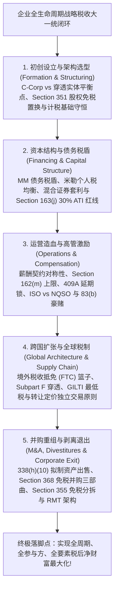
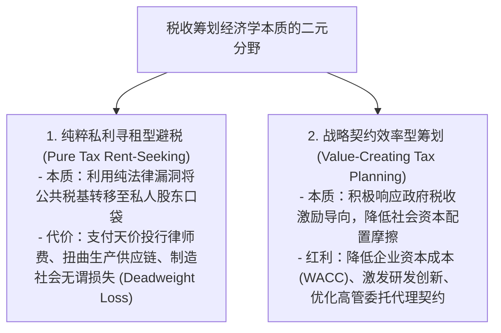
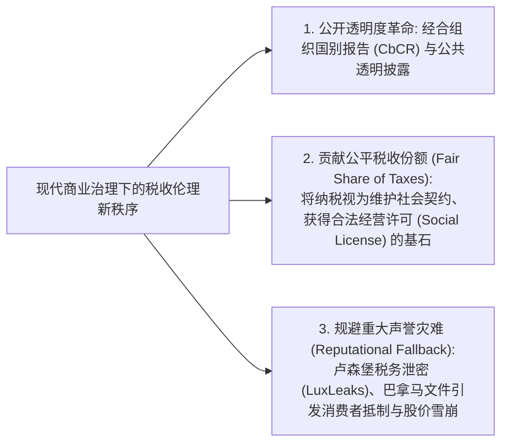
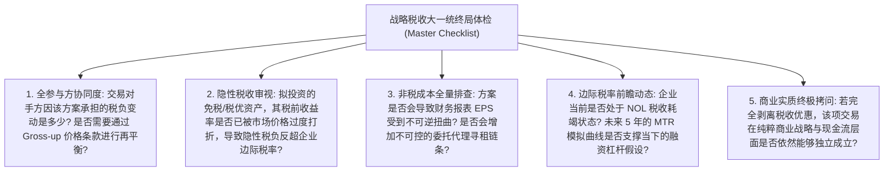

# Lec 20 战略税收筹划大一统框架与商业伦理边界 (Synthesis: The Capstone Framework of Taxes and Business Strategy)

> MIT Sloan School of Management · 15.518 Taxes and Business Strategy · 讲义 20

## TL;DR

- 斯科尔斯-沃尔夫森大一统框架将税收内生化为贯穿企业全生命周期的核心契约设计变量。
- 纯粹零和避税导致社会无谓损失，卓越的税收战略通过降低资本成本与优化激励创造正和增量。
- ESG 与全球税收透明度（如 CbCR 报告）将激进避税转化为不可忽视的重大声誉与监管风险。
- 终局商业架构师将税收筹划深度锚定于坚实商业实质，实现经济价值与合规韧性的终极统一。

## 斯科尔斯-沃尔夫森大一统框架生命周期全景统合

历经整整二十讲对微观税法法条、金融工程模型、多边契约博弈与跨国反避税规制的深入解剖，我们最终汇聚于商业战略与税收经济学的大一统圣殿。

迈伦·斯科尔斯与马克·沃尔夫森所创立的理论范式，其最伟大的贡献在于**打破了将税收视为孤立合规记账的传统桎梏，将税收逻辑完整内生化为企业从孕育诞生直至兼并分拆的全生命周期商业操作系统**。

这一大一统框架向未来的商业领袖展示了一张纵横交错的立体战术地图：
- **横轴是三大筹划空间**：跨时点转换（推迟纳税）、跨主体转换（税负洼地分流）、跨性质转换（普通收入转资本利得）；
- **纵轴是三维平衡透镜**：全参与方原则（买卖双赢补偿）、全税种原则（穿透终极个税）、全成本原则（压制非税摩擦）；
- **底座是法律刚性边界**：商业实质原则、反避税设备测试与真实经济所有权连续性。

::: definition [战略税收大一统框架 (Integrated Strategic Tax Framework)]
战略税收大一统框架是指将税收规则体系视为现代市场经济中由主权国家设计的微观经济激励与约束网，在企业初创、股权融资、日常运营、全球扩张、兼并分拆等每一个战略决策节点中，系统性权衡显性税负、隐性税负与各类非税摩擦成本，使税后经风险调整的长期股东经济价值达到帕累托最优状态的决策方法论。
:::

## 财富再分配 vs 正和价值创造：税收筹划的经济学本质

在深入掌握了复杂的税收工程技术后，每一位商业分析师与战略决策者都必须面对一个根本性的哲学之问：**税收筹划究竟是在为社会创造真正的增量经济价值，还是仅仅在进行一场精巧的零和财富再分配（Zero-Sum Wealth Redistribution）？**

### 1. 纯粹避税的社会无谓损失（Deadweight Loss）

如果一项筹划（如建立毫无商业意义的离岸三明治空壳、利用纯纸面跨期跨式金融衍生品制造虚假会计亏损）除了将应缴国库的税款拦截下来之外，对企业的生产效率、商品质量、技术革新没有任何增量贡献，那么这项活动在宏观经济学上属于典型的**非生产性寻租活动**。
不仅如此，企业为了维持这种脆弱的避税外壳，必须常年向华尔街投行与离岸律师支付数百万美元咨询费，并在面对税务稽查时耗费巨额法务成本；更致命的是，复杂的离岸黑盒往往破坏了企业内部透明度，诱发了管理层侵吞公款的代理灾难。

### 2. 战略税收的正和契约价值（Positive-Sum Efficiency）

然而，高维度的战略税收筹划绝非简单的偷漏税，它在微观金融机制中能够创造显著的正向经济价值：
- **降低全社会资本成本（Lowering WACC）**：合理利用债务税盾与研发加计扣除，有效降低了企业资本开支的边际门槛，使得大量在税前 NPV 为负、但在税后能创造深远社会效益的前沿科技项目（如清洁能源电站、创新药研发）得以成功立项落地；
- **优化多方委托代理激励**：通过 Section 83(b) 与限制性股票激励，以极低的税收摩擦将顶尖科学家的个人命运与初创公司的长周期成长深度绑定，消除了短期道德风险；
- **消除低效双重课税壁垒**：利用 Section 351 免税注资与 Section 355 免税分拆，使得资本能够自由流出衰退产业、灵活注入朝阳赛道，维系了现代市场经济新陈代谢的敏捷度。

## 现代企业治理与 ESG 浪潮中的税收伦理新秩序

在进入二十一世纪二十年代的今天，商业世界的评价维度正在发生波澜壮阔的巨变。以往跨国巨头以“将全球实际有效税率压低至 5%”为荣的时代已经一去不返。

在**环境、社会与治理（ESG）**投资理念席卷全球资本市场的当下，**“税收治理（Tax Governance）与纳税透明度”已经被全球主流主权财富基金（如挪威政府养老基金）、贝莱德（BlackRock）等顶尖资管机构正式纳入公司治理的核心评估基准**。

::: pitfall [将激进避税方案误判为“零风险净利润”]
在现代监管环境下，任何高度激进的跨国避税方案都蕴含着巨大的隐性尾部期权空头（Tail Risk）。
苹果公司曾被欧盟反垄断委员会裁定在爱尔兰享受非法国家补贴，强制要求其补缴高达 **130 亿欧元（约 145 亿美元）的巨额税款加计利息**。这种突发性的跨国司法追索，不仅直接摧毁了企业长期的财务规划，更使其全球商业品牌与企业社会声誉蒙受了难以估量的沉重打击。
:::

## 商业架构师终局战略审查清单（Master Tax Scorecard）

在企业推进重大投资、并购重组、股权激励方案或跨国供应链迁移前，专业战略决策团队必须对照以下**战略税收大一统终局审查清单（The Master Strategic Tax Checklist）**逐项排查，确保商业意图、财务治理与税收效率达到最严密的自洽平衡。

### 五大终局维度的核查要义

1. **全参与方协同度与对价再平衡（All Parties Alignment）**：
   交易对手方（卖方、雇员、债权人）因该交易架构设计所承担的税负净变动是多少？若该方案给对手方造成了增量税负，合同中是否已通过公允的对价补偿金（Gross-up）或溢价条款进行妥善再平衡，避免交易在谈判终局因税收摩擦破裂。
2. **隐性税负与资产定价折价审查（Implicit Tax Sanity Check）**：
   拟配置的免税资产、税收抵免股权或享有政府补贴的项目，其资产公允价格是否已被狂热的资本市场过度推高？其税前收益率的折让幅度（隐性税率 $t_I$）是否已经反超了企业自身的法定边际税率，导致企业沦为被动承受高额隐性税款的受害者。
3. **全要素非税成本综合核算（Comprehensive Non-Tax Costs Audit）**：
   方案是否会触碰税会一致性原则（如 LIFO）从而压低财报账面 EPS 并引发市值暴跌？跨国多层离岸通道是否会削弱管理层的内部治理控制权并增加代理寻租成本？中介费、合规审计与境外维系成本是否已侵蚀大部分税收利益？
4. **边际税率前瞻动态模拟（Forward-Looking MTR Modeling）**：
   企业是否正深陷历史巨额 NOL 的税收耗竭泥潭？是否运用格雷厄姆蒙特卡洛算法测算了未来 5 至 10 年的动态 MTR 曲线？若未来数年内 MTR 接近于零，模型中是否已保守剔除了即期债务利息税盾与加速折旧假设。
5. **商业实质与反避税穿透终极压力测试（Economic Substance Stress Test）**：
   假设国家税务局明天突然宣布将该特定税收优惠政策全额作废，该项投资、重组或供应链搬迁在纯粹商业逻辑、客户需求与税前自由现金流层面是否依然具备独立的战略价值？若该交易完全依赖税收补贴苟延残喘，董事会应立即行使一票否决权，断然终止该方案。

## 我的理解

::: insight [税收战略的终极境界：在制度的律动中守护商业的尊严]
当我们走完这二十讲跨越半个世纪税收思想史的宏伟旅程，回望那些密密麻麻的法典条文与代数模型，一个最终极的顿悟在心头澄澈如水：**税法从不是横亘在商业道路上的绊脚石，它是现代文明为引导资本奔流而修筑的宏伟河道**。

一个平庸的会计师，终其一生都在河滩的泥淖里寻找制度的漏洞，试图用几张假发票或几个离岸空壳去偷运几滴露水，却时刻处于被洪水吞没的恐惧之中；

而一名真正的商业战略大师，拥有俯瞰整座大江大河的宏大格局。

他懂得顺应水流的磅礴引力——他懂得在 Section 351 的通道里汇聚全社会的创新智慧，在 Section 368 的航道上完成产业巨轮的并轨联姻，在 Section 355 的闸口前优雅地完成机体的蜕变与重生。他深知每一滴税收都是企业向维系公平司法的文明社会支付的崇高租金，他更深知商业的终极尊严永远立足于实实在在的技术发明、卓越的产品与对人类生活的改善，而非虚浮的法律幻象。

精通规则，是为了超越规则；利用税盾，是为了滋养更加纯粹的创新。愿这套融汇了斯科尔斯、沃尔夫森与一代代经济学大师心血的战略大一统框架，成为你未来统领商业帝国、在复杂制度风浪中从容破浪的最强罗盘。
:::
