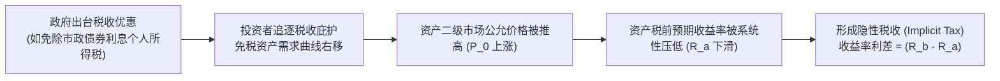
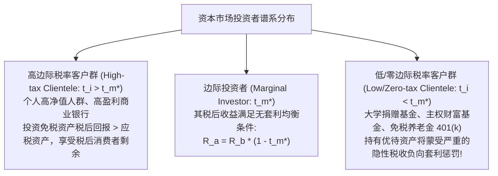
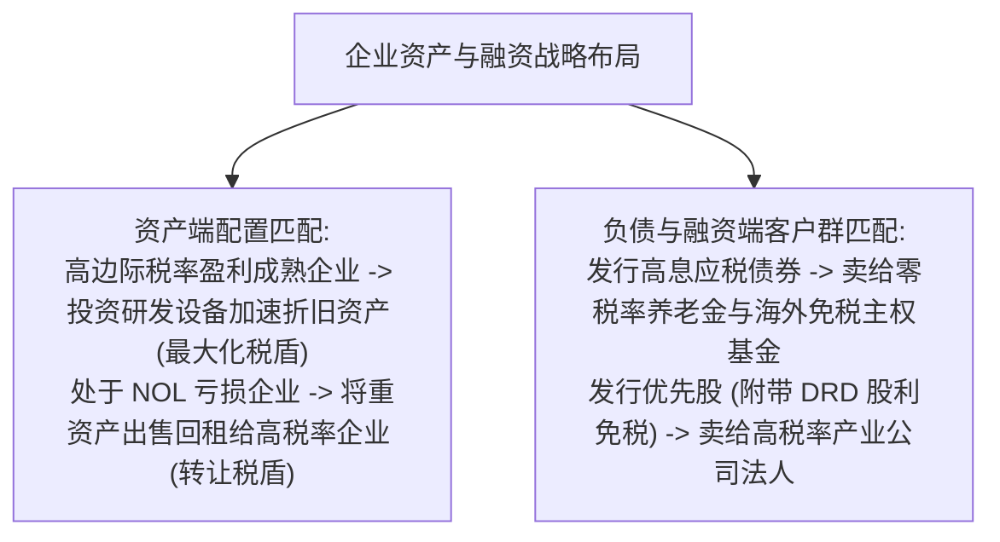

# Lec 03 隐性税收、免税资产与税收客户群理论 (Implicit Taxes and Tax Clienteles)

> MIT Sloan School of Management · 15.518 Taxes and Business Strategy · 讲义 03

## TL;DR

- 资本市场通过资产定价将税收优待内生化为更低的税前收益率，产生隐性税收。
- 边际投资者的边际税率决定了免税资产与应税资产之间的均衡市场利差。
- 税收客户群理论揭示不同税率属性的投资者会自动分类持有与其边际税率匹配的资产。
- 低税率机构持有税收优待资产将遭受隐性税收惩罚，而高税率投资者则能享受超额税后消费者剩余。

## 隐性税收的一般均衡资产定价机理

在金融学经典理论中，资产的期望收益率由其所承担的系统性风险（Beta）决定。然而，在引入现实税收制度后，资产的税收法律属性直接扭曲了其在资本市场上的供求均衡。

当某类特定资产（如美国地方政府发行的市政债券 Municipal Bonds、享有研发抵免的新能源基础设施、或者适用股利扣除优惠的优先股）被政府赋予免税或税收减免特权时，该资产对理性投资者的吸引力将大幅飙升。追逐税后回报的资本竞相涌入，直接推高了该资产的二级市场交易价格。**资产价格的抬升反向压低了其税前收益率，从而使投资者在未向税务局缴纳一分钱显性税款的情况下，通过接受较低的市场回报率实质性承担了税收负担——这就是隐性税收（Implicit Taxes）**。

::: definition [隐性税收 (Implicit Taxes)]
隐性税收是指由于某项资产享有税收优惠政策，引发市场资金追捧推高资产估值，从而导致该资产的税前均衡收益率低于同等风险水平的基准完全应税资产税前收益率的差额部分。它反映了市场价格机制对法定税收优待的完全或部分资本化（Tax Capitalization）。
:::

## 隐性税率测算模型与总税收负担恒等式

为了严密量化隐性税收的规模，斯科尔斯-沃尔夫森框架构建了基于基准完全应税资产的测算恒等式。

设市场上存在基准完全应税投资品 $b$（如高评级企业债），其税前收益率为 $R_b$，适用显性税率为 $t_b$；同时存在税收优待资产 $a$（如市政债），其税前收益率为 $R_a$，适用显性税率为 $t_a$（通常 $t_a = 0$）。

::: theorem [隐性税率与总税负分解公式]
优待资产 $a$ 的**隐性税率（Implicit Tax Rate, $t_{I, a}$）**定义为：
$$t_{I, a} = \frac{R_b - R_a}{R_b}$$
优待资产 $a$ 的**显性税率（Explicit Tax Rate, $t_{E, a}$）**为其向税务局直接缴纳的显性税款对税前收益的比率：
$$t_{E, a} = t_a$$
优待资产 $a$ 承担的**总有效税率（Total Effective Tax Rate, $t_{T, a}$）**为显性税率与隐性税率之和：
$$t_{T, a} = t_{E, a} + t_{I, a} = t_a + \frac{R_b - R_a}{R_b}$$
对于完全免税资产（$t_a = 0$），其总税负完全等于隐性税负：$t_{T, a} = t_{I, a}$。
:::

通过这一定理，我们能清晰看清所谓“免税投资”的本质：**投资者并不是免除了税负，而是将原本应开给国家税务局的支票，以让渡投资收益率的形式，折价转移支付给了资产的发行方（如市政债券的发行地方政府）**。

## 边际投资者（Marginal Investor）与税收客户群的形成

资本市场上免税资产与应税资产之间的均衡利差究竟由谁决定？答案是：**市场出清点上的边际投资者（Marginal Investor）**。

### 市场均衡税率的代数推导

假定市场上高税率投资者的资金不足以完全吸收所有发行的免税市政债券，为了让发行的债券全部被市场认购，债券价格必须下跌、收益率 $R_a$ 必须上升，直到吸引到某一特定税率水平的投资者入场达到供需平衡。该临界投资者即为**边际投资者**，其边际所得税率记为 $t_m^*$。

在无套利均衡状态下，边际投资者在两类资产之间的税后收益率必然严格相等：

$$R_b (1 - t_m^*) = R_a \iff t_m^* = \frac{R_b - R_a}{R_b} = t_I$$

**重要推论：在资本市场均衡状态下，免税资产所承担的隐性税率，严格等于边际投资者的边际法定所得税率！**

### 税收客户群（Tax Clienteles）的分类法则

根据不同纳税人的实际边际税率 $t_i$ 与市场出清隐性税率 $t_I$（即 $t_m^*$）的相对大小，投资者自动被市场分流为不同的资产持有客户群：

| 投资者类型 | 税率特征 | 资产税后收益对比 | 最优资产配置决策 | 经济租金获得情况 |
| :--- | :--- | :--- | :--- | :--- |
| **高税阶客户群** | $t_i > t_I$ | $R_a > R_b(1 - t_i)$ | **全仓配置免税/税收优待资产** | 获得税后**超额消费者剩余**（Inframarginal Rent） |
| **边际投资者** | $t_i = t_I$ | $R_a = R_b(1 - t_i)$ | 无差异，任意配置 | 获得正常风险调整回报 |
| **低/零税阶客户群** | $t_i < t_I$ | $R_a < R_b(1 - t_i)$ | **严禁配置免税资产，全仓配置完全应税资产** | 若持有免税资产，将蒙受**隐性税收净亏损** |

::: example
假定市场上基准应税高等级企业债年化收益率 $R_b = 10.0\%$。
免税市政债券的年化收益率 $R_a = 7.0\%$。
由此可解出市场出清的隐性税率为：
$$t_I = \frac{10.0\% - 7.0\%}{10.0\%} = 30\%$$
现在考量三类不同纳税主体的投资收益表现：
1. **哈佛大学捐赠基金（免税实体，法定税率 $t = 0\%$）**：
   - 若投资企业债：税后收益率 $= 10.0\% \times (1 - 0) = 10.0\%$；
   - 若投资市政债：税后收益率 $= 7.0\%$；
   - 捐赠基金若买入市政债，相当于白白向市场交纳了 $3.0\%$ 的年化隐性税收，属于极其愚蠢的资产错配。
2. **硅谷科技新贵（个人联邦及加州最高边际税率 $t = 50\%$）**：
   - 若投资企业债：税后收益率 $= 10.0\% \times (1 - 0.50) = 5.0\%$；
   - 若投资市政债：税后收益率 $= 7.0\%$；
   - 该富豪投资市政债获得了 $7.0\% - 5.0\% = 2.0\%$ 的税后超额无风险利差！其总税负仅为 30%（全部为隐性税），相较于其原本面临的 50% 显性税率，享受了每年 20% 的税收红利。
:::

::: pitfall [免税养老金与大学基金配置税收优待资产的荒谬陷阱]
在资产管理实务中，许多非营利组织理财委员会或免税养老基金（Pension Funds），其投资经理有时会因“市政债券安全性高、信誉好”而将其纳入投资组合。
这是对战略税收理论的无知。免税机构自身无需缴纳任何显性所得税，它们在金融市场上最强大的竞争优势，就是去承接那些**因显性税负沉重而被高税率个人嫌弃、从而具有极高税前收益率的完全应税资产**（如高收益垃圾债、高分红股票、应税房地产信托 REITs）。免税机构去持有低息免税资产，等同于自愿向资本市场“纳贡”。
:::

## 组织层面的客户群错配套利与资本流动

税收客户群理论不仅指导个人理财，更是现代公司金融中资本结构与资产处置的核心决策指南。

例如，美国税法中的**股利免税扣除制度（Dividends Received Deduction, DRD）**规定：一家 C 公司投资于另一家非关联公司的优先股，其获得的股利可以享受 50%（或历史上的 70%）免征企业所得税。
因此，这类优先股的边际买家是面临高额企业所得税的产业公司，其收益率被推低；个人投资者若买入此类优先股，将因无法享受 DRD 而承受严重的隐性税收折价。

## 我的理解

::: insight [隐性税收与看不见的手：资本市场最深邃的均衡法则]
当人们谈论税收时，眼前浮现的往往是严肃的税法法条、厚重的报税表格和税务官冷酷的审计通知。然而，在经济学大师的眼中，**资本市场本身就是一台永不停歇的超级计税计算机**。

隐性税收理论最震撼人心的地方，在于它揭示了亚当·斯密那只“看不见的手”是如何在资产价格中化解政府的政策干预的。政府以为自己给某项资产发放了“免税金牌”，但在万千投资者用真金白银投票的博弈场上，这项特权瞬间被折算成了资产价格的溢价，化作了税前收益率的折让。

没有哪一笔财富能真正逃脱经济学的地心引力。富人买入了免税债券，看似避开了国税局的显性大网，但市场早已通过压低利息，替社会向他征收了隐性税款。

卓越的商业战略家必须具备这种“透过价格看税收”的透视眼。当你审视任何一个投资项目的收益率时，你看到的不再只是一个单一的百分比，而是能清晰剥离出其背后的无风险基准、风险溢价、显性税款与隐性税负。看懂了税收客户群的流动，你才算真正参透了全球数万亿资本在应税与免税汪洋中迁徙的底层暗涌。
:::
