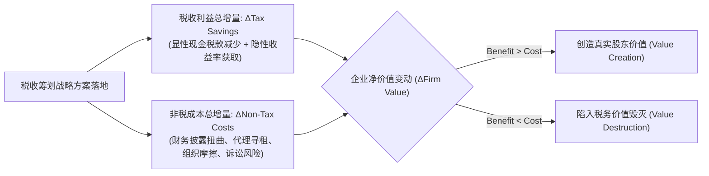
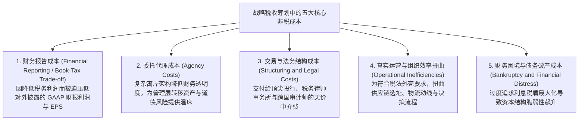
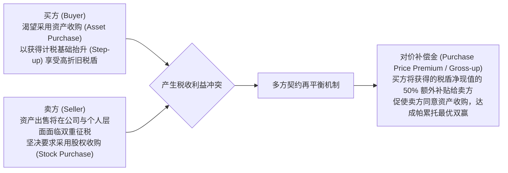

# Lec 04 非税成本与多方契约权衡 (Non-Tax Costs and Contractual Trade-offs)

> MIT Sloan School of Management · 15.518 Taxes and Business Strategy · 讲义 04

## TL;DR

- 税收筹划绝非免费午餐，任何税收利益的获取均伴随着特定非税摩擦成本的上升。
- 财税权衡（Book-Tax Trade-off）迫使上市公司在美化账面净利润与最大化现金税收抵扣之间艰难抉择。
- 复杂的避税架构通过削弱内部控制透明度，急剧放大了管理层寻租与委托代理成本。
- 多方商业契约谈判必须通过对价补偿（Gross-up）机制，在交易双方间合理分配净税收盈余。

## 商业价值最大化的终极公式：税收收益 vs 非税成本

在战略税收筹划的实践中，商学院学生与年轻分析师最容易犯下的教条主义错误，就是将“税收节省额（Tax Savings）”直接等同于“股东价值创造（Value Creation）”。他们往往设计出极端精巧、能够将应纳税额压降至零的避税模型，却在董事会或投委会遭到资深管理层的无情否决。

这是因为，**税收利益从来不是在真空中独立产生的。改变一项商业交易的形式、时间或组织架构以获取税收优惠，必然会对企业的实际运营、治理结构、资本成本以及市场声誉施加反向摩擦力——这些阻力统称为非税成本（Non-Tax Costs）**。

::: theorem [战略税收价值创造判定公理]
任何战略税收筹划方案能够被采纳的充分必要条件，是其创造的税收节省现值严格大于其引发的增量非税成本现值：
$$\Delta \text{Firm Value} = \Delta \text{Tax Savings} - \Delta \text{Non-Tax Costs} > 0$$
若 $\Delta \text{Non-Tax Costs} > \Delta \text{Tax Savings}$，则该项筹划在经济学上属于“因小失大”的非理性行为。
:::

## 商业世界中的五大核心非税成本

要对战略方案展开全面的可行性评估，分析师必须建立立体透视透镜，排查以下五大类深层非税成本：

### 1. 财务报告成本与税会权衡（Book-Tax Trade-off）

资本市场参与者（证券分析师、机构投资者）高度聚焦于上市公司在 10-K 年报中披露的公认会计原则（GAAP）净利润与每股收益（EPS）。然而，税法规定的应纳税所得额（Taxable Income）与财务会计净利润（Book Income）存在深刻的内在冲突：
- 企业在税务上希望**收入最少化、费用最大化**以少缴税；
- 企业在财报上希望**收入最大化、费用最少化**以推高股价与高管奖金。

在某些税法领域，法律强制要求**税会一致性原则（Book-Tax Conformity）**。最为著名的莫过于美国税法典第 472(c) 条的**后进先出法一致性规则（LIFO Conformity Rule）**：企业若希望在税法申报中采用 LIFO（在通胀期通过虚高销货成本以抵减巨额现金税负），**必须同时在对外披露的年度财务报告中采用 LIFO**！
大量上市公司首席财务官（CFO）宁可放弃数千万美元的真金白银税盾，执意在报表中采用先进先出法（FIFO），仅仅为了向二级市场呈报亮丽的短期 EPS。

### 2. 委托代理成本与管理层寻租（Agency Costs）

哈佛大学与麻省理工学院的研究表明，**激进的避税活动是企业内部舞弊与管理层寻租的强大催化剂**（Desai & Dharmapala, 2006）。
为了规避所得税，企业往往设立层层嵌套的离岸壳公司、签署虚假的咨询服务合同或构建复杂的衍生品通道。这种刻意制造的“制度黑盒”在屏蔽了税务机关目光的同时，也彻底瘫痪了董事会、外部独立审计师和资本市场分析师的监督机制。管理层借机利用这些离岸暗道侵吞企业现金、发放高额隐性补贴，给股东带来的代理损失往往数十倍于节省的税款。

### 3. 真实运营效率的扭曲（Operational Inefficiencies）

税收套利经常迫使企业做出在纯商业上极其荒谬的次优决策。例如：
- 为满足特定低税区（如波多黎各、爱尔兰）的税优实体资格，企业不得不将高端研发或高管团队搬迁至远离核心市场的小岛；
- 生产部门被迫通过绕道第三国的复杂物流网络运输原材料，仅仅为了赚取特定自贸协定下的转让定价差额，导致供应链交期延误、损耗率大幅上升。

::: example
某跨国高科技公司开发了一项新型智能传感器。
若将全球制造中心设在深圳，单台制造成本 50 美元，物流敏捷，能够即时对接亚洲精密元器件供应链；但深圳工厂需适用 25% 的企业所得税率。
若将工厂设在某东欧低税国，当地政府提供前十年免征所得税（0% 税率）的招商优惠。然而，由于当地熟练工人缺乏，单台制造成本攀升至 65 美元，且运往核心市场的物流运费增加 5 美元，单台总成本增至 70 美元。
假定传感器全球售价为 80 美元/台。

对比两地的单台税后商业表现：
1. **深圳方案（高税区但高效率）**：
   - 税前净利润：$80 - 50 = 30$ 美元；
   - 显性企业所得税（25%）：$30 \times 25\% = 7.5$ 美元；
   - **单台税后净利润：$30 - 7.5 = 22.5$ 美元**。
2. **东欧低税国方案（零税区但低效率）**：
   - 税前净利润：$80 - 70 = 10$ 美元；
   - 显性企业所得税（0%）：$0$ 美元；
   - **单台税后净利润：$10 - 0 = 10.0$ 美元**。

结论：东欧方案向税务局缴纳了 0 元税款，但在商业上由于单台承担了高达 20 美元的非税运营摩擦成本（生产与物流劣势），导致税后利润暴跌超过 **55%**！
:::

::: pitfall [“避税成功、企业破产”的极端债务税盾陷阱]
在经典公司金融中，MM 定理表明负债利息可以全额抵税，产生诱人的“债务税盾（Interest Tax Shield）”。
有些激进的私募股权基金为了将企业的显性税率降至接近于零，盲目实施极高杠杆收购（LBO），将负债率推高至 90% 以上。
然而，这一决策急剧推高了**破产与财务困境成本（Costs of Financial Distress）**。一旦宏观遭遇微小需求逆风，企业息税前利润略有下滑便立即引发债务违约，巨额的法庭破产律师费、供应商挤兑与核心客户流失，瞬间将所有历史积累的税盾利益全部吞噬殆尽。
:::

## 多方契约谈判中的补偿与对价再平衡

在现实并购、资产转让与高管签约中，税收筹划从不是单方面强加的。由于一方的税收减免往往建立在交易对手方税负上升或承担额外法律风险的基础上，契约谈判的核心技术在于设计**对价补偿条款（Gross-up Clauses）**。

在并购实战中，如果买方通过精算发现，采用资产收购模式未来每年可通过无形资产摊销现值节省 1 亿美元税款，而该模式会导致卖方当期额外多缴纳 4,000 万美元的所得税。
此时，买方主动在收购对价中加价 6,000 万美元（Gross-up）：
- 卖方扣除额外 4,000 万税款后净赚 2,000 万美元额外对价；
- 买方在多付 6,000 万对价后依然锁定了 4,000 万美元的净税盾现值。
**通过对非税交易成本的量化补偿，双方在多边博弈中共同做大了税后净价值蛋糕**。

## 我的理解

::: insight [非税成本的哲学启示：拒绝任何局部最优的智力诱惑]
在现代商业组织中，人类智力最常犯下的傲慢错误，就是**沉迷于局部的极值，而遗忘了全局的平衡**。

税务律师沉醉于设计一套能避开所有税收法条的绝妙离岸通道，工程师沉醉于打造一款性能极致却成本失控的工业艺术品，财务总监沉醉于在特定财季呈现平滑无瑕的 EPS 增长。然而，商业世界的残酷规律在于：**每一个局部的极致优化，往往都在悄无声息地向系统的其他节点转嫁着毁灭性的非税成本**。

为了省下几张支票的税款，把原本高效的供应链拆得支离破碎；为了规避所得税，把企业的财务治理搞成连独立董事都看不懂的迷魂阵——这种所谓的“精明”，在战略格局上是何等拙劣的短视！

斯科尔斯-沃尔夫森框架对当代商业精英最深远的淬炼，在于培养一种**系统动力学的全局契约观**。真正卓越的首席执行官与商业架构师，永远能够从容地对下属呈报的避税方案追问一句：“为了这笔税盾，我们在组织信任、战略敏捷度与商业自由度上到底付出了什么隐性代价？”

学会接受合理的显性税收，将其视为换取商业运营极度纯粹、财务治理阳光透明的合规对价，在税收利益与非税摩擦之间找到那条优雅的黄金分割线，这才是商业战略家至高无上的智慧。
:::
