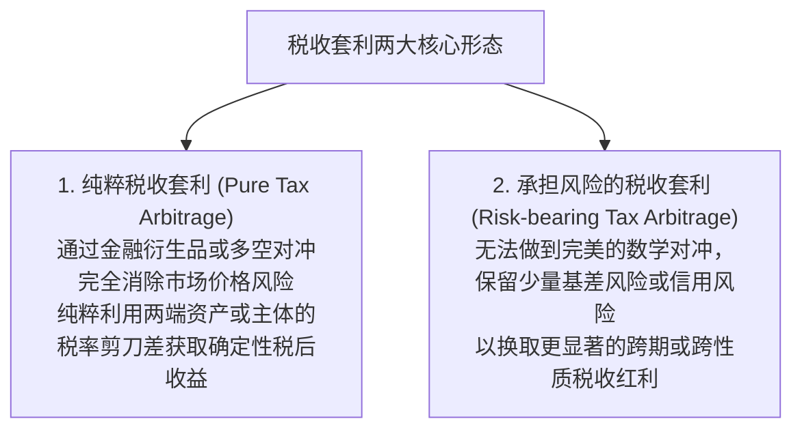
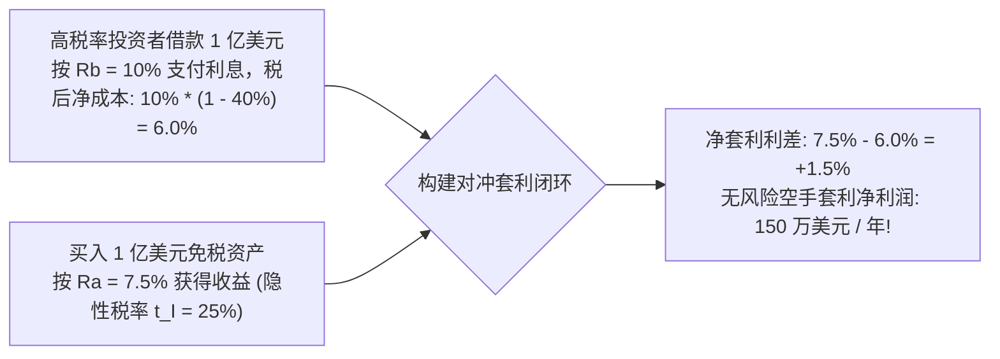
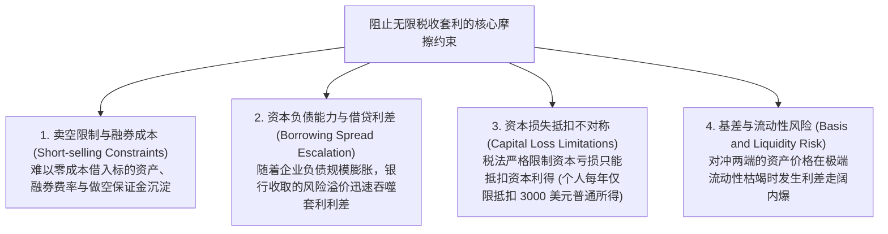
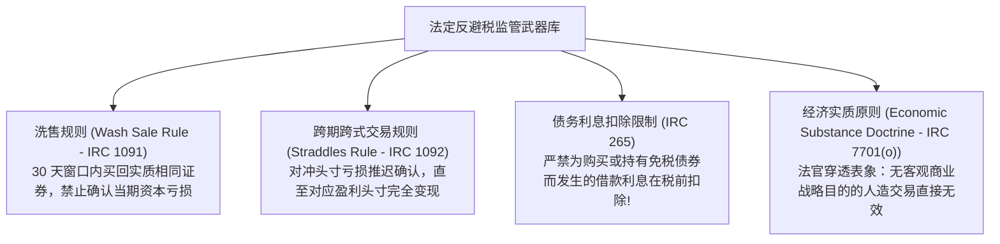
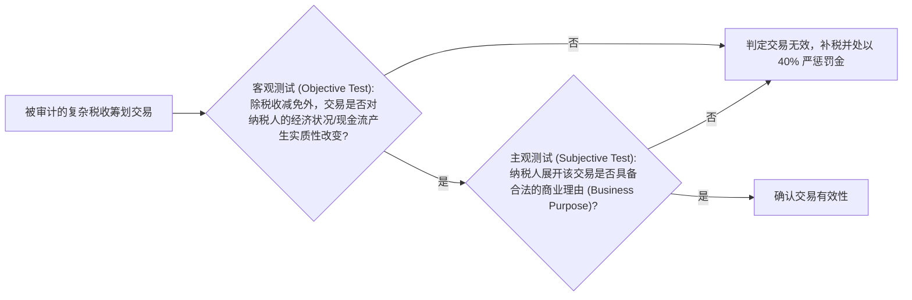

# Lec 05 税收套利技术、限制边界与反避税规制 (Tax Arbitrage: Mechanics, Limits, and Anti-Avoidance)

> MIT Sloan School of Management · 15.518 Taxes and Business Strategy · 讲义 05

## TL;DR

- 纯粹税收套利通过无风险对冲两端不同的税收规则差异，攫取无风险税后经济租金。
- 卖空摩擦、资本利得抵扣上限与不对称借贷成本构成了阻止无限税收套利的市场内生边界。
- 洗售规则（Wash Sale Rule）严禁在 30 天窗口内通过买卖实质相同证券虚假确认税收亏损。
- 跨期跨式头寸限制与经济实质原则（双重测试）赋予司法机关穿透人造交易结构的法律重锤。

## 税收套利的本质与双重形态

在现代金融学中，“无套利原则（No-Arbitrage Condition）”是资产定价的公理化基石。如果同一项资产或具有完全相同现金流的资产组合在两个市场上存在价差，套利者将通过“买低卖高”瞬间平抑价差并获取无风险利润。

然而，在税收制度介入后，由于政府对不同纳税主体、不同持有期限、不同计税属性的金融头寸施加了非对称的税率，产生了一类特殊的市场机会——**税收套利（Tax Arbitrage）**。

税收套利的最经典范式是**跨主体与跨税率组合套利**：
一个处于极高边际税率（例如 $t_h = 40\%$）的纳税人，向金融机构借入完全应税债务（利息支出可全额按 40% 抵税），同时将借入的资金全额投向一项享受免税或低隐性税率（例如 $t_I = 25\%$）的资产。

::: definition [税收套利 (Tax Arbitrage)]
税收套利是指纳税人在两项或多项在现金流或经济收益上彼此对冲的金融交易中，利用税法对各交易分支在收益确认时点、抵扣比率或法定税率上的非对称规定，在不承担或仅承担极低市场风险的前提下，系统性创造正向税后净现金流的操作。
:::

## 经典跨主体税收套利数学模型

我们通过一个严密的双主体两资产代数模型，推导税收套利创造无风险剩余的机制。

设市场上存在基准无风险应税借贷利率 $R_b$，借款利息允许在税前全额扣除；同时存在免税资产，其税前收益率为 $R_a$。
假定借贷两端无任何信用违约利差（$R_{\text{borrow}} = R_b$）。

::: theorem [税收套利收益率方程]
设某高税率投资者的边际税率为 $t_h$。该投资者借入 1 美元应税债务，并买入 1 美元免税资产：
1. **借款分支的税后资金成本**：
   $$r_{\text{cost}} = R_b (1 - t_h)$$
2. **投资分支的税后收益**：
   $$r_{\text{return}} = R_a = R_b (1 - t_I)$$
3. **该投资者实现的无风险税后净套利利差（Net Arbitrage Spread, $\pi$）**为：
   $$\pi = r_{\text{return}} - r_{\text{cost}} = R_b (1 - t_I) - R_b (1 - t_h) = R_b (t_h - t_I)$$
:::

从公式可以得出一个极其震撼的结论：**只要投资者的法定边际税率高于市场内生出清的隐性税率（$t_h > t_I$），该投资者就可以通过无限借债并全额买入免税资产，实现空手套白狼式的无风险财富暴增！**

## 阻止无限税收套利的现实市场摩擦边界

如果上述理论模型在现实中毫无阻碍地运转，富豪与盈利巨头只需无限放大资产负债表规模，就能将国库所有的税款套取殆尽。然而，现实金融市场中存在着强大的**内生市场摩擦边界（Market Frictional Limits）**：

最为致命的是**资本损失抵扣不对称性（Asymmetric Loss Treatment）**。
税法普遍规定：投资盈利必须立即全额缴纳所得税；但一旦对冲出现意外亏损，纳税人无法直接要求政府退还现金，只能在未来有限年限内向后结转（Carryforward）抵扣未来的同类所得。这种“赚了政府分红、赔了个人全扛”的非对称结构，使得任何带有微小价格偏差的套利交易都内嵌了巨大的尾部风险。

## 法定反避税规制武器库：从洗售到经济实质原则

除了市场内生摩擦外，立法机关与司法判例发展出了一整套严密的**反避税法定规制（Statutory Anti-Avoidance Rules）**，对人造税收套利实施精准打击。

### 1. 洗售规则（Wash Sale Rule, IRC Section 1091）

高净值投资者最常用的年终避税手法是在 12 月底“突击卖出亏损股票”确认资本亏损（Capital Loss）以抵减当年的其他投资收益，同时在次日早晨立即重新买回相同股票，以维持其长期资产配置组合不变。
针对这一投机，税法出台了严厉的**洗售规则**：

::: theorem [洗售规则 (Wash Sale Rule)]
若纳税人在出售某项股票或证券发生亏损的**前 30 天至后 30 天内（共计 61 天的时间窗口内）**，买入或订立合约买入**实质相同（Substantially Identical）**的股票或证券，则该笔交易产生的任何资本亏损在当期**绝对严禁扣除**！
已发生的亏损必须强制加计至新购入证券的计税基础（Tax Basis）中，将税收抵扣推迟至未来最终彻底清算该资产之时。
:::

### 2. 严禁免税资产借款利息抵扣（IRC Section 265）

为了彻底封死前文推导的“借钱买免税市政债套利”漏洞，美国税法典第 265 条确立了毁灭性的大杀器：**任何纳税人为了购买或持有完全免征联邦所得税的证券（如市政债）而直接或间接承担的债务利息支出，在计算所得税时一律 100% 严禁在税前扣除！**
这条法网直接将上述套利公式中的借款成本从 $R_b(1 - t_h)$ 强行打回 $R_b$。由于 $R_a = R_b(1 - t_I) < R_b$，套利利差瞬间从正变成负数（$\pi < 0$），任何人若敢借钱买市政债，必将遭遇严重的自杀式亏损。

### 3. 经济实质原则（Economic Substance Doctrine, IRC Section 7701(o)）

当纳税人设计的避税结构在字面法条上挑不出任何毛病时，税务法庭拥有最高裁决权——**经济实质原则双重测试（Two-Pronged Test）**：

在 2010 年美国医改法案将该原则正式法典化后，一旦交易被法庭判定缺乏经济实质，纳税人将面临高达 **40% 的严苛无过错惩罚性罚金（Strict Liability Penalty）**，彻底切断了投行兜售无商业意义“避税黑盒产品”的可能。

## 我的理解

::: insight [税收套利与制度演化：猫鼠游戏的动态博弈美学]
如果把税法体系比作一座戒备森严的宏伟大厦，那么税收套利就是金融工程师在大厦墙角寻找的微小物理裂隙。

从借贷免税利差套利，到世纪末柯达与通用电气参与的复杂税收跨式衍生品（Tax Straddles），人类最高智慧的数学家与华尔街宽客曾前赴后继地涌入这个领域。他们用期权、互换和离岸信托编织出了一张又一张精妙绝伦的数学网络，试图在不惊动任何一根红线的前提下，将数以百亿计的税收财富转移给私人资本。

然而，制度经济学的伟大之处在于：**监管与套利永远是一场动态演化的共生博弈**。

洗售规则（Wash Sale）堵死了时间的微小漏洞，Section 265 斩断了负债与免税资产的杠杆连线，而最终落下的“经济实质原则”，则是普通法文明对纯粹数学投机施加的终极道德铁律——**任何脱离了真实创造人类商品与服务的金融空转，在法律正义面前都将化为齑粉**。

卓越的商业领袖绝不屑于去充当走钢丝的套利赌徒。理解套利的边界，不是为了去触碰高压线，而是为了在设计企业真实的资本扩张路线时，始终对法律的刚性抱有最崇高的敬畏，在坚实的商业实质土壤之上，筑牢企业长青的财富基业。
:::
