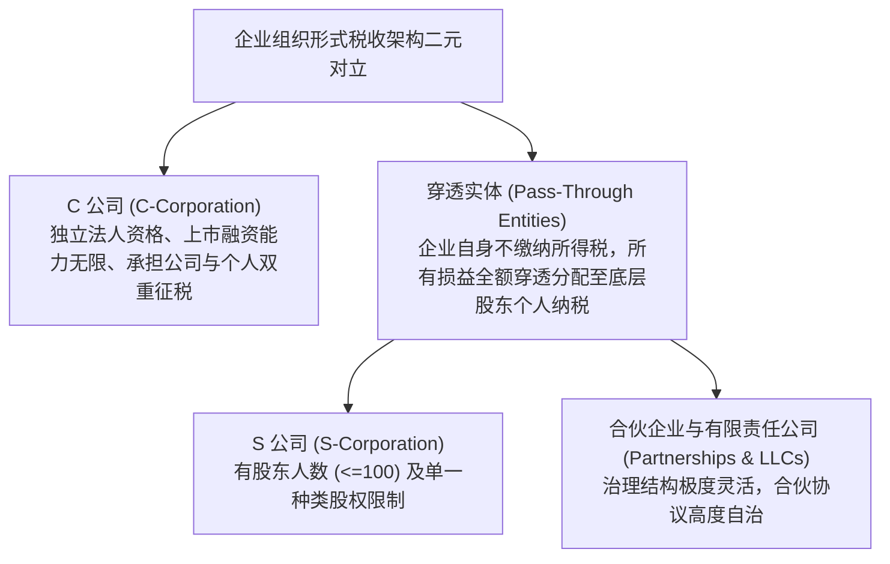
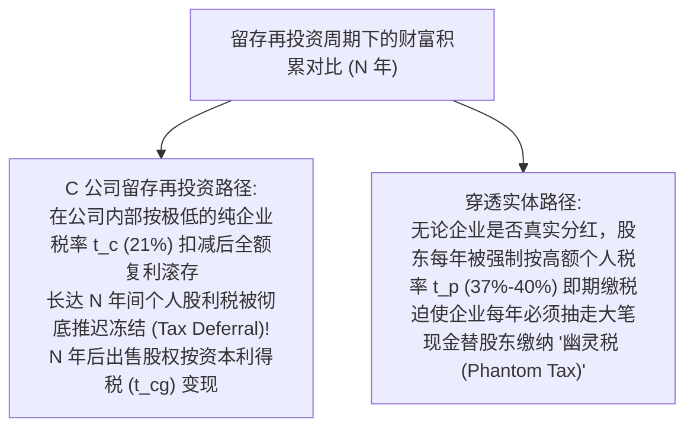
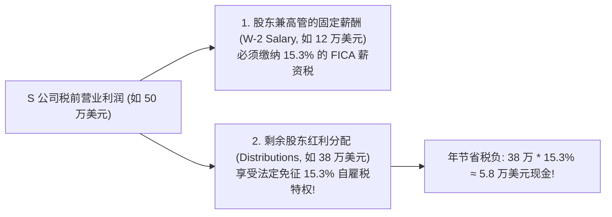

# Lec 06 企业法律组织形式选择与税制重构 (Choice of Organizational Form: C-Corp vs Pass-Through)

> MIT Sloan School of Management · 15.518 Taxes and Business Strategy · 讲义 06

## TL;DR

- 现代企业组织形式分为双重征税的 C 公司与单层穿透征税的穿透实体两大阵营。
- C 公司综合有效税率由企业所得税与股东分红个税复合决定，留存再投资可推迟分红税负。
- 穿透实体将损益直接穿透至合伙人，避免双重征税但迫使高税阶股东每年即期纳税。
- 税收无差异平衡点模型量化了企业税率、个人税率、留存期与再投资收益率的临界阈值。

## 企业法律组织形态的两大税制阵营

在企业初创设立、进行股权融资或筹备首次公开发行（IPO）时，创业者与投资人面临的首要战略决策就是**选择企业的法律组织形式（Choice of Organizational Form）**。

在税法层面，全球主要资本市场（尤其是美国税制）将企业截然划分为两大税收规则阵营：**独立法人纳税实体（C-Corporations）**与**税收穿透实体（Pass-Through Entities）**。

这一选择绝不仅仅是一张法律注册证书的差异，它从根本上决定了企业利润在流入终极投资者口袋之前，将被政府在几个关口、以何种税率强行课征。

::: definition [C 公司双重征税 (Double Taxation of C-Corps)]
C 公司双重征税是指根据税法，C 公司作为一个独立的法律法人，其实现的净利润必须首先缴纳**企业所得税（Corporate Income Tax, $t_c$）**；随后，当税后留存利润以现金股利形式分配给普通股股东时，股东个人必须就收到的分红再次缴纳**个人股利所得税（Dividend Tax, $t_{\text{div}}$）**。同一笔商业经济收益在两个不同主体层面被连续征税两次。
:::

## 双重征税数学模型与综合有效税率

我们构建严密的代数模型，测算当 C 公司赚取 1 美元税前利润并全额分红时，终极股东实际落袋的净现金与综合有效税率。

设企业所得税率为 $t_c$，个人股东适用的股利所得税率为 $t_{\text{div}}$。
1. **企业层面的初次课税**：
   企业实现税前利润 1.00 美元，缴纳企业税 $t_c$，剩余税后利润为：
   $$\text{After-tax Corporate Earnings} = 1 - t_c$$
2. **个人层面的二次课税**：
   假定企业将上述利润全额以股利形式派发给股东，股东面临股利税 $t_{\text{div}}$，实际扣税为 $(1 - t_c) t_{\text{div}}$。
3. **股东最终到手税后财富（After-Tax Cash Flow）**为：
   $$W_{\text{CCorp}} = (1 - t_c) - (1 - t_c) t_{\text{div}} = (1 - t_c)(1 - t_{\text{div}})$$
4. **C 公司全要素综合有效税率（Combined Effective Tax Rate, $t_{\text{combined}}$）**为：
   $$t_{\text{combined}} = 1 - (1 - t_c)(1 - t_{\text{div}}) = t_c + t_{\text{div}}(1 - t_c)$$

相比之下，若采用**穿透实体（Pass-Through）**架构，企业层面无需缴纳任何所得税，1.00 美元的税前利润全额穿透计入股东当期的个人所得税申报表，按股东个人边际所得税率 $t_p$ 缴纳单层税负：

$$W_{\text{Pass}} = 1 - t_p$$

::: example
假定某企业面临以下税率环境（美国现行联邦基准）：
- 企业所得税率 $t_c = 21\%$；
- 高净值个人符合条件的股利所得税率 $t_{\text{div}} = 20\%$，外加净投资所得税（NIIT）$3.8\%$，综合股利税率 $t_{\text{div}} = 23.8\%$；
- 个人最高普通边际所得税率 $t_p = 37\%$（叠加 NIIT 及附加税后达 $40.8\%$）。

1. 若注册为 **C 公司**且赚取的 100 万美元税前利润全部向股东分红：
   - 企业缴纳企业税：$100 \times 21\% = 21$ 万美元；
   - 剩余 79 万美元全额分红，股东缴纳个人股利税：$79 \times 23.8\% = 18.802$ 万美元；
   - 股东最终税后到手现金：$79 - 18.802 = 60.198$ 万美元；
   - **综合有效税负高达：$100\% - 60.198\% = 39.802\%$**。
2. 若注册为 **合伙企业 / LLC** 穿透实体：
   - 企业缴纳税款：0 元；
   - 股东个人按最高个税税率纳税：$100 \times 40.8\% = 40.8$ 万美元；
   - **股东最终税后到手现金：$59.2$ 万美元**。
在此静态全额分红情景下，C 公司的双重征税综合税率（39.8%）反而略低于个人最高边际所得税率（40.8%）。
:::

## 留存再投资效应与税收平衡点模型

上述静态模型假设企业将利润 100% 即期分红。然而，真实的高成长企业往往在长达十年甚至更久的扩张期内**绝不进行任何现金分红**，而是将所有税后利润留在企业内部滚动再投资。

这一“留存再投资效应（Retention Effect）”彻底重塑了两种组织形式的优劣平衡！

### 动态税收无差异临界方程

::: theorem [动态税后财富无差异模型]
设初始税前利润为 1 美元，在企业内部以年化投资回报率 $R$ 进行留存复利再投资，期限为 $N$ 年。期末企业被出售，股东按长期资本利得税率 $t_{\text{cg}}$ 退出：
- **C 公司期末税后净财富**：
  $$W_{\text{CCorp}}(N) = (1 - t_c) \left[ 1 + R(1 - t_c) \right]^{N-1} (1 - t_{\text{cg}}) + \text{Basis Recovery}$$
- **穿透实体期末税后净财富**：
  $$W_{\text{Pass}}(N) = (1 - t_p) \left[ 1 + R(1 - t_p) \right]^{N-1}$$

当 $t_c \ll t_p$ 且再投资期限 $N$ 足够漫长时，即使 C 公司在终局退出时面临资本利得税，其凭借在存续期内享有更低企业税率（21% vs 40%）所带来的巨大复利雪球效应，将**在总财富上无可逆转地超越穿透实体**！
:::

## 自雇税（FICA）博弈与 S 公司“合理薪酬”红线

在未上市的中小型私营企业与专业服务机构中，组织形式选择不仅涉及所得税，更涉及沉重的**自雇税与薪资税（Self-Employment Tax / FICA，涵盖社会保障与联邦医保，综合税率 15.3%）**。

在 LLC / 合伙企业中，普通合伙人或活跃成员分得的全部穿透净经营利润，必须全额缴纳 15.3% 的自雇税；
然而，在 **S 公司（S-Corporation）** 中，税法确立了极其特殊的套利裂隙：

::: pitfall [S 公司“薪酬过低”引发的 IRS 穿透补税惩戒]
许多激进的创业者将 S 公司股东年薪设定为极其荒谬的 1 万美元甚至 0 元，而将 50 万美元利润全额作为分红发放，试图规避全部自雇税。
美国国税局（IRS）建立了专门的**“合理薪酬测试（Reasonable Compensation Test）”**审计模型。如果税务法官判定同等资质、同等工作强度的职业高管在公开劳动力市场上的公允年薪应为 15 万美元，IRS 将强制把分红重分类为工资，补缴全部 FICA 税款并处以高额滞纳金与过失罚款。
:::

## Section 199A 合格经营所得（QBI）减免的现代变量

2017 年美国《减税与就业法案》（TCJA）将 C 公司法定税率从 35% 永久性腰斩至 21%，这对穿透实体造成了毁灭性的竞争打击。
为了平抑这种不公平，立法者引入了极其复杂的 **Section 199A 条款——允许符合条件的穿透实体独资者、合伙人与 S 公司股东，对其合格经营所得（Qualified Business Income, QBI）享受高达 20% 的特别扣除**。

若股东享受全额 20% QBI 抵扣，其面临的最高边际个人所得税率实质上从 37% 降至：

$$t_{\text{effective, QBI}} = 37\% \times (1 - 20\%) = 29.6\%$$

这一变量再次极大地拉平了穿透实体与 C 公司之间的税率天平，使得特定行业（非特定服务型行业 SSTB）的中小企业依然能够通过穿透实体维持极强的税收竞争力。

## 我的理解

::: insight [组织形式的法度与境界：外壳是战略意图的物化形态]
在初创企业创立的热血沸腾时刻，极少有创始人愿意静下心来仔细研究那些枯燥的税务表格——大家总觉得注册成 LLC 还是 C-Corp 只是个无足轻重的法律格式问题。

然而，商业史一再证明：**企业的法律组织形式，是企业商业抱负与融资战略最底层的基因图谱**。

如果你志在打造一家需要数轮引入顶级风险投资、需要为全球工程师发放海量期权池、并最终在纳斯达克挂牌敲钟的科技巨头，那么 C 公司就是你唯一合法的船票。哪怕你深知未来可能会遭遇双重征税的微观摩擦，但为了换取公开资本市场无穷无尽的股权流动性（这是最大的非税利益），你也必须坦然承受这层制度代价。

反之，如果你经营的是一家现金流极其稳健、不需要外部稀释股权的家族隐形冠军或地产基金，那么穿透实体的单层课税与 S 公司的合理薪酬设计，就是守护财富不被制度无形稀释的坚实盾牌。

顶级商业架构师从来不问“哪种组织形式税率最低”。他们思考的是：在未来十年的资本航程中，企业究竟需要多少留存再投资的复利空间？股东究竟何时需要现金分红？当税法的算盘与战略的罗盘精准对齐，那张薄薄的公司注册证书，才能真正化作企业开疆拓拓土的宏伟旗舰。
:::
