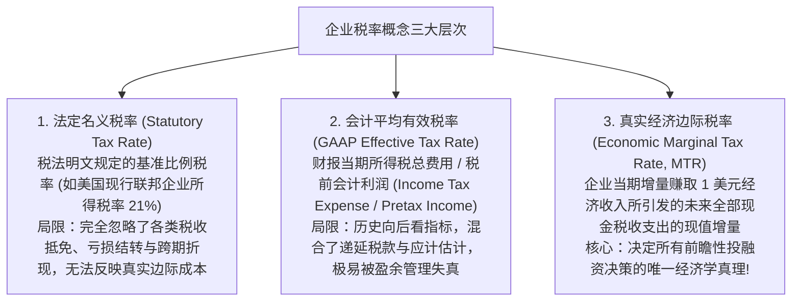
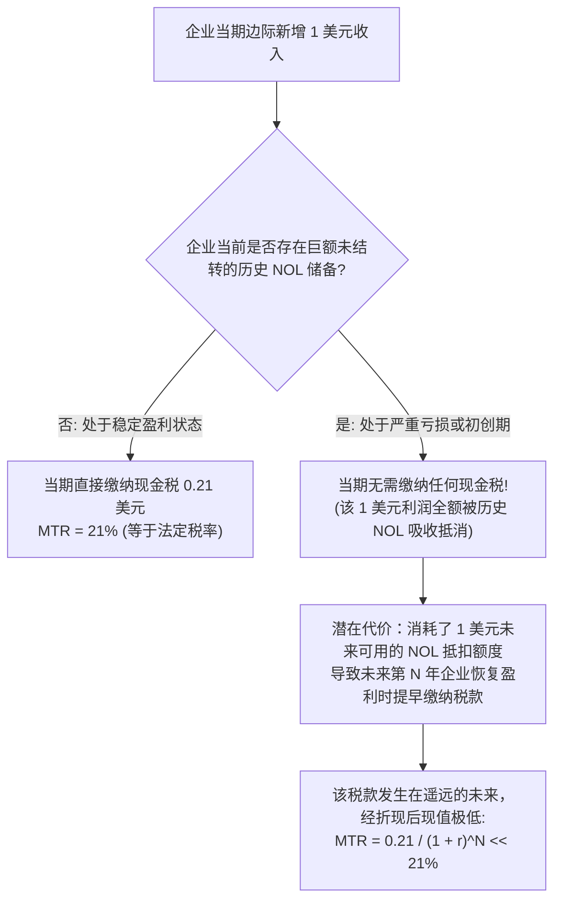
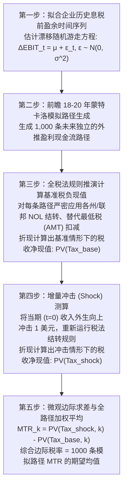

# Lec 07 企业有效边际税率测算与模拟 (Marginal Tax Rates and Simulation: Graham Approach)

> MIT Sloan School of Management · 15.518 Taxes and Business Strategy · 讲义 07

## TL;DR

- 真实经济边际税率（MTR）是决定企业增量投资与举债决策的唯一核心贴现指标。
- 净经营亏损（NOL）结转通过改变未来现金税负时点，使静态边际税率呈现高度非线性与折现衰减。
- 税收耗竭状态导致企业丧失利息税盾与加速折旧价值，反向催生售后回租等契约重组。
- 约翰·格雷厄姆蒙特卡洛模拟算法通过构建前瞻盈利路径，实现了前瞻性 MTR 的高保真量化。

## 三大税率概念的本质辨析：从法定税率到经济边际税率

在企业财务报表分析与公司金融决策中，“税率”是最常被提及但也最常被混淆的词汇。许多分析师机械地套用 21% 的名义企业所得税率去计算一项新投资的净现值（NPV），或者直接采用 10-K 年报中的会计有效税率去评估企业的负债融资税盾，这往往会得出完全脱离商业现实的错误结论。

要精确刻画税收对企业边际决策的真实牵引力，必须严密区分**三大截然不同的税率概念**：

::: definition [经济边际税率 (Marginal Tax Rate, MTR)]
经济边际税率是指企业在当期（$t$ 期）边际增加赚取 1 美元税前经济所得时，导致企业在当前及未来所有会计期间必须实际向税务机关缴纳的增量现金税收支出，经折现至当期所得出的贴现现值：
$$MTR_t = \sum_{s=t}^{\infty} \frac{\Delta \text{Cash Taxes}_s}{(1 + r)^{s-t}}$$
其中 $\Delta \text{Cash Taxes}_s$ 为在第 $s$ 期由于第 $t$ 期那 1 美元增量收入所引发的增量现金税负变动，$r$ 为企业的税后资本机会成本贴现率。
:::

## 净经营亏损（NOL）与税收耗竭（Tax Exhaustion）

为什么企业的边际税率 $MTR$ 会偏离法定税率 $t_c$？最核心的扭曲机制来源于税法中的**净经营亏损结转制度（Net Operating Loss, NOL Carryforward / Carryback）**。

在现实商业世界中，企业并非每年都能稳定实现盈利。当企业发生亏损时，政府并不会直接给企业寄送退税支票；取而代之的是，税法允许企业将当年的经营亏损作为一种特殊的“税收抵扣凭证”储存在资产负债表外，用于**冲抵以前年度已纳税额（Carryback，结转退税）**或**向后无限期冲抵未来年度的应纳税所得额（Carryforward）**。

### 税收耗竭状态的连锁商业反应

当一家企业（如周期性暴跌中的半导体晶圆厂、连年巨额研发的生物医药公司）积累了数额庞大、预计未来十年都难以消耗殆尽的历史亏损时，该企业便步入了著名的**税收耗竭（Tax Exhaustion）**状态。

在税收耗竭状态下，企业面临以下颠覆性的财务法则转变：
1. **债务税盾价值归零**：根据 MM 定理，企业发行债券的利息可以抵税。然而对于税收耗竭企业，当期应纳税额本来就是 0，增发债券支付的利息根本无法在当期产生一分钱的真金白银现金节税！其边际债务税盾价值在当前事实上为零。
2. **加速折旧特权失效**：税法允许的固定资产加速折旧（Bonus Depreciation）本意是让企业提早享受税盾，但由于亏损企业无税可抵，加速折旧只会凭空变成更多沉睡的 NOL，无法产生即期流动性。
3. **催生售后回租（Sale-Leaseback）交易**：亏损企业拥有大量高折旧机器但自身无法利用其税盾；此时理性的战略操作是将资产出售给处于高税阶的盈利商业银行（高 MTR 主体），由银行全额享受加速折旧税盾，再将设备租回给亏损企业并给予极低的租金折让。**企业通过契约设计将沉睡的税盾转让给了能利用它的主体，实现了多方共赢**。

## 约翰·格雷厄姆（John Graham）蒙特卡洛模拟算法

如何客观、无偏地计算一家企业的真实前瞻性边际税率？传统的学术研究常采用简单的粗糙替代变量（如：若上期 NOL 为正则设 MTR 为 0，否则设为 21%）。杜克大学讲席教授约翰·格雷厄姆（John Graham, 1996）在《金融学期刊》（*Journal of Finance*）上发表了重磅论文，确立了统治现代实证金融学的**蒙特卡洛 MTR 模拟算法（Graham's Simulated MTR）**。

::: theorem [格雷厄姆 MTR 蒙特卡洛算法测算原理]
对于企业 $i$ 在当前年份 $t$：
1. 假定企业未来盈利遵循带有长期增长漂移项的随机波动过程：
   $$EBIT_{t+s} = EBIT_{t+s-1} + \hat{\mu}_i + \hat{\sigma}_i \cdot \epsilon_{s}, \quad \epsilon_s \sim \mathcal{N}(0, 1)$$
2. 模拟生成第 $k$ 条未来 20 年的宏观盈利序列（$k = 1, \dots, 1000$）；
3. 按照国家法典税率、亏损结转期限（如旧法 20 年结转、现行 80% 限制）计算未来各年实际现金应纳税额，贴现得出总税负现值 $PV_{\text{base}}^k$；
4. 将当年收入人为增加 1 美元（$EBIT_t \to EBIT_t + 1$），保持所有未来随机冲击项完全一致，重新推算得出增量税负现值 $PV_{\text{shock}}^k$；
5. 第 $k$ 条路径的边际税率为两者的增量差额：
   $$MTR^k = PV_{\text{shock}}^k - PV_{\text{base}}^k$$
6. 最终的经济有效边际税率是全景模拟路径的无偏数学期望：
   $$\mathbb{E}[MTR] = \frac{1}{K} \sum_{k=1}^{K} MTR^k$$
:::

::: example
某大型生物科技公司期初持有 10 亿美元历史累积 NOL 结转额度。
当前法定所得税率 $t_c = 21\%$，无风险贴现率 $r = 8\%$。
经格雷厄姆模型模拟测算，在 1,000 条前瞻未来路径中：
- 在 65% 的路径下，由于后续新药研发失败，公司在未来 10 年内持续亏损，NOL 始终未能用尽，当期增量 1 美元利润在未来 10 年内未引发任何现金税款（$MTR_{\text{path}} = 0\%$）；
- 在 35% 的路径下，核心新药在第 6 年成功商业化上市，企业在第 7 年彻底消化所有历史 NOL 并开始全额上缴现金税款。这导致当年那 1 美元收入在第 7 年实际多引发了 0.21 美元的现金纳税。

计算该生物科技公司当期的期望经济边际税率：
$$MTR = 65\% \times 0 + 35\% \times \frac{0.21}{(1 + 0.08)^7} = 0 + 35\% \times \frac{0.21}{1.7138} \approx 35\% \times 0.1225 = 4.29\%$$
结果表明：尽管该公司的法定税率高达 21%，报表上的 GAAP ETR 更是因暂时性差异呈现混乱，但其真正的商业经济边际税率仅有微弱的 **4.29%**！管理层若按 21% 去评估发债税盾或研发设备投资，将导致灾难性的过度借贷与资本错配。
:::

::: pitfall [将“GAAP 报表所得税费用”误当作“边际现金流流出”]
在 DCF 估值建模中，许多分析师习惯直接从利润表中提取“当期所得税费用（Income Tax Expense）”并除以税前利润算出一个所谓的有效税率（如 18%），并以此作为未来各期现金流的贴现扣除参数。
这是严重的理论硬伤。利润表中的所得税费用包含巨额的递延所得税（Deferred Taxes），属于非现金会计分录。只有真正穿透到资产负债表与现金流量表中的“实际支付的现金税（Cash Taxes Paid）”，并结合前瞻性 MTR 进行动态折现，才能得出真正精准的自由现金流贴现模型。
:::

## 边际税率对企业宏观资本配置的传导

当企业的真实 MTR 发生动态跃迁时，其全部企业金融行为将发生系统性重组：

| 财务与战略决策维度 | 高边际税率企业 (High MTR: 接近 21%) | 处于税收耗竭企业 (Low MTR: 趋近 0%) |
| :--- | :--- | :--- |
| **资本结构与负债决策** | 大规模举借固定利率债券，充分榨取利息税盾红利 | 回避负债，优先使用普通股权融资以防范财务困境 |
| **资产获取方式** | 倾向于直接购买重资产，全额享受税法加速折旧 | 倾向于采用经营租赁（Leasing），将税盾转让给出租人 |
| **薪酬与福利设计** | 优先发放现金薪资与奖金，以立即获得高额税前抵扣 | 倾向于发放员工股票期权与股权激励，节约宝贵现金 |
| **股利派发政策** | 倾向于通过股票回购（享受资本利得递延）替代分红 | 分红政策受税收扭曲影响极小，更多服从现金流平稳要求 |

## 我的理解

::: insight [边际税率的量子态：在随机漫步中度量未来的影子]
在经典的牛顿力学式商业认知中，世界被假设为确定性的：去年的税率是 21%，明年的税率就理所当然该算 21%。然而，约翰·格雷厄姆模拟算法的诞生，向整个金融界引入了如同比尔·夏普与薛定谔波动方程般深邃的**概率论之美**。

边际税率从不是一个静止刻在法律全书上的死板数字，它是**企业未来数百种可能生存轨迹在当下的折现加权投影**。

当一家企业深陷亏损时，那 1 美元的增量价值，究竟会在三年后被某款爆款产品激活为真金白银的税负，还是会在十年后随着企业清算而彻底化为虚无？这完全取决于未来宏观周期的随机漫步。格雷厄姆用一千次蒙特卡洛模拟，替管理层在无数条平行时空的迷宫中计算出了那抹淡淡的“税收引力”。

懂得经济边际税率的战略家，拥有了看穿财报幻象的超凡定力。他们不会因为报表上亮眼的账面税率而沾沾自喜，更不会在深陷暂时亏损时盲目悲观。他们懂得在概率的矩阵中精确称量每一个增量决策的真实税后净现值，在最不确定的商业汪洋中，锚定那条最具确定性的价值航线。
:::
