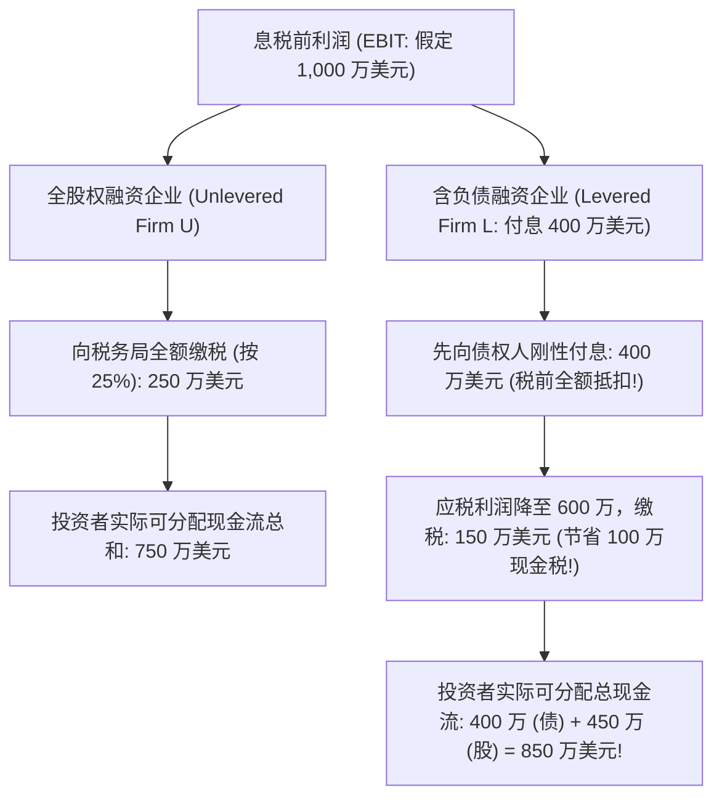
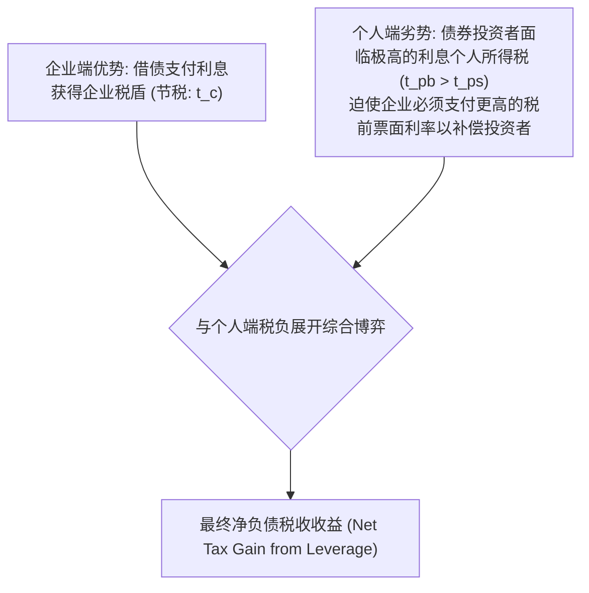
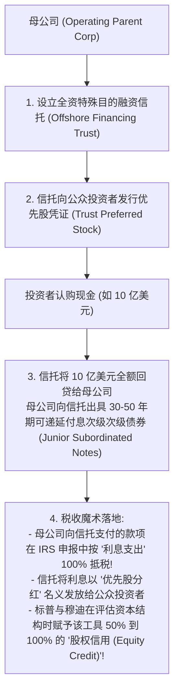
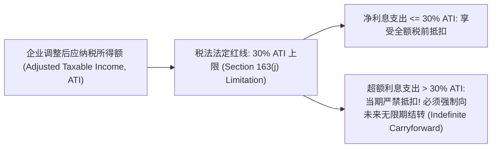

# Lec 08 资本结构税收经济学：债务税盾与混合金融工具 (Capital Structure: Debt Tax Shield and Financial Innovation)

> MIT Sloan School of Management · 15.518 Taxes and Business Strategy · 讲义 08

## TL;DR

- 经典含税 MM 定理证明了债务利息税前扣除创造了确定性的企业价值增量（利息税盾）。
- 米勒均衡模型引入个人所得税，揭示债权人端的高个人税负会系统性侵蚀企业端债务税盾。
- 混合证券（如 MIPS）通过精巧的法律分拆，实现“会计归权益、税法归债务”的双重监管套利。
- 美国税改 Section 163(j) 条款确立 30% ATI 利息抵税红线，彻底终结了极端无序杠杆避税。

## 经典债务税盾与 MM 命题的含税修正

在现代公司金融体系中，企业资本结构（Capital Structure）——即普通股、优先股与长期付息债务的搭配比例——是否影响企业总价值？莫迪利亚尼与米勒（Modigliani & Miller, 1958）在最初的无税世界假定下，给出了著名的“资本结构无关论（MM 定理第一命题）”。

然而，当莫迪利亚尼与米勒于 1963 年引入**企业所得税（Corporate Income Taxes）**后，整个资本结构理论的基石发生了颠覆性逆转。

税法的非对称性设计构成了这种价值跃迁的根源：**企业向股权所有者支付的股利在计算企业所得税时严禁扣除，而向债权人支付的借款利息则被作为法定的经营成本允许在税前全额扣除**。这一制度倾斜直接诞生了**利息税盾（Interest Tax Shield）**。

::: theorem [MM 含税定理与杠杆企业价值方程 (MM 1963)]
假定企业持有永续存续的固定付息债务 $D$，债务到期收益率为 $r_d$，年刚性利息支出为 $I = r_d D$，企业适用边际所得税率为 $t_c$。
每年由债务利息创造的现金税收节省额为：
$$\text{Annual Tax Shield} = t_c \times r_d D$$
若假定税盾的现金流风险与债务本金风险完全一致，按债务贴现率 $r_d$ 进行永续贴现，债务税盾的现值（PV of Tax Shield）严格等于：
$$PV(\text{Tax Shield}) = \frac{t_c \times r_d D}{r_d} = t_c D$$
因此，杠杆企业的资产总价值 $V_L$ 严格等于同等经营风险的无负债企业价值 $V_U$ 加上债务税盾现值：
$$V_L = V_U + t_c D$$
:::

若仅根据这一公式推导，企业的理性选择应当是将资产负债率推向 100%，以最大化企业总价值。然而，现实中极少有健康企业会将负债率推至极限。

## 米勒模型：个人所得税对债务税盾的侵蚀

1977 年，诺贝尔经济学奖得主默顿·米勒（Merton Miller）发表了题为《负债与税收》（*Debt and Taxes*）的里程碑演讲，尖锐指出 1963 年 MM 模型的重大盲区：**它仅仅看到了企业层面的税收抵扣，却完全忽略了债权人与股东个人在二级市场所承受的个人所得税（Personal Taxes）**。

在个人税收层面，税法再次呈现出深刻的不对称性：
- 债权人收到的大额债务利息，被作为**普通所得（Ordinary Income）**征收极高的即期个人所得税（$t_{pb}$，最高可达 37%-40%）；
- 股票投资者获得的权益回报，一部分是低税率的符合条件股利（$t_{\text{div}} \approx 20\%$），另一部分则是可以无限期推迟纳税的长期资本利得（$t_{\text{cg}}$）。因此，股票投资者的综合有效个人所得税率 $t_{ps}$ 显著低于利息个人税率（$t_{ps} \ll t_{pb}$）。

::: theorem [米勒资本结构模型 (Miller 1977)]
在同时考量企业所得税率 $t_c$、债券利息适用的个人所得税率 $t_{pb}$、以及股票所得适用的综合个人有效税率 $t_{ps}$ 的全景框架下，杠杆企业价值方程为：
$$V_L = V_U + \left[ 1 - \frac{(1 - t_c)(1 - t_{ps})}{1 - t_{pb}} \right] D$$

**三种典型微观情景推演**：
1. **若完全不考虑个人所得税（$t_{pb} = t_{ps} = 0$）**：
   公式回归至经典 MM 模型：$V_L = V_U + t_c D$；
2. **若债权人与股东面临完全相同的个人有效税率（$t_{pb} = t_{ps}$）**：
   个人税相互抵消，债务税盾价值依然为 $t_c D$；
3. **米勒均衡条件（Miller Equilibrium）**：
   若全市场出清点满足：
   $$(1 - t_{pb}) = (1 - t_c)(1 - t_{ps})$$
   则方括号内的系数严格等于零！**这意味着企业端通过借债省下的税收，被债权人在个人端多缴纳的个税完全对冲吸收，全市场的债务总税盾增量净归于零！**
:::

::: example
假定某企业法定所得税率 $t_c = 25\%$。
高税阶个人投资者面临的利息个人所得税率 $t_{pb} = 40\%$。
由于长期持有股票并享受资本利得递延，股东综合有效个人税率 $t_{ps} = 15\%$。

计算企业发行 1 亿美元永续债务所能创造的真实全要素净增量价值：
1. 计算分子：$(1 - t_c)(1 - t_{ps}) = (1 - 0.25) \times (1 - 0.15) = 0.75 \times 0.85 = 0.6375$。
2. 计算分母：$1 - t_{pb} = 1 - 0.40 = 0.60$。
3. 杠杆净增量收益系数：
   $$1 - \frac{0.6375}{0.60} = 1 - 1.0625 = -0.0625$$
4. 综合净价值变动：
   $$\Delta V = -0.0625 \times 1.0 \text{ 亿美元} = -625 \text{ 万美元}$$
结论极其震撼：在此税率结构下，企业每发行 1 亿美元债务，不仅没有为投资者创造税盾，反而由于债权人端沉重的个人税负摩擦，导致全系统的总税后净价值净缩水 625 万美元！
:::

## 金融工程创新：混合证券（Hybrid Securities）的套利构造

面对“企业想要利息税盾、投资者想要低税股权、评级机构想要权益防破产”的多方撕裂诉求，华尔街顶级投行在 1990 年代构筑了金融史上最精妙的结构化产品——**月度收入优先股（Monthly Income Preferred Stock, MIPS）**与**信托优先股（Trust Preferred Securities, TruPS）**。

混合证券的核心哲学在于：**在法律上创造一个跨界实体，使同一笔金融工具在会计与信用评级机构眼中被认定为“权益（Equity）”，但在国税局（IRS）眼中被判定为“次级债务（Subordinated Debt）”**。

通过这一架构，企业在完全不稀释普通股每股收益（EPS）、不恶化资产负债表评级的前提下，完整攫取了数亿美元的国库利息税盾。

## 现代税改监管紧箍咒：Section 163(j) 扣除上限革命

为了终结跨国企业与私募股权基金（PE）通过天文数字般的利息支出将企业所得税侵蚀殆尽，美国在 2017 年 TCJA 法案中推出了具有里程碑意义的 **Section 163(j) 利息扣除限制条款**。

::: theorem [IRC Section 163(j) 扣除上限规则]
自 2018 纳税年度起，除特定微型企业与豁免行业外，纳税人每年允许在企业所得税前扣除的**净利息支出（Business Interest Expense 扣除 Interest Income）**，严格受限于其当期**调整后应纳税所得额（ATI）的 30%**：
$$\text{Max Allowable Interest Deduction} = \text{Business Interest Income} + 30\% \times \text{ATI} + \text{Floor Plan Financing}$$

更为严峻的是，自 2022 年起，ATI 的计算基准被税法强制取消了折旧与摊销的加回（从类似 EBITDA 口径收紧至类似 **EBIT 口径**）。对于重资产制造企业与高杠杆收购（LBO）实体，其允许抵税的利息空间被大幅压缩了 30% 到 50%。
:::

::: pitfall [将“超额利息”盲目代入 WACC 模型的估值灾难]
在并购估值与 LBO 偿债测算中，许多分析师依然机械地按 $r_d(1 - t_c)$ 测算全量债务成本。
如果标的企业负债过高，其利息支出已远超 30% ATI 红线，那么**超出部分的每一块钱利息都将不再产生任何当期税盾**，其实际税后成本直接飙升为原始的税前成本 $r_d$。忽视 163(j) 的刚性约束，会导致对杠杆并购现金流的高估达到数千万美元之巨。
:::

## 我的理解

::: insight [资本结构的动态均衡：杠杆是带刺的权杖]
在公司金融长达半个世纪的演进史中，没有任何一个公式能像莫迪利亚尼-米勒的 $t_c D$ 一样，对实体经济的资本配置产生如此诱人而危险的催眠力量。它如同一位低语的塞壬女妖，诱惑着一代又一代的首席财务官（CFO）与杠杆收购掠食者不断加高债务的桅杆，去追逐那似乎取之不尽的利息税盾。

然而，米勒模型的冷静审视与 Section 163(j) 的监管铁拳，终于将这场狂欢拉回了常识的地面。

负债是一柄双刃剑。表面上看，你利用债务利息侵蚀了国家的税基，但在资本市场的全景天平上，债权人在背后索要的流动性补偿、个人所得税摩擦，以及时刻悬在头顶的破产风暴，早已将那点微薄的税盾吞噬得一干二净。

MIPS 等混合证券的兴衰更是一场绝妙的讽刺剧——人类最顶尖的金融大脑耗费数年心血去搭建复杂的离岸信托，只为在会计准则与税法的夹缝中寻得一线套利生机，而立法者只需一条简短的“30% ATI”法案，就让数千亿美元的金融工程瞬间归于尘土。

真正的商业巨子懂得超越“债务税盾崇拜”。他们深知：企业的内在价值永远源于其核心资产的造血能力，而非资产负债表右侧精巧搭建的负债迷宫。克制对极限杠杆的贪婪，将资本结构维持在安全边际之内，才是穿越周期最坚实的铠甲。
:::
