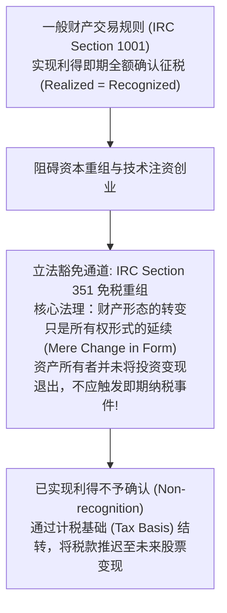
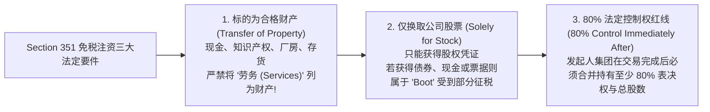
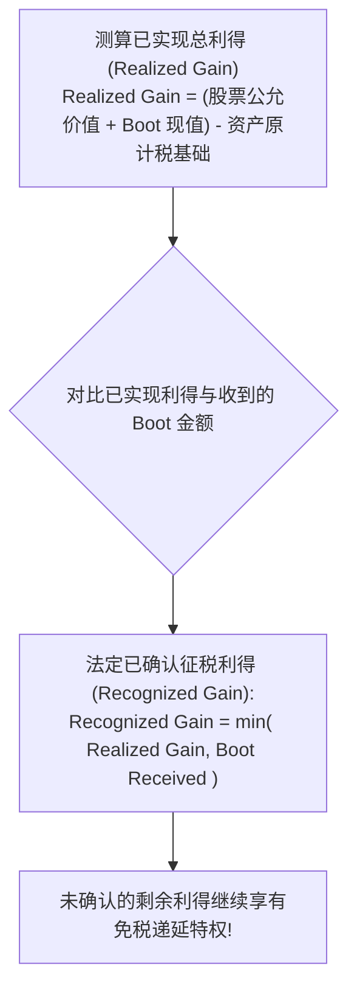
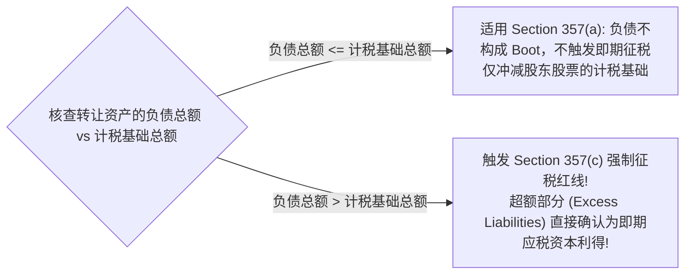

# Lec 09 公司设立、注资与财产转让的税法架构 (Corporate Formation and Property Transfers: Section 351)

> MIT Sloan School of Management · 15.518 Taxes and Business Strategy · 讲义 09

## TL;DR

- 美国税法 Section 351 允许创业注资享受免税待遇，防止因形式转换惩罚资本形成。
- 免税设立三大法定要件：财产转让、仅换取公司股票、发起人集团满足 80% 控制权门槛。
- 劳务出资不能作为合格财产，获得相应股权将触发即期普通所得纳税义务。
- 转移负债超出资产计税基础将强制触发 Section 357(c) 应税利得，计税基础双向守恒追踪。

## 创业注资的税法痛点与立法保护初衷

在商业经济生活中，最普遍的资本运作莫过于设立一家新公司。创业者、技术发明人与天使投资人聚集在一起：投资人投入现金，技术极客投入多年研发的核心专利与软件代码，产业老手投入厂房或现有业务资产，共同换取初创公司的股权。

然而，在一般税法规则（如美国国内税收法典 IRC Section 1001）的严格视线下：**以任何资产换取其他资产（包括换取公司的股票），在法律上均构成一次“财产转让与交换（Sale or Exchange）”**！
如果一名科学家花费 5 万美元研发的专利在注资时估值 500 万美元，并以此换取新公司 50% 的股票，按照一般买卖规则，该科学家在注资当日就实现了 495 万美元的巨额资本利得，必须立即向税务局缴纳上百万美元的现金税款。此时科学家手头只有纸面股票而无分文现金，这种税收重负将彻底扼杀全社会的科技创新与商业资本形成。

为了破除这一制度障碍，美国国会确立了名垂税法史册的 **IRC Section 351 免税设立（Non-recognition on Corporate Formation）制度**。

::: definition [IRC Section 351 免税设立规则]
根据美国国内税收法典第 351 条，当一人或多人将“财产（Property）”转让给一家公司，且仅用于换取该公司的“股票（Stock）”，并在交换完成后该转让人集团立即拥有该公司的“法定控制权（80% Control）”时，转让人在注资过程中实现的任何财产增值利得或亏损，在当期均不予确认征税。
:::

## 免税注资的三大核心法定要件

要成功迈入 Section 351 的免税安全庇护所，该笔交易在架构设计上必须**无瑕疵地同时满足以下三大法定支柱**：

### 1. 转让标的必须属于合格“财产”（Property vs Services）

税法对“财产”给予了宽泛定义，涵盖现金、有形资产（设备、土地）、商业秘密、专利商标以及软件代码。
**然而，税法以绝对红线将“劳务（Services）”排除在财产之外！**
如果一名职业经理人或顾问仅以“未来为公司提供三年管理服务”为对价直接换取了 20% 的公司初始股权，这 20% 股权在税法上直接被定性为普通劳动报酬（Compensation for Services）。该高管必须在取得股权当日，按股权的公允市场价值全额计入普通所得缴纳个人所得税！

### 2. 必须且仅换取该公司的“股票”（Stock Requirement）

转让人换取的对价必须是公司的股权工具（包括普通股或合格优先股）。在 1989 年税法修订前，企业发行的长期债券（Securities）曾被允许作为免税对价；但现行准则明确规定：**任何公司债权、借款本票（Notes）或认股权证均不属于股票范畴**。

### 3. 发起人集团满足 80% 法定控制权（The 80% Control Test）

这是最容易发生合规崩塌的暗礁。根据 IRC Section 368(c) 的跨条文引用，转让人集团（所有在同一次整合交易中出资的成员总和）在资产交割完成后，必须立即拥有：
1. 公司所有类别拥有表决权的股票总投票权的至少 **80%**；并且
2. 公司所有其他非表决权类别股票总股数的至少 **80%**。

::: pitfall [引入“纯劳务出资人”击穿 80% 控制权门槛]
假定创始人 A 投入估值 70 万美元的专利（计税基础 0 元），换取 70% 股权；
联合创始人 B 投入其卓越的个人算法开发劳务（不出一分钱财产），换取 30% 股权。
**灾难发生**：
- B 投入的是劳务，因此 B 不属于合格财产转让人集团成员；
- 合格财产转让人（仅 A 一人）在交易完成后持股仅为 70%，**未能达到 80% 的法定控制权门槛**！
- 结果导致整个 Section 351 架构彻底瓦解：A 的专利出资全部退化为一般应税交易，A 必须就 70 万美元增值在当期全额纳税！
- **战术解法**：B 必须同时投入一定规模的真实财产（如出资 10 万美元现金外加劳务），且该财产出资额并非象征性微不足道的“名义投入（Nominal Property）”，从而使 B 跻身合格财产转让人集团，保全全盘交易的免税属性。
:::

## 混合对价（Boot）确认与二次分配机制

如果转让方在换取股票的同时，还从公司拿回了少量现金、短期借据或其他实物资产，这些非股票对价在税法上统称为**启动对价（Boot）**。

一旦交易中混入了 Boot，免税庇护将被部分撕开：

::: theorem [Boot 确认利得与计税基础追踪恒等式]
1. **已确认利得规则**：
   $$\text{Recognized Gain} = \min(\text{Realized Gain}, \text{Boot Received})$$
   注意：**Boot 只能用于触发利得征税，绝对严禁用于确认亏损（No Loss Recognition）**。
2. **股东对所获股票的计税基础（Substituted Basis）**：
   $$\text{Basis}_{\text{stock}} = \text{Basis}_{\text{property transferred}} + \text{Recognized Gain} - \text{Boot Received} - \text{Liabilities Assumed}$$
3. **公司对所受让资产的计税基础（Carryover Basis）**：
   $$\text{Basis}_{\text{corp property}} = \text{Basis}_{\text{transferor}} + \text{Recognized Gain by Transferor}$$
:::

这一组精密的双向计税基础公式，保证了整个税收闭环中“未纳税的增值部分”被完整封存在未来的股票与资产中，确保国家税基绝不流失。

## 负债转移陷阱：Section 357(a) 豁免与 Section 357(c) 强制征税

在将现有业务或不动产注入新公司时，资产往往附带着银行抵押贷款或经营性负债。新公司在受让资产的同时，承接了这笔负债。
在一般合同法逻辑中，“别人替你还债”等同于你收到了现金（Boot）。但如果按此征税，将使负债企业的设立寸步难行。因此，**IRC Section 357(a) 规定：公司承接转让人的合规负债，原则上不视为 Boot**。

然而，这里埋伏着一个极度凶险的法条——**Section 357(c) 负债超基础强制课税**！

::: example
某建筑承包商设立一家 C 公司，向新公司注入一栋商业办公楼。
- 办公楼当前市场公允价值（FMV）：1,000 万美元；
- 由于历年加速折旧，办公楼在承包商账上的计税基础（Adjusted Basis）仅剩：**200 万美元**；
- 该办公楼附带的银行按揭贷款本金为：**350 万美元**（由新公司承接）；
- 公司向承包商发行价值 650 万美元的全部新普通股。

纳税后果测算：
1. 已实现利得：$FMV - Basis = 1,000 - 200 = 800$ 万美元。
2. 承接负债分析：承接负债 350 万美元 $>$ 资产计税基础 200 万美元，**超出部分为 $350 - 200 = 150$ 万美元**！
3. 触发 Section 357(c)：承包商在注资当日，**必须立即就该 150 万美元超额负债确认应税资本利得，当期缴纳所得税**！
4. 承包商对新股票的计税基础计算：
   $$\text{Basis}_{\text{stock}} = 200 \text{ (原基础)} + 150 \text{ (确认利得)} - 0 \text{ (Boot)} - 350 \text{ (承接负债)} = 0 \text{ 元}$$
股票计税基础被彻底压低至 0 元。
:::

## 我的理解

::: insight [Section 351 的制度契约：所有权形式转变的免税通道]
在人类商业史上，企业的诞生是一场最壮丽的“资产聚变”——无形的智慧代码、沉睡的厂房土地与冷冰冰的银行现钞，通过一份法律契约被汇聚成一个崭新的商业有机体。

如果税法固守“凡交换必征税”的教条，那么每一场伟大的商业融合都会在破晓前夕被沉重的税负阻击在摇篮之中。

Section 351 的精妙之处，就在于它敏锐地洞察到了“商业所有权连续性”的微观哲学：**只要发起人集团依然牢牢握着那张 80% 表决权的缰绳，资产就从未真正从投资者的指缝中流出，它只是换了一身叫做‘股票’的衣裳**。

然而，法律的宽容绝非毫无底线的纵容。80% 控制权红线的设立、对纯劳务出资人的断然拒绝，以及 Section 357(c) 对通过抵押负债变相套现行为的严惩，无一不彰显着立法者与纳税人博弈的精深智慧。

对于商业架构师而言，熟稔 Section 351 的每一道门槛，就是在为颠覆性的科技成果铺设一条合法通往商业王国的免税高速公路；在资产与股权的交响乐中，精准守住计税基础的连续性，正是战略筹划赋能企业从零到一腾飞的至高艺术。
:::
