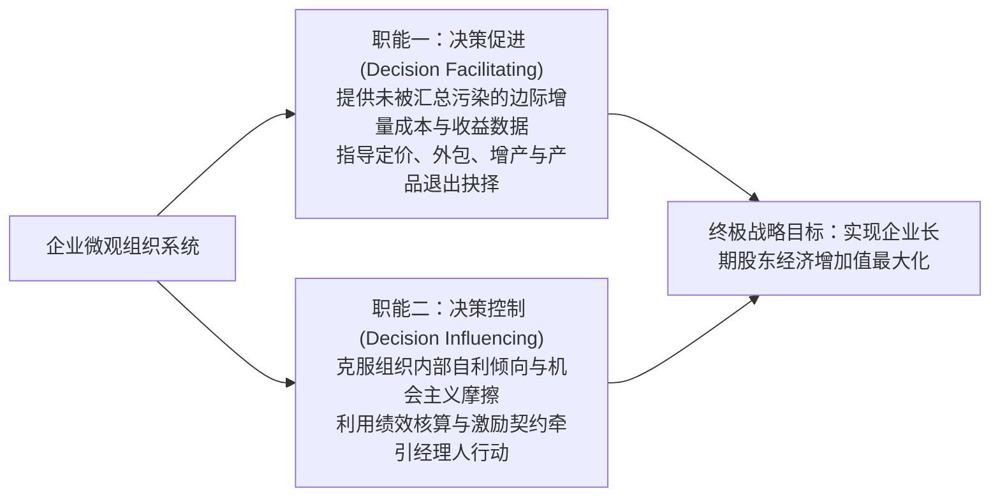
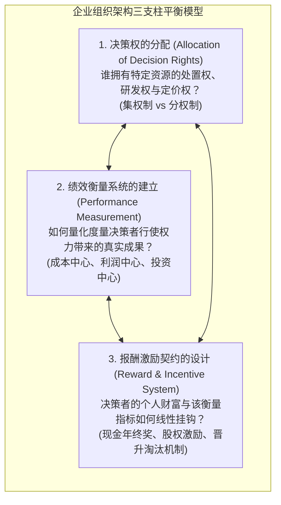

# Lec 01 管理会计框架与决策控制导论 (Introduction to Management Accounting and Control)

> MIT Sloan School of Management · 15.521 Accounting Information for Decision Makers · 讲义 01

## TL;DR

- 管理会计是企业内部资源优化配置与组织协调控制的核心量化神经系统。
- 内部会计系统同时承担决策制定（Decision Facilitating）与决策控制（Decision Influencing）双重职能。
- 组织架构三支柱（决策权分配、绩效衡量指标、激励与惩罚契约）决定了管理控制系统的成败。
- 传统外部财务报告对沉没成本与折旧的分摊规则，常常与内部最优经济决策产生严重目标置换。

## 管理会计的本质：从外部合规到内部决策与控制

在现代商业组织中，各级管理者每时每刻都需要做出关乎企业生死存亡的关键决断：是否应该接受一份低于常规售价的特殊外贸追加订单？是否应该关停某条连续亏损的传统产品线？某项关键零部件应当自主研发制造还是整体外包给外部供应商？如何设计研发事业部主管的季度奖金考核指标以避免短视行为？

外部财务会计受制于公认会计准则（GAAP）的刚性条框，其数据高度汇总且完全回溯历史；而麻省理工学院斯隆管理学院开设的 **15.521 决策者会计信息（Management Accounting and Control）** 则将视角彻底倒转，专注于为企业内部经营决策者提供微观、动态且面向未来的分析罗盘。

::: definition 管理会计与控制系统 (Management Accounting & Control System)
一套在企业内部收集、处理、分配并报告财务与非财务量化信息的管理信息架构。其核心经济学功能包含：
1. **决策促进 (Decision Facilitating)**：为各级管理者提供事前的前瞻性信息，降低不确定性，辅助进行最优资本与运营资源配置；
2. **决策控制 (Decision Influencing)**：通过建立事中与事后的度量基准，监督员工与管理者的受托履职状态，协调委托代理冲突。
:::

## 组织架构三支柱模型（Zimmerman's Three-Pillar Framework）

罗彻斯特大学杰里·齐默曼（Jerry Zimmerman）在经典教材《决策与控制的会计学》中提出了著名的**组织架构三支柱模型（The Organizational Architecture Framework）**。任何企业的管理控制体系，必须在以下三个维度保持严格的几何自洽：

::: theorem 组织架构平衡定理 (Organizational Equilibrium Theorem)
1. **三位一体刚性匹配**：决策权赋权给谁，绩效衡量指标就必须穿透到谁，激励薪酬就必须与其指标绑定；
2. **失衡诱发系统溃败**：
   - 若赋予分公司经理定价权（赋权），却仅以总销售额而非边际利润作为考核（错误指标），经理人必然疯狂打折甩卖；
   - 若考核分厂厂长的机器闲置率（指标），却不赋予其拒绝定制急单的权利（无决策权），考核必然引发抵触与士气崩溃；
   - 若指标完美但激励机制吃大锅饭（缺乏激励），管理者就会选择偷懒与懈怠。
:::

## 财务会计与管理会计的内在目标冲突

在管理实践中，许多缺乏经济学训练的企业高管，往往错误地直接套用财务报表数据指导经营决策，诱发了灾难性的目标置换（Goal Congruence Failure）：

| 决策场景 | 财务会计 (GAAP) 报告导向 | 管理会计 (经济学) 决策导向 | 典型决策冲突与战略陷阱 |
| :--- | :--- | :--- | :--- |
| **特殊降价追加订单** | 分摊了全部历史固定折旧后显示“单位成本 $100$，售价 $80$ 属于巨额亏损”，建议**拒绝订单** | 闲置产能下固定折旧已沉没，单件变动成本仅 $50$，$80$ 售价创造 $30$ 边际贡献，建议**果断接单** | 盲目拒绝能带来真金白银现金流的盈利订单 |
| **亏损产品线关停决策** | 产品净利润为负，财报建议**立即砍掉该业务**以扭亏为盈 | 该业务贡献的边际收益吸收了总部大量公共租金，关停后公共租金无法消除，公司**总利润反而暴跌** | “越砍业务，剩余业务摊销越重越亏损”的死亡螺旋 |
| **存货期末增产冲动** | 将固定制造费用沉淀在期末存货中，**超额增产可以瞬间做大净利润** | 超额生产严重积压营运资本，增加仓储与过期跌价风险，必须坚决**遏制无需求增产** | 车间厂长为了个人考核奖金疯狂盲目积压存货 |

::: pitfall 沉没成本与会计全额分摊的认知陷阱
在传统财务会计中，购置厂房设备的巨额支出通过折旧被系统分摊到各个会计年度。在后续的经营决策中，许多管理者将这些“账面折旧”误认为是未来可避免的增量现金流出。任何已经发生、且在未来任何备选方案下都无法改变的历史耗费均为**沉没成本（Sunk Costs）**，在理性的边际经济决策中必须毫不犹豫地予以完全剔除。
:::

## 案例启示：现代决策者的知识罗盘

15.521 课程的核心旨趣在于培养能够“看穿账簿表象、直达经济实质”的战略型管理者：
1. **识别局部优化与全局次优**：采购部门为了达成“降低原材料单价”的 KPI，大批量采购质量低劣的钢材，导致车间废品率飙升、交付延误；管理会计必须构建端到端的跨职能核算模型；
2. **理解人类自利的博弈动力学**：下级管理者在编制年度预算时具有天然的“留预算余地（Budget Slack）”冲动，刻意低报产能、高报成本，以便在年底轻松超额达成业绩并领取奖金；
3. **权衡计量成本与代理成本**：极其精细复杂的微观计量系统虽然能防范代理人的懈怠，但系统本身的软件部署、流程盘点与组织摩擦成本巨大。管理控制的核心艺术，是在信息透明带来的收益与系统维护成本之间划定最优均衡点。

## 我的理解

::: insight 管理会计是组织神经系统的控制论工程
从现代系统控制论（Cybernetics）与组织行为学的交叉视角剖析管理会计，可以得出颠覆传统常识的见解：
1. **会计指标不是被动的仪表盘，而是具有强引导性的“指挥棒”**：正如物理学中的海森堡测不准原理——当你测量一个粒子的位置时，测量行为本身就会改变其动量；在企业组织中，**只要你宣布对某一个量化财务指标进行考核，员工就会本能地改变行为去扭曲甚至绑架这个指标**。考核调用工时，研发就会故意把代码写得复杂拖沓；考核表面净利润，经理人就会推迟厂房维护。卓越的管理会计师在设定指标的第一天，必须预判出人性会如何合法地博弈并钻空子。
2. **管理会计的最高境界是“促成自发协同”**：平庸的管理者依赖自上而下的行政命令与繁琐审批；高明的组织设计者依靠管理控制系统。通过设置合理的内部转移价格与分权利润中心，使得子公司经理人在出于自利最大化自身部门账面利润时，其做出的商业抉择恰好完美达成了全集团的整体利润最大化。用机制替代口号，才是管理会计赋予企业领袖的终极战略武器。
:::
