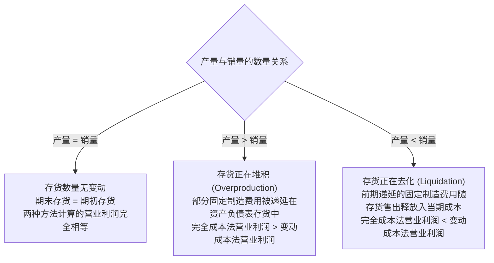
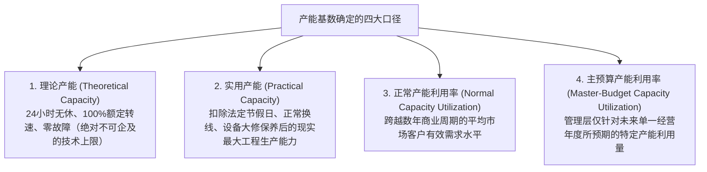

# Lec 10 完全成本法、变动成本法与产能成本 (Absorption Costing vs. Variable Costing: Inventory Building & Capacity Costs)

> MIT Sloan School of Management · 15.521 Accounting Information for Decision Makers · 讲义 10

## TL;DR

- 完全成本法将固定制造费用资本化计入存货，变动成本法将其作为期间费用全额当期扣除。
- 两种方法下的营业利润差额严格等于期末存货与期初存货所吸收的固定制造费用差额。
- 完全成本法会诱导管理者通过盲目超产将固定成本“囤积”在资产负债表中，制造虚假账面繁荣。
- 采用实用产能（Practical Capacity）制定制造费用分摊率，能有效防止主预算口径下的下行死亡螺旋。

## 存货计价核心分水岭：固定制造费用的会计定性

在现代企业会计中，产品成本计量存在两大根本性范式：**完全成本法（Absorption Costing / Full Costing）**与**变动成本法（Variable Costing / Direct Costing）**。二者产生分野的唯一技术分水岭，在于**对固定制造费用（Fixed Manufacturing Overhead, 如厂房折旧、产线租金、车间管理人员工资）的经济性质界定**：

```mermaid
flowchart TD
    CostSplit[企业全部制造成本与期间运营开支]
    CostSplit --> DM[直接材料 Direct Materials]
    CostSplit --> DL[直接人工 Direct Labor]
    CostSplit --> VMOH[变动制造费用 Variable MOH]
    CostSplit --> FMOH[固定制造费用 Fixed MOH]
    CostSplit --> SGA[销售与行政管理费用 SG&A]

    subgraph AbsorptionFramework [完全成本法框架 (GAAP / 外部审计强制要求)]
        DM & DL & VMOH & FMOH --> ProductCost_Abs[产品存货成本 Product Cost<br/>流经资产负债表存货科目]
        SGA --> PeriodCost_Abs[期间费用 Period Expense<br/>当期利润表全额冲销]
    end

    subgraph VariableFramework [变动成本法框架 (管理会计内部决策专用)]
        DM & DL & VMOH --> ProductCost_Var[产品变动存货成本<br/>流经资产负债表存货科目]
        FMOH & SGA --> PeriodCost_Var[期间固定开支 Period Expense<br/>发生当期利润表全额扣除]
    end
```

两种方法在成本归集与报表编制上的核心差异对比如下：

| 成本要素与报表项目 | 完全成本法 (Absorption Costing) | 变动成本法 (Variable Costing) |
| :--- | :--- | :--- |
| **直接材料与直接人工** | 计入产品成本（资产负债表存货） | 计入产品成本（资产负债表存货） |
| **变动制造费用 (VMOH)** | 计入产品成本（资产负债表存货） | 计入产品成本（资产负债表存货） |
| **固定制造费用 (FMOH)** | **计入产品成本**（伴随产成品入库而资本化） | **计入期间费用**（发生当期全额在损益表中费用化） |
| **销售与管理费用 (SG&A)** | 全额计入当期期间费用（区分变动与固定） | 全额计入当期期间费用（区分变动与固定） |
| **损益表编制格式** | 传统职能式格式：收入 - 销货成本 = **毛利** | 贡献毛益格式：收入 - 全口径变动成本 = **边际贡献** |
| **法定与监管合规性** | **GAAP 与 IFRS 强制法定要求**，用于外部纳税与年报 | **严禁用于外部公开财报**，仅作为内部经营决策与绩效控制 |

## 营业利润差异公式推导与库存波动关系

当期的产量（Production Volume）与销售量（Sales Volume）发生脱节时，两种方法所计算出的营业利润（Operating Income, $\Pi$）将产生显著差异。

::: theorem 营业利润差异公理
$$\Pi_{\text{完全成本法}} - \Pi_{\text{变动成本法}} = \text{期末存货中吸收的固定制造费用} - \text{期初存货中吸收的固定制造费用}$$

若单位产品分配的固定制造费用费率（$r_{\text{FMOH}}$）在期初与期末保持稳定，则上述关系可精准简化为：
$$\Pi_{\text{Abs}} - \Pi_{\text{Var}} = r_{\text{FMOH}} \times (\text{当期完工产量 } Q_{\text{prod}} - \text{当期实际销量 } Q_{\text{sales}}) = r_{\text{FMOH}} \times \Delta \text{Inventory}$$
:::

该数学公式揭示了产量、销量与库存波动对两套利润指标的支配性规律：



## 完全成本法下的道德风险：盲目超产与“虚假利润”

在公认会计准则（GAAP）的完全成本法体系下，隐藏着一个极其致命的组织行为学道德风险——**超产制造虚假利润（Phantom Profits from Overproduction）**。

::: example 车间主任通过疯狂超产粉饰利润全过程
某重型机械制造厂年预算固定制造费用（厂房折旧、机器维护等刚性支出）为 **$1,000,000 美元**。
每台机器的单位变动制造成本（材料与计件人工）为 **$500 美元**，产品统一外部售价为 **$1,000 美元**。全厂全年固定销售与管理费用为 **$100,000 美元**。

下半年由于宏观行业骤然降温，全厂全年的实际市场订单销售量仅有 **1,000 台**。
此时，车间主任面临两种截然不同的排产决策：

- **方案 A（理性排产）**：按需生产，产线仅生产市场能消化的 **1,000 台**，零库存期末过年；
- **方案 B（恶意超产）**：开足马力三班倒疯狂运转，全力生产 **5,000 台**，导致 4,000 台巨额产成品压在库房吃灰。
:::

现在我们分别在两套会计方法下核算方案 A 与方案 B 的账面营业利润：

| 会计核算与经营指标 | 方案 A：生产 1,000 台 (按需生产) | 方案 B：生产 5,000 台 (恶意超产) | 方案 B 相对方案 A 的报表变动 |
| :--- | :--- | :--- | :--- |
| **实际销售收入 (1,000 台 × $1,000)** | $1,000,000 | $1,000,000 | 无变动（实际只卖了 1,000 台） |
| **单位固定制造费用分配率** | $\frac{\$1,000,000}{1,000} = \$1,000$ | $\frac{\$1,000,000}{5,000} = \$200$ | 分配率被大幅稀释 $80\%$ |
| **单位产成品完全制造成本** | $\$500 + \$1,000 = \$1,500$ | $\$500 + \$200 = \$700$ | 账面单位成本看似暴跌 |
| **销货成本 COGS (售出 1,000 台)** | $1,000 \times \$1,500 = \$1,500,000$ | $1,000 \times \$700 = \$700,000$ | **账面销货成本骤减 $800,000** |
| **期间销售管理费用** | $100,000 | $100,000 | 无变动 |
| **完全成本法营业利润 ($\Pi_{\text{Abs}}$)** | **亏损 -$600,000** | **盈利 +$200,000** | **凭空凭空多出 $800,000 利润！** |
| **变动成本法真实营业利润 ($\Pi_{\text{Var}}$)** | **亏损 -$600,000** | **亏损 -$600,000** | 忠实反映了全厂亏损现状 |

::: pitfall 虚假利润（Phantom Profit）的财务魔术机理
为什么仅仅把机器开足马力多做了 4,000 台卖不掉的库存，完全成本法下的营业利润就能**从巨亏 60 万神奇逆转为盈利 20 万**？
- **秘密在于资产负债表的“藏污纳垢”**：在方案 B 中，全年发生的 $1,000,000 固定制造费用中，有整整：
  $$\text{递延在期末库存中的固定成本} = 4,000 \text{ 台} \times \$200 = \$800,000 \text{ 美元}$$
- 这 80 万美元固定成本根本没有进入当期的利润表，而是**被作为“优质存货资产”堂而皇之地挂在资产负债表上**！
- **后果**：车间主任在年底拿着 $+20$ 万美元的虚假利润报表，欢天喜地领走了数十万元的年终奖金并成功跳槽；而次年接手的新厂长却必须面对库房中高达 4,000 台积压过时、即将发生巨额存货跌价减值准备的重度灾难。
:::

## 产能度量四大口径与闲置产能成本归属

造成上述悲剧的根源，是固定制造费用分配率分母的选取。在确定分母产能基数时，企业通常有四大选择口径：



如果企业不幸采用了**主预算口径（Master-Budget Capacity）**来计算单位分摊率，就会陷入经典的**产能下行死亡螺旋（Downward Demand Spiral）**：
1. 市场需求下滑，管理层将下年度预算产能从 10,000 台下调至 5,000 台；
2. 由于固定折旧总额不变，导致算出来的单位固定制造费用分摊率直接翻倍；
3. 财务系统提示产品“总成本大幅上升”，销售部门据此执行成本加成提价；
4. 提价进一步吓退客户，导致下下年需求更加萎缩，分摊率进一步飙升，直至整个企业破产关停。

**治理准则**：在管理会计体系中，强烈推荐以**实用产能（Practical Capacity）**作为分母计算标准分摊率。此时，未被利用的产能所对应的固定成本被确认为**闲置产能差异（Unused Capacity Variance）**，直接作为当期损失予以单独列示，从而杜绝了将管理层的过剩投资失误强加给终端产品或个别客户。

## 我的理解

::: insight 资产负债表不是防空洞，把成本当资产是组织最隐蔽的自欺
深入完全成本法与变动成本法的哲学较量，可以发现现代财务系统的深层认知陷阱：
1. **会计上的“资产”有时只是未被承认的损失**：在 GAAP 的严格定义中，资产是“预期能给企业带来未来经济利益的资源”。但是，当企业在市场上根本卖不掉某批产品，仅仅为了吸收折旧而把它造出来堆在仓库时，这批库存不仅无法带来未来利益，反而在每天持续消耗仓储租金、保险费与资金利息。但在完全成本法公式里，它却被神圣地赋予了资产属性。这种财务准则与商业真实的严重割裂，是诱发无数制造业上市公司暴雷的核心病灶。
2. **变动成本法是管理者直面现实的试金石**：变动成本法虽然被外部审计准则所排斥，但它在企业内部管理控制中享有崇高的地位。在变动成本法下，无论你多生产了 10 万台还是少生产了 10 万台，本期利润**只严格取决于你到底真金白银卖出去了多少台**！彻底切断“靠多开机器造库存来刷利润”的投机通道，才能逼迫各级管理者把全部心智聚焦在开拓真实市场客户与优化精益供应链上。
:::
