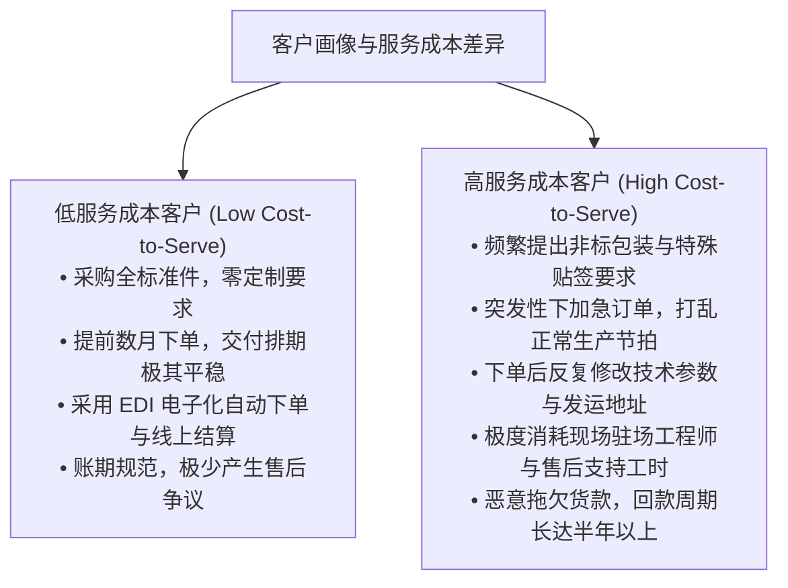
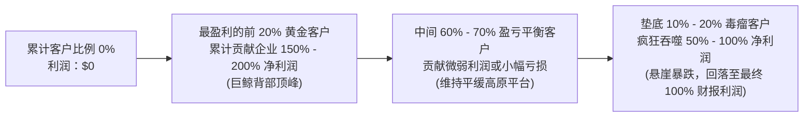
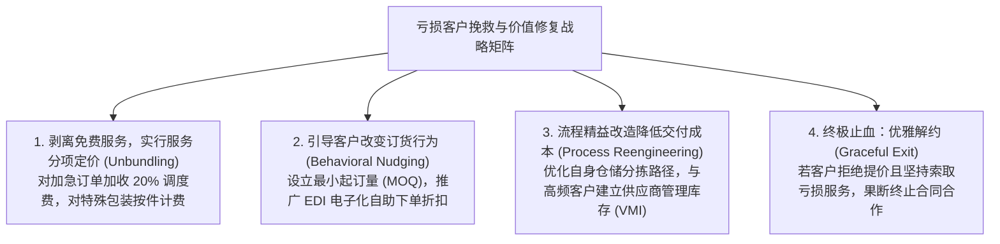

# Lec 11 作业管理与客户盈利性战略 (Activity-Based Management & Strategic Customer Profitability: Whale Curve & Cost-to-Serve)

> MIT Sloan School of Management · 15.521 Accounting Information for Decision Makers · 讲义 11

## TL;DR

- 作业成本管理（ABM）将作业动因核算转化为流程再造、增值作业优化与非增值作业剔除的行动框架。
- 相同售价与毛利的产品在交付给不同客户时，因服务成本（Cost-to-Serve）差异呈现极大的盈利鸿沟。
- 客户盈利性“巨鲸曲线”揭示了前 20% 的黄金客户创造 150%-200% 利润、底层客户重度吞噬价值的规律。
- 处置负价值客户需区分可避免成本与沉没产能，防止盲目解约造成固定间接费用分摊恶化。

## 从 ABC 到 ABM：从成本核算向经营重构跨越

如果企业仅仅把作业成本法（ABC）作为一种更加精准的财务核算工具，那么它所花费的高昂实施成本将很难收回。作业成本法最深刻的商业红利，在于将其升级为**作业成本管理（Activity-Based Management, ABM）**。

```mermaid
flowchart LR
    subgraph ABC [ABC：成本核算视角 (Cost Attribution)]
        Res[资源消耗] --> Act[作业库] --> Obj[产品/客户成本]
    end

    subgraph ABM [ABM：经营管理视角 (Process Reengineering)]
        DriverAnalysis[动因分析：为何发生这些作业?]
        ActAnalysis[作业价值分析：能否削减或重组?]
        PerfMeasure[绩效评价：交付效率是否持续提升?]
        
        DriverAnalysis --> ActAnalysis --> PerfMeasure
    end

    ABC ==>|数据赋能| ABM
```

作业成本管理在企业运营实践中分为两大正交战线：
1. **运营型 ABM（Operational ABM）——“把事情做对”**：
   - 聚焦流程再造与运营卓越，通过重新编排业务动线消除车间等待、仓储倒运与返工；
   - 区分**增值作业（Value-Added, VA）**与**非增值作业（Non-Value-Added, NVA）**。增值作业必须满足三项硬性经济检验：（1）该作业能否改变产品形态或服务质感？（2）最终客户是否真正愿意为该作业买单？（3）该作业是否在首次执行时即一次性做对？
   - 凡是不满足上述三项的搬运、多次复检、库存暂存与等待签章，全部属于必须坚决削减的非增值浪费。
2. **战略型 ABM（Strategic ABM）——“做对的事情”**：
   - 聚焦产品组合优化、客户选择、差异化服务定价与长期产能调配；
   - 识别哪些产品线是隐形亏损的吞金黑洞，哪些客户正在暗中吸干企业的盈利精华。

## 客户盈利性分析与服务成本（Cost-to-Serve）

传统企业财务报表通常只核算到“产品毛利（Gross Margin）”层级，误以为只要两个客户购买了相同数量、相同毛利的产品，他们对企业的盈利贡献就是完全平等的。然而，随着现代商业竞争向全生命周期服务延伸，**服务成本（Cost-to-Serve, CTS）**的悬殊差异彻底打破了这种幼稚假设：



::: definition 服务成本 (Cost-to-Serve, CTS)
服务成本是指企业为了维系特定客户关系，在售前技术支持、订单定制处理、专用物流履约、退换货质检以及售后现场技术服务等全链路非制造环节所发生的所有间接作业成本的总和。
:::

## 客户盈利性“巨鲸曲线”（The Whale Curve）深度解码

哈佛商学院卡普兰教授在大量跨国企业咨询实践中，发现了商业世界中一条普遍适用的经验法则——**客户盈利性巨鲸曲线（The Whale Curve / Stobachoff Curve）**：



巨鲸曲线所揭示的组织残酷真相令人震撼：
- **前 $20\%$ 的客户**：构成了整座企业的盈利顶梁柱。他们以极具规模的规范订单，贡献了企业实际创造总利润的 $150\%$ 至 $200\%$；
- **中间 $60\%-70\%$ 的客户**：基本处于盈亏平衡线上，他们的毛利刚好能够打平为其服务的履约成本；
- **末尾 $10\%-20\%$ 的客户**：构成了企业的“价值杀手（Value Destroyers）”。这部分客户凭借极高的销售额享受着大客户折扣，同时无休止地向企业索取免费的定制化研发与超规格售后服务。他们在财报水面之下，**硬生生将企业此前赚取的 $50\%-100\%$ 的超额利润彻底抹平**！

::: example 巨鲸曲线全真数据剖析
假设一家全球工业轴承分销商全年实现法定净利润 **$1,000 万美元**：
- 如果没有巨鲸曲线视角的 ABC 分析，CEO 会以为这 1,000 万美元是由全公司的 1,000 家客户共同创造的；
- 实施客户服务成本透视后发现：最优质的 200 家规范大客户，实际上带来了 **$2,000 万美元**的真实现金利润；
- 中间的 600 家中小客户带来了 **$0 美元**的净盈亏平衡；
- 而垫底的 200 家高难度客户，通过海量急单变更、特批免费空运与驻场调试，整整造成了 **$1,000 万美元的隐性亏损**！最终在利润表上，企业的整体经营成果被拖累至区区 $1,000 万美元。
:::

## 亏损客户转化策略与战略产品线精简

识别出处于巨鲸曲线右下角的亏损客户后，平庸的管理者往往会意气用事地采取一刀切的“开除客户（Fire the Customer）”策略。然而在管理会计的经济学框架中，这种粗暴做法极其危险。企业应构建多梯度的**客户盈利性转化行动清单**：



::: pitfall 盲目解约亏损客户带来的“固定成本滞留陷阱”
当企业决定“砍掉”一个导致 100 万元账面亏损的客户时，必须严格做边际可避免成本检验：
- 如果为该客户服务的仓库租金、运输车队折旧与全职工程师工资属于**不可避免的长期固定成本（Sunk / Unavoidable Overhead）**；
- 砍掉该客户后，这些 100 万元的固定支出**并不会随之在空气中蒸发**！它们会被迫重新分摊到原本盈利的健康客户头上，导致更多健康客户在账面上“变成亏损”；
- **正确法则**：只有当削减客户的同时，企业能够同步**削减真实的物理资源投入**（如退租仓库、变卖多余卡车、裁减冗余人员），或者**将释放出来的宝贵产能迅速重新配置给高利润客户**时，客户精简才能真正转化为底线利润的跃升。
:::

## 我的理解

::: insight 销售额是浮云，利润是现实，但唯有真实现金流才关乎生死
客户盈利性分析对传统以销售为中心的商业崇拜构成了根本性反思：
1. **警惕“大客户规模幻觉”**：在销售总监的年终庆典上，被众星捧月的往往是那些为公司贡献了上亿元流水的天字第一号大客户。然而在管理会计师冷静的穿透审计下，这些大客户往往也是最精明、最冷酷的博弈高手——他们利用自己的采购话语权拼命压榨企业的每一分出厂价，同时要求企业在技术支持、账期授信与专属库存上承担无限的义务。追求这种虚胖的营收规模，本质上是用股东的净资产去为大客户的供应链效率做无偿慈善。
2. **真正的战略定力是向不合理的需求说“不”**：现代企业的核心竞争力不仅体现在“能为客户做什么”，更体现在“清晰界定什么是不做、什么是必须收费的”。通过把作业管理细化为标准服务菜单，企业才能把前线业务员从“无底线满足客户任何任性要求的取悦者”，重构为“协助客户寻找最具成本效益解决方案的商业顾问”。只有当每一次资源消耗都在组织契约中明码标价，企业的商业闭环才算真正筑牢了坚不可摧的利润防线。
:::
