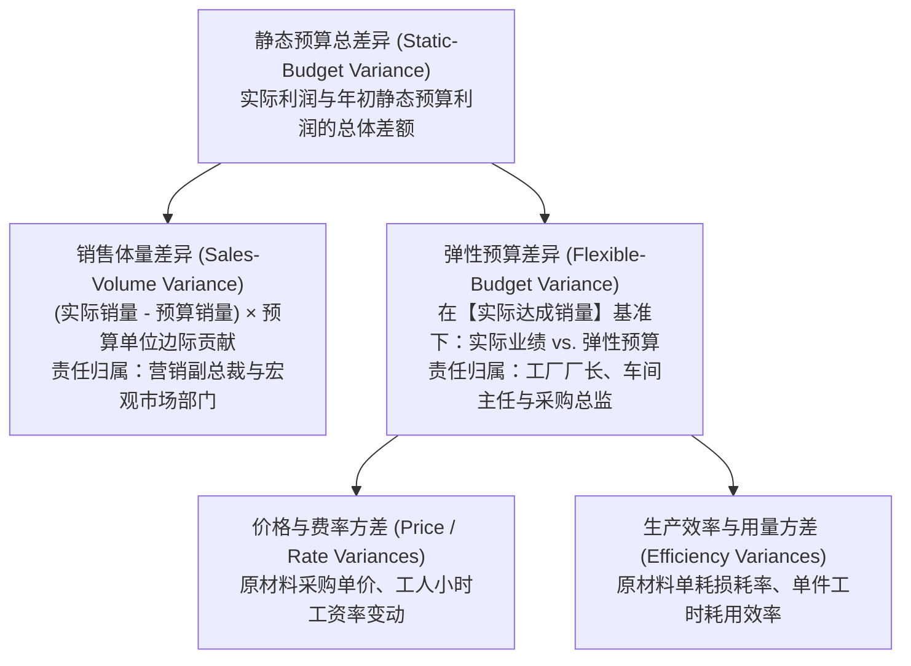
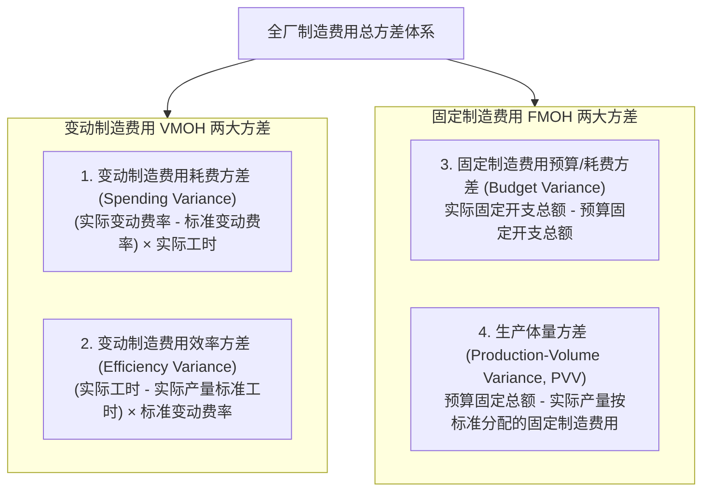
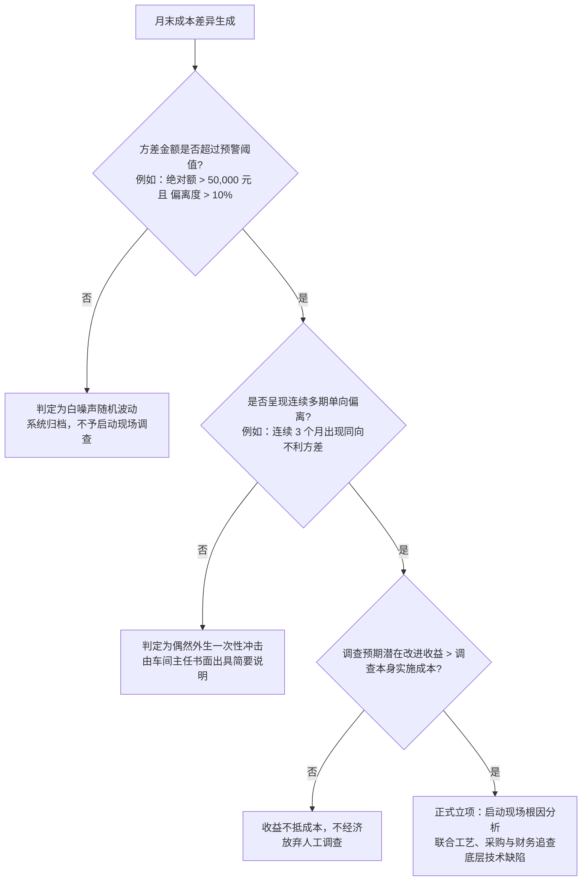

# Lec 12 标准成本制度与方差分析 (Standard Costs and Variance Analysis: Flexible Budgets, DM/DL & Overhead Variances)

> MIT Sloan School of Management · 15.521 Accounting Information for Decision Makers · 讲义 12

## TL;DR

- 静态预算差异混合了业务规模波动与底层运营效率，必须通过弹性预算进行纯净剥离。
- 直接成本方差正交拆解为价格/工资率方差（采购议价）与效率/用量方差（车间工程控制）。
- 固定制造费用生产体量方差衡量长期产能吸收效率，绝不能误判为当期付现开支失控。
- 例外管理原则主张仅对超出统计控制界限的系统性异常启动成本调查，避免无效审计内耗。

## 预算基准的层级演进：静态预算 vs. 弹性预算

在企业运营期末，管理层面对财务部门提交的“实际业绩与年初预算差异表”时，最容易犯的错误是直接将**实际发生数**与年初制定的**静态预算（Static Budget）**进行粗暴对比。这种未经校准的粗糙对比被称为**0 级与 1 级差异**，它将“由于市场销量暴增导致的成本总额上升”与“车间工人操作浪费导致的单件成本超标”毫无道理地混为一谈。

现代管理控制系统的基石，是构建**弹性预算（Flexible Budget）**：



- **静态预算（Static Budget）**：在期初基于“预计销售量”编制的刚性基准；
- **弹性预算（Flexible Budget）**：在期末基于**“实际达成的生产与销售量”**重新反算、如果在标准单价与标准消耗定额下理应发生的各项理论成本基准。

通过在静态预算与实际结果之间插入“弹性预算”这一基准，管理层能够清晰把“销售端拉力”与“制造端效率”完全解耦，实施精准的责任追究。

## 直接成本双因素方差分析模型

对于直接材料（Direct Materials, DM）与直接人工（Direct Labor, DL），管理会计建立了经典的标准成本双因素分解模型。任何实际成本与标准成本的偏离，均可严格推导为**价格因素**与**数量效率因素**的代数展开：

```mermaid
flowchart LR
    subgraph ThreeColumns [三栏式方差计算经典架构]
        Col1["实际成本 (Actual Cost)<br/>实际投入量 AQ × 实际单价 AP"]
        Col2["弹性混合基准 (Split Point)<br/>实际投入量 AQ × 标准单价 SP"]
        Col3["弹性预算标准 (Flexible Standard)<br/>标准允许投入量 SQ × 标准单价 SP"]
    end

    Col1 ---|价格 / 工资率方差<br/>(AP - SP) × AQ| Col2
    Col2 ---|数量 / 生产效率方差<br/>(AQ - SQ) × SP| Col3
```

### 1. 直接材料方差分解公式
- **材料价格方差（Material Price Variance, MPV）**：
  $$\text{MPV} = (\text{实际采购单价 } AP - \text{标准采购单价 } SP) \times \text{实际采购量 } AQ$$
  *责任归属*：采购供应链部门。反映议价能力、交期批次与供应商寻源质量。
- **材料用量/数量方差（Material Quantity Variance, MQV）**：
  $$\text{MQV} = (\text{实际生产耗用量 } AQ - \text{实际产量对应的标准允许耗用量 } SQ) \times \text{标准单价 } SP$$
  *责任归属*：生产车间主任与产线工人。反映废品率、下料精度与机器跑冒滴漏。

### 2. 直接人工方差分解公式
- **人工工资率方差（Labor Rate Variance, LRV）**：
  $$\text{LRV} = (\text{实际平均小时工资 } AR - \text{标准小时工资 } SR) \times \text{实际工作总工时 } AH$$
  *责任归属*：人事招聘与排班主管。反映加班费比重（Overtime Premium）与资深熟手误用工种错配。
- **人工效率方差（Labor Efficiency Variance, LEV）**：
  $$\text{LEV} = (\text{实际工作总工时 } AH - \text{实际产量对应的标准允许工时 } SH) \times \text{标准小时工资 } SR$$
  *责任归属*：车间带班班长与现场工程师。反映工人熟练度、工序防错设计与机器故障停工影响。

::: pitfall 部门割裂考核下的“虚假有利方差”互害陷阱
在实践中，方差指标之间存在深度的技术联动与负向博弈：
- 采购经理为了刷出亮眼的**材料价格有利方差（Favorable Price Variance, F）**，私自向低资质供应商订购了一批超低价的劣质生铁；
- 这批劣质材料进入车间后，杂质过多导致机床频繁崩刀，机器故障率飙升，工人为了剔除废品疯狂返工；
- 最终结果：采购部门拿到了 5 万元的降价表彰，却在车间端引发了高达 30 万元的**不利材料用量方差（Unfavorable Quantity, U）**以及 20 万元的**不利人工效率方差（Unfavorable Efficiency, U）**！
- 孤立考核单一责任中心的价格方差，是对企业全局生产系统的巨大破坏。
:::

## 制造费用三因素与四因素方差分析

间接制造费用（Overhead）由于包含变动制造费用（VMOH）与固定制造费用（FMOH），其方差机理更加深奥。现代管理会计将其拆解为精细的四因素体系：



### 1. 变动制造费用方差
- **VMOH 耗费方差（Spending Variance）**：反映由于水电气单价上涨、润滑油与间接耗材采购单价变化带来的开支波动；
- **VMOH 效率方差（Efficiency Variance）**：由于变动制造费用通常以工时或机器小时为分配动因，如果工人在产线上磨洋工多花了工时，伴随工时发生的车间照明与动力电费也会同步上升。该方差直接挂钩于人工或机器的生产节拍效率。

### 2. 固定制造费用方差与生产体量方差的经济本质
固定制造费用在相关范围内总额保持刚性，因此它**根本不存在“效率方差”**。其方差结构呈现独特的二重性：
- **固定费用预算方差（Fixed MOH Budget Variance）**：
  $$\text{Budget Variance} = \text{实际固定制造费用} - \text{预算固定制造费用}$$
  衡量厂房租金、财产税、管理人员年薪等硬性付现开支是否发生超支，是纯粹的开支控制指标。
- **生产体量方差（Production-Volume Variance, PVV）**：
  $$\text{PVV} = \text{预算固定制造费用总额} - (\text{实际产量对应的标准工时 } SH \times \text{固定制造费用标准分配率 } r_{\text{FMOH}})$$
  $$= r_{\text{FMOH}} \times (\text{预算分母产能 } Q_{\text{budget}} - \text{实际产出品当量 } Q_{\text{actual}})$$

::: theorem 生产体量方差的经济学真容
**生产体量方差（PVV）不是一项成本控制指标，而是对企业产能规划与长期资产吸收利用状态的会计刻画**：
- 当实际产量低于年初预算产能时，PVV 呈现**不利差异（Unfavorable）**。这并不意味着车间主任多花了一分钱现金，而仅仅说明车间有大量机床厂房处于闲置放空状态，固定资产的折旧未能被充足的产出产品所完全吸收（Underapplied Overhead）；
- 反之，当实际产量超过预算产能时，PVV 呈现**有利差异（Favorable）**，说明产能处于超负荷运转状态。
:::

## 例外管理原则与调查决策树

在现代化工业集团中，每月末财务系统在数千个成本中心会自动生成数万个大大小小的方差数据。如果管理层要求对每一个微小方差都展开拉网式调查，组织的日常运营将立刻陷入严重的官僚主义瘫痪。

管理控制系统必须遵循**例外管理原则（Management by Exception, MBE）**：

::: definition 例外管理原则 (Management by Exception)
最高管理层应当将有限的管理注意力集中于那些显著偏离预期基准、对经营利润具有重大潜在威胁的“例外事件”上。对于在统计容忍区间内正常波动的微小方差，系统自动默认通过，不予人工介入。
:::

企业应当依据统计过程控制（SPC）与经济收益成本权衡，建立严密的**方差调查决策树**：



在建立方差审计机制时，企业需遵循三项现代计量统计与契约控制准则：
1. **统计质量控制边界（Statistical Control Limits）**：在现实物理生产中，任何作业参数都必然伴随固有的微小随机热扰动（Common Cause Variation）。企业通常引入休哈特控制图（Shewhart Control Chart），以历史标准偏差 $\sigma$ 建立上下控制限（如 $\pm 2\sigma$ 或 $\pm 3\sigma$）。只有当成本方差落入控制限之外、或者呈现连续 5 期单向漂移时，才触发系统自动预警；
2. **调查的净现值权衡（Cost-Benefit Trade-off）**：每一次现场调查都会消耗宝贵的工程师工时与管理注意力。只有当“调查发现根因并彻底修复工艺缺陷后所能挽回的未来期望现金流现值”，严格大于“调查审计本身所耗费的资源成本”时，启动调查在经济学上才是有利的；
3. **消除第一类与第二类决策错误**：既要防范因反应过度将正常随机扰动误判为管理失误的“假警报（Type I Error）”，又要警惕因阈值设定过宽而对正在恶化的微小工艺跑偏视而不见的“漏网之鱼（Type II Error）”。动态校准预警阈值是控制系统生命力的关键保障。

## 我的理解

::: insight 方差不是对员工的问责皮鞭，而是探寻组织底层系统缺陷的诊断探针
深入方差分析的组织学底色，可以提炼出最具穿透力的现代管理认知：
1. **警惕“有利方差崇拜症”**：财务外行看到报表上的绿字“F（Favorable 有利）”就心花怒放，看到红字“U（Unfavorable 不利）”就雷霆大怒。然而在高度精密协同的现代工业体系中，**过大的有利方差往往与不利方差一样致命**。大幅有利的材料用量方差，很可能是工人在关键承重结构件上少喷了防锈涂层；大幅有利的机器维护费用方差，很可能是机修主管为了省钱停掉了年度强制探伤检测。任何超出统计工艺公差的“超额节约”，都是系统深层失控的危险信号。
2. **从“归咎个人”升维为“系统纠错”**：当产线持续爆发不利工时效率方差时，平庸的管理者只会在早会上痛骂工人偷懒磨洋工；卓越的精益管理会计师会拿起秒表走进车间现场：他们会发现工人们之所以频繁停顿，是因为上游供应的物料毛刺过大需要手工锉削，或者是因为料箱摆放位置不符合人机工程学导致工人每天多弯腰三千次。方差分析的终极价值，永远是充当照亮车间真实物理世界的诊断探针，引导组织从制度与流程根部推动系统进化。
:::
