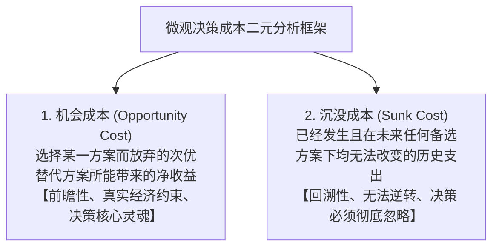
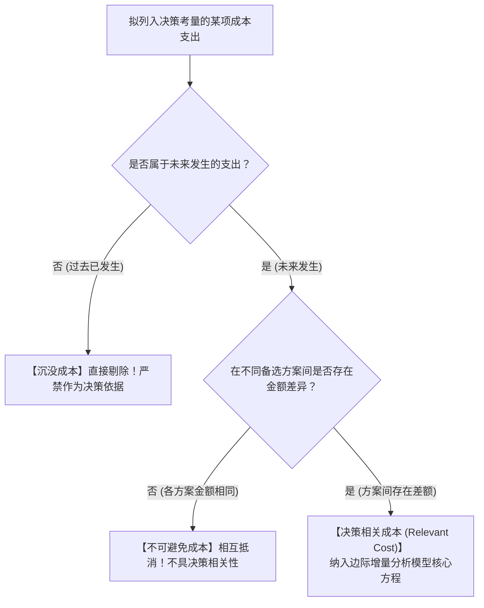

# Lec 02 成本性态与决策相关成本 (The Nature of Costs: Opportunity, Sunk & Incremental Costs)

> MIT Sloan School of Management · 15.521 Accounting Information for Decision Makers · 讲义 02

## TL;DR

- 经济学决策成本聚焦前瞻性增量现金流与机会成本，与传统财务会计的历史发生额分摊绝然对立。
- 决策相关成本必须同时满足属于未来发生且在不同备选决策方案之间存在差异两大硬性检验。
- 沉没成本是不可逆转的历史支出，在任何理性商业决策模型中均应作为无用噪声予以彻底剔除。
- 在多产品产能受限环境下，资源配置的最优顺序由单位瓶颈资源所创造的边际贡献绝对主导。

## 成本的经济学本质：机会成本 vs. 沉没成本

在微观经济学与管理会计的语境中，任何决策的本质都是对稀缺资源的取舍权衡。评估一项决策的代价，必须剥离会计账面的名义分录，回归到两类最纯粹的成本概念：

::: definition 机会成本与沉没成本
- **机会成本 (Opportunity Cost)**：将某种资源投入特定用途时所放弃的、在所有其他可供选择的替代用途中所能获取的最大净经济利益。机会成本不一定伴随实际的现金流出，但它构成了理性资源配置的真实底线门槛；
- **沉没成本 (Sunk Cost)**：由于过去的决策已经发生、且当前的任何作为或不作为都无法收回或改变的成本。沉没成本不随未来方案的选择而发生任何差异，因而在决策分析中属于**完全不相关成本（Irrelevant Costs）**。
:::

::: example 闲置写字楼的机会成本考量
某科技公司拥有一栋完全自建、已在会计报表上全部提足折旧（账面净值几乎为零）的独栋研发楼。公司正在评估是否在此设立一个前沿 AI 算法创新实验室：
- 财务会计账面视角：由于研发楼折旧已提完，入驻该楼的“账面租金成本为零”；
- 经济决策视角：若外部企业愿意以每年 2,000 万元现金整租该研发楼，则 AI 创新实验室一旦入驻，每年必须承担的**真实机会成本就是放弃的 2,000 万元现金租金收入**。如果该实验室预期的超额商业回报无法覆盖这 2,000 万元机会成本，将研发楼对外出租才是股东利益最大化的最优决策。
:::

## 决策相关性（Relevance）的两大刚性检验

当管理者面临商业决策时，并非报表上的所有数字都具备决策参考价值。根据相关成本分析法（Relevant Costing），一项成本或收益要被判定为**决策相关（Relevant）**，必须同时通过以下两大刚性检验：

::: theorem 决策相关成本充分必要条件 (Relevant Cost Criteria)
1. **未来性检验 (Future Costs)**：它必须是**在未来期间才会实际发生的预期成本**，任何过去已经发生的支出（无论是昨天的设备买价还是半年前签署的违约金）均被一票否决；
2. **差异性检验 (Differential / Incremental Costs)**：它必须在**不同的备选决策方案之间存在可量化的差额**。如果在方案 A 和方案 B 下该笔支出金额完全相同，则该成本在方案对比中自动相互抵消，不具备决策相关性。
:::

## 经典微观经营决策四大模型实战

运用决策相关成本分析法，能够系统性攻克微观管理实践中最常见的四大经典决策难题：

### 1. 特殊追加订单定价决策（Special Order Decisions）
当企业存在闲置厂房与机器产能时，外部客户开出显著低于正常市场售价的批量采购报价：
- **决策规则**：若特殊订单所带来的**增量营业收入（Incremental Revenue）**大于其产生的**增量变动成本（Incremental Cost）**，且不损害正常客户价格体系与品牌形象，企业**应当果断接受该订单**；
- 已经存在的固定制造费用与厂房折旧属于不可避免成本，不应作为拒绝订单的理由。

### 2. 自制还是外包决策（Make-or-Buy Decisions）
企业所需的核心零部件，是由内部车间生产还是直接向外部专业供应商采购：
- **决策规则**：比较**内部可避免成本（Avoidable Costs，包括直接材料、直接人工及可消除的变动制造费用）**与**外部采购报价**；
- 若内部自制被终止，释放出的厂房工位可用于转产其他高利润产品，则该工位的**机会成本必须作为“自制成本的加项”**参与终极对比。

### 3. 亏损部门/产品线取舍决策（Keep-or-Drop Decisions）
某项业务在传统会计报表上呈现持续净亏损，是否应该立即予以关停并裁撤该产品线：

::: theorem 部门贡献边际判断准则 (Segment Margin Rule)
企业切忌直接根据报表最终净利润做关停决策，必须计算**部门贡献边际（Segment Margin）**：
$$\text{部门贡献边际} = \text{该部门营业收入} - \text{直接变动成本} - \text{该部门专属可消除固定成本 (Direct Fixed Costs)}$$
- 若 $\text{部门贡献边际} > 0$：**坚决保留该业务**！因为该部门不仅能全额弥补自身专属成本，还向公司总部净贡献了剩余资金，用于吸收无法消除的总部公共固定成本；一旦关停，这笔公共固定成本将被转嫁给其他健康业务，导致公司全盘利润断崖式暴跌；
- 若 $\text{部门贡献边际} < 0$：该业务连自身专属支出都无法覆盖，应果断予以剥离清算。
:::

### 4. 产能瓶颈下的多产品资源配置决策（Constrained Resource Allocation）
当企业的关键生产设备（如核心数控机床工时）或核心关键工序出现产能瓶颈（Bottleneck）时，如何在多种产品之间分配有限工时：

::: definition 限制性资源单位边际贡献 (CM per Unit of Constrained Resource)
面对产能刚性瓶颈时，单件产品绝对利润或名义毛利率的高低彻底失去指导意义，唯一的最优决策指标是**每消耗一单位瓶颈资源所能创造的边际贡献**：
$$\text{瓶颈单位边际贡献} = \frac{\text{单件产品边际贡献 (Unit CM)}}{\text{单件产品消耗的瓶颈资源量 (如机床小时数)}}$$
企业必须严格按照该指标从高到低排序，优先满足指标最高产品的市场全部订单，将剩余残余产能再依次分配给次优产品。
:::

::: example 瓶颈资源排产数值实战演练
某精密仪器工厂拥有每月 1,000 小时的精密磨床工时瓶颈，生产 A、B 两种产品：
- **产品 A**：单价 $200$，单件变动成本 $120$，单件边际贡献 $80$ 美元；加工一件需耗费 **4 小时**磨床工时；
- **产品 B**：单价 $100$，单件变动成本 $70$，单件边际贡献 $30$ 美元；加工一件仅需耗费 **1 小时**磨床工时。

**错误直觉**：产品 A 单件赚 80 美元，远高于产品 B 的 30 美元，看似应该优先排产产品 A；
**科学决策**：
- 产品 A 瓶颈边际贡献：$\frac{80}{4} = 20 \text{ 美元/机时}$；
- 产品 B 瓶颈边际贡献：$\frac{30}{1} = 30 \text{ 美元/机时}$。
磨床每运转 1 小时，生产产品 B 能为企业净赚 30 美元，而生产产品 A 只能赚 20 美元！因此，工厂必须优先把磨床产能打满给产品 B，才能实现企业总盈利最大化。
:::

## 认知陷阱剖析：协和谬误（The Concorde Fallacy）

在企业研发与资本开支决策中，最常见的人性认知偏差是**协和谬误（Sunk Cost Fallacy / Concorde Fallacy）**：
- 英法两国政府联合研制协和式超音速客机，在项目推进中期，技术专家已明确测算出该机型油耗极高、商业运营注定巨额亏损；
- 但由于此前两国已经沉淀了数十亿英镑的巨额研发资金，决策者抱持着“既然已经砸了这么多钱，半途而废之前的钱就全打了水漂”的非理性心理，执意继续追加数百亿注资，最终酿成了更为惨烈的商业大溃败。
- 理性决策者的唯一信条应当是：**沉没成本是不可收回的历史化石，过去的损失已经发生，未来的决策只取决于未来每一元追加投入能否创造超过资金成本的增量净现值（NPV）**。

## 我的理解

::: insight 决策边界的艺术在于看透“假定条件的相关范围”
在管理实务中，许多初级分析师容易将决策相关成本法则机械化、教条化：
1. **边际增量接单的临界约束**：我们在上面论证了“只要特殊订单价格高于变动成本就可以接单”。但这个结论成立有一个极其致命的隐含假设——**闲置产能且市场严格隔离**。如果国内核心老客户得知你以半价向某外贸商倾销同款产品，老客户必然集体抗议并要求同等降价，原本以为赚取的几万元边际贡献，将瞬间引爆千万级主营大盘的价格坍塌。
2. **固定成本的阶段性跳跃（Step-Fixed Costs）**：在相关范围（Relevant Range）内，固定成本是固定的。但如果特殊订单超出了现有车间的变动负荷，导致你必须额外增聘一名质检工程师、或增开一条带固定底薪的夜班班次，这笔原本看似“固定”的费用就瞬间蜕变成了该订单的**增量专属相关成本**。卓越的管理会计师在做敏感性分析时，必须动态监控产能跃迁的临界断裂点。
:::
