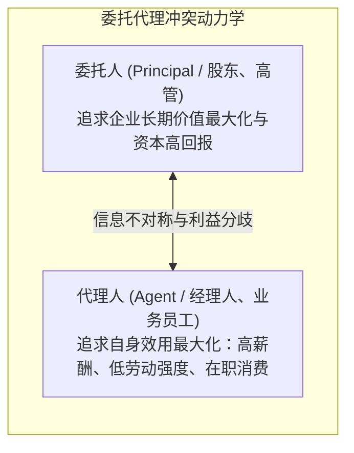
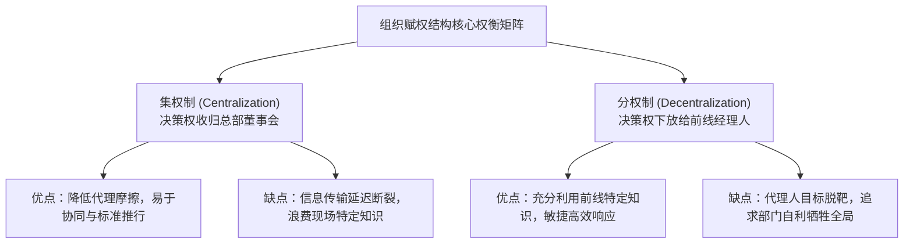

# Lec 03 组织经济学、委托代理与契约架构 (The Economics of Organizations: Agency Theory & Decentralization)

> MIT Sloan School of Management · 15.501 Accounting Information for Decision Makers · 讲义 03

## TL;DR

- 现代企业本质上是由自利个体构成的多边契约联结体，面临目标分歧诱发的代理成本损耗。
- 本地特定知识与总部通用知识的分布错位，构成了集权与分权组织设计的核心经济权衡。
- 决策管理（发起与执行）与决策控制（审批与监督）的刚性职责分立是化解内部道德风险的关键防线。
- 管理会计系统通过责任中心量化核算与契约挂钩，承担起在分权环境下维系组织协同的制度重任。

## 企业的契约联结体本质与委托代理摩擦

在现代组织经济学（Organizational Economics）中，企业不再被简单视作一个追求利润最大化的黑箱“生产函数”（Production Function），而是由股东、经理人、一线员工、供应商与债权人组成的**契约联结体（A Nexus of Contracts）**。

科斯（Ronald Coase）、阿尔奇安-德姆塞茨（Alchian & Demsetz）以及詹森-麦克林（Jensen & Meckling）的研究揭示：企业之所以存在，是为了克服公开市场中高昂的搜寻、谈判与履约交易成本；但将交易内部化（Internalization）必然伴随着企业内部的**委托代理问题（The Principal-Agent Problem）**：



::: definition 代理成本的三重构成 (Agency Costs)
由于代理人与委托人目标函数的不一致，加之委托人无法零成本实时监控代理人的每一步行为，诱发了代理成本：
$$\text{总代理成本 (Total Agency Costs)} = \text{监督成本 (Monitoring)} + \text{守约保证成本 (Bonding)} + \text{剩余损失 (Residual Loss)}$$
1. **监督成本 (Monitoring Costs)**：委托人为了约束代理人行为而付出的监督资源（如聘请内部审计师、安装车间监控系统、部署复杂的管理会计报表）；
2. **守约保证成本 (Bonding Costs)**：代理人为了向委托人证明自身诚信而自愿承担的约束成本（如签署竞业禁止协议、自愿接受薪酬递延与合规惩戒条款）；
3. **剩余损失 (Residual Loss)**：即便实施了最优的监督与保证契约，代理人做出的决策与如果由所有者完全亲力亲为时相比，依然存在的净财富缩水差额。
:::

### 代理人微观机会主义行为四大典型形态
1. **努力厌恶与偷懒懈怠 (Effort Aversion / Shirking)**：在缺乏直接激励时，员工本能地倾向于付出低于最优水平的努力；
2. **在职消费溢价 (Perk Consumption)**：将公司公款用于豪华差旅、奢华办公室装潢与非必要排场，将企业财富转化为个人享受；
3. **帝国构建冲动 (Empire Building)**：经理人为了提升个人行业声望与下属权力规模，盲目进行低回报的跨界并购与资本开支扩建；
4. **视界期限偏见 (The Horizon Problem)**：职业经理人由于预期将在 3 至 5 年内离任或退休，倾向于削减长周期基础研发（R&D）与设备保养，以做大短期净利润套现年终奖，将长期技术衰竭的恶果留给继任者。

## 知识分布与集权/分权的组织权衡

管理会计系统之所以必须嵌入组织架构，根源于哈耶克（Friedrich Hayek）所阐述的**知识在社会与组织中的分散分布特征**。

在企业中，完成决策所需的经济信息被划分为两类截然不同的知识：
- **通用知识 (General Knowledge)**：易于汇总、提炼并以标准化文字或数字低成本向远端传输的知识（如宏观基准利率、行业税率、统一会计准则规范）；
- **特定知识 (Specific Knowledge)**：深植于微观现场、具有高度突发性且**向总部传输极其昂贵甚至不可传输的知识**（如特定客户昨天的即时情绪偏好、某台机床运转时的微妙异响、当地外协加工厂的议价弱点）。



::: theorem 赋权与信息传递的经济权衡公理
企业组织选择集权还是分权，取决于两项边际成本的比较：
1. **信息传递成本 (Cost of Poor Information)**：如果选择集权，前线特定知识在层层上报过程中失真、迟滞所导致的决策质量受损成本；
2. **代理失控成本 (Cost of Agency / Incompatible Goals)**：如果选择分权，前线经理人利用手中信息优势追求局部自利、损害公司整体利益所导致的代理成本。
:::

## 决策管理与决策控制的四步职能分离

为了在享受分权敏捷性的同时彻底扼杀内部道德风险，尤金·法玛（Eugene Fama）与迈克尔·詹森（Michael Jensen，1983）在奠基性论文《所有权与控制权的分离》（*Separation of Ownership and Control*）中提出了现代公司治理与内部控制的经典理论基石——**决策权四步拆分法（Partitioning Decision Rights）**。

在古典小型合伙制或家族作坊中，业主既是资本所有者，又是日常决策者与最终监督者，四项职能高度合一，不存在委托代理摩擦。然而在所有权高度分散的现代大型企业中，职业经理人掌握专业经营技能但并不承担决策失误的全部财富损失。如果将所有决策职权无限制赋予管理层，管理层必然会为了建立“个人商业帝国”、追求过度在职消费或规避个人职业风险，做出损害股东长期价值的逆向选择。

解决这一根本矛盾的制度设计，并非简单剥夺前线经理的灵活性，而是对每一个重大经营决策进行**正交拆解**，将决策流程严格划分为“管理”与“控制”两个互不重叠的独立序列：

```mermaid
flowchart TD
    subgraph DecisionManagement [决策管理职能 (Decision Management) - 赋权前线经理]
        direction TB
        S1["1. 发起权 (Initiation)<br/>前线业务团队识别市场商机，起草新项目投资方案"]
        S2["2. 执行权 (Implementation)<br/>方案批准后，前线团队具体推进研发、采购与交付"]
    end

    subgraph DecisionControl [决策控制职能 (Decision Control) - 归属总部审计与管理会计]
        direction TB
        S3["3. 审批权 (Ratification)<br/>独立风控、投委会与 CFO 审核方案财务合理性并立项"]
        S4["4. 监督评价权 (Monitoring)<br/>管理会计跟踪全流程 KPI，核算真实偏差并执行奖惩"]
    end

    DecisionManagement <==>|刚性权力制衡与职责隔离| DecisionControl
```

在该体系下，前线业务负责人拥有最敏锐的现场特定知识，因此由其主导**发起权（Initiation）**与**执行权（Implementation）**，这构成了“决策管理（Decision Management）”；而董事会、投委会、风险控制部与管理会计系统等独立监控主体，则牢牢掌握**审批权（Ratification）**与**监督衡量权（Monitoring）**，构成了“决策控制（Decision Control）”。这种分离确保了任何资源调配动议必须经受中立经济标准的检验，并在实施后接受无偏倚的业绩审计。

::: pitfall 职责混同诱发的内部治理灾难
如果将发起权与审批权、执行权与监督权全部赋予同一个人（即“运动员同时兼任裁判员”）：
- 部门总监既有权发起一项 5,000 万元的系统采购（发起），又有权独立批准合同签署（审批），还能自行决定验收标准（执行与监督）；
- 委托代理制衡机制将瞬间荡然无存，必然诱发巨额商业受贿、关联方利益输送与劣质资产采购暴雷。
:::

## 管理控制系统在组织架构中的协调使命

在分权化的大型现代集团中，各事业部经理拥有广泛的日常运营权。管理会计系统正是为了填补分权带来的代理真空而构建的**技术性组织协调网络**：
1. **建立量化信息基础设施**：通过设立标准成本、责任会计中心（Cost Center, Profit Center, Investment Center），将抽象的经营活动转化为不可抵赖、可横向比较的量化指标；
2. **削减信息不对称**：通过定期的预算差异分析与管理审计，将前线的现场特定知识系统性地“解码”为总部可理解的高阶指标；
3. **对齐自利动机与企业利益**：将下级管理者的晋升薪酬与净资产收益率（ROE）或经济增加值（EVA）紧密绑定，使代理人在为个人前途奋斗的同时，客观上达成委托人的财富最大化。

## 我的理解

::: insight 没有纯粹的技术问题，所有会计争议本质上都是权力和利益的博弈
深入理解组织经济学后，管理者会获得看待企业内部纷争的全新透视眼：
1. **车间与总部的争吵不是数学问题**：在企业运营分析会上，当事业部经理与集团财务总监为“间接制造费用究竟按工时还是机器小时分摊”争得面红耳赤时，外行以为他们在探讨数学精度。**实际上，他们在争夺部门的利益再分配权**！分摊规则稍微一变，某部门的账面利润就会增加数百万元，部门总监的年终奖与升迁机会便有了着落。
2. **制度设计比道德说教更可靠**：平庸的领导者在面对团队推诿扯皮时，习惯于强调“大家要有大局观、要有奉献精神”；卓越的经济学家领导者深知人性自利的刚性约束。当两个部门互相推诿时，一定是现行的绩效衡量指标把他们逼成了零和博弈的对手。重构契约接口、理顺转移定价机制，比一千次集体动员讲话都更有效。
:::
