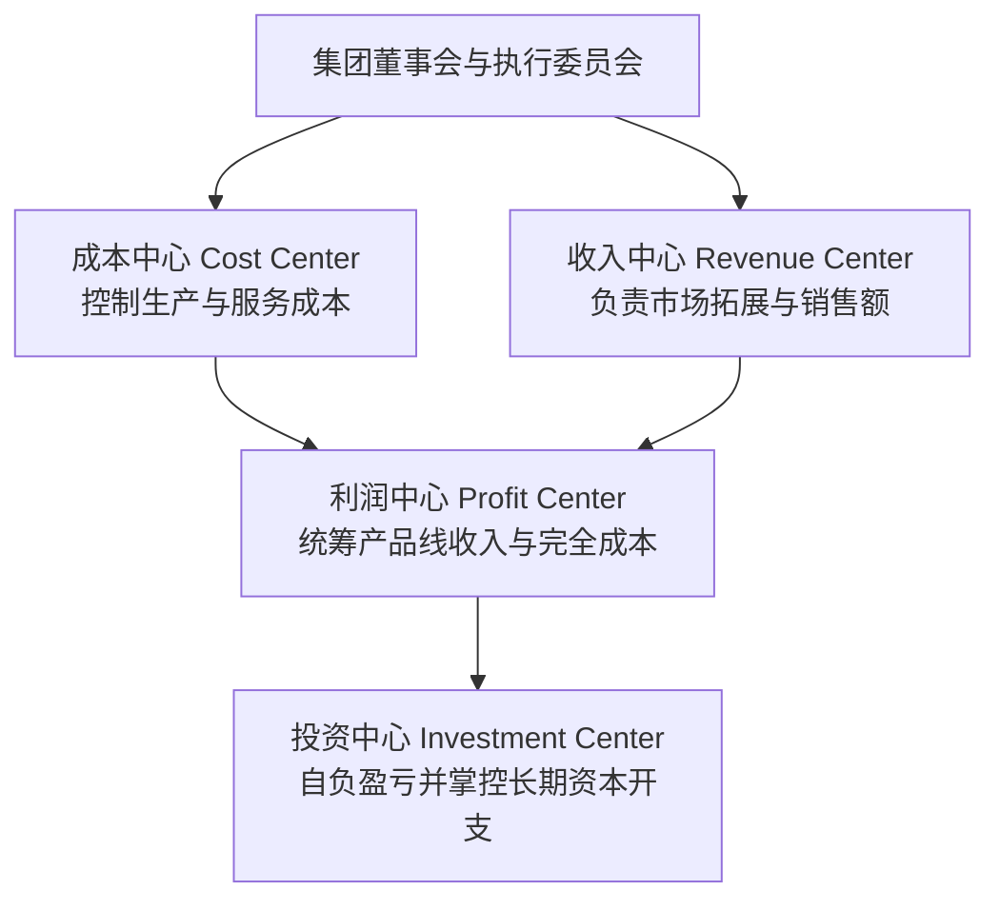
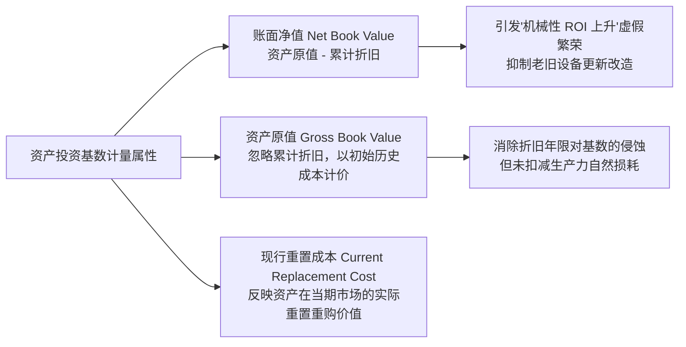

# Lec 04 责任中心划分与财务绩效衡量 (Responsibility Accounting: Cost/Profit/Investment Centers, ROI, Residual Income & EVA)

> MIT Sloan School of Management · 15.521 Accounting Information for Decision Makers · 讲义 04

## TL;DR

- 责任会计通过建立成本、收入、利润与投资四类责任中心，实现经营决策权与财务问责机制的精确匹配。
- 可控性原则主张仅考核经理人可控事项，但在实践中常需引入相对业绩评价以激励其积极应对不可控风险。
- 投资回报率（ROI）存在诱发经理人放弃高于资本成本但低于当前部门平均回报率项目的“次优投资陷阱”。
- 剩余收益（RI）与经济增加值（EVA）通过扣减全口径资本成本，彻底消除次优投资逆向选择并对齐股东长期财富。

## 责任中心四层级划分与赋权契约

在分权管理结构中，为了使各级管理者的日常决策符合公司战略目标，组织必须将其划分为不同的**责任中心（Responsibility Centers）**。每一个责任中心本质上是一组特定决策权与对应量化财务控制指标的契约组合：

各层级责任中心在决策授权与考核指标上存在严格的梯度差异：

| 责任中心类型 | 典型组织形态 | 赋予的核心决策权 | 主要考核与控制指标 | 潜在代理风险 |
| :--- | :--- | :--- | :--- | :--- |
| **标准成本中心 (Standard Cost Center)** | 制造业总装车间、流水线工厂 | 输入要素组合、日常排产与废品控制（投入与产出有明确工程物理关系） | 标准成本方差（材料价格/用量方差、直接人工效率方差） | 偷工减料降低表面成本、盲目过量生产稀释固定制造费用 |
| **费用成本中心 (Discretionary Cost Center)** | 集团法务部、战略研发中心、人力资源部 | 日常运营费用开支与专业服务交付（投入与产出无明确因果关系） | 静态/弹性预算控制额度、服务满意度与关键交付里程碑 | 预算用尽博弈（花光当期预算以避免下一年度预算被砍） |
| **收入中心 (Revenue Center)** | 区域销售办事处、品牌直营展厅 | 销售定价浮动权、商业促销执行、客户信用账期初审 | 净销售收入、销售毛利率、区域市场占有率、应收账款账龄 | 盲目追求销售额进行大额折扣倾销、向低资质客户滥放赊销信用 |
| **利润中心 (Profit Center)** | 独立产品事业部、区域分公司 | 产品定价、要素采购、营销渠道、生产排期与员工任免 | 边际贡献（Contribution Margin）、部门可控营业利润（Operating Income） | 忽视企业集团内部协同、打价格战争抢兄弟部门客户、短视削减必要维护费用 |
| **投资中心 (Investment Center)** | 战略业务单元（SBU）、全资子公司 | 利润中心全部权限 + 厂房设备投资、收购兼并、资本处置与营运资本管理 | 投资回报率（ROI）、剩余收益（RI）、经济增加值（EVA） | 拒绝有利可图的扩张以维持高 ROI、推迟设备更新造成资产隐性老化 |

::: definition 责任会计制度 (Responsibility Accounting)
责任会计是一套通过界定组织内部责任中心边界、归集各中心可归属收入与成本，并定期出具绩效报告以衡量管理人员经营成果的会计控制系统。其核心逻辑是**决策权下放到哪里，财务核算与考核指标就必须跟踪到哪里**。
:::

## 可控性原则与其在组织中的边界与失效

古典责任会计理论的一块基石是**可控性原则（Controllability Principle）**。该原则要求考核指标必须严格剔除管理者无法控制的外部因素。

::: theorem 可控性原则 (Controllability Principle)
一个责任中心管理者应当且仅应当对其拥有直接控制权、能够通过其管理决策显著改变结果的成本、收益或资产承担财务责任。不可控的集团公摊费用、宏观汇率波动或大宗商品基准价格冲击，不应计入该管理者的业绩评价基数。
:::

然而在现代经济学与现代实证管理会计看来，**机械执行绝对可控性原则会导致严重的激励失效**：

1. **不可控风险的消极应对陷阱**：如果完全剔除原材料市场价格波动或汇率冲击对采购经理的考核影响，当外部市场发生逆风暴跌时，经理人将毫无动力寻找替代材料、优化库存周转或开展金融套期保值。企业引入部分“不可控”风险考核，本质上是购买经理人主动预测、吸收和缓冲外部冲击的专业努力。
2. **相对业绩评价（Relative Performance Evaluation, RPE）**：为了消除全行业共同面临的不可控系统性冲击（如全球半导体晶圆断供或宏观利率跳升），最优契约往往将经理人业绩与同业竞争对手的平均表现进行横向基准比较（Benchmarking），从而过滤掉公共外生噪音，精准分离出代理人的超额纯努力（Alpha）。

## 投资中心核心绩效指标深度推导

对于拥有资本配置权力的投资中心（如事业部），仅考核营业利润是不充分的，因为经理人可以通过无限度堆砌资本来换取微薄的利润增量。投资中心必须采用综合衡量资本使用效率的综合指标。

### 1. 投资回报率 (Return on Investment, ROI)

投资回报率是工业界历史上应用最广泛的指标，其定义为部门营业利润与所占用资产基数的比值：

$$\text{ROI} = \frac{\text{营业利润 (Operating Income)}}{\text{投资基数 (Investment Base)}}$$

通过杜邦分析体系（DuPont Analysis），ROI 可以精确解构为销售利润率与资产周转率的乘积：

$$\text{ROI} = \left( \frac{\text{营业利润}}{\text{销售收入}} \right) \times \left( \frac{\text{销售收入}}{\text{投资基数}} \right) = \text{销售利润率 (Profit Margin)} \times \text{资产周转率 (Asset Turnover)}$$

这一分解为管理者提供了两条清晰的价值改善路径：要么通过精益生产与差异化定价提高单位销售毛利（提高 Margin），要么通过缩短营运周期、减少呆滞库存提高资产周转速率（提高 Turnover）。

### 2. 剩余收益 (Residual Income, RI)

针对 ROI 无法体现资金真实机会成本的缺陷，通用电气（GE）于 20 世纪 50 年代率先开发了**剩余收益（Residual Income）**模型：

$$\text{RI} = \text{营业利润} - \left( \text{资本成本率 } r \times \text{投资基数} \right)$$

其中 $r$ 为公司设定的加权平均资本成本（WACC）或部门最低要求回报率（Hurdle Rate）。剩余收益代表了部门在补偿了所有债权人与股权投资者所要求的最低报酬后，为企业创造的绝对超额经济价值。

### 3. 经济增加值 (Economic Value Added, EVA)

由思腾思特（Stern Stewart & Co.）咨询公司推广的 **EVA** 是剩余收益在现代公司金融与公认会计准则（GAAP）修正后的精细化演进：

$$\text{EVA} = \text{税后净营业利润 (NOPAT)} - \left( \text{加权平均资本成本 WACC} \times \text{调整后资本占用 Capital Employed} \right)$$

为了修正 GAAP 准则偏向稳健主义所造成的会计数字失真，EVA 在计算时通常执行数项核心调整：
- **研发支出与市场开拓费用资本化**：GAAP 规定研发支出在发生当期全额费用化，导致勇于创新投入的经理人当期账面利润骤降。EVA 将研发费用确认为无形资产并在其预期受益期内（如 3-5 年）分期摊销，消除研发创新惩罚。
- **营业租赁全部资本化**：将表外经营租赁作为负债与资产并表，还原真实的资本占用全貌。
- **递延所得税负债与各类减值准备还原**：将资产减值准备等非现金准备金加回资本占用，防止经理人通过随意计提或转回“洗大澡”操纵利润。

## ROI 次优投资决策困境与 RI/EVA 治理纠偏

在管理实践中，ROI 指标最饱受诟病的结构性缺陷，在于它会诱发经理人采取严重的**次优投资决策（Sub-optimal Investment Decisions）**。

::: example ROI 与 RI 激励冲突的实证测算
假设海天集团设定的公司加权平均资本成本（Hurdle Rate）为 $10\%$。
旗下拥有两个独立事业部：
- **A 事业部（高效成熟部门）**：当前资产占用 10,000 万元，年营业利润 2,000 万元，当前 $\text{ROI}_A = \frac{2,000}{10,000} = 20\%$。
- **B 事业部（低效重整部门）**：当前资产占用 10,000 万元，年营业利润 1,200 万元，当前 $\text{ROI}_B = \frac{1,200}{10,000} = 12\%$。

现集团工程部提出了一个极具商业前景的新技术改造项目，该项目需新增投资 2,000 万元，预计每年产生营业利润 300 万元，其独立投资回报率为：
$$\text{Project ROI} = \frac{300}{2,000} = 15\%$$

**从集团整体价值最大化视角来看**：
由于该项目的回报率 $15\%$ 显著高于集团的资金成本 $10\%$，该项目的净现值（NPV）严格大于零，实施该项目每年将为集团股东带来净价值增量：
$$\Delta \text{Value} = 300 - (10\% \times 2,000) = +100 \text{ 万元}$$
因此，集团整体理应毫不犹豫地推进该投资。

**各事业部在 ROI 考核下的博弈决策**：
1. **A 事业部经理的选择**：若接受该项目，A 部门新的总资产变为 12,000 万元，总利润变为 2,300 万元。合并后的部门投资回报率为：
   $$\text{New ROI}_A = \frac{2,000 + 300}{10,000 + 2,000} = \frac{2,300}{12,000} \approx 19.17\%$$
   A 部门的 ROI 从 $20\%$ **被硬生生拉低至 $19.17\%$**！如果 A 部门经理的年终奖金与晋升完全挂钩于 ROI，该经理将**坚决拒绝接受该项目**。高回报部门为了保护自身的平均高分，宁愿牺牲股东的绝对财富增量。
2. **B 事业部经理的选择**：若接受该项目，B 部门新的总资产变为 12,000 万元，总利润变为 1,500 万元。合并后的部门投资回报率为：
   $$\text{New ROI}_B = \frac{1,200 + 300}{10,000 + 2,000} = \frac{1,500}{12,000} = 12.50\%$$
   B 部门的 ROI 从 $12\%$ **提升至 $12.50\%$**！B 部门经理将极为积极地申请推进该项目。

**若改用剩余收益 (RI) 考核**：
- 该项目创造的增量剩余收益为：
  $$\Delta \text{RI} = 300 - (10\% \times 2,000) = +100 \text{ 万元}$$
- 无论是 A 部门还是 B 部门，只要承接该项目，其总剩余收益都将在原有基数上净增加 100 万元：
  - A 部门原始 $\text{RI}_A = 2,000 - (10\% \times 10,000) = 1,000$ 万元；新 $\text{RI}_A = 2,300 - 1,200 = 1,100$ 万元（增长 100 万元）；
  - B 部门原始 $\text{RI}_B = 1,200 - (10\% \times 10,000) = 200$ 万元；新 $\text{RI}_B = 1,500 - 1,200 = 300$ 万元（增长 100 万元）。
- 考核指标与企业净现值（NPV）规则实现了**完美同向共振**，彻底消除了优质部门的推诿拒收行为。
:::

## 资产计价口径对投资回报率的失真冲击

除了目标不一致问题，投资基数的会计计量属性也会系统性扭曲 ROI 的计算结果。在实务中，投资基数通常有**原值（Gross Book Value）**与**账面净值（Net Book Value）**两种选择：

::: pitfall 账面净值（NBV）下的设备老化陷阱与虚假利润率
若采用账面净值计价，随着固定资产持续计提折旧，分母（资产净值）逐年单调递减。即便该生产线的实际产出效率与净现金流每年完全持平，计算得出的 ROI 也会呈现**机械性自然上升的假象**。
- 这会向董事会传递极其危险的错误信号：持有破旧老机床的部门似乎比刚刚投资数亿元引入最新数控机床的现代化部门更具“管理效率”；
- 迫使精明的事业部经理竭力拖延厂房与核心产线的资本开支更新，导致企业资产组合整体丧失长远市场竞争力。
:::

## 我的理解

::: insight 相对指标适合跨部门对齐，绝对指标才能守护终极股东财富
在管理控制系统设计中，比率类指标与绝对值类指标的博弈揭示了企业治理的核心真理：
1. **警惕“效率指标”对“规模价值”的绞杀**：管理者往往极度迷恋百分比或比率指标（如 ROI、ROE、利润率），因为比率消除了体量差异，让规模悬殊的部门看起来可以横向对标。然而，股东在现实世界中赚取并用于分红的是**真金白银的绝对现金钞票**，而不是账面百分比。盲目考核 ROI 会迫使优质业务部门主动缩减规模以追求局部高回报率，造成典型的“富人俱乐部封闭症”——为了保持 30% 的净资产回报率，放弃了大量能赚取 18%（依然远超 8% 资本成本）的优秀商机。
2. **资本成本是唯一的照妖镜**：绝大多数传统企业部门之所以看似繁荣，是因为在财务损益表上，债务资本有显性的利息支出，而股权资本被默认为“免费的阳光雨露”。引入 EVA 或剩余收益模型，其划时代意义在于把所有股权资本的隐性机会成本硬性摊入部门日常账本。只有当业务负责人清醒地意识到“放在办公室角落吃灰的每台闲置设备每天都在以 10% 的利息抽干部门利润”时，精益资产管理的自觉性才可能真正从组织肌体深处被唤醒。
:::
