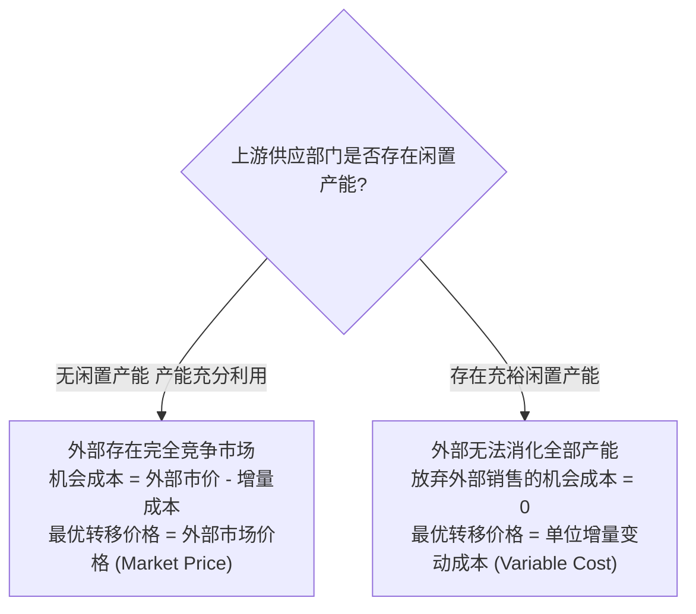

# Lec 05 内部转移定价与组织协同 (Transfer Pricing: Economics, Cost-based, Market-based & Strategic Arbitrage)

> MIT Sloan School of Management · 15.521 Accounting Information for Decision Makers · 讲义 05

## TL;DR

- 内部转移定价是多事业部企业在中间品内部流转时设定的结算价格，兼具资源配置与业绩评价职能。
- 最优转移定价通用法则为“单位增量成本 + 供应方单位机会成本”，其实质是对真实经济机会成本的定价。
- 完全成本转移定价会导致下游部门将上游固定成本误判为变动成本，诱发双重边际化次优停产决策。
- 跨国转移定价必须在公司所得税套利、关税摩擦与 OECD 独立交易原则（Arm's Length）间取得平衡。

## 转移定价的本质与多重相互冲突的目标

当企业实施分权化管理，并在内部设立多个相互关联的利润中心或投资中心时，一个事业部生产的半成品或零部件经常需要流转到另一个事业部进行深加工或最终组装。**内部转移定价（Transfer Pricing）**即为这类内部中间品交易设定的内部结算名义价格：

在管理控制系统设计中，一个理想的转移定价体系必须同时兼顾以下四项核心经济目标：
1. **目标一致性 (Goal Congruence)**：激励各自主决策的事业部经理在追求各自部门账面利益最大化的同时，其决策动作恰好与集团公司整体价值最大化保持严格一致；
2. **管理努力与激励 (Managerial Effort)**：确保各分部经理具备持续优化工艺、削减采购成本的内生动力，而不是坐享集团内部订单保护；
3. **部门自治权 (Subunit Autonomy)**：最大限度维护各事业部在市场采购、产品定价与生产排产上的独立决策自由，避免集团最高管理层陷入无休止的行政微观干预；
4. **业绩评价准确性 (Accurate Performance Evaluation)**：公允、客观地衡量各责任中心对企业总价值创造的真实增量贡献，避免不公平地将利润从一个部门转移至另一个部门。

::: pitfall 转移定价机制的“不可能三角”困境
在绝大多数非完全竞争的市场环境下，**没有任何单一转移定价机制能够同时完美满足上述四项标准**。
- 如果集团直接采用行政指令强行规定转移价格（追求目标一致性），将直接剥夺各分部的自治权，使利润中心退化为无精打采的行政车间；
- 如果允许部门自主漫天要价协商（追求自治权），将耗费海量管理层精力陷入内耗博弈，并经常因谈判破裂导致双输局面。
:::

## 经济学最优转移定价通用法则

微观经济学与契约理论证明，为了达成企业全局价值最大化，上游部门向内部下游部门收取的单位转移价格，必须服从**通用经济法则（The General Transfer Pricing Rule）**：

::: theorem 最优转移定价通用经济法则
$$\text{最低转移价格 (Minimum Transfer Price)} = \text{供应方增量自付成本} + \text{供应方放弃外部销售的机会成本}$$

$$\text{Transfer Price} = \text{Incremental Cost per unit} + \text{Opportunity Cost per unit}$$
:::

该法则的精妙之处在于将企业的决策情境与上游部门的实际产能利用率深度绑定：

### 1. 产能充分利用且外部市场完全竞争
当上游部门产能完全饱和，且外部存在高度活跃的完全竞争市场时，上游部门若将 1 单位中间品拨交给内部下游部门，就必须硬性放弃向外部客户以市场价 $P_{\text{market}}$ 销售所能赚取的所有现金流。此时：
- 供应方单位机会成本 = 放弃的外部边际贡献 = $P_{\text{market}} - \text{增量成本}$
- 最优转移价格 = $\text{增量成本} + (P_{\text{market}} - \text{增量成本}) = P_{\text{market}}$（外部市场价格）

在此情境下，以**市场价格**作为转移价格是最优解：它既测试了下游部门是否有能力在承受真实外部资源成本下生存，又保障了上游部门的自主利润。

### 2. 上游存在充裕闲置产能
当外部市场低迷或上游产线大量闲置时，上游部门拨交内部订单**不需要牺牲任何外部销售收入**。此时：
- 供应方单位机会成本 = $0$
- 最优转移价格 = 单位增量自付成本（通常即单位变动制造成本）

若此时强行按市场价或完全成本向内部下游报价，下游部门将因表面成本过高而主动削减内部采购量，导致上游优质产能进一步放任放空，给全集团带来不可挽回的死重损失。

## 常见转移定价机制的运作机制与治理陷阱

在企业实务运作中，主要存在四种主流定价方法，各自对应不同的应用场景与管理陷阱：

| 定价方法 | 核心操作规则 | 核心适用场景 | 核心劣势与管理风险 |
| :--- | :--- | :--- | :--- |
| **市价法 (Market-Based)** | 参考公开活跃现货市场的外部公允报价（可扣减销售佣金等节约费用） | 存在流动性极高的标准件大宗外部交易市场 | 专用定制零部件不存在外部公开透明报价；市场摩擦导致关联方对“公允市价”产生争议 |
| **变动成本法 (Variable-Cost)** | 仅按上游实际发生的增量变动制造成本结算 | 上游存在大量闲置产能，且下游急需内部扶持 | 上游部门沦为“纯雷锋”，为内部干活颗粒无收，上游经理毫无服务内部兄弟部门的积极性 |
| **完全成本法 (Full-Cost)** | 变动制造成本 + 分摊的上游固定制造费用（有时叠加预设加成率） | 财务报表编制简便，会计信息易于获取 | **引发双重边际效应**；下游误将固定成本当变动成本，诱发全局性的次优生产决策 |
| **双重定价法 (Dual Pricing)** | 上游按“市价或完全成本加成”确认内部收入，下游按“变动成本”记账采购 | 既想调动上游积极性，又想避免下游因高成本抑制需求 | 账目无法自然平衡，集团每月需强制编制冲销分录；掩盖了部门真实竞争力，助长成本膨胀 |
| **协商议价法 (Negotiated)** | 上下游事业部自主博弈、讨价还价决定结算价 | 各分部拥有高度自治权，外部没有统一定价标杆 | 极度耗费高级管理层精力；价格受谈判者个人博弈权势影响而非经济理性驱动 |

## 双重边际效应与跨部门次优决策实务推导

在现实工业企业中，最常见的制度性灾难是采用**完全成本法（Full-Cost Transfer Pricing）**。完全成本法将上游的固定制造费用强行打包进内部转移单价中，彻底破坏了下游边际分析的清晰视界。

::: example 完全成本转移定价诱发集团停产暴跌测算
某高科技装备集团旗下包含两个分权事业部：
- **微电子事业部（上游）**：为终端部门生产定制传感控制主板。
  - 单位变动制造成本：$VC_A = 40$ 元；
  - 每件分摊的固定制造费用：$FC_A = 20$ 元；
  - 事业部核定的完全制造成本：$\text{Full Cost} = 40 + 20 = 60$ 元。
  - 目前微电子事业部由于下游外部周期下行，拥有 $40\%$ 的充裕闲置产能。
- **智能装备事业部（下游）**：采购该主板并安装到工业机器人总成中。
  - 每台机器人需使用 1 块主板，下游自身需投入的追加变动加工成本：$VC_B = 30$ 元；
  - 当前国际市场上某突发急单客户对整机机器人的最高出价报价为：$P_{\text{final}} = 85$ 元。

**情境 1：集团执行完全成本转移定价（以 60 元结算）**
- 下游装备事业部经理开始核算该笔订单的部门经济效益：
  $$\text{下游部门感知单位增量成本} = \text{内部采购转移价} + \text{自身变动加工成本} = 60 + 30 = 90 \text{ 元}$$
- 面对客户 $85$ 元的最终报价，下游经理得出结论：
  $$\text{下游部门账面边际贡献} = 85 - 90 = -5 \text{ 元}$$
- **下游决策结果**：由于每卖一台机器人部门账面就要净亏损 5 元，下游事业部经理为了保护自身的部门考核利润，**断然拒绝了该客户的采购请求，放弃该项目**！

**情境 2：集团全局经济视角的真实账目核算**
- 集团 CEO 与总会计师穿透内部部门壁垒，审查该笔订单对企业集团全口径现金流的真实净影响：
  - 由于上游主板部门存在充裕闲置产能，上游原本分摊的 20 元固定资产折旧与厂房租金是**无论接单与否都会必然发生的沉没成本**；
  - 全集团为了履行该笔急单所必须实际追加付出的现金增量成本仅仅为：
    $$\text{集团全口径增量变动成本} = VC_A + VC_B = 40 + 30 = 70 \text{ 元}$$
  - 面对客户 $85$ 元的付款，集团的真实增量经济效益为：
    $$\Delta \text{Profit}_{\text{Corporate}} = P_{\text{final}} - (VC_A + VC_B) = 85 - 70 = +15 \text{ 元}$$
- **结论**：完全成本转移定价像一面凹凸镜，**将上游不可避免的固定沉没成本伪装成了下游决策的增量变动成本**。当下游部门基于自利原则决策时，活生生将全集团能赚取 $15$ 元净利润的黄金商机扔进了垃圾桶！这种现象在组织经济学中被称为**双重边际化扭曲（Double Marginalization）**。
:::

## 跨国公司全球税务与关税套利博弈

在跨国巨头（如苹果、辉瑞、Alphabet）的全球价值链布局中，转移定价超越了纯粹的内部组织考核范畴，演变为**合规降低全球有效综合税率（Effective Tax Rate）的核心财务工程工具**：

跨国财务战略的经典策略是在高税率国家压低经营利润，在低税率地区做大留存收益：
- **提高上游转移价**：当上游位于低税率地区、下游位于高税率地区时，集团故意推高上游向由下游收取的中间品转移定价与特许权使用费（Royalty Fees），使得高税率地区的利润被上游“合理合法”抽干，从而整体享受低档税率。
- **关税与所得税的反向冲抵**：然而，过高的转移定价会导致该中间品在进入高税率国家海关时被征收高额的从价关税（Ad Valorem Tariffs）。跨国财资部必须构建非线性规划模型，在所得税节税额与关税增支额之间求解最优平衡点。
- **OECD 独立交易原则（Arm's Length Principle）约束**：各国税务稽查机关（如中国国家税务总局、美国国税局 IRS）根据 OECD 税基侵蚀与利润转移（BEPS）行动计划，严密监控跨国关联交易。税务局要求跨国企业必须提供厚重的转移定价同期资料（Local File & Master File），证明内部转移定价与非关联独立第三方之间的交易价格（Comparable Uncontrolled Price, CUP）不存在统计学上的系统偏离。

## 我的理解

::: insight 转移价格不是会计科目的算术，而是企业内部“计划与市场”的政治经济学
在商业帝国的深层运作中，转移定价触碰到了现代企业理论最底层的命题：
1. **企业内部并不天然是“一家人”**：科斯（Ronald Coase）在其传世之作《企业的性质》中指出，企业之所以存在，是因为利用企业内部行政权威协调资源的交易成本在某些情境下低于外部市场交易成本。然而，当一个企业成长为拥有数十万员工的巨型多事业部航母时，**内部官僚协调成本往往会急剧飙升并超越外部市场成本**。引入转移定价，本质上是企业试图在自身体内人工模拟一个“微型自由市场”。但只要这个微型市场缺乏真正外部破产威胁与自由清算退出机制，部门之间就必然演变为充满政治游说、信息封锁与权术妥协的计划经济官僚博弈。
2. **两部制定价是破解双重边际化的制度解药**：要消除下游将固定成本误判为变动成本的悲剧，最高效的现代会计治理方案是**两部制定价法（Two-Part Tariff）**：上游部门向内部下游供应中间品时，日常单件结算价格**严格等于增量变动成本**；同时，下游部门按其预订的产能配额，在每季度初向全额支付一笔不可退还的**固定资产产能保留费（Fixed Lump-Sum Capacity Charge）**。通过将“单件边际决策”与“长期产能投资”在财务结算上彻底物理剥离，下游经理在面临外部临时追加急单时便能拥有与集团 CEO 完全同频的真实经济视野。
:::
