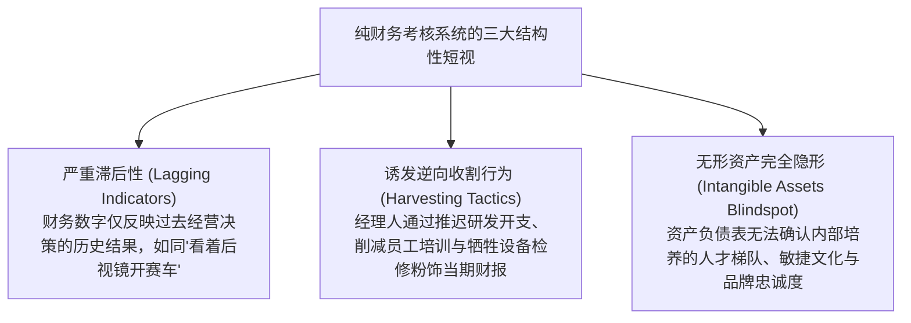
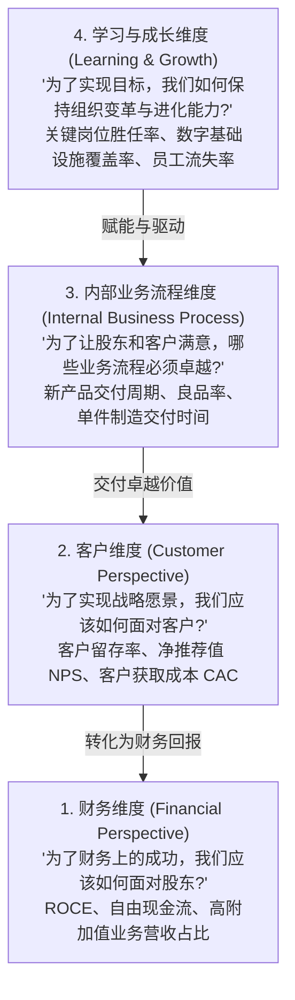
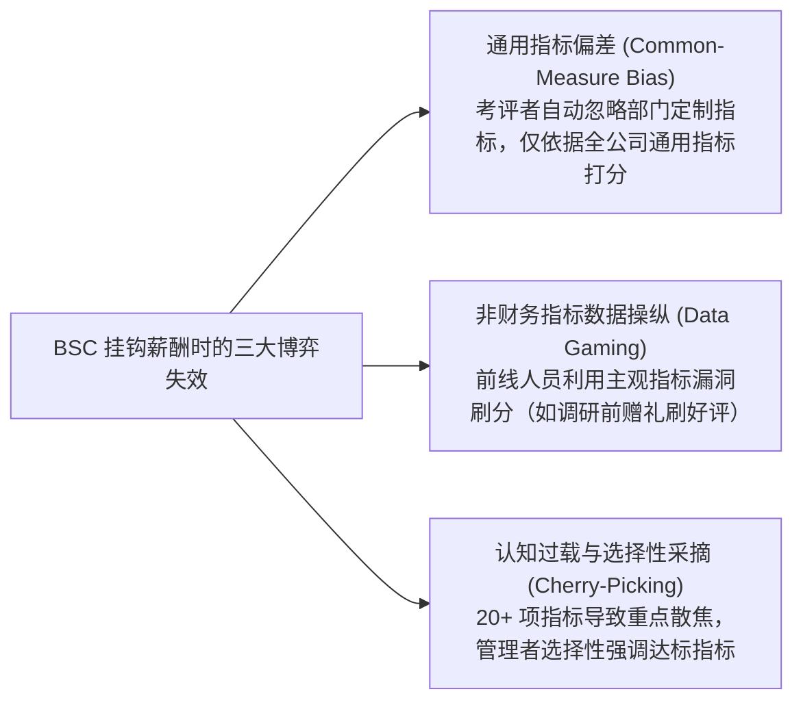

# Lec 06 战略绩效平衡计分卡 (The Balanced Scorecard: Strategy Maps, Four Perspectives & Incentive Alignment)

> MIT Sloan School of Management · 15.521 Accounting Information for Decision Makers · 讲义 06

## TL;DR

- 传统财务指标作为滞后产出变量，无法有效衡量现代知识经济下无形资产驱动的长期价值创造。
- 平衡计分卡（BSC）通过财务、客户、内部流程与学习成长四大维度，构建起闭环的战略因果假设链。
- 前导指标指示未来商业潜能，滞后指标反映历史执行结果，二者的平衡融合消除了短视管理操纵。
- 在挂钩薪酬激励时，BSC 易受通用指标偏差、主观权重博弈与非财务数据造假的挑战，需辅以因果计量检验。

## 传统纯财务衡量体系的结构性短视

在工业经济向知识与数字经济转型的浪潮中，企业创造超额利润的核心引擎，已从有形机器厂房彻底转向组织无形资产（如核心技术专利、组织敏捷度、客户黏性与数字信息系统）。然而，依赖公认会计准则（GAAP）的传统财务控制指标体系（如净利润、每股收益 EPS、资产回报率 ROA），在指导企业战略导航时暴露出致命的结构性缺陷：

::: pitfall 短期利润与长期竞争力的“自杀式置换”
如果一家战略业务单元的总经理仅被考核“当期营业利润”与“本季资本回报率（ROI）”：
- 该经理人最理性的自利策略是在离任前最后两年，坚决冻结新一代核心技术研发、辞退高薪资深工程师、大幅降低客户服务质量以削减当期营运费用；
- 财务账面上，该部门的短期利润与 ROI 将迎来爆发式假象增长，经理人顺理成章荣升总部高管；
- 但留给继任者的，却是一个技术断代、客户严重流失、核心骨干被挖空的“烂摊子”。
:::

## 平衡计分卡四大维度的因果链条逻辑

针对上述痛点，哈佛商学院罗伯特·卡普兰（Robert Kaplan）与管理咨询专家戴维·诺顿（David Norton）于 1992 年提出了**平衡计分卡（The Balanced Scorecard, BSC）**。其核心革命性主张在于：企业战略不能止步于空洞的口号，必须转化为**四套互相关联、动态平衡的量化业务指标群**：

平衡计分卡的核心灵魂是**平衡（Balance）**，它实现了四组关键维度的张力约束：
1. **财务指标与非财务指标的平衡**：将硬性的利润追求与软性的研发创新、服务质量刚柔结合；
2. **短期战术成果与长期战略投资的平衡**：在当期季度报表与未来十年竞争护城河之间设立安全隔离；
3. **前导指标（Leading Indicators）与滞后指标（Lagging Indicators）的平衡**：滞后指标衡量终极商业成果（如利润率），前导指标揭示成果的驱动源头（如新员工研发专利转化率）；
4. **内部运营效率与外部利益相关者的平衡**：既审视企业内部流程优化，又紧盯外部客户市场份额与资本市场期望。

## 战略地图构建方法论与因果假设检验

卡普兰与诺顿在后续研究中进一步将平衡计分卡升级为**战略地图（Strategy Maps）**工具。战略地图将企业的抽象战略假设提炼为一张清晰的、包含明确因果逻辑的图解链条：

::: definition 战略地图 (Strategy Map)
战略地图是一种将组织战略目标按平衡计分卡四大维度分层展开，并通过一连串严密的**“如果……那么……”（If-Then）因果关系假设**将各维度目标串联起来的可视化框架。战略在本质上就是一组关于组织行动与商业成果的科学假设。
:::

| 维度层级 | 典型战略核心目标 | 衡量前导与滞后指标 | 底层假设的因果逻辑链条 |
| :--- | :--- | :--- | :--- |
| **财务维度** | 提升企业长期净资本收益率与经营性现金流 | 已动用资本回报率（ROCE）、高毛利新业务营收年复合增长率 | 如果我们实现前所未有的客户高黏性，那么最终的财务回报必然持续超越资本成本 |
| **客户维度** | 成为目标高净值客户群最信任的端到端解决方案商 | 核心客户年化留存率、客户终身价值（LTV）、市场份额渗透率 | 如果我们能大幅缩短订单交付周期并提供零缺陷产品，那么客户满意度与续约率必然提高 |
| **内部流程** | 构建全球领先的敏捷研发与精益柔性制造流程 | 新一代产品打样上市周期、产线一次良品率（First-Pass Yield） | 如果我们拥有行业最顶尖的工程技术专家与协同工业云，那么核心工艺流程就能被颠覆式重构 |
| **学习成长** | 培育数据驱动的工程师创新文化与数字 IT 基建 | 核心架构师保留率、员工敏捷培训覆盖率、业务系统实时化打通率 | 组织的一切伟大成就，终极起点永远是底层人才的知识储备、组织文化与数字化工具赋能 |

## 平衡计分卡在激励薪酬挂钩中的博弈与失效

当企业试图将平衡计分卡从“战略阐述工具”转型为“高管年终奖金考核公式”时，一系列复杂的组织行为学与契约设计缺陷迅速显现：

1. **通用指标偏差（Common-Measure Bias）**：心理学与行为管理会计研究证明，当总部考评者面对拥有不同定制化非财务指标的分部经理时，人类大脑的认知负荷会导致考评者**下意识地忽视各分部的差异化特色指标**，而几乎完全依赖所有分部都有的通用指标（即传统的财务净利润或销售额）。这导致辛辛苦苦设计的非财务指标在实际考核中沦为摆设。
2. **非财务数据的“善意刷分”与欺诈**：不同于受到严格会计准则与外部独立审计师监督的财务报表，诸如“客户满意度调查”、“员工敬业度评分”等非财务数据极易被前线操纵。例如，业务员会在向关系极佳的老客户发放礼品后再发起满意度测评，甚至直接替客户代填问卷，导致非财务前导指标与实际真实经营彻底脱节。
3. **指标繁冗引发的战略散焦**：许多企业盲目堆砌指标，一张计分卡上列出 30 多项考核项。指标过多直接稀释了每个维度的激励强度，经理人会挑选最容易达成的廉价指标刷分，而对于耗费心力但权重仅占 3% 的核心研发突破指标置之不理。

## 经典商业案例深度剖析：花旗银行绩效评价系统演进

哈佛商学院经典案例《花旗银行：绩效评价系统》（*Citibank: Performance Evaluation*）为理解平衡计分卡的制度张力提供了教科书级的实证样本：

::: example 花旗银行洛杉矶分行行长詹姆斯·麦加兰考核困境
- **背景**：花旗银行加州分行为了从传统的“交易导向型”转变为“客户关系导向型”，率先推行了一套基于平衡计分卡理念的全新业绩考核卡，涵盖六大维度：**财务指标、战略目标、客户满意度、控制与风控、人员管理、社区贡献**。
- **人物**：詹姆斯·麦加兰（James McGaran）是洛杉矶金融街旗舰分行的行长。在全加州所有分行中，他的分行业绩**财务表现长期独领风骚**，当期超额完成利润预算的 $130\%$，为集团贡献了最丰厚的现金流。在控制风控、人员管理与社区贡献方面均获得最高评级“卓越（Above Par）”。
- **争议焦点**：由于该旗舰分行地处繁忙商业区、客流高度过载且客户期望极高，在第三方电话随机抽样的“客户满意度”调查中，麦加兰的分行仅获得了 $54\%$ 的评分，被评为“低于基准（Below Par）”。
- **决策两难**：
  - **如果严格按 BSC 规则执行**：花旗银行此前三令五申宣称客户满意度是生死攸关的战略红线，任何一项关键指标为 Below Par 者，年度综合绩效等级最高只能定为“平庸（Par）”，从而彻底丧失当年的全额高额奖金；
  - **如果向现实妥协给予最高评级**：如果给予麦加兰最高等级评级，等于总部向全加州数千名员工公开宣告——“所谓平衡计分卡与客户满意度全是骗人的官僚废话，只要你能搞来利润，你就是英雄”；
  - **最终妥协结果**：区域管理层经过激烈闭门争议，最终给予其带有特批备注的“卓越”评级，并破例发放奖金。这一事件深刻反映了企业在面对短期硬性利润与长期软性战略指标冲突时，组织契约不可避免的动摇与妥协。
:::

## 我的理解

::: insight 平衡计分卡的真正价值是组织沟通元语言，而非替代财务的数学算式
反思现代管理控制系统的演进，平衡计分卡常被企业界严重工具化和庸俗化：
1. **战略地图是一套因果逻辑命题，必须被科学检验**：许多企业高管在画战略地图时，只是在白板上随意把“员工敬业度提高”用箭头指向“销售额暴增”。但现实中，二者的正向因果联系往往只是未经证实的管理鸡汤。卓越的管理会计师应当扮演实证科学家的角色——提取企业过去数年的纵向面板数据，利用统计计量学（Panel Regression）检验非财务前导指标对未来财务结果的滞后回归系数。只有那些在统计上能显著预测未来现金流的指标，才配留在战略地图的核心主干上。
2. **它是一门打破部门巴别塔的对话协议**：平衡计分卡最伟大的组织贡献，不是算出了一个更加复杂的奖金乘数，而是**为研发、运营、市场与财务部门提供了一套统一的沟通元语言**。在过去，CTO 只懂代码重构与系统延迟，CMO 只讲品牌声量与流量点击，CFO 只盯应收账款与净利润，三者在战略例会上各说各话、形同鸭同讲。当所有关键战略要素被统一定义在四个相互咬合的维度矩阵中时，企业才真正拥有了能够跨越专业壁垒、推动全局协同的组织操作系统。
:::
