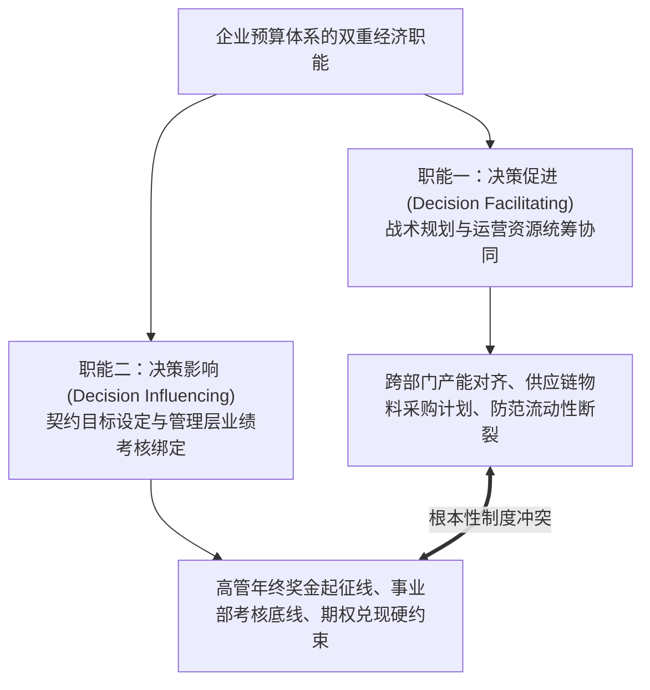
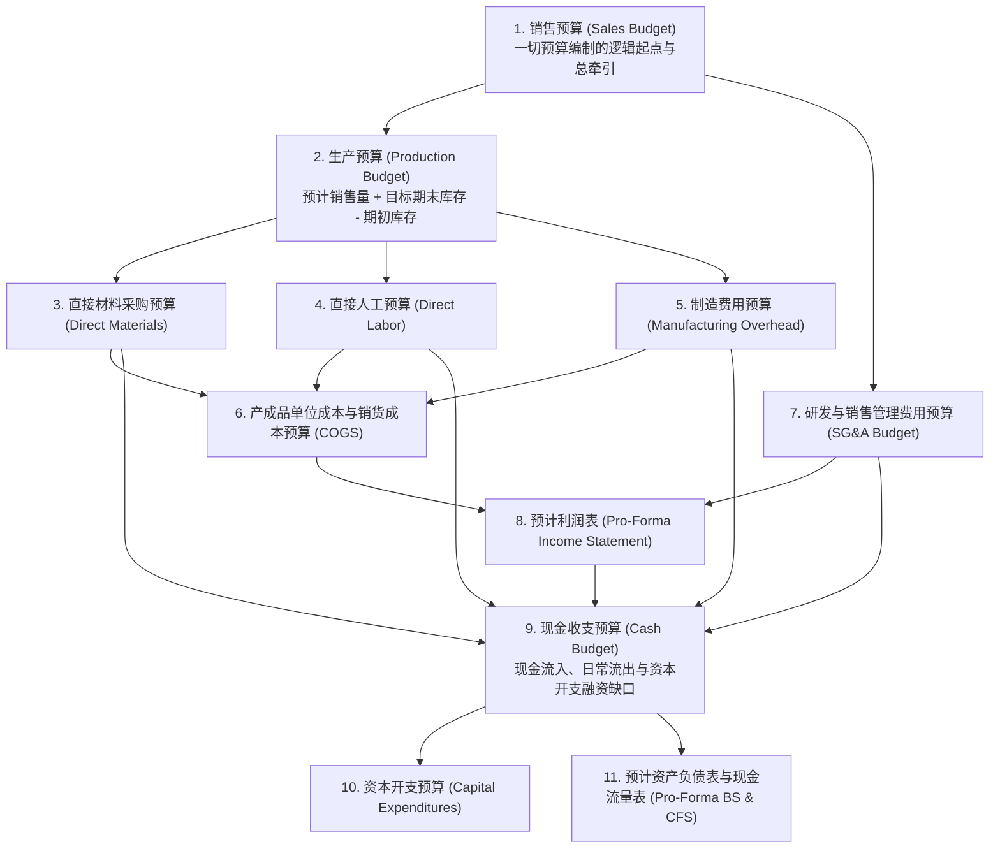
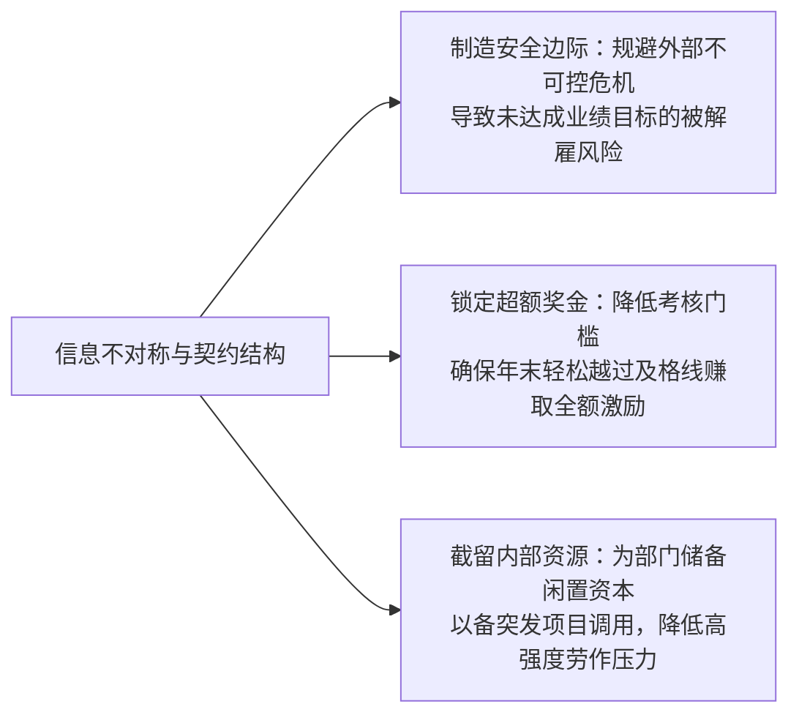

# Lec 07 全面预算编制与博弈控制 (Budgets and Budgeting: Operational Planning, Slack & The Ratchet Effect)

> MIT Sloan School of Management · 15.521 Accounting Information for Decision Makers · 讲义 07

## TL;DR

- 预算系统同时承载战术运营规划（促进决策）与年度考核基准（影响决策）双重职能，二者天生存在张力。
- 全面预算以销售预测为逻辑起点，层层推导生产、要素采购与财务现金流，最终闭环生成预计财务报表。
- 预算松弛与年底花钱狂欢源自信息不对称与契约结构缺陷，经理人通过隐藏真实产能以谋求自保。
- 棘轮效应迫使理性代理人隐藏生产潜力，现代组织正通过超越预算（Beyond Budgeting）与滚动预测重构弹性控制。

## 预算编制的双重使命：战略规划与业绩契约

在绝大多数企业中，预算（Budget）是每年第四季度耗费管理层最多精力、引发最激烈争吵的组织管理活动。预算在现代企业架构中承担着两项截然不同但必须兼顾的**双重经济使命**：

这两项职能之间存在深刻的**结构性内在矛盾**：
- **作为运营规划工具**：企业最高决策层需要最诚实、最中立、最贴近市场实际的真实经营预测，以便精准规划明年的原油储备、晶圆采购与银行授信额度；
- **作为业绩评价契约**：一旦预算目标被确认为下年度部门负责人的奖金考核基准线，各级部门经理在自利驱动下，就会有极其强烈的动机向总部**隐瞒真实的盈利潜力与产销上限**，竭力压低销售指标、虚夸成本开支。

::: theorem 预算目标设定的“矛盾公理”
**用于考核评价的指标越严厉，基于该指标获得的预测信息就越虚假**。当预算被直接定义为薪酬奖惩机制时，它作为资源配置规划工具的预测精确度就彻底宣告崩溃。
:::

## 全面预算管理编制流程与逻辑闭环

在规范的企业财务体系中，**全面预算（Master Budget）**是一套由经营预算与财务预算深度嵌套而成的综合量化行动网络。其逻辑展开严格遵循特定的因果序列：

整个全面预算体系由两大子系统有机聚合而成：
1. **经营预算（Operating Budget）**：
   - **销售预算（Sales Budget）**：整个预算编制引擎的源动力，结合宏观经济走势、历史销售台账与订单在手情况预测下年度产品销量与定价；
   - **生产与供应链预算**：依据产成品安全库存策略，倒推季度生产批次，进一步细化为材料采购量、采购现金支付节奏、直接工人工时排班以及车间水电气维修等制造费用；
   - **销货成本与期间费用预算**：归集变动成本与固定制造费用，测算出预测毛利与销售管理运营费用。
2. **财务预算（Financial Budget）**：
   - **现金预算（Cash Budget）**：整个全面预算的核心枢纽。它将所有权责发生制的收入与费用，通过历史回款账期与供应商账期模型，完全折算为当期真实现金流入与流出，提前测算企业在未来 12 个月内的流动性盈余与债务违约敞口；
   - **预计财务报表（Pro-Forma Financial Statements）**：全面检验下年度经营计划执行后的最终财务健康状态。

## 预算松弛（Budgetary Slack）的微观形成机理

在上下级信息不对称的组织中，下级管理者在自下而上申报预算草案时，普遍存在构建**预算松弛（Budgetary Slack，俗称“预算水分”或“打埋伏”）**的行为。

::: definition 预算松弛 (Budgetary Slack)
预算松弛是指下级经理人故意少报预期的真实销售收入与市场需求，或者故意高估所需的人力成本、消耗定额与原材料损耗，从而使上级批准的最终预算目标远低于其真实潜力的策略性蓄意行为。
:::

预算松弛在微观契约层面具有高度的理性自利基础：

当总部缺乏穿透底层车间特定知识的审计工具时，下属事业部经理编制松弛预算将带来纯粹的个人期望效用最大化——既能轻松躺赢拿到绩效提成，又能向外界展示“卓越的超预算完成能力”。

## 棘轮效应（The Ratchet Effect）与“年底花钱狂欢”

预算控制系统中最经典的动态博弈陷阱是**棘轮效应（The Ratchet Effect）**与**年底突击突击花钱现象（Use-it-or-lose-it Behavior）**。

### 1. 棘轮效应的机制推导
在多期重复博弈中，上级往往倾向于将下级“当期的实际完成业绩”作为制定“下一期预算指标”的主要参考依据：
- 如果某部门经理今年发扬拼搏精神、挖掘潜能，将原本 1 亿元的销售预算干到了 1.5 亿元；
- 总部高管层在次年制定目标时，绝不会把基数退回到 1 亿元，而是顺理成章地将次年预算锁定在 1.6 亿元甚至 1.8 亿元；
- 这种“只能往上拨、无法往下落”的齿轮机制被称为**棘轮效应**。

::: pitfall 棘轮效应对员工长远生产力的永久扼杀
在理性预期假设下，聪明的经理人很快就会参透这套博弈规则：
- **今年表现越惊艳，明年的日子就越艰难**；超额完成预算获得的当期奖金，根本无法补偿未来数年被沉重预算压垮的职业惩罚；
- 因此，当经理人在当年 10 月份发现部门已经达成了年度预算的 $100\%$ 时，其最优策略不是继续开足马力为公司拓展客户，而是**故意放缓发货节奏、推迟签署大客户合同、甚至劝说客户将订单延后至明年元旦以后交割**。这种为了避税式避开考核棘轮而人为压制生产力的行为，给企业带来了巨大的隐性经济内耗。
:::

### 2. “年底花钱狂欢”的逻辑怪圈
在成本与费用中心，几乎所有经理人都熟知一条潜规则——**“用完预算，否则明年就会失去它”**：
- 如果一个部门通过精打细算、厉行节约，在年底将 1,000 万元的研发差旅费用节约了 200 万元；
- 集团财务总监得出的第一结论通常不是“该部门管理精益”，而是“该部门当初申报时多要了 200 万编制，明年直接将预算基数砍到 800 万”；
- 为了防止未来的预算控制权被剥夺，部门在每年的 11 月和 12 月会掀起不可思议的突击花钱狂潮：突击更换办公室豪华地毯、突击采购未来两年都用不完的昂贵办公文具、突击召开高端度假式研讨会。节约者受惩罚，挥霍者得嘉奖，形成了劣币驱逐良币的荒谬闭环。

## 超越预算（Beyond Budgeting）理念与滚动预测

鉴于传统年度预算僵化、迟缓且充满政治博弈的弊端，20 世纪末欧洲管理界发起了**超越预算圆桌会议（Beyond Budgeting Round Table, BBRT）**运动，提出彻底废除传统固定年度预算的激进主张：

| 维度对比 | 传统年度全面预算体系 | 超越预算与敏捷控制体系 (Beyond Budgeting) |
| :--- | :--- | :--- |
| **预测时间跨度** | 固定 12 个月（自然日历年周期），期末断崖 | **滚动连续预测 (Rolling Forecasts)**，例如动态维护未来 5 个季度的无缝视野 |
| **目标设定机制** | 静态协商谈判数字，包含大量博弈水分 | 动态**相对对标基准 (Relative Benchmarks)**，与行业中位数或竞争对手同期业绩联动 |
| **资源调配模式** | 每年底一次性按部门“分蛋糕”锁死额度 | **按需动态申领 (Dynamic Resource Allocation)**，依据当前投资回报率与商业机会即时立项 |
| **绩效评价基础** | 是否达成一年前协商出的僵化静态指标 | 考察事后价值创造的团队综合贡献、市场份额增长率与资本回报绝对增量 |

通过采用滚动预测（Rolling Forecasts），企业不再在 12 月 31 日之后面临信息悬崖，管理层始终能够清晰看到未来 15 个月的资源流向；而将考核与外部同行基准动态挂钩，则彻底粉碎了下属部门通过与总部博弈压低目标的投机空间。

## 我的理解

::: insight 预算博弈的解药不是更严苛的审计，而是重构真相申报的激励相容机制
深入剖析预算失真现象，可以得出极具穿透力的经济学洞见：
1. **说真话必须在经济上获得重奖**：苏联著名经济学家马丁·韦茨曼（Martin Weitzman）与组织经济学家格罗夫斯（Theodore Groves）曾提出著名的**真实报告诱导方案（Truth-Eliciting Incentive Scheme）**。该数学模型证明：如果高管层想要下属交出最真实的潜能底牌，奖金公式就必须设计为——**当下级主动申报一个更高的预算目标并完成它时，其所能获得的奖金系数，必须严格大于“申报一个低目标并大幅超额完成它”时的系数**。如果超额完成保守目标的奖励高于挑战宏伟目标的奖励，任何理性的管理者都只会把预算做成一块软海绵。
2. **区分“雷达”与“油门”是管理成熟的标志**：卓越的管理控制架构，必须把负责感知环境的“雷达系统”（纯粹的业务中性预测）与决定奖励轻重的“油门系统”（高管考核奖金）在组织层面上做物理隔离。当一个组织能够允许业务主管坦率承认“明年受行业周期影响我们的销售额必然下挫 30%，但这是我们深度研判后的最严谨真相”而不必担心被扣除绩效工资时，这家企业才算真正摆脱了预算内耗的泥潭，拥有了面对残酷市场风浪的真实生存定力。
:::
