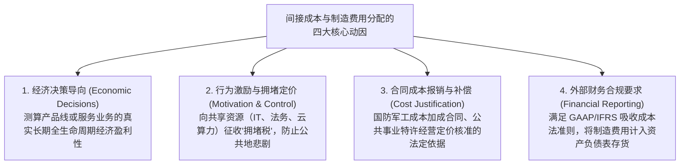
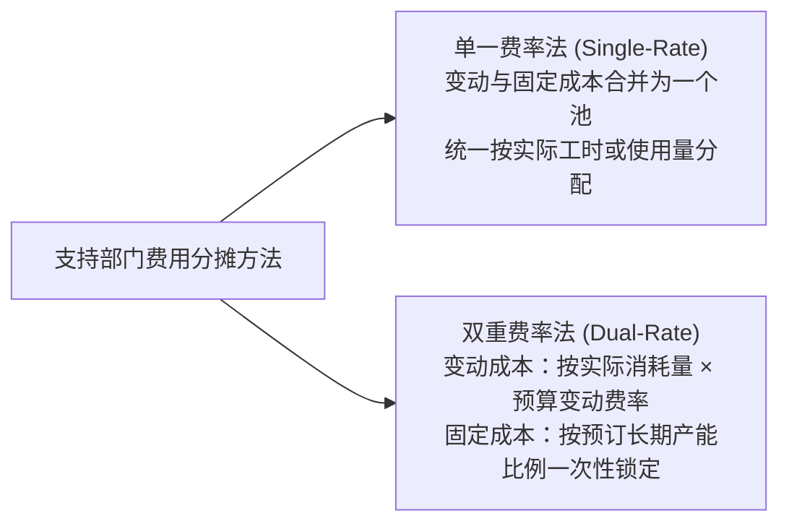
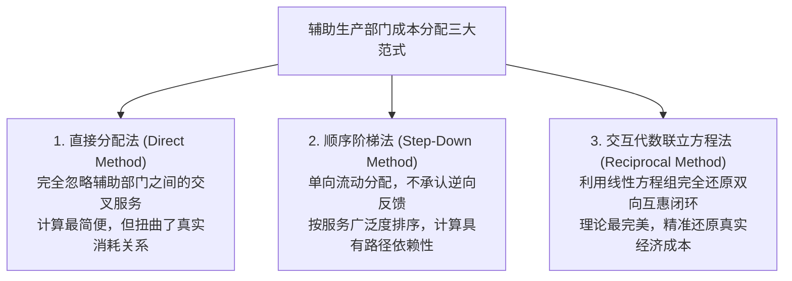

# Lec 08 间接成本分配原理与动因逻辑 (Cost Allocation: Dual-Rate Method & Support Department Allocations)

> MIT Sloan School of Management · 15.521 Accounting Information for Decision Makers · 讲义 08

## TL;DR

- 间接成本分配承担经济决策指引、抑制公共池资源滥用、合同成本补偿与 GAAP 存货计价四重职能。
- 单一费率法将固定与变动成本混同，导致某一部门减产时反向推高其他健康部门的分摊负担。
- 双重费率法将变动成本按实际消耗分配、固定成本按预订产能分配，有效实现成本动因解耦。
- 辅助部门互惠服务分配涵盖直接法、顺序阶梯法与交互代数联立方程法，精度与系统认知成本递增。

## 间接成本分配的经济学争议与四大目的

在微观经济学原教旨主义者看来，“分配共同间接成本（Allocating Common Overhead）”往往被视为一种在数学上缺乏严谨因果基础的“会计炼金术”。因为共同成本（如集团总部大楼租金、法务合规支出、中央数据中心折旧）在本质上是不可分摊的沉没或联合投入，任何强加的人工分摊比例都带有一定的主观随意性。然而在管理会计工程实践中，组织之所以坚定推行间接成本分配，主要是为了达成**四项不可替代的管理目标**：

::: pitfall 公共地悲剧：免费共享资源的恶性滥用
如果企业设立了中央法务部或高性能计算集群，但在内部执行“免费按需调用”政策（即分摊率为零）：
- 业务线经理会为了推卸个人商业判断风险，将每一个几千元的零星采购合同都提交给法务部进行数轮细化审查；
- 算法团队会无节制地提交低效训练任务，彻底霸占昂贵的 GPU 显存；
- 这种对零边际成本公共资源的过度索取，迅速导致核心支持部门严重拥堵瘫痪，给高价值战略项目带来灾难性延误。
:::

## 单一费率法 vs. 双重费率分配法

在将辅助服务部门（如集中 IT 运维中心）的成本向业务部门分摊时，选择**单一费率法（Single-Rate Method）**还是**双重费率法（Dual-Rate Method）**，会产生截然不同的行为激励效应。

### 1. 单一费率法的结构性缺陷
单一费率法将固定成本与变动成本混在一个池子中，按各部门当期的**实际使用量**计算一个综合小时费率：
$$\text{综合分配率} = \frac{\text{实际或预算的总成本（固定 + 变动）}}{\text{实际或预算的总工时}}$$
- **缺陷一：外部性交叉感染（负向溢出效应）**：如果部门 A 当月大幅减产、减少了 $50\%$ 的 IT 工时使用量，支持部门的固定房租与折旧依然保持刚性不变。这会导致计算出来的综合小时费率大幅飙升，从而使得正常满负荷运转的部门 B **被动承受高昂的分摊成本上涨**！部门 B 经理会因隔壁部门的减产而无辜遭受绩效扣罚。
- **缺陷二：将固定成本伪装为变动成本**：导致业务部门将 IT 服务的长期固定基础设施投入，误当成了每小时都需真金白银追加的变动开支，从而做出错误的外部自建或外包短视决策。

### 2. 双重费率法的治理机制
双重费率法从根本上解决了上述扭曲，它将固定成本与变动成本彻底物理隔离：
1. **变动成本分配规则**：
   $$\text{部门分摊额} = \text{该部门实际资源使用量} \times \text{预算标准单位变动费率}$$
   采用**预算标准费率**而非实际费率，可以防止支持部门自身的窝工低效与材料浪费被暗中转嫁给下游业务部门；
2. **固定成本分配规则**：
   $$\text{部门分摊额} = \text{支持部门总预算固定成本} \times \left( \frac{\text{该部门立项时预订的峰值产能配额}}{\text{全公司总预订峰值产能}} \right)$$
   固定成本严格依据各部门在资本立项时所申报的**峰值产能比例（Peak Capacity Requested）**进行刚性分摊，与当月的临时使用波动彻底脱钩。谁当初要求配备大产线，谁就必须按期支付资产持有成本。

## 辅助服务部门成本交互分配的三大经典方法

在大型工业实体中，不仅支持部门为生产部门提供服务，**支持部门之间也存在密集的交叉互惠服务**（例如动力车间为维修车间供电，维修车间为动力车间检修发电机组）。如果简单忽略这种部门间自我循环与互惠支持网络，就会严重低估那些大量消耗其他支持部门资源的服务中心的真实总成本。现代管理会计确立了三种处理内部交叉服务的经典范式：

这三种范式在计算复杂度与因果真实性之间构成了清晰的权衡光谱：

1. **直接分配法（Direct Method）**：最为激进的简化处理方式。它在分配阶段直接“切断”并无视所有支持部门之间的相互服务关系，将每个支持部门的初始预算总成本，完全按照核心生产部门之间的相对消耗比例直接一步分摊到位。其优势在于计算极快、没有任何认知门槛，但当支持部门之间存在重度互惠依赖时，会导致严重的成本扭曲与交叉补贴。
2. **顺序分配法 / 阶梯分配法（Step-Down / Sequential Method）**：折中的渐进式单向分配。该方法要求先对所有支持部门进行排位（通常将“为其他支持部门提供服务金额最多或比例最高”的部门排在首位）。排在第一位的部门先将其总成本分摊给后续的所有支持部门和最终生产部门，随后该部门“关闭结算”；排在第二位的部门将其自身成本与接收到的第一部门转入成本相加，再向下游部门继续分摊，但**绝对不允许逆向回流给已关闭的部门**。这种方法部分承认了互惠关系，但排序的先后顺序对最终分摊结果具有强烈的路径依赖性。
3. **交互代数联立方程法（Reciprocal Allocation Method）**：在理论上最为严密、唯一能够 $100\%$ 精确还原现实互惠关系的科学方法。它将每个支持部门视作一个既对外提供输出、又对内吸收输入的完整经济节点，通过构建多元线性联立方程组（Simultaneous Linear Equations），求解出各个支持部门包含双向循环消耗在内的“全口径虚拟总成本（Full Reciprocal Cost）”，随后一次性按照原始服务比例精确分配给终端生产部门。

## 综合案例推导与三种分配方法数值对比

::: example 动力车间与维修车间交互分摊全真测算
某装备制造基地设立两个辅助支持部门：**S1 动力车间（Power）**与 **S2 维修车间（Maintenance）**；以及两个主要生产加工部门：**P1 机械加工（Machining）**与 **P2 总装车间（Assembly）**。
- **直接发生成本**：S1 动力车间为 $100,000$ 元；S2 维修车间为 $80,000$ 元。
- **部门间服务消耗比例矩阵**如下表所示：

| 服务提供方 | 接受方 S1 (动力) | 接受方 S2 (维修) | 接受方 P1 (机加) | 接受方 P2 (总装) | 合计比例 |
| :--- | :--- | :--- | :--- | :--- | :--- |
| **S1 动力服务 (%)** | — | $20\%$ | $50\%$ | $30\%$ | $100\%$ |
| **S2 维修工时 (%)** | $10\%$ | — | $60\%$ | $30\%$ | $100\%$ |
:::

### 方法 1：直接分配法 (Direct Method)
直接分配法彻底无视 S1 与 S2 之间的交叉消耗，将服务直接按相对比例切分给 P1 和 P2：
- **S1 动力费用分配（总额 100,000 元）**：
  - 机加车间相对比例：$\frac{50\%}{50\% + 30\%} = \frac{5}{8} = 62.5\%$，分摊 $100,000 \times 62.5\% = 62,500$ 元；
  - 总装车间相对比例：$\frac{30\%}{50\% + 30\%} = \frac{3}{8} = 37.5\%$，分摊 $100,000 \times 37.5\% = 37,500$ 元。
- **S2 维修费用分配（总额 80,000 元）**：
  - 机加车间相对比例：$\frac{60\%}{60\% + 30\%} = \frac{6}{9} \approx 66.67\%$，分摊 $80,000 \times \frac{2}{3} \approx 53,333$ 元；
  - 总装车间相对比例：$\frac{30\%}{60\% + 30\%} = \frac{3}{9} \approx 33.33\%$，分摊 $80,000 \times \frac{1}{3} \approx 26,667$ 元。
- **最终生产部门承担总额**：
  - $\text{P1 机加车间} = 62,500 + 53,333 = 115,833 \text{ 元}$；
  - $\text{P2 总装车间} = 37,500 + 26,667 = 64,167 \text{ 元}$。

### 方法 2：顺序分配法 / 阶梯法 (Step-Down Method)
假设按服务外部性从大到小排序，先分配提供服务比例更高的 S1 动力车间（为 S2 提供了 20% 服务）：
1. **第一步：分配 S1 动力车间（100,000 元）**：
   - 转移给 S2 维修车间：$100,000 \times 20\% = 20,000$ 元；
   - 分摊给 P1 机加车间：$100,000 \times 50\% = 50,000$ 元；
   - 分摊给 P2 总装车间：$100,000 \times 30\% = 30,000$ 元；
   - S1 动力车间清零并闭环，后续不再接受任何回流。
2. **第二步：分配 S2 维修车间（自身 80,000 + S1 转入 20,000 = 100,000 元）**：
   - 此时维修车间不能再向已结算的 S1 分配，其对 P1 与 P2 的相对服务比例为 $60 : 30$（即 $2:1$）；
   - 分摊给 P1 机加车间：$100,000 \times \frac{60\%}{90\%} = 66,667$ 元；
   - 分摊给 P2 总装车间：$100,000 \times \frac{30\%}{90\%} = 33,333$ 元。
- **最终生产部门承担总额**：
  - $\text{P1 机加车间} = 50,000 + 66,667 = 116,667 \text{ 元}$；
  - $\text{P2 总装车间} = 30,000 + 33,333 = 63,333 \text{ 元}$。

### 方法 3：交互代数分配法 (Reciprocal Method)
利用联立方程组完全刻画 S1 与 S2 的全口径虚拟互惠成本总量：

$$\begin{cases}
S_1 = 100,000 + 0.10 \times S_2 \\
S_2 = 80,000 + 0.20 \times S_1
\end{cases}$$

将第二式代入第一式进行代数求解：
$$S_1 = 100,000 + 0.10 \times (80,000 + 0.20 S_1)$$
$$S_1 = 100,000 + 8,000 + 0.02 S_1 \implies 0.98 S_1 = 108,000 \implies S_1 = 110,204.08 \text{ 元}$$
进而解得：
$$S_2 = 80,000 + 0.20 \times 110,204.08 = 102,040.82 \text{ 元}$$

此时，各辅助部门按原始全比例向生产部门实施精准结转：
- **P1 机加车间分摊总额**：
  $$\text{Allocation}_{P1} = (50\% \times S_1) + (60\% \times S_2) = (0.50 \times 110,204.08) + (0.60 \times 102,040.82) = 55,102.04 + 61,224.49 = 116,326.53 \text{ 元}$$
- **P2 总装车间分摊总额**：
  $$\text{Allocation}_{P2} = (30\% \times S_1) + (30\% \times S_2) = (0.30 \times 110,204.08) + (0.30 \times 102,040.82) = 33,061.22 + 30,612.25 = 63,673.47 \text{ 元}$$
- **总额校验**：$116,326.53 + 63,673.47 = 180,000.00$ 元，与初始全厂支持成本总额完美分毫不差。

## 我的理解

::: insight 成本分配的终极挑战不是数学求解器，而是组织内部的公信力契约
对比三种辅助部门分配算法的演进，可以提炼出深刻的制度洞见：
1. **代数完美并不必然带来组织满意**：在计算机算力过剩的今天，求解一个包含 50 个辅助部门的 50 阶交互线性方程组（$A x = b$）在算法上只需几毫秒。但为什么许多全球五百强依然固执地沿用简单的阶梯法甚至直接法？因为**透明度本身就是一种稀缺的管理价值**。如果车间主任无法在一张简单的 Excel 表格上用小学加减乘除看懂自己部门的费用是怎么来的，而只能得到一个黑盒矩阵逆运算的结果，这种算法的高深就会转化为前线经理对总部财务体系的深度怀疑与抵触情绪。
2. **分配规则确立了组织权力的边界**：阶梯法的排序优先权绝非纯技术讨论。先被分配的部门能够将自身的成本毫无顾忌地转嫁给后面的部门，而永远不必分摊后续部门的任何费用，这在组织政治学中代表着特权序列。因此，管理会计师不仅需要精通运筹优化算法，更需要深刻洞悉制度规则背后的利益平衡与心理契约，用最恰当的计算精度服务于组织的终极协同使命。
:::
