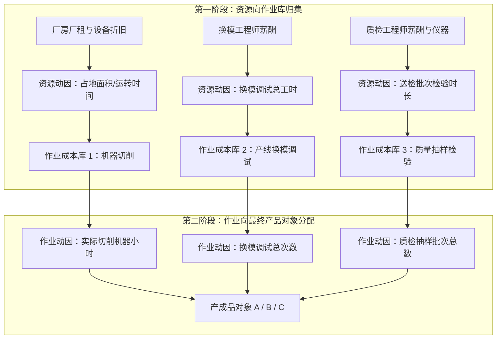

# Lec 09 间接成本分配深化与作业成本 (Activity-Based Costing: Resource Drivers, Cost Hierarchy & Destin Brass)

> MIT Sloan School of Management · 15.521 Accounting Information for Decision Makers · 讲义 09

## TL;DR

- 传统基于产量的分配法将所有制造费用按单一动因均摊，导致高产量产品对小批量定制产品的严重交叉补贴。
- 作业成本法（ABC）遵循“产品消耗作业，作业消耗资源”的两阶段动因映射逻辑。
- 制造费用被划分为单位级、批次级、产品维持级与设施维持级四层成本层级结构。
- 德斯汀黄铜案例揭示了产品成本严重扭曲下的定价灾难，作业成本分析能够有效识别真实的盈利基石。

## 传统产量基准成本法的“花生酱分摊”扭曲

在 20 世纪初的早期工业制造时代，企业生产线极其单一，直接人工与直接原材料在产品总成本中占据绝对统治地位（往往超过 $80\%$），而车间间接制造费用（Overhead）占比极低。在此背景下，将制造费用按**直接人工工时（Direct Labor Hours, DLH）**或**机器工时（Machine Hours, MH）**简单均摊，完全符合成本效益原则。

然而在高度自动化、柔性化和多样化生产的现代工业体系中，制造费用占比飙升至 $40\%-60\%$，直接人工占比往往已不足 $5\%$。传统单一费率法在面对复杂产品矩阵时，会引发灾难性的**“花生酱分摊”扭曲（Peanut-Butter Costing）**：

::: pitfall 成本交叉补贴引发的商业逆向淘汰
- **大批量标准品被严重高估成本（Overcosted）**：标准品生产工艺成熟，全年不需要换模、不需要工程变更、不需要单独送检。但由于其生产件数多、累计人工工时大，被财务系统硬性摊派了绝大多数模具切换与质检费用。企业误以为其成本高昂，在市场上报出过高售价，导致市场份额被专业化聚焦的单品竞争对手蚕食；
- **小批量定制品被严重低估成本（Undercosted）**：定制品每次生产都需要工程师重新调试机器、单独向外部供应商零星采购高精元器件、每做几件就要停机重新质检。但由于其人工工时极少，分摊的制造费用微乎其微。企业误以为其是“高毛利爆款”，四处大肆推广接单，结果接单越多，全厂实际利润越差。
:::

## 作业成本法（ABC）两阶段模型与四层成本动因层级

为了彻底破除花生酱分摊的迷雾，罗宾·库珀（Robin Cooper）与罗伯特·卡普兰（Robert Kaplan）系统构建了**作业成本法（Activity-Based Costing, ABC）**。其核心哲学是一句不可动摇的因果公理：**产品消耗作业，作业消耗资源（Products consume activities, and activities consume resources）**。

在 ABC 体系下，制造费用不再被视为一个无差别的混沌整体，而是严格按照**成本动因层级（Cost Hierarchy）**进行正交解构：

| 成本层级 | 概念定义与经济本质 | 典型车间作业范例 | 科学作业动因 (Cost Driver) |
| :--- | :--- | :--- | :--- |
| **1. 单位级作业 (Unit-Level)** | 每生产一个独立物理产品单元就必须发生一次的作业 | 冲压车间机床电费、涂装单件消耗、易耗刀具切削磨损 | 机器运转小时数、直接原材料物理用量 |
| **2. 批次级作业 (Batch-Level)** | 无论该批次包含 10 件还是 10,000 件产品，每生产一整个批次只需发生一次的作业 | 停机清洗并更换模具（Setup）、整批物料搬运吊装、批量采购订单处理 | 换模次数（Setup Hours）、采购订单数量、搬运批次 |
| **3. 产品维持级 (Product-Sustaining)** | 为使某特定产品型号能够在产线上生产而必须维系的专业作业，与产量和批次完全无关 | 工程变更单处理（ECO）、特定产品模具设计开发、国家合规性认证送检 | 工程变更工时数、特定产品专用测试工装件数 |
| **4. 设施维持级 (Facility-Sustaining)** | 维系整个工厂作为一个物理实体正常运转所不可或缺的基础作业，无法找到科学因果分配路径 | 总经理与厂长薪酬、全厂保安保洁、厂房外墙维修与保险 | 原则上不宜分摊给单个产品，应作为期间费用从全厂毛利中扣减 |

## 经典商业案例：德斯汀黄铜制品公司（Destin Brass Products）

哈佛商学院与 MIT 教学中的经典案例《德斯汀黄铜制品公司》（*Destin Brass Products Co.*）完美展现了传统成本法与作业成本法的剧烈认知颠覆：

::: example 德斯汀黄铜三种阀门成本重构实测
德斯汀黄铜主要生产三类铜质流体控制阀门：
1. **阀门（Valves）**：大批量标准品，月产 7,500 件，生产批次大（每批 750 件，全年仅需调试 10 次）；
2. **水泵（Pumps）**：中等批量成熟品，月产 4,000 件，生产批次适中（每批 800 件，全年调试 5 次）；
3. **流量控制器（Flow Controllers）**：小批量高定制新品，月产 1,000 件，由于客户频繁提出小改动，生产批次极其零碎（每批仅 40 件，全年调试高达 25 次）。
:::

各产品生产过程中的资源消耗明细与关键生产参数如下表所示：

| 经营指标与资源消耗 | 标准阀门 (Valves) | 水泵 (Pumps) | 流量控制器 (Flow Controllers) | 全厂总计 |
| :--- | :--- | :--- | :--- | :--- |
| **月生产总量 (Units)** | 7,500 件 | 4,000 件 | 1,000 件 | 12,500 件 |
| **单位直接材料成本** | $16.00 | $20.00 | $22.00 | — |
| **单位直接人工工时 (DLH)** | 0.40 小时 | 0.50 小时 | 0.40 小时 | 5,400 小时 |
| **换模调试次数 (Setups)** | 10 次 ($25\%$) | 5 次 ($12.5\%$) | 25 次 ($62.5\%$) | 40 次 ($100\%$) |
| **机器运转小时 (MH)** | 3,750 小时 | 3,200 小时 | 800 小时 | 7,750 小时 |

全厂当月发生间接制造费用共计 **$122,450**，涵盖三大核心作业池：
- **机器运转折旧费（单位级）**：$62,000；
- **产线换模调试费（批次级）**：$38,000；
- **收发与搬运调度费（批次级）**：$22,450。

### 1. 传统成本法测算（以直接人工工时 DLH 作为统揽分配率）
- 全厂统一分配率：$\text{Overhead Rate} = \frac{\$122,450}{5,400 \text{ DLH}} = \$22.676 \text{ / DLH}$；
- **标准阀门单位制造成本**：
  $$\text{Unit Cost}_{\text{Valve}} = \$16.00 + (0.40 \text{ DLH} \times \$22.676) = \$16.00 + \$9.07 = \$25.07$$
- **流量控制器单位制造成本**：
  $$\text{Unit Cost}_{\text{Flow}} = \$22.00 + (0.40 \text{ DLH} \times \$22.676) = \$22.00 + \$9.07 = \$31.07$$
- **传统报表反馈的结论**：标准阀门市场售价为 $29.00（毛利率仅 13.5%）；而小批量定制的流量控制器市场售价为 $49.00（毛利率高达惊人的 36.6%）！公司管理层据此决定逐步压缩标准阀门产能，全力扩张流量控制器。

### 2. 作业成本法（ABC）测算
按照 ABC 两阶段因果归集，计算各作业池独立费率：
- **机器切削费率**：$\frac{\$62,000}{7,750 \text{ MH}} = \$8.00 \text{ / MH}$；
- **换模调试费率**：$\frac{\$38,000}{40 \text{ Setups}} = \$950.00 \text{ / 次}$；
- **收发搬运调度费率**：按零件批次精准分配，流量控制器因批次多承担了 $45\%$。

**穿透 ABC 后的真实单位制造成本**：
- **标准阀门真实单位成本**：经精准剔除换模与杂项批次成本后，其真实分配的制造费用仅为 $\$5.93$，**真实单位成本降至 $\$21.93$**！其实际毛利率高达：
  $$\text{Real Margin}_{\text{Valve}} = \frac{\$29.00 - \$21.93}{\$29.00} \approx 24.4\%$$
- **流量控制器真实单位成本**：由于 25 次调试费用绝大部分压在了仅仅 1,000 件产品上（仅调试成本一项，每件就分摊了 $\frac{25 \times \$950}{1,000} = \$23.75$），加上物料与机器运转，**真实单位成本飙升至 $\$58.20$**！其真实经济毛利率为：
  $$\text{Real Margin}_{\text{Flow}} = \frac{\$49.00 - \$58.20}{\$49.00} = -18.8\%$$
- **惊人真相**：德斯汀黄铜自以为毛利率高达 $36.6\%$ 的“战略核心新品”流量控制器，**在现实中每卖出一件就要净亏损 $9.20 美元**！公司之前所谓的利润，全部是标准阀门凭借极简批次所产生的巨大现金流在暗中无偿输血。

## ABC 系统的实施成本、认知负荷与局限性

既然 ABC 如此洞察入微，为何在 2000 年后许多企业放弃了传统的 ABC 系统？
1. **主观工时问卷访谈的沉重维护成本**：传统的 ABC 系统依赖于每季度对全厂工程师和员工进行面对面访谈或填写工时日志（Timesheets），询问“你在机器调试上花了百分之几的时间”。不仅耗费海量人力，而且员工存在严重的防御性撒谎行为；
2. **闲置产能分摊的“死亡螺旋”再现**：传统 ABC 将当期实际发生成本除以当期实际作业量计算作业单价。当经济萧条导致全厂生产批次锐减时，计算得出的单次换模费率会莫名暴涨，将由于宏观萧条造成的闲置产能成本硬塞入产品成本中；
3. **向时间驱动作业成本法（TDABC）的演进**：卡普兰与史蒂文·安德森（Steven Anderson）随后提出了升级版的 **TDABC（Time-Driven ABC）**，废除了繁琐的员工调查，仅测算两项核心参数：
   - 部门单位时间产能成本（$\text{Capacity Cost Rate} = \frac{\text{部门总成本}}{\text{部门实用产能总时间}}$）；
   - 完成单位特定作业的标准预计用时（如每次换模标准耗时 45 分钟）。TDABC 能够自动隔离闲置产能成本，并支持大规模企业级 ERP 自动化实时测算。

## 我的理解

::: insight 商业世界中最昂贵的虚荣，是把高复杂性误当成高附加值
德斯汀黄铜的经典困境在当今的高科技与制造业中每天都在反复上演：
1. **警惕“定制化崇拜”陷阱**：在很多管理层潜意识中，标准化产品代表着落后平庸，只有“满足客户个性化长尾需求的小批量定制”才代表高级与创新。然而在没有 ABC 护航的粗糙财务核算下，这种虚荣心极其致命。每一个微小定制要求背后，都隐藏着图纸修改、专用夹具制作、采购谈判、产线停机清洗等一整套庞大的官僚协调作业成本。如果企业不能在定价上向定制客户索取足以覆盖所有批次与产品维持级作业成本的超额溢价，长尾定制就是慢性自杀。
2. **管理会计的最高境界是引导战略取舍**：ABC 系统的终极输出绝不是那张漂亮的成本明细表，而是推动管理层产生壮士断腕的战略勇气——要么依据真实 ABC 成本向定制客户大幅提价 $50\%$（若客户拒绝就果断砍掉产品线），要么重构研发平台推行模块化设计，将原本繁复的非标作业转化为底层的标准化插拔。只有把隐藏在水面之下的作业动因成本彻底暴晒在阳光下，企业的资源配置才可能实现真正的理性回归。
:::
