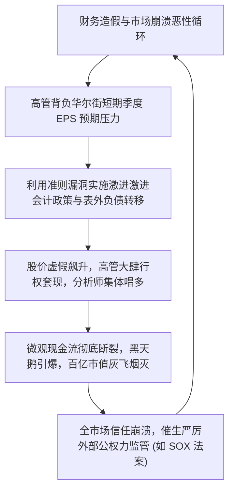
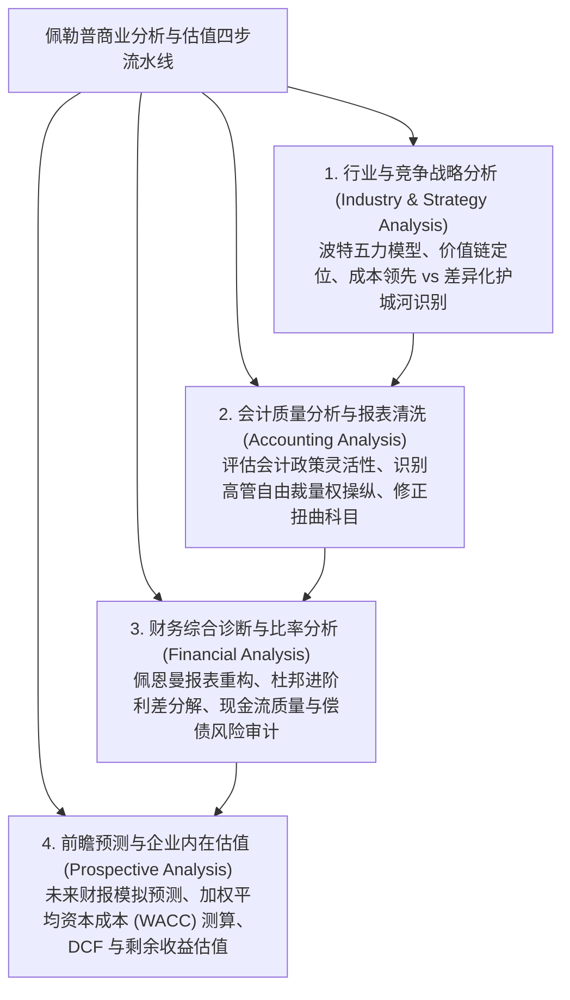
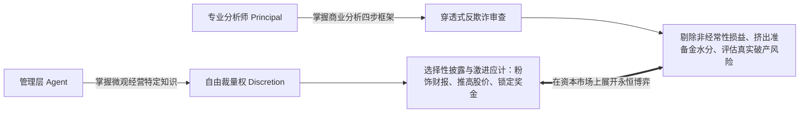

# Lec 01 会计丑闻、企业估值与有效市场假说 (Introduction: Accounting Scandals, Valuation and Market Efficiency)

> MIT Sloan School of Management · 15.535 Business Analysis Using Financial Statements · 讲义 01

## TL;DR

- 世纪初安然与世通等系列会计丑闻彻底击碎了资本市场对审计自律的盲目信任，催生了严厉的监管变革。
- 佩勒普-希利商业分析四步范式依次涵盖战略分析、会计质量清洗、财务比率诊断与前瞻估值预测。
- 有效市场假说（EMH）确立了价格反映信息的基准，但系统性认知偏差为基本面量化分析创造了超额空间。
- 财务报告是委托代理博弈的信息战场，卓越的分析师必须扮演“逆向侦探”以还原企业真实的内在公允价值。

## 会计丑闻的世纪冲击与审计信任危机

在 21 世纪初，全球资本市场经历了一场空前的大地震。安然（Enron）、世通（WorldCom）、泰科（Tyco）、帕玛拉特（Parmalat）等曾经光芒万丈的财富 500 强行业领袖，在短短数月内因财务欺诈相继轰然崩塌。

这批丑闻的爆发给金融学与会计学界带来了致命的认知冲击：
- **审计公信力的彻底破产**：作为全球“五大会计师事务所”之一、拥有百年声誉的安达信（Arthur Andersen），因直接参与销毁安然审计底稿而被判妨碍司法公正，最终走向解体；
- **自律监管神话的幻灭**：在华尔街投行丰厚的承销佣金与高管天价股票期权的利益诱惑下，传统的行业自律委员会完全沦为形同虚设的摆设；
- **资本配置的巨大扭曲**：数千亿美元本应投向高生产率创新领域的社会财富，被虚假财报引导至早已资不抵债的空壳公司，最终化为乌有。

## 商业分析四步框架：Palepu-Healy 经典范式

为了使证券分析师与投资人不再被管理层精心修饰的会计报表所蒙蔽，哈佛商学院克里希纳·佩勒普（Krishna Palepu）与保罗·希利（Paul Healy）构建了享誉全球投资界的**基于财务报表的商业分析四步框架（Business Analysis and Valuation Framework）**：

1. **行业与竞争战略分析**：财务分析的终极前提是理解商业模式。如果一家公司的 ROE 极高，但其所处的行业没有任何进入壁垒，那么这一超额收益在未来必然迅速被新进入的竞争对手均值回归。战略分析确立了企业未来现金流预测的定性天花板；
2. **会计质量分析**：分析师必须审查管理层在编制报表时是否实施了“选择性采摘（Cherry-Picking）”或“洗大澡（Big Bath）”。在将报表数字输入估值模型之前，必须先将违规资本化的费用剔除、将表外隐蔽负债拉回表内，还原纯净的经济现实；
3. **财务综合诊断**：通过重构资产负债表与利润表，分离核心经营活动（Operating）与金融融资活动（Financing），评估企业内生造血能力（RNOA）与债务杠杆的可持续性；
4. **前瞻预测与估值**：将前三步提炼出的战略假设与清洗后的基数，转化为对未来 5 至 10 年财务报表的严密预测，并在贴现率模型下测算股票内在公允价值。

## 有效市场假说（EMH）的三种形态与行为金融挑战

在探讨“财务报表分析究竟能否创造超额超额阿尔法收益（Alpha）”时，现代金融学的基石理论是尤金·法玛（Eugene Fama）提出的**有效市场假说（Efficient Market Hypothesis, EMH）**：

::: definition 有效市场假说 (EMH)
有效市场假说认为，在信息充分流动的金融市场中，证券价格在任何时点都完全、充分且瞬时地反映了所有可获取的相关信息，因此没有任何投资者能够持续获得经风险调整后的超额超额收益。
:::

有效市场假说依据信息集的不同划分为三个递进层次：

| 市场有效性形态 | 价格所反映的信息集合 | 核心经济学结论与市场实证 | 对财务报表基本面分析的启示 |
| :--- | :--- | :--- | :--- |
| **弱势有效 (Weak-Form)** | 仅反映历史价格与历史成交量信息 | 股票价格变动服从随机游走（Random Walk），基于K线图的技术分析彻底失效。 | 基本面财务报表分析仍然具备挖掘未公开价值的潜在超额空间。 |
| **半强势有效 (Semi-Strong)** | 反映**所有公开可获取的信息**（包括已披露的 10-K 年报、新闻、宏观数据） | 市场能够以极快速度消化年报信息；普通散户靠阅读公开发布的利润表无法获得 Alpha。 | **分析师必须具备“穿透式逆向重构能力”**！市场虽能吸收表面数字，但对附注深处的隐蔽应计项反应严重迟钝。 |
| **强势有效 (Strong-Form)** | 反映**包含未公开内幕信息在内的所有信息** | 即便掌握公司绝密内幕的高管也无法在二级市场获得超额垄断利润。 | 现实世界已被大量内幕交易实证彻底证伪；强势有效仅作为理论极端基准存在。 |

现代行为金融学（Behavioral Finance）的研究表明：由于人类大脑普遍存在**锚定效应、过度自信与有限注意力（Limited Attention）**，证券市场在绝大多数时期仅能达到“表面半强势有效”。市场往往过度追捧短期的靓丽净利润，而系统性忽视藏在附注里的恶性应收账款堆积——这恰恰为精通深层财务报表分析的理性价值投资者提供了巨大的市场定价错误套利窗口。

## 财务报告使用者与资本配置的代理人博弈

现代资本市场的核心矛盾是**委托人（外部股东与债权人）与代理人（企业职业经理人）之间的信息不对称博弈**。

财务报告从来不是微观物理世界的客观复印件，而是管理层在契约激励与监管威慑之间精算妥协的产物。卓越的分析师必须时刻牢记：**你的交易对手是深谙会计规则的专业高管团队**。如果仅仅把年报正文的数字作为理所当然的事实输入计算器，那么在估值模型输出的那一刻，投资人就已经沦为任人宰割的信息劣势受害者。

## 我的理解

::: insight 商业分析不是算术，而是在不确定性迷雾中重构商业真相的认知战争
站在金融学与会计学的十字路口，我们可以提炼出最具穿透力的分析师哲学：
1. **财报是冰山的尖角，水下才是真实的商业暗礁**：很多初学者以为财务分析就是计算市盈率（P/E）和净资产收益率（ROE）。但任何一个稍通会计技巧的 CFO，都能在几个小时内通过微调折旧年限、提前确认几笔软件维保合同，把账面 ROE 从 10% 拔高到 20%。真正的商业分析是一场侦探工作——你必须先用波特五力模型审视这家企业在产业链中究竟有没有定价权，再用会计分析的手术刀把管理层涂抹的脂粉一层层刮掉，直到露出真实的税后净经营利润（NOPAT）。
2. **市场有效性是竞争的产物，而不是坐享其成的赠礼**：有效市场假说常被教条主义者误读为“既然市场已经反映了一切信息，那么深入研究财报就是徒劳的”。然而事实恰恰相反：**市场之所以在宏观上看起来具有一定程度的有效性，正是因为有一批最聪明、最严谨的基本面分析师在夜以继日地拆解 10-K 附注、逆向还原微观现金流，从而通过真金白银的交易不断纠正错误定价**。掌握深层商业报表分析能力，就是让自己成为推动市场走向有效、并在市场犯下系统性愚蠢错误时捕获超额财富的清醒狩猎者。
:::
