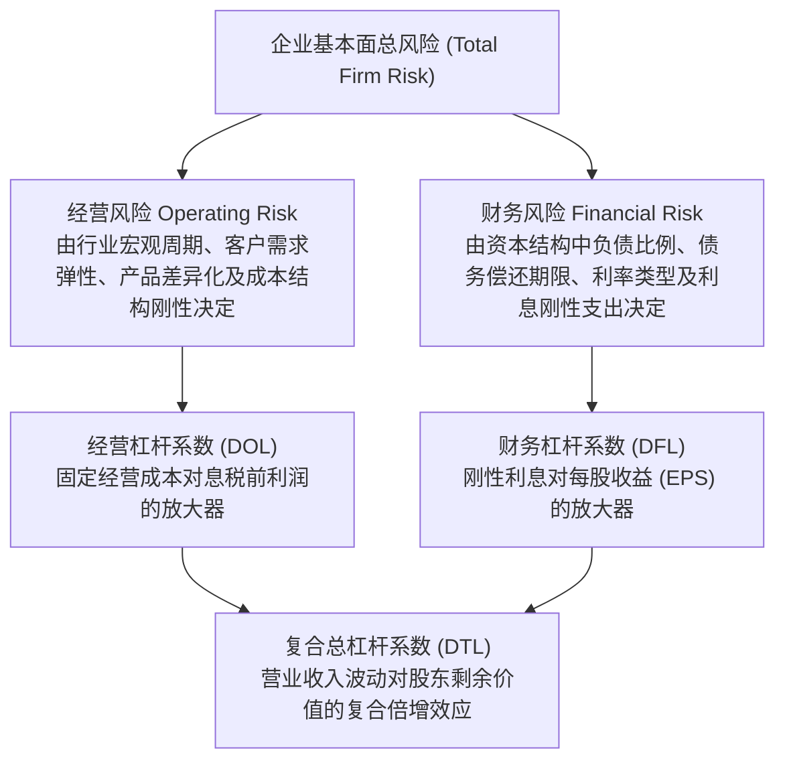
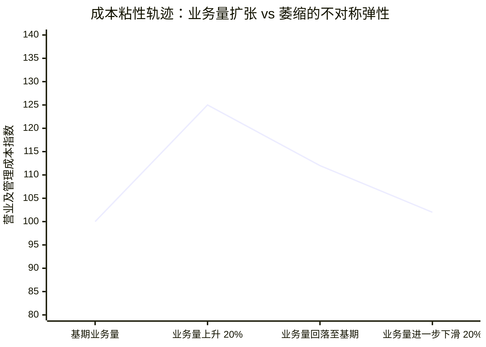
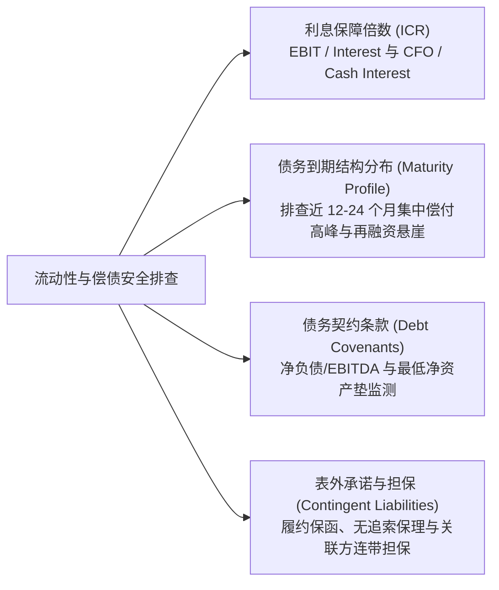

# Lec 10 风险评估与财务报表中的风险刻画 (Risk Assessment and Profiling in Financial Statements)

> MIT Sloan School of Management · 15.535 Business Analysis Using Financial Statements · 讲义 10

## TL;DR

- 企业基本面总风险由经营杠杆决定的业务波动与财务杠杆决定的偿债刚性共同构成。
- 经营杠杆系数（DOL）由固定经营成本主导，成本粘性在需求下行期加剧利润崩塌效应。
- 财务杠杆系数（DFL）放大经营利润变动对股东收益的冲击，两者的乘积（DTL）决定尾部破产风险。
- 财务报表通过债务到期时间分布、利息保障倍数与衍生品敞口附注，全景映射流动性枯竭敞口。

## 基本面风险的双重视角：经营风险与财务风险

现代证券估值与信用评级体系不仅关注企业能创造多少期望收益，更关注这些收益在面对宏观逆风、产业竞争加剧与技术颠覆时所承受的波动率与下行破产概率。

从企业资产负债表与利润表架构来看，企业承担的系统性与特异性风险可以严格解构为两大正交维度：**经营风险（Operating Risk）**与**财务风险（Financial Risk）**。

在财务报表中，经营风险主要反映在利润表的营业收入生成机制、毛利空间与经营费用结构中；而财务风险则主要隐藏在资产负债表的流动与非流动金融负债规模、资本公积与利息支出刚性中。

::: definition [经营风险 vs 财务风险]
- **经营风险（Operating Risk）**：指企业在完全不使用任何债务杠杆（即 100% 股权融资）的纯股权架构下，其主营业务经营资产所面临的固有波动性。其来源包括产品价格与销量的宏观敏感性、上游原材料议价能力以及生产经营中固定成本（如厂房折旧、固定人工）的占比。
- **财务风险（Financial Risk）**：指由于引入优先股、银行借款、企业债券等具有固定财务索偿权的外部债务工具，而额外加诸于普通股股东身上的剩余索偿权波动与现金断裂违约风险。
:::

## 经营杠杆（DOL）与成本粘性（Cost Stickiness）

### 经营杠杆系数的数学形式

经营杠杆的核心驱动机制在于企业生产要素配置中的**固定成本（Fixed Costs, FC）**。当企业具备高额固定生产成本时，微小的销量增长将使固定成本被摊薄，从而带来经营利润的大幅飞跃；然而一旦销量下滑，固定成本分毫未减，将迅速把企业推入亏损深渊。

::: theorem [经营杠杆系数 (Degree of Operating Leverage, DOL)]
经营杠杆系数衡量息税前利润（EBIT）对营业收入（或产销量 $Q$）变动的弹性百分比。设产品单价为 $P$，单位变动成本为 $V$，固定经营成本总额为 $FC$，息税前利润 $EBIT = Q(P - V) - FC$：

$$DOL = \frac{\% \Delta EBIT}{\% \Delta Q} = \frac{\frac{\Delta EBIT}{EBIT}}{\frac{\Delta Q}{Q}} = \frac{Q(P - V)}{Q(P - V) - FC} = \frac{\text{边际贡献总额 (Contribution Margin)}}{EBIT}$$
:::

从公式可知，若企业无任何固定成本（$FC = 0$），则 $DOL = 1.0$，利润与营收同比例变动；随着 $FC$ 在成本结构中占比提升，分母 $EBIT$ 趋近于零，$DOL$ 趋于无穷大，企业对宏观需求的任何轻微震颤都变得极度敏感。

### 成本粘性理论的深化

传统管理会计假设成本与业务量之间呈对称线性关系：收入增长 10% 时成本增加 7%，收入下降 10% 时成本亦同等压缩 7%。

然而，实证会计学大师 Anderson、Banker 和 Janakiraman 于 2003 年提出了著名的**成本粘性理论（Cost Stickiness）**：在真实商业世界中，**当业务量上升时成本增加的幅度，显著大于业务量下降时成本减少的幅度**。

造成成本粘性的经济动因包括：
1. **调整成本（Adjustment Costs）**：解雇研发人员与熟练产业工人需要支付巨额法定遣散补偿；一旦需求未来复苏，重新招聘、背景调查与岗位培训的重置成本更高。
2. **管理层帝国构建动机（Empire Building）**：管理层出于维持个人权力和声望的心理，极其不情愿在衰退初期缩减其控制的办公面积、分支机构和行政预算。
3. **合同刚性（Contractual Commitments）**：长期经营性租赁合同、IT 系统年度授权许可与最低采购承诺（Take-or-Pay）使管理层在短期内无法解约。

成本粘性意味着在宏观下行周期，企业的真实固定成本占比会瞬时大幅飙升，导致实际承受的下行经营杠杆远超基于历史平稳期测算的理论值。

## 财务杠杆（DFL）与复合总杠杆（DTL）

### 财务杠杆系数与偿债刚性

财务杠杆系数衡量利息刚性支出对普通股每股收益（EPS）或税后利润波动的二次放大效应。

::: theorem [财务杠杆系数 (Degree of Financial Leverage, DFL)]
财务杠杆系数度量普通股每股收益对息税前利润变动的百分比敏感度。设年刚性利息费用总额为 $I$，优先股股利为 $D_p$，企业所得税率为 $t$：

$$DFL = \frac{\% \Delta EPS}{\% \Delta EBIT} = \frac{EBIT}{EBIT - I - \frac{D_p}{1 - t}}$$
若不存在优先股，则简化为：
$$DFL = \frac{EBIT}{EBIT - I}$$
:::

当 $EBIT$ 高度覆盖利息支出时，$DFL$ 接近于 1；当 $EBIT$ 逼近利息费用总额时，$DFL \to \infty$，微小的经营利润波动就足以将股东权益彻底清零甚至推入资不抵债。

### 复合总杠杆系数（DTL）的杀伤力

将经营杠杆与财务杠杆链式复合，便可得出营业收入变动对普通股股东剩余收益的综合传导倍数：

$$DTL = DOL \times DFL = \frac{Q(P - V)}{Q(P - V) - FC} \times \frac{EBIT}{EBIT - I} = \frac{Q(P - V)}{Q(P - V) - FC - I}$$

::: example
某重资产半导体制造企业年营业收入 20 亿元，变动成本 8 亿元（边际贡献 12 亿元），固定制造与折旧费用 8 亿元，年付息债务利息 3 亿元。
1. 计算 $EBIT$：$12 - 8 = 4$ 亿元。
2. 经营杠杆系数：$DOL = 12 / 4 = 3.0$。
3. 财务杠杆系数：$DFL = 4 / (4 - 3) = 4.0$。
4. 复合总杠杆系数：$DTL = 3.0 \times 4.0 = 12.0$。

这意味着如果全球半导体行业陷入周期性萧条，该企业营业收入下滑仅 5%，其普通股股东每股收益将暴跌：
$$\% \Delta EPS = DTL \times (\% \Delta REV) = 12.0 \times (-5\%) = -60\%$$
若收入下滑超过 $8.33\%$（$1 / 12$），息税前利润将不足以支付 3 亿元借款利息，企业将立即陷入现金流断裂与债务违约。
:::

::: pitfall [“高经营杠杆 + 高财务杠杆”的死亡配比]
在周期性繁荣阶段，管理层极易沉醉于双高杠杆带来的惊人 EPS 爆发力。然而，财务理论铁律表明：**重资产、高经营杠杆（高固定折旧）的行业（如航运、航空、钢铁、半导体代工），必须在资本结构中保持保守的低财务杠杆**；反之，只有具备极低经营杠杆和稳定经常性现金流的公用事业与消费品企业，才有能力承担较高的债务杠杆。违背这一匹配原则的企业，几乎无一例外在宏观流动性收紧周期走向崩解。
:::

## 财务报表中的流动性与偿债深水区体检

在资产负债表与 10-K 报告附注中，分析师必须跳出粗糙的流动比率（Current Ratio）表面数字，深入解构以下关键信用风险指标。

### 核心流动性风险检验清单

1. **利息保障倍数（Interest Coverage Ratio, ICR）的双重视角**：
   - 账面口径：$ICR_{\text{accrual}} = \frac{EBIT}{\text{利息支出}}$。通常认为低于 2.0 倍进入预警区，低于 1.0 倍意味着企业当期经营利润无法覆盖借贷成本。
   - 现金口径：$ICR_{\text{cash}} = \frac{CFO + \text{支付的利息与税费}}{\text{实际支付的现金利息}}$。现金口径排除了应收账款虚增带来的纸面利润遮蔽，能直接反映账面现金的真实偿付冗余。
2. **债务到期期限分布（Debt Maturity Profile）**：
   - 细读 10-K 附注中的长短期借款明细表，警惕“再融资悬崖”（Refinancing Cliff）。若企业在未来 12 到 18 个月内有超过 40% 的高息债券集中到期，在加息周期或信用评级下调背景下，极易遭遇金融机构抽贷断贷。
3. **外汇与利率衍生品敞口（Item 7A / Derivative Disclosures）**：
   - 审查管理层是否使用利率互换（IRS）将浮动利率转为固定利率，是否存在跨币种借贷（如美元借债而资产全为新兴市场弱势货币）而未进行严格套期保值。

## 我的理解

::: insight [杠杆的物理学本质：时间与不确定性的非对称透支]
杠杆在财务学中的数学本质，是对空间换时间的非线性放大器。在顺周期阶段，它让企业以极小的初始权益撬动庞大的资产飞轮，将 5% 的行业微利放大为 30% 的股东净资产收益率（ROE），让所有参与者沉浸在“复利奇迹”的狂欢中。

然而，财务报表分析的至高智慧在于看清杠杆背后的物理学代价——**非对称脆弱性（Asymmetric Fragility）**。固定资产折旧不因工厂停工而减免一分钱，银行债务本息不因产品滞销而推迟一秒钟。当外部环境风暴来袭，经营杠杆与财务杠杆的叠加，会以无情的乘数效应将收入端的微弱降幅放大为资产负债表端的瞬间内爆。

合格的价值评估者从不单纯追逐牛市中高杠杆企业亮眼的 EPS 增速。真正卓越的分析师，永远在资产负债表的角落里审视企业应对“百年一遇”黑天鹅事件时的流动性护城河（Financial Flexibility）。只有理解了固定成本的刚性、看清了债务期限结构的暗礁，你才能分清哪些企业是在凭借核心技术壁垒稳健前行，而哪些企业仅仅是坐在火药桶上随着宏观流动性周期起舞。
:::
