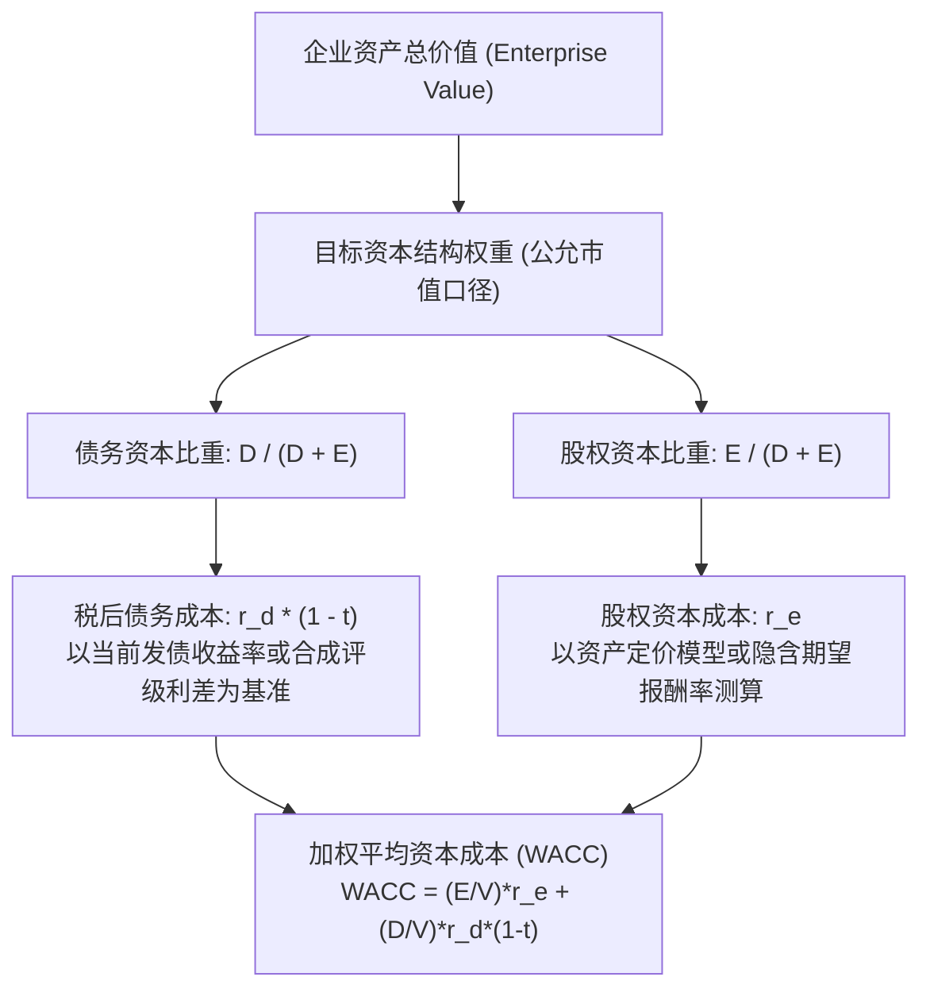
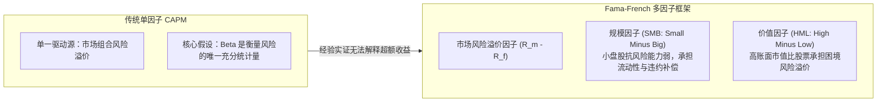
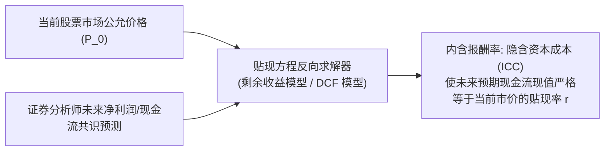
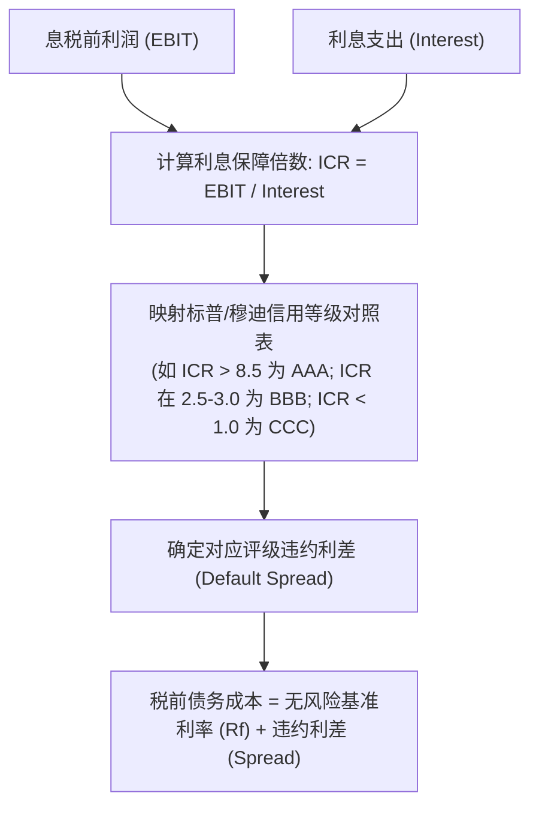

# Lec 11 资本成本测算与 CAPM 模型争议 (Cost of Capital: Estimation and the CAPM Debate)

> MIT Sloan School of Management · 15.535 Business Analysis Using Financial Statements · 讲义 11

## TL;DR

- 加权平均资本成本（WACC）是连接企业现金流与内在价值的贴现桥梁，其测算核心在于股权资本成本。
- 传统 CAPM 单因子模型依赖历史 Beta，但受观测区间、基准指数与杠杆解耦公式假设的严重扰动。
- Fama-French 因子模型证明市值规模与账面市值比能系统性解释传统 Beta 无法覆盖的超额收益溢价。
- 隐含资本成本（ICC）通过剩余收益模型反推市场即时期望报酬率，打破了历史回归向后看的局限性。

## 资本成本的经济学本质与 WACC 计算架构

在企业价值评估（DCF 模型与剩余收益模型）与资本配置决策中，**资本成本（Cost of Capital）**扮演着决定性的折现标尺角色。从经济学视角来看，资本成本并非企业向资金提供方实际支付的历史利息或股利，而是投资者将稀缺资本投向该特定企业资产所放弃的、在同等风险水平金融资产上可获得的**机会成本（Opportunity Cost）**。

企业整体价值来源于经营资产创造的自由现金流，其适用的综合贴现率为**加权平均资本成本（Weighted Average Cost of Capital, WACC）**。

在 WACC 的测算框架中，必须遵循两项不妥协的财务学公理：
1. **公允市值权重（Market Value Weights）**：权益价值 $E$ 与债务价值 $D$ 必须采用当期可观测的资本市场公允价值，绝对禁止采用资产负债表上的历史账面价值。账面权益忽略了企业历年积累的商誉与未来增长期权，会严重高估高负债重资产企业的债务权重。
2. **边际与前瞻原则（Marginal and Forward-looking）**：计算中采用的成本参数是企业未来筹集增量资本所需支付的边际成本，而非资产负债表上存量债务的历史票面利率。

::: definition [加权平均资本成本 (WACC)]
加权平均资本成本是企业各类长期融资来源的税后边际成本按其公允市场价值占比加权计算得出的综合期望报酬率：
$$WACC = \left(\frac{E}{V}\right) r_e + \left(\frac{D}{V}\right) r_d (1 - t)$$
其中 $E$ 为普通股权益市值，$D$ 为付息债务总市值，$V = E + D$ 为企业总价值，$r_e$ 为股权期望报酬率，$r_d$ 为税前债务边际收益率，$t$ 为企业适用的边际所得税率。
:::

## 传统 CAPM 模型与 Beta 系数估计的实务陷阱

在经典现代金融学中，威廉·夏普（William Sharpe）建立的**资本资产定价模型（CAPM）**是测算股权资本成本 $r_e$ 的标准教科书方法：

$$r_e = r_f + \beta_i (r_m - r_f)$$

其中 $r_f$ 为无风险利率（通常选用 10 年期国债到期收益率），$(r_m - r_f)$ 为市场风险溢价（Equity Risk Premium, ERP），$\beta_i$ 为该资产收益率对全市场组合收益率变动的系统性风险敏感度。

### 历史 Beta 回归估计的技术陷阱

在实务中，分析师通常对个股历史超额收益与市场基准指数收益（如标普 500 指数）运行时间序列 OLS 回归来估计 Beta。然而，该过程充斥着高度人为裁量与统计噪音：
- **数据频率与时间窗口的敏感性**：采用过去 2 年的周频数据、过去 5 年的月频数据或过去 1 年的日频数据，估计出的同一家公司的 Beta 可能在 0.8 到 1.5 之间剧烈摆动。
- **市场基准指数的选择偏差**：选择标普 500、罗素 2000 还是明晟全球指数（MSCI World），对跨国经营企业的 Beta 回归斜率产生重大影响。
- **均值回归修正（Blume Adjustment）**：由于企业经营多元化与宏观竞争驱动，历史极端 Beta 倾向于向全市场平均值 1.0 回归。美林证券常用的修正公式为：
  $$\beta_{\text{adjusted}} = \frac{2}{3} \beta_{\text{raw}} + \frac{1}{3} (1.0)$$

### 财务杠杆解耦与加耦（Unlevering and Relevering）

企业的股权 Beta（$\beta_L$，含杠杆 Beta）同时吸收了底层业务的经营风险与资本结构带来的财务杠杆风险。为了客观评估特定主营资产的真实风险，或为未上市标的公司寻找可比行业基准，必须进行杠杆剥离。

::: theorem [哈马达方程 (Hamada Equation)]
基于莫迪利亚尼-米勒定理（MM 定理）在含税条件下的推导，假定企业债务为无风险且利息税盾具有与债务相同的风险特征：
$$\beta_L = \beta_U \left[ 1 + (1 - t) \frac{D}{E} \right]$$
逆向解耦剥离杠杆（Unlevering）：
$$\beta_U = \frac{\beta_L}{1 + (1 - t) \frac{D}{E}}$$
其中 $\beta_U$ 为资产 Beta（无杠杆 Beta），纯粹反映业务固有的经营风险。
:::

::: example
分析师评估一家未上市的云计算初创公司，其目标资本结构为 20% 债务与 80% 股权（即 $D/E = 0.25$），企业所得税率 $t = 25\%$。
市场上三家可比上市云计算公司的平均含杠杆 Beta 为 1.60，平均负债权益比 $D/E = 0.50$。
1. 第一步：剥离可比公司的财务杠杆，提取纯业务资产 Beta：
   $$\beta_U = \frac{1.60}{1 + (1 - 0.25) \times 0.50} = \frac{1.60}{1 + 0.375} \approx 1.164$$
2. 第二步：根据拟评估标的公司的目标资本结构重新加杠杆：
   $$\beta_{L, \text{target}} = 1.164 \times [1 + (1 - 0.25) \times 0.25] = 1.164 \times [1 + 0.1875] \approx 1.382$$
3. 若无风险利率 $r_f = 4.0\%$，市场风险溢价 $ERP = 5.5\%$，则标的企业的股权资本成本为：
   $$r_e = 4.0\% + 1.382 \times 5.5\% = 11.60\%$$
:::

## “Beta 已死？”学术界与业界的世纪论战

1992 年，芝加哥大学教授 Eugene Fama 与 Kenneth French 发表了震撼金融界的重磅论文《股票期望收益的横截面》（*The Cross-Section of Expected Stock Returns*），尖锐指出：**在控制了企业规模（Size）与账面市值比（Book-to-Market, B/M）之后，传统 CAPM 中的 Beta 系数与股票长期横截面超额回报之间几乎毫无统计显著的线性关系**。

### Fama-French 三因子模型数学表述

为了修补 CAPM 的预测缺陷，Fama-French 将定价模型扩展为多维风险补偿结构：

$$r_{it} - r_{ft} = \alpha_i + \beta_{i1} (r_{mt} - r_{ft}) + \beta_{i2} SMB_t + \beta_{i3} HML_t + \epsilon_{it}$$

- **SMB（规模溢价）**：做多小市值股票、做空大市值股票投资组合的月度收益率差额。
- **HML（价值溢价）**：做多高账面市值比（价值型）股票、做空低账面市值比（成长型）股票组合的月度收益率差额。

该模型表明，大量科技成长股展现出的“低预期报酬率”和周期困境股展现出的“高报酬率”，并非由于其 Beta 估算有误，而是资本市场在对其承担的相对困境风险与增长期权进行理性定价。

## 前瞻性替代范式：隐含资本成本（Implied Cost of Capital, ICC）

传统资产定价模型（CAPM 或 Fama-French）在估值实务中面临一个根本性的哲学困境：**它们全部依赖对历史交易价格的向后追溯回归（Backward-looking）**。如果过去三年宏观处于零利率超宽流动性环境，历史 Beta 将无法反映未来利率中枢抬升与行业去产能后的边际资本成本。

实证会计学者（Gebhardt, Lee & Swaminathan, 2001; Claus & Thomas, 2001）提出了革命性的逆向求解框架——**隐含资本成本（Implied Cost of Capital, ICC）**。

### 基于剩余收益模型（RIM）的 ICC 测算

根据剩余收益估值模型，当前股价 $P_0$ 必须严格等于期初每股账面净资产 $B_0$ 加上未来无限期预期剩余收益的现值总和。若将分析师预期的未来各期每股盈余 $EPS_t$ 与预估净资产 $B_{t-1}$ 代入方程：

$$P_0 = B_0 + \sum_{t=1}^{T} \frac{\mathbb{E}[EPS_t] - r_{\text{ICC}} \cdot B_{t-1}}{(1 + r_{\text{ICC}})^t} + \frac{\mathbb{E}[EPS_{T+1}] - r_{\text{ICC}} \cdot B_T}{r_{\text{ICC}} (1 + r_{\text{ICC}})^T}$$

在这个方程中，当前股价 $P_0$、当前净资产 $B_0$ 以及未来各期分析师预测的 $EPS_t$ 均为**已知输入变量**，唯一的未知数就是贴现率 $r_{\text{ICC}}$。通过数值迭代算法即可求解出当期市场定价中隐含的股权资本成本。

::: definition [隐含资本成本 (ICC) 的核心优势]
- **绝对前瞻性**：完全立足于资本市场当前交易价格与卖方分析师对未来的预期基本面，不依赖任何一段选定历史时期的股价波动方差。
- **避免循环论证**：在进行相对估值检验时，ICC 可以直接作为独立基准，检验市场是否对特定行业的贴现率定价过高或过低。
:::

::: pitfall [盲目信任分析师预期导致的 ICC 偏差]
ICC 模型的阿喀琉斯之踵在于对分析师盈余预测的强依赖。由于卖方分析师普遍存在系统性乐观偏差（Optimism Bias），代入未经校准的膨胀 $EPS$ 预测值会导致倒算出的 $r_{\text{ICC}}$ 被系统性高估。在使用 ICC 时，必须对分析师长期预测实施保守平滑或收敛调整。
:::

## 债务资本成本与破产合成利差评估

对于绝大多数没有公开发行高流动性信用评级债券的非上市公司、中小型科技企业或高杠杆实体，直接从公开交易盘口获取前瞻性债务到期收益率（Yield to Maturity, YTM）往往难以实现。在估值实践中，纽约大学斯特恩商学院教授 Aswath Damodaran 提出了被华尔街投行广泛采纳的**合成信用评级法（Synthetic Rating Method）**。

### 合成评级测算的三大关键步骤

1. **核心覆盖指标测算（Interest Coverage Ratio, ICR）**：
   从最近十二个月（LTM）经审计财报中提取经正常化调整的息税前利润（$EBIT$）与实际应付利息费用总额，计算其利息保障倍数：
   $$ICR = \frac{EBIT}{\text{年利息总支出}}$$
   若企业资产规模较小（市值或资产低于 50 亿美元），其现金流波动抵御能力较弱，模型会采用更严苛的 ICR 评级映射阶梯。
2. **对齐国际评级基准与违约利差（Default Spread Mapping）**：
   将计算得出的 ICR 映射至标普（S&P）或穆迪（Moody's）对应的企业信用等级。例如，对于大型企业，若 $ICR > 8.5$ 映射为 AAA 级（违约利差约 0.50%）；若 $ICR$ 落在 2.5 至 3.0 之间则映射为 BBB 级（违约利差约 1.60%）；若 $ICR$ 跌破 1.0 则划入 CCC 级深度垃圾债预警区（违约利差通常超过 8.00%）。
3. **叠加主权与边际税盾约束（Marginal Tax Shield）**：
   企业的税前债务成本即为同期限国债无风险利率加上对应评级的违约利差。在考虑税盾效应时，必须严格审视税法对利息抵税的法定限制（例如美国 TCJA 法案 163(j) 条款对利息支出抵扣不得超过调整后应纳税所得额 30% 的限制）。若企业已经陷入持续性亏损，则边际税盾价值归零，不能机械地按 $(1 - t)$ 扣减税收抵免。

通过这一逻辑链条，分析师能够跳过复杂的场外债券报价，直接从资产负债表与利润表的底层偿债覆盖指标，推导出现实金融市场对企业特定信用风险所收取的边际融资成本。

## 我的理解

::: insight [资本成本的认知跃迁：从“纯数学公式”到“主观意志的折射”]
在初级金融学教科书中，WACC 与 CAPM 常常被包装成一组精密的牛顿力学公式——代入 Beta、乘上 ERP、加上国债利率，就能精确到小数点后两位得出 8.74% 的贴现率。然而，在资深商业分析师的眼中，资本成本从来不是一个由外部客观世界冷冰冰给定的物理常数。

资本成本在本质上是**全市场参与者对该企业未来商业模式不确定性、治理结构风险与现金流脆弱性的集体定价与主观意志折射**。

当你意识到历史 Beta 在不同时间窗口下的荒谬漂移，当你目睹安然破产前夕仍然维持着极低的理论 Beta，你就必须明白：依赖向后看的股价波动率来给未来二十年的现金流定价，无异于开着后视镜在悬崖边驱车。

真正的财务估值大师，既熟练掌握 CAPM 与多因子模型的数学骨架，更懂得运用隐含资本成本（ICC）与合成利差去反向审视市场先生当下的狂热与恐慌。贴现率的微小微调，是对企业护城河深度最严酷的灵魂拷问；看懂了资本成本，才算真正推开了企业内在价值评估的圣殿之门。
:::
