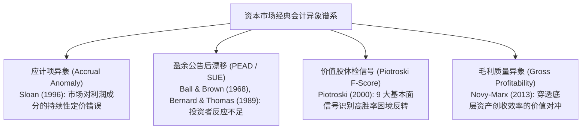
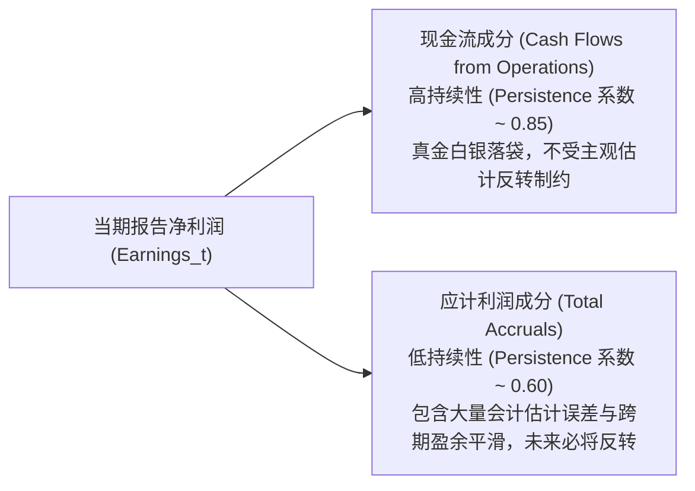
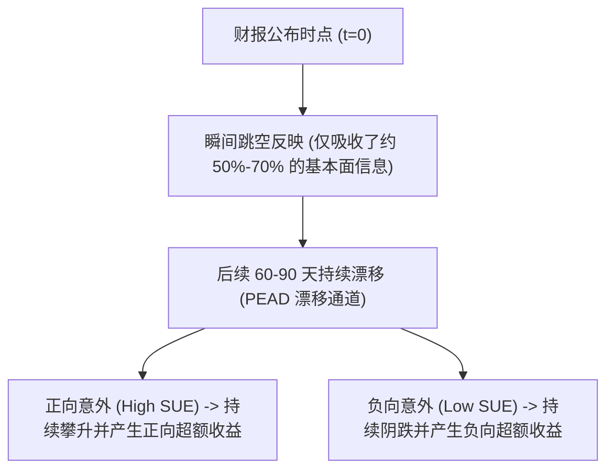
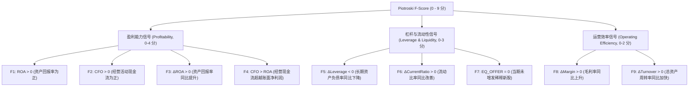

# Lec 12 会计信息异象与基本面量化投资策略 (Accounting Anomalies and Quantitative Value Strategies)

> MIT Sloan School of Management · 15.535 Business Analysis Using Financial Statements · 讲义 12

## TL;DR

- 应计项异象揭示了市场系统性高估非现金应计利润的持续性，低应计组合能长期获取显著超额收益。
- 盈余公告后漂移（PEAD）由投资者对未预期盈余的认知锚定与反应不足驱动，为基本面量化提供持续动量。
- 皮奥特罗斯基 F-Score 通过九大二元财务信号体系，在深度价值股中有效剔除价值陷阱。
- 现代量化基本面策略将毛利质量因子与资本再投资纪律融入多因子选股，实现了会计智慧的系统化变现。

## 有效市场假说的裂痕与会计异象的崛起

有效市场假说（EMH）主张，在半强式有效市场中，资产价格能够瞬时、无偏地吸收所有公开发布的财务报表与公司公告信息。如果该假说严格成立，基于对 10-K 年报、10-Q 季报中历史财务比率和应计指标的深入挖掘，将不可能产生系统性跑赢市场基准的超额回报（Alpha）。

然而，过去三十年间由实证会计学与行为金融学共同揭示的一系列**会计信息异象（Accounting Anomalies）**，对传统金融学理论发起了深刻挑战。

这些异象的存在雄辩地证明：**资本市场并非冷酷无情的理性超级计算机，而是充满了具有认知偏差、注意力瓶颈与代理考核压力的现实人类投资者**。深入理解这些财务信息的微观定价错误，构成了现代基本面量化对冲基金（如 AQR、桥水、千禧年）构建超额 Alpha 模型的核心源泉。

## 斯隆应计项异象（The Accrual Anomaly, Sloan 1996）

1996 年，宾夕法尼亚大学沃顿商学院教授 Richard Sloan 发表了会计学史上引用率最高的经典论文《股票价格是否完全反映了应计与现金流中关于未来盈余的信息？》（*Do Stock Prices Fully Reflect Information in Accruals and Cash Flows about Future Earnings?*）。

### 盈余持续性的二元解构

斯隆首先通过计量经济学检验了净利润（$Earnings$）中两个不同组分的未来持续性特征：

$$Earnings_{t+1} = \gamma_0 + \gamma_1 Accruals_t + \gamma_2 CashFlow_t + \epsilon_{t+1}$$

大量的全市场经验实证数据呈现出极其稳健的规律：**$\gamma_1 < \gamma_2$**。

- **现金流组分的高持续性**：真金白银流入企业银行账户的经营现金流，其未来延续并维持在相似水平的概率极高。
- **应计利润组分的低持续性**：应计利润由应收账款增加、存货积压、预提费用减少等会计记账调节产生。由于权责发生制的刚性时间约束，本期提前透支确认的应收账款下期若未收回必将计提坏账冲销，本期推迟计提的折旧费用未来终将体现。因此，**应计项目天然具有均值回归与反转的内在脆弱性**。

### 市场定价错误与对冲交易策略

斯隆的核心发现是：**普通投资者与华尔街分析师存在系统性的“功能锁定”（Functional Fixation）——他们只看重最底层的综合净利润数字，而未能穿透审视利润内部的现金流与应计成分的质地差异**。

市场错误地假设应计项与现金流具有相同的长期持续性，导致：
- **高应计企业被严重高估**：当期净利润亮眼但经营现金流匮乏的企业被市场追捧，当未来应计项反转导致利润断崖时，股价发生暴跌。
- **低应计企业被严重低估**：当期进行了严苛拨备或净利润暂时落后于现金流的企业被市场遗弃，随后其强劲的现金流持续转化为超预期利润，推动股价大幅修复。

::: theorem [斯隆对冲交易组合构建]
按期末资产总额标准化的应计利润率进行全市场十分位数（Decile）排序：
$$\text{Accrual Ratio} = \frac{NI_t - CFO_t}{TotalAssets_{t-1}}$$
构建自融资对冲投资组合：**做多应计率最低的 10% 股票（组合 1），同时做空应计率最高的 10% 股票（组合 10）**。

在控制了市场 Beta、公司规模、账面市值比等所有已知风险因子后，该多空策略在长达几十年的回测区间内创造了年化超过 **10.4% 的惊人异常超额收益（Alpha）**。
:::

::: example
公司 A 与公司 B 资产规模均为 10 亿元，当期均报告净利润 1.0 亿元。
- 公司 A：经营现金流 $CFO = 1.8$ 亿元，应计项 $TA = 1.0 - 1.8 = -0.8$ 亿元（应计率 -8%）。
- 公司 B：经营现金流 $CFO = 0.1$ 亿元，应计项 $TA = 1.0 - 0.1 = +0.9$ 亿元（应计率 +9%）。
普通市场投资者给予两家公司相同的 25 倍 P/E 估值（市值均为 25 亿元）。
然而次年，公司 B 由于前期堆积的未收款客户发生违约，计提巨额坏账减值，净利润直接崩塌至 0.2 亿元，股价暴跌 60%；而公司 A 凭借丰沛现金流展开低成本产能扩张，净利润攀升至 1.5 亿元，股价上涨 40%。做多 A、做空 B 的基本面量化策略在此类情景下斩获丰厚超额收益。
:::

## 盈余公告后漂移（PEAD）与未预期盈余测算

**盈余公告后漂移（Post-Earnings Announcement Drift, PEAD）**是金融学实证研究中发现历史最悠久、跨越全球各大市场最为稳健的异象之一（Ball & Brown, 1968; Bernard & Thomas, 1989）。

在传统有效市场假设下，当企业发布大幅超出预期的财报（Positive Earnings Surprise）时，股价应当在毫秒内阶梯式跃升至新的公允均衡价格；反之亦然。然而，现实市场呈现出显著的**延迟漂移现象**：在超预期财报公布后的 60 至 90 个交易日内，股价仍然会沿着超预期的方向持续缓缓漂移攀升或下跌。

### 标准化未预期盈余（SUE）的量化界定

为了精准捕获盈余惊喜的幅度，量化策略通常构建**标准化未预期盈余（Standardized Unexpected Earnings, SUE）**指标：

::: definition [标准化未预期盈余 (SUE)]
$$SUE_{it} = \frac{EPS_{it} - \mathbb{E}[EPS_{it}]}{\sigma_{i, \text{surprise}}}$$
其中 $EPS_{it}$ 为公司 $i$ 在 $t$ 季度公布的实际每股收益，$\mathbb{E}[EPS_{it}]$ 为公告前的预期每股收益（可采用卖方分析师共识中位数预测，或采用带季节性漂移的时间序列模型估算），分母 $\sigma_{i, \text{surprise}}$ 为过去历史盈余预测误差的标准差。
:::

### PEAD 现象的行为金融学根源

- **认知锚定（Anchoring Bias）**：人类分析师和基金经理在面对大幅爆发的新业绩时，倾向于固执地锚定在过去的保守盈利模型上，对颠覆性商业增长信息表现出“反应不足”（Under-reaction）。
- **资本配置摩擦（Disposition Effect & Capital Constraints）**：许多持股者在看到财报超预期、股价跳空高开后急于“落袋为安”锁定利润，卖盘的集中涌现人为压抑了股价向内在公允价值快速靠拢的速度，留出了漫长的时间窗口供量化资金逐步建仓。

## 皮奥特罗斯基 F-Score：深度价值股的质检雷达

价值投资者通常使用低市净率（Low P/B，高 Book-to-Market）作为选股池。然而，低 P/B 股票中隐藏着大量的“价值陷阱”（Value Traps）——那些濒临技术破产、主营业务彻底沉沦的僵尸企业。

斯坦福大学会计学教授 Joseph Piotroski 于 2000 年提出了著名的 **F-Score 模型**，从**盈利能力**、**财务杠杆与流动性**、**营运效率**三大维度提炼出 9 个严格的二元财务信号（满足为 1 分，不满足为 0 分），总分 0 到 9 分。

::: theorem [F-Score 投资实证效力]
在低 P/B（前 20% 高账面市值比）的深度价值股票池中：
- 筛选得分 **8 至 9 分**的高质量价值股组合进行配置；
- 回避或做空得分 **0 至 2 分**的财务持续恶化陷阱股。

Piotroski 的实证研究表明，该策略在控制宏观周期后，相较于纯粹买入持有低 P/B 组合，能斩获每年 **至少 7.5% 的增量年化超额 Alpha**，大幅拉高了价值投资的信息比率（Information Ratio）。
:::

## 现代多因子架构中的毛利质量与资本配置信号

随着量化对冲基金规模的爆发，经典因子经历了密集的资本套利。现代基本面量化进一步进化出更高维度的会计特征：

1. **Novy-Marx 毛利率质量异象（Gross Profitability Premium, 2013）**：
   罗切斯特大学教授 Robert Novy-Marx 证明，**毛利润对总资产比率（$Gross Profit / Total Assets$）**是衡量企业经营效率最纯粹的指标。与净利润相比，毛利润不受管理层在研发费用化、行政薪酬与资本结构债务利息上的人为扭曲。高毛利质量股票虽然估值看起来偏贵，但其超强的资产造血能力在长期为投资者提供了与经典价值因子完全负相关的卓越回报。
2. **过度资本投资惩罚因子（Asset Growth Anomaly, Cooper et al., 2008）**：
   全市场总资产扩张速度最快的企业（积极进行大规模外延并购、激进扩建固定资产），在未来 1 到 3 年内的股票回报率系统性跑输全市场。这一会计异象揭示了管理层的过度自信与资本毁灭倾向，量化多因子模型通常将“资产高增速”作为严厉的负向剔除惩罚项。

::: pitfall [机械依赖历史会计因子在黑天鹅时期的失效]
基本面量化策略面临的最大风险是“因子拥挤（Factor Crowding）”与“回撤共振”。当大量多因子基金依据相同的低应计、高 F-Score 信号集中持仓时，一旦突发宏观流动性危机引发部分基金去杠杆强平，优质股票会遭遇无差别的踩踏式抛售。量化基本面分析必须与宏观流动性监控和严密的事前风险预算相结合。
:::

## 我的理解

::: insight [会计学与量化投资的交融：从“经验直觉”到“可计算的真理”]
在许多传统基本面投资者的偏见中，量化投资不过是冷冰冰的数学模型、高频算法和缺乏商业直觉的统计黑盒；而在许多硬核宽客眼中，财务报表分析似乎又太过于主观、繁琐甚至充满艺术性玄学。

斯隆的应计异象、伯纳德的 PEAD 以及皮奥特罗斯基的 F-Score，正是打破这一学科鸿沟的伟大桥梁。它们向整个金融世界证明：**最坚实、最持久、最具经济学解释力的量化 Alpha，从来不是来自纯粹的数据挖掘（Data Mining），而是深深植根于对企业会计制度微观机理的透彻洞察**。

应计利润与现金流的背离，反映的是权责发生制下人性深处的贪婪与粉饰；PEAD 的漫长漂移，反映的是专业投资群体在面对认知重构时的迟钝与傲慢；F-Score 的 9 个二元打分，本质上是用计算机代码将巴菲特与格雷厄姆的价值安全边际哲学编写成了一张自动化流水线。

对于有志于融合基本面与科技赋能的金融分析师而言，财务报表分析不再仅仅是阅读几份孤立的 PDF 讲义，它是将商业逻辑、法务会计与概率统计融会贯通，在充满噪声的市场汪洋中捕获微观真实定价偏差的终极武器。
:::
