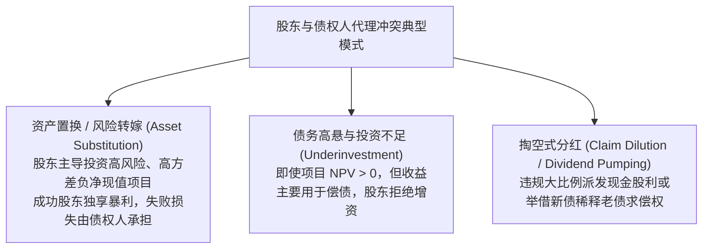
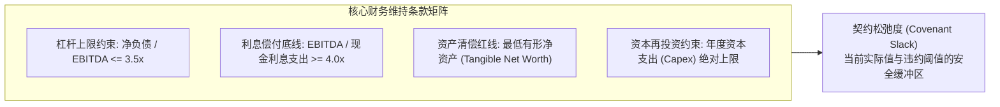
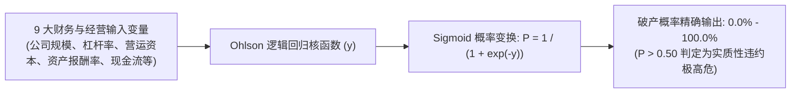

# Lec 13 契约中的会计指标、比率分析与破产预测 (Debt Covenants, Ratio Analysis and Bankruptcy Prediction)

> MIT Sloan School of Management · 15.535 Business Analysis Using Financial Statements · 讲义 13

## TL;DR

- 债务契约利用会计比率约束股东与债权人的代理冲突，防范资产置换与过度分红掏空。
- 财务维持条款（Maintenance Covenants）设立动态安全垫，契约松弛度枯竭将触发技术性违约。
- 奥特曼 Z 值模型通过多元判别分析融合盈利、流动性与杠杆，建立两阶段违约预警雷达。
- 奥尔森 O-Score 依托 Logistic 概率回归克服正态性假设缺陷，实现违约发生率的精确测算。

## 契约理论：股东与债权人的代理冲突根源

在企业金融架构中，普通股股东拥有企业的剩余索偿权（Residual Claim）与控制权，而债权人（商业银行、银团、企业债投资者）仅享有固定的本息偿还权。这种收益与风险的非对称结构，引发了著名的**股东与债权人代理冲突（Shareholder-Debtholder Conflict）**（Jensen & Meckling, 1976; Myers, 1977）。

由于这些道德风险的存在，理性债权人在未受到保护的情况下，会要求极高的违约风险溢价（Credit Spread），甚至彻底关闭信贷通道。为了降低债务融资的代理成本，**会计指标被广泛引入债务合同作为客观、可验证的刚性约束机制——即债务限制性契约（Debt Covenants）**。

::: definition [财务限制性契约 (Financial Debt Covenants)]
财务限制性契约是借款合同中具有法律约束力的专门条款。它强制要求借款企业定期提供经审计的财务数据，并将特定的财务指标（如杠杆率、利息保障倍数、净营运资本总额）维持在约定的阈值之上，以此作为银行维持授信或债券存续的先决条件。
:::

## 财务维持条款设计与契约松弛度管理

债务契约条款通常分为三大层次：**肯定性条款（Affirmative Covenants）**、**否定性条款（Negative Covenants）**与**财务维持条款（Maintenance Covenants）**。其中，财务维持条款最为量化，也最为严苛。

### 契约松弛度（Covenant Slack）与技术性违约

在企业信用监控中，分析师最关注的指标是**契约松弛度（Covenant Slack）**：

$$\text{Slack} = |\text{当前实际指标} - \text{契约临界阈值}|$$

例如，若借款协议规定“总负债 / EBITDA”不得超过 4.0 倍，而企业当期实际比率为 3.6 倍，则契约松弛度仅为 0.4 倍 EBITDA。一旦宏观下行导致下季度 EBITDA 缩水 10%，该比率将立刻突破 4.0 倍。

::: pitfall [混淆“技术性违约”与“实际付息违约”]
许多分析师认为企业只有在账面没钱、未能按时支付利息或本金时才算违约（Payment Default）。这是对信贷法务的严重误解。
**技术性违约（Technical Default）**是指企业本息支付完全正常，但某一财务契约指标突破了约定阈值（如债务比率超标或流动比率跌破约定线）。一旦发生技术性违约，银行拥有立即宣布贷款提前到期（Acceleration）、查封抵押品或强行接管董事会的法定权利。在实践中，技术性违约往往伴随着银行严苛的惩罚性利率上调、额外抵押品追加以及对企业重大经营决策否决权的剥夺。
:::

## 奥特曼经典 Z 值模型（Altman Z-Score, 1968, 1983）

为了给商业银行和信用分析师提供标准化的破产预警雷达，纽约大学斯特恩商学院教授 Edward Altman 于 1968 年利用多元判别分析（Multivariate Discriminant Analysis, MDA）构建了名垂金融史册的 **Altman Z-Score 模型**。

### 制造类上市公司原始 Z 值方程

奥特曼从数十个候选财务比率中，筛选出 5 个对企业破产最具区隔能力的财务特征，构建出加权判别方程：

$$Z = 1.2 X_1 + 1.4 X_2 + 3.3 X_3 + 0.6 X_4 + 0.999 X_5$$

各项变量的具体财务内涵如下：

| 变量 | 计算公式 | 权重系数 | 财务经济学解释 |
| :--- | :--- | :--- | :--- |
| **$X_1$** | $\frac{\text{净营运资本 (NWC)}}{\text{总资产}}$ | 1.2 | 衡量短期流动性储备与短期偿债缓冲能力。 |
| **$X_2$** | $\frac{\text{留存收益 (Retained Earnings)}}{\text{总资产}}$ | 1.4 | 衡量企业历年累计盈利留存与抗风险资本积累（初创企业往往偏低）。 |
| **$X_3$** | $\frac{\text{息税前利润 (EBIT)}}{\text{总资产}}$ | 3.3 | **权重最高的核心因子**，反映资产本身的纯粹生产性造血效率。 |
| **$X_4$** | $\frac{\text{股票总市值 (Market Value of Equity)}}{\text{总负债账面值}}$ | 0.6 | 结合资本市场公允预期，衡量资产价值在资不抵债前能承受的下跌幅度。 |
| **$X_5$** | $\frac{\text{营业收入 (Sales)}}{\text{总资产}}$ | 0.999 | 总资产周转率，衡量利用资产生成销售收入的竞争周转活力。 |

::: definition [Altman Z 值判别区间]
- **安全区（Safe Zone）**：$Z > 2.99$。企业财务结构极其健康，两年内破产概率极低。
- **灰色地带（Grey Zone）**：$1.81 \le Z \le 2.99$。财务处于亚健康状态，需密切跟踪流动性异动。
- **困境/破产高危区（Distress Zone）**：$Z < 1.81$。企业具有极高的违约破产风险，实证表明模型在该区间预测两年内违约的准确率超过 75%。
:::

### 针对非上市与服务型企业的修正方程

针对非上市企业缺乏公允股票市值的问题，奥特曼在 1983 年推出了 **$Z'$ 模型**（以所有者权益账面值替代市值并重估权重）；随后又剔除了对资本密集度依赖极高的 $X_5$（资产周转率），推出了适用于轻资产、现代服务业与新兴市场的 **$Z''$ 四变量模型**：

$$Z'' = 6.56 X_1 + 3.26 X_2 + 6.72 X_3 + 1.05 X_4$$
在该模型下，$Z'' < 1.10$ 划入破产困境预警区。

::: example
某重工业制造公司资产负债表与利润表摘要如下：
总资产 50 亿元，总负债 35 亿元（其中流动负债 20 亿元），流动资产 15 亿元（$NWC = 15 - 20 = -5$ 亿元）。
留存收益 2.5 亿元，EBIT 为 1.5 亿元，营业收入 40 亿元，当前股票市值 18 亿元。
1. 计算各因子：
   - $X_1 = -5 / 50 = -0.10$
   - $X_2 = 2.5 / 50 = 0.05$
   - $X_3 = 1.5 / 50 = 0.03$
   - $X_4 = 18 / 35 \approx 0.514$
   - $X_5 = 40 / 50 = 0.80$
2. 代入原始 Z 值方程：
   $$Z = 1.2(-0.10) + 1.4(0.05) + 3.3(0.03) + 0.6(0.514) + 0.999(0.80) = -0.12 + 0.07 + 0.099 + 0.308 + 0.799 = 1.156$$
3. 判定结论：$Z = 1.156 < 1.81$，深陷“破产高危区”。流动资金净额为负，资产盈利息税前收益率仅 3%，负债高企，面临巨大的违约重组风险。
:::

## 奥尔森 O-Score 概率预测模型（Ohlson 1980）

尽管奥特曼 Z-Score 在工业界大获成功，但其采用的多元判别分析（MDA）在统计学上存在两大天然软肋：它强制假定各输入财务变量严格服从多元正态分布，且要求违约与非违约两组样本具有相同的协方差矩阵，这在高度偏态的现实财务数据中很难满足。

1980 年，加州大学伯克利分校教授 James Ohlson 引入条件逻辑回归（Logistic Regression），开发了能够直接输出**破产违约概率绝对值（0 到 1 之间）**的 **Ohlson O-Score 模型**。

### O-Score 核函数与关键驱动变量

Ohlson 模型的线性得分 $y$ 由 9 个核心自变量决定：

$$y = -1.32 - 0.407 \ln(TotalAssets) + 6.03 \left(\frac{TotalLiabilities}{TotalAssets}\right) - 1.43 \left(\frac{NWC}{TotalAssets}\right) + 0.0757 \left(\frac{CurrentLiabilities}{CurrentAssets}\right) - 2.37 \left(\frac{NetIncome}{TotalAssets}\right) - 1.83 \left(\frac{FFO}{TotalLiabilities}\right) + 0.285 INTWO - 1.72 OENEG - 0.521 CHIN$$

其中：
- $INTWO$ 为二元哑变量：若过去两年净利润均为负则取 1，否则取 0；
- $OENEG$ 为二元哑变量：若当前净资产（股东权益）为负则取 1，否则取 0；
- $CHIN$ 为当期净利润相对于前期的变动斜率。

通过逻辑函数变换：

$$P(\text{Bankruptcy}) = \frac{1}{1 + e^{-y}}$$

O-Score 的划时代意义在于：**它不再给出一个模糊的分类区间，而是直接为银行授信定价和违约损失率（LGD）测算提供了可直接代入风险中性定价模型的违约概率参数**。

## 我的理解

::: insight [破产预测的终极隐喻：企业新陈代谢的熵增警铃]
债务契约与破产预测模型，常常被外界视为冰冷无情的清算工具，但从商业生态学视角审视，它们恰恰是资本主义肌体维持健康的“免疫自愈系统”。

奥特曼 Z 值方程中权重高达 3.3 的核心因子永远是息税前资产收益率（$EBIT/TA$），这揭示了一个颠扑不破的真理：**一切流动性危机、一切违约爆雷，本质上都只是企业核心经营资产造血功能衰竭的外在晚期并发症**。当一家企业的资产无法再创造出超越资本成本的增量利润时，无论账面上通过展期再借入多少新债、无论通过会计手法如何美化流动比率，都只是在延缓熵增崩塌的必然来临。

债务契约中的“技术性违约”并不是惩治企业的断头台，而是债权人在企业资产价值尚足以覆盖损失时踩下的紧急制动刹车。对于成熟的商业分析师而言，精通 Z-Score 与 O-Score 的运算不是为了在企业猝死时充当验尸官，而是要穿透资产负债表的层层迷雾，在企业尚处于安全区但核心造血动能已开始退化的萌芽阶段，精准敲响风险防范的刺耳警铃。
:::
