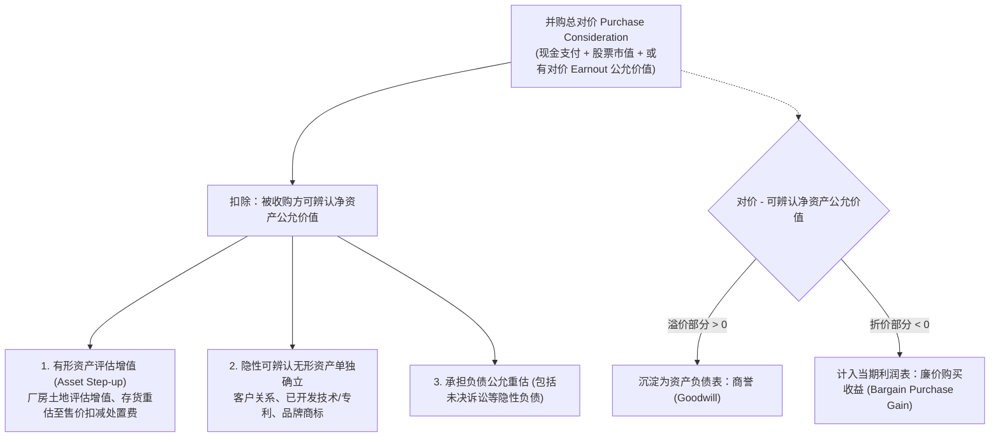
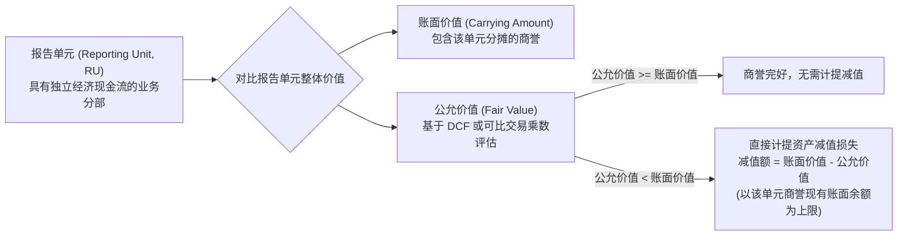
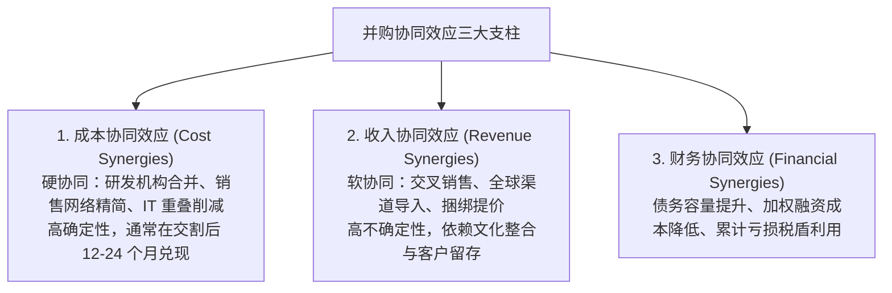
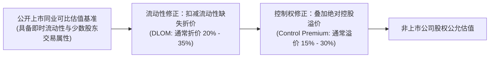

# Lec 14 兼并收购估值、商誉减值与非上市公司估值 (M&A Valuation, Goodwill Impairment and Private Firms)

> MIT Sloan School of Management · 15.535 Business Analysis Using Financial Statements · 讲义 14

## TL;DR

- 购买法要求按公允价值全额重估标的资产与负债，对价超出可辨认净资产公允价值的部分确认为商誉。
- 商誉不再定期摊销，而是每年进行减值测试；简化单步法直接以报告单元账面值超额扣减商誉。
- 协同效应必须区分高胜率的成本协同与高不确定性的收入协同，警惕“赢者诅咒”透支并购收益。
- 非上市公司估值需系统性修正缺乏流动性折价（DLOM）与控制权溢价，避免简单套用公开发行乘数。

## 并购会计基石：购买法与购买价格分摊（PPA）

兼并收购（M&A）是企业实现外延式扩张、整合产业链与获取关键知识产权的最重大战略动作。在现代会计准则（US GAAP ASC 805 / IFRS 3）框架下，企业合并统一采用**购买法（Acquisition Method）**核算。

购买法的核心会计逻辑在于：**并购是一次市场化公平交易，收购方必须以交割日的公允价值（Fair Value）对被收购方的所有可辨认资产、负债进行全面重新计量，对价溢价部分沉淀为商誉**。

### 购买价格分摊（PPA）的四步执行序列

1. **确定合并成本（Purchase Consideration）**：
   合并对价不仅包含交割日实际支付的现金和发行的股票公允价值，还必须采用蒙特卡洛模拟或二叉树模型估算未来可能支付的**或有对价（Earnouts / Contingent Consideration）**在交割日的公允折现值。
2. **重估有形资产（Asset Step-up）**：
   将被收购方的固定资产（厂房、生产线）从历史折余成本重估至当前公允重置价值。存货亦需从历史生产成本调整至预估销售价格扣除必要销售费用，这往往导致并购后首期毛利率由于存货公允价值结转而暂时承压。
3. **识别并单独确认无形资产（Identifiable Intangibles）**：
   准则强制要求剥离此前在被收购方报表中未予资本化的内部生成无形资产。主要包括：
   - 合同及客户关系资产（采用多期超额收益法 MPEEM 估值）；
   - 已开发软件与核心技术专利（采用许可费节省法 Relief-from-Royalty 估值）；
   - 品牌与商标（采用特许权免除法估值）。
4. **残差确认为商誉（Goodwill）**：
   商誉是合并对价扣除所有可辨认有形及无形净资产公允价值后的最终不可辨认残差，代表了收购方对未识别的人力资本、未来潜在客户以及企业整体协同效应的溢价支付。

::: definition [商誉 (Goodwill)]
商誉是指在企业合并中形成的、无法在资产负债表中作为单独资产予以单独识别和确认的未来经济利益预期。它由目标公司未入账的组织资本、团队凝聚力、行业声誉以及并购双方整合后预期释放的协同效应所共同构成。
:::

## 商誉减值测试（Impairment）与管理层盈余博弈

在 2001 年 SFAS 142 颁布前，商誉在长达 40 年的时间内按直线法逐年摊销进入利润表。新准则彻底终结了商誉摊销，改为**每年至少进行一次的商誉减值测试（Goodwill Impairment Test, ASC 350 / IAS 36）**。

### 减值测试的演进与单步法计量（ASU 2017-04）

传统商誉减值测试分为两步法，由于第二步要求假设拟定一次虚拟的 PPA 流程，实务操作极其昂贵繁琐。美国财务会计准则委员会（FASB）在 ASU 2017-04 中将准则全面简化为**单步法（Single-step Test）**：

::: theorem [ASU 2017-04 单步商誉减值确认规则]
对于各报告单元（Reporting Unit），减值损失金额严格等于该报告单元的账面价值（含商誉）超过其公允价值的差额：
$$\text{Impairment Loss} = \min\left( \text{Carrying Value}_{\text{RU}} - \text{Fair Value}_{\text{RU}}, \text{Goodwill Balance}_{\text{RU}} \right)$$
计提后的商誉减值损失直接计入当期营业外支出，且**在未来任何会计期间均严禁转回**。
:::

::: pitfall [商誉减值的“战略延迟”与新任高管的“大清洗”]
在实践中，由于公允价值估值高度依赖管理层提供的预测现金流假设（贴现率、长期增长率、终值乘数），在位管理层倾向于通过人为拉高未来增长率来推迟确认减值，以保全个人声誉与薪酬。
然而，一旦企业发生 CEO 换届，新任管理层往往会迅速推翻前任的乐观预测，发动**巨额商誉冲销（Goodwill Big Bath）**，将前任所有失败并购的包袱一次性出清，既推卸了历史责任，又极大降低了未来周期的资产基数和折旧摊销负担。
:::

## 并购协同效应（Synergies）的现金流解构与赢者诅咒

并购最核心的战略理由在于创造“$1 + 1 > 2$”的**协同效应（Synergies）**。然而，麦肯锡与哈佛商学院的历史统计表明，超过 60% 的跨国并购未能创造股东价值，其核心败因在于**对协同效应的盲目估值导致严重超额支付（Winner's Curse）**。

### 协同效应折现估值方程

量化协同效应价值必须扣除实现协同所需的增量一次性整合成本（Integration Costs）：

$$V_{\text{Synergy}} = \sum_{t=1}^{\infty} \frac{\Delta CF_{\text{Cost}, t} + \Delta CF_{\text{Rev}, t} + \Delta TaxShield_t - \text{IntegrationCosts}_t}{(1 + WACC_{\text{combined}})^t}$$

::: example
收购方计划以 5 亿美元收购竞争对手。经尽调测算，合并后每年可产生净成本协同 3,000 万美元，同时因市场地位提升每年可产生增量税后经营利润 1,000 万美元。合并整合需要前两年每年投入一次性整合开支 2,000 万美元。综合 WACC 为 10%，假定协同利润从第 3 年起进入永续期。
1. 第 1-2 年净增量现金流：$4,000 - 2,000 = 2,000$ 万美元/年。
2. 第 3 年起永续增量现金流：$4,000$ 万美元/年。
3. 协同效应总现值：
   $$PV = \frac{2,000}{1.10} + \frac{2,000}{1.10^2} + \frac{\frac{4,000}{0.10}}{1.10^2} = 1,818 + 1,653 + \frac{40,000}{1.21} \approx 3,471 + 33,058 = 36,529 \text{ 万美元} \approx 3.65 \text{ 亿美元}$$
若收购方支付的并购溢价（Acquisition Premium）超过 3.65 亿美元，则表明收购方将预期的全部协同收益白白拱手送给了被收购方股东，自身股东价值将遭遇永久毁灭。
:::

## 非上市公司估值调整：流动性折价（DLOM）与控制权溢价

在对非上市公司或私营实体展开估值时，分析师绝不能简单地套用可比上市公司的市盈率（P/E）或 EV/EBITDA 乘数。必须在可比价值基准上系统性引入两大修正维度：

### 缺乏市场流动性折价（DLOM）

非上市公司的股权无法在公开二级市场上随时挂牌变现。寻找意向买家、展开漫长尽调、签署股权转让协议往往需要耗费 6 到 18 个月，并面临巨大的交易不确定性。
- **限制性股票实证研究（Restricted Stock Studies）**：通过比较上市公司在私募配售中发行的限售股（如 Rule 144）与同类可自由交易股票的价格差异，实证平均折价幅度在 **20% 至 35%** 之间。
- **期权定价模型法（Chaffe & Finnerty Put Models）**：将流动性缺失视为持有者失去了一份“在锁定期内随时以市价行权退出的欧式看跌期权”，利用 Black-Scholes 衍生方程估算看跌期权的理论价值，作为 DLOM 的折价比率。

### 控制权溢价（Control Premium）与少数股权折价（DLOC）

拥有 51% 以上具有绝对表决权控股地位的股东，拥有更换 CEO、决定资本再投资预算、发起外延并购以及直接分红清算的特权；而仅持有 1% 的少数股东（Minority Interest）只能被动接受既定方针。

从少数股东价值向绝对控股价值转换时，必须叠加**控制权溢价（通常在 15% 到 30% 之间）**；反之，若从整体企业价值推算少数股东估值，则需计入**缺乏控制权折价（Discount for Lack of Control, DLOC）**：

$$DLOC = 1 - \frac{1}{1 + \text{Control Premium}}$$

## 我的理解

::: insight [并购估值的博弈本质：打破“规模崇拜”的虚妄幻象]
在商业财经新闻的头条版面中，千亿美元级别的重磅跨国并购总是伴随着高管们雄心勃勃的演讲、壮丽的协同效应幻灯片和投行团队的欢呼。然而，当褪去聚光灯的光晕，翻开资产负债表的深水区，并购最常留下的遗产往往是数额惊人的虚幻商誉。

购买法下的会计方程式是极其冷峻的：你付出的每一笔真金白银溢价，如果在现实中找不到可辨认的专利、找不到落地的客户合同，就必须全额沉淀为商誉。商誉不是一台能自动产生利润的精密机床，它只是一张**寄托着收购方关于未来协同预期的巨额借据**。

为什么大部分并购最终沦为价值毁灭？因为人类天性中对“商业帝国规模”的贪婪追逐，远胜于对“资本回报率（ROIC）”的理智克制。在竞价拍卖的狂热中，买方总是不自觉地把最完美的成本协同与最激进的收入增长假设代入模型，从而落入经典的“赢者诅咒”。

卓越的商业分析师必须懂得“逆风而立”：在所有人为巨无霸的诞生举杯相庆时，去冷静测算每一分协同现金流实现的概率、去扣除缺乏流动性资产的估值水分，去严密盯防资产负债表上那座由高估商誉堆砌而成的达摩克利斯之剑。
:::
