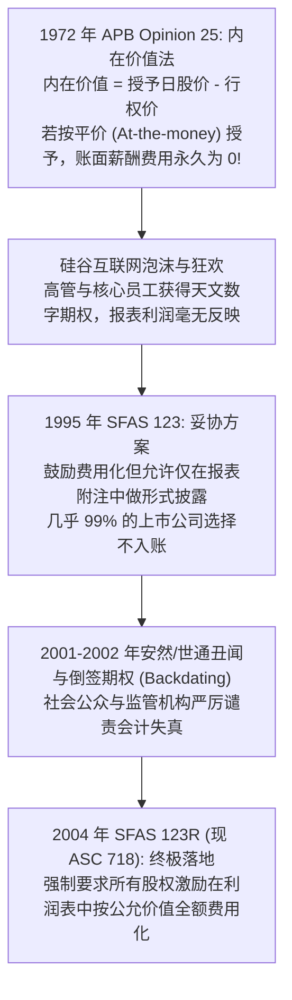
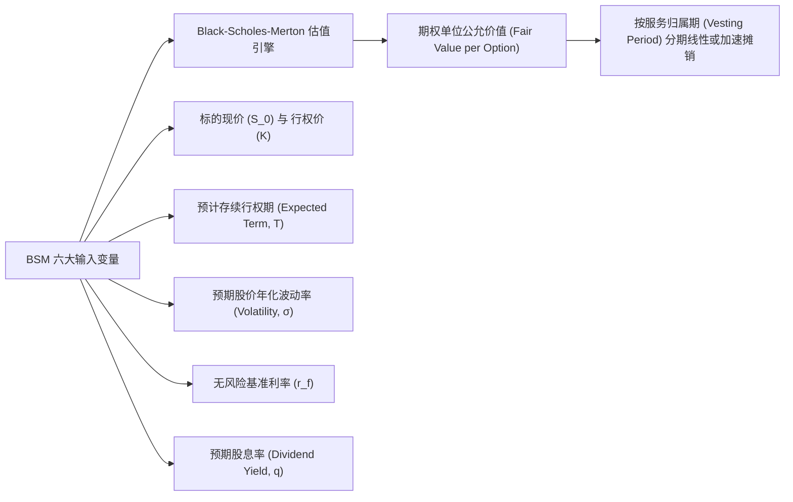
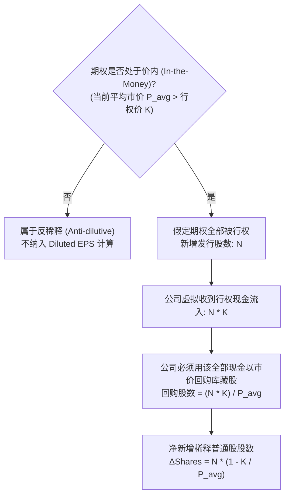
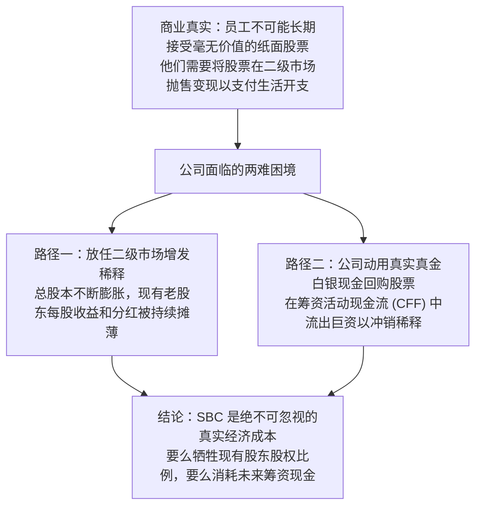

# Lec 15 员工股票期权、股权激励与估值影响 (Employee Stock Options and Share-Based Compensation)

> MIT Sloan School of Management · 15.535 Business Analysis Using Financial Statements · 讲义 15

## TL;DR

- 股权激励准则从历史零费用化到公允价值强制费用化（ASC 718），终结了科技巨头的隐形福利红利。
- 股票期权采用 Black-Scholes 或二叉树模型在授予日锁定公允价值，并在服务归属期内分期摊销。
- 稀释每股收益（Diluted EPS）依托库藏股法，动态衡量价内期权行权后对现有股东权益的摊薄冲击。
- SBC 费用作为非现金项目加回经营现金流，掩盖了企业通过发行股票稀释股权支付人力报酬的真实资本损耗。

## 股权激励会计的世纪论战与准则演进

在现代硅谷科技巨头（如微软、苹果、谷歌、Meta）与高成长型企业的资本运作中，**股权激励（Share-Based Compensation, SBC）**扮演着吸引全球顶尖工程与管理人才的核心薪酬工具。然而，围绕股权激励如何计入财务报表，曾爆发了会计学史上最漫长、最具政治游说色彩的世纪激战。

在旧准则 APB 25 时代，企业只要将期权的行权价设定为等于授予日的市场公允价格，期权的“内在价值”即为零，从而在利润表中无需确认哪怕一美元的薪酬开支。这直接导致了 90 年代末互联网泡沫期间科技公司利润被系统性严重虚增。2004 年颁布的 **SFAS 123R（现编入 ASC 718 / IFRS 2）**彻底终结了这一特权，确立了**公允价值费用化原则**。

::: definition [股权激励 (Share-Based Compensation, SBC)]
股权激励是指企业为换取员工或管理层提供的劳动服务，而授予其自身权益工具（如限制性股票单元 RSU、股票期权）或承担以权益工具价格为基础计算的负债交易。其本质是将人力资本的对价以股权索偿权形式支付，必须在员工提供服务的归属期内摊销计入当期损益。
:::

## 估值模型与摊销机制：RSU 与股票期权

现代企业向员工发放的股权激励主要包含两大主流形态：**限制性股票单元（Restricted Stock Units, RSU）**与**股票期权（Stock Options）**。

### 限制性股票单元（RSU）的会计计量

RSU 的计量相对直观：以**授予日（Grant Date）标的股票的二级市场公允收盘价**，扣除在归属期内员工无法享受的预期股利现值，作为该批股票的单位公允价值。此价值在授予日一次性锁定，后续股票市值的任何波动均不再调整已确定的总费用基数。

### 股票期权的 Black-Scholes-Merton（BSM）定价

员工股票期权属于不可转让的衍生工具，准则规定必须在授予日采用期权定价模型测算其公允价值：

::: theorem [Black-Scholes 期权公允价值公式]
标准欧式看涨期权的公允价值计量公式为：
$$C_0 = S_0 e^{-q T} N(d_1) - K e^{-r_f T} N(d_2)$$
其中：
$$d_1 = \frac{\ln(S_0 / K) + \left( r_f - q + \frac{\sigma^2}{2} \right) T}{\sigma \sqrt{T}}, \quad d_2 = d_1 - \sigma \sqrt{T}$$
$N(\cdot)$ 为标准正态分布的累积概率分布函数。
:::

在计算出的总公允价值确定后，企业根据设定的归属期（如分 4 年归属，每年 25%），按服务期线性分摊至各年度的销售费用、管理费用或研发费用中。

::: pitfall [管理层操纵期权参数的“暗箱操作”]
在 BSM 模型中，“预期波动率 $\sigma$”和“预计存续期 $T$”具有极强的主观裁量弹性。期权公允价值对波动率高度正相关。若管理层希望压低财报中的 SBC 费用，往往会故意选择历史平静期的低波动率，或者主观假定员工会极早行权（缩短 $T$），从而人为压低期权单位估值。分析师在审视 10-K 附注时必须横向对比同业设定的假设参数合理性。
:::

## 稀释每股收益（Diluted EPS）与库藏股法（Treasury Stock Method）

股权激励的存在，意味着未来会有大量增量普通股涌入市场，稀释现有股东的股权份额。因此，上市公司必须同时披露**基本每股收益（Basic EPS）**与**稀释每股收益（Diluted EPS）**。

在测算包含股票期权与认股权证的稀释效应时，会计准则强制采用**库藏股法（Treasury Stock Method）**。

::: theorem [库藏股法计算恒等式]
若期权处于价内（当期普通股平均市场价格 $\bar{P} > K$），净增量稀释股份数计算公式为：
$$\Delta \text{Shares} = N - \frac{N \times K}{\bar{P}} = N \left( 1 - \frac{K}{\bar{P}} \right)$$
稀释每股收益公式为：
$$\text{Diluted EPS} = \frac{\text{净利润} - \text{优先股股利}}{\text{基本发行在外加权普通股数} + \Delta \text{Shares}}$$
:::

::: example
某互联网公司当期净利润为 1.2 亿美元，基本发行在外加权普通股为 1 亿股（$Basic EPS = 1.20$ 美元）。
公司有一批已授予的员工股票期权，对应股数 $N = 1,000$ 万股，行权价 $K = 20$ 美元。当期公司股票平均二级市场价格 $\bar{P} = 50$ 美元。
1. 计算行权假设下的虚拟现金流入：$1,000 \text{ 万股} \times 20 \text{ 美元} = 2 \text{ 亿美元}$。
2. 虚拟回购股数：$2 \text{ 亿美元} / 50 \text{ 美元/股} = 400 \text{ 万股}$。
3. 净增稀释普通股：$\Delta \text{Shares} = 1,000 - 400 = 600 \text{ 万股}$。
4. 稀释每股收益：
   $$\text{Diluted EPS} = \frac{12,000 \text{ 万美元}}{10,000 + 600 \text{ 万股}} = \frac{12,000}{10,600} \approx 1.132 \text{ 美元}$$
每股收益被稀释了近 6%，真实反映了期权潜在兑现对现有股东价值的稀释侵蚀。
:::

## 现金流量表的迷思：SBC 掩盖的真实资本损耗

现代很多科技成长型上市公司在面向华尔街路演时，极其推崇“调整后自由现金流（Adjusted Free Cash Flow）”或“调整后 EBITDA”，他们向投资者宣称：**“虽然 SBC 在利润表里是一笔数十亿美元的开支，但它完全是非现金的（Non-cash Expense），因此我们经营活动创造的现金流（CFO）极其健康强劲！”**

这是资本市场上流传最广、也最具欺骗性的财务神话之一。

在现金流量表的间接法编制中，SBC 费用由于未在当期直接支付现金，确实被作为调增项加回到了经营现金流（CFO）中。然而，这种会计处理割裂了经营活动与筹资活动之间的经济闭环：
- 企业为了不让股本无限制膨胀稀释 EPS，每年不得不耗费数十亿美元的真实真金白银现金在公开市场实施**股票回购（Stock Repurchases）**。
- 这笔回购支出在现金流量表中被精巧地归类在**筹资活动现金流（CFF）**的流出项中。
- 最终结果是：**利润表被“Non-GAAP 调整”净化了，经营现金流（CFO）被非现金加回美化了，而真实的现金消耗全部被转移隐藏到了筹资活动现金流中！**

专业分析师在评估科技公司的真实内生自由现金流时，**必须将 SBC 费用视为真实的经常性经营人工现金成本全额扣除**：

$$\text{True FCF} = CFO - \text{Capex} - \text{SBC Expense}$$

## 企业估值中的期权债务桥梁调整

在从企业价值（Enterprise Value, EV）过渡到每股股权价值时，分析师必须妥善处理发行在外的未行权期权与未归属 RSU：

$$\text{Equity Value} = EV + \text{Cash} - \text{Total Debt} - \text{Value of Outstanding Options / RSUs}$$

若不扣减现有期权池的公允价值，就必须在分母中采用充分稀释后的完全稀释股本（Fully Diluted Shares Outstanding）。忽视期权池的价值切分，会导致对现有流通股股东每股价值的高估达到 10% 到 20% 之巨。

## 我的理解

::: insight [股权激励的本质：免费午餐的终结与资本真实成本的觉醒]
硅谷有句著名的谚语：“如果你不给工程师期权，你就招不到最聪明的大脑；但如果你给了期权，华尔街就会惩罚你的财报。”这一矛盾生动揭示了股权激励作为一种金融工具的复杂张力。

股权激励绝不是什么天上掉下来的“免费午餐”。它在会计分录上可能只是一笔不触动银行账户的记账凭证，但在企业底层的所有权结构中，它是一场**极其深刻的无声财富转移——从全体外部被动股东手中，将不可逆的企业所有权份额源源不断地割让给核心管理层与内部员工**。

巴菲特在致股东信中曾发出著名的灵魂拷问：“如果期权不是一种薪酬形式，那它是什么？如果薪酬不是一种费用，那它是什么？如果费用不该计入利润表，那它到底该去哪里？”

当一家高科技企业吹嘘其高达 30% 的 Adjusted EBITDA 利润率，却小心翼翼地把占营收 25% 的股票薪酬作为“Non-GAAP 特别项”剔除在外时，理智的分析师必须保持高度清醒。看清 SBC 背后的稀释本质，将筹资端的回购现金失血与经营端的造血能力重新并轨，正是撕下科技新贵华丽财报面具、还原企业真实自由现金流创造力的试金石。
:::
