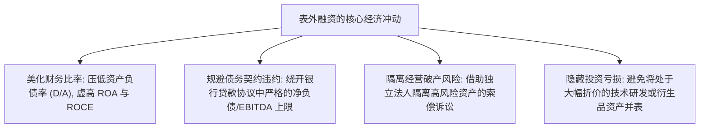
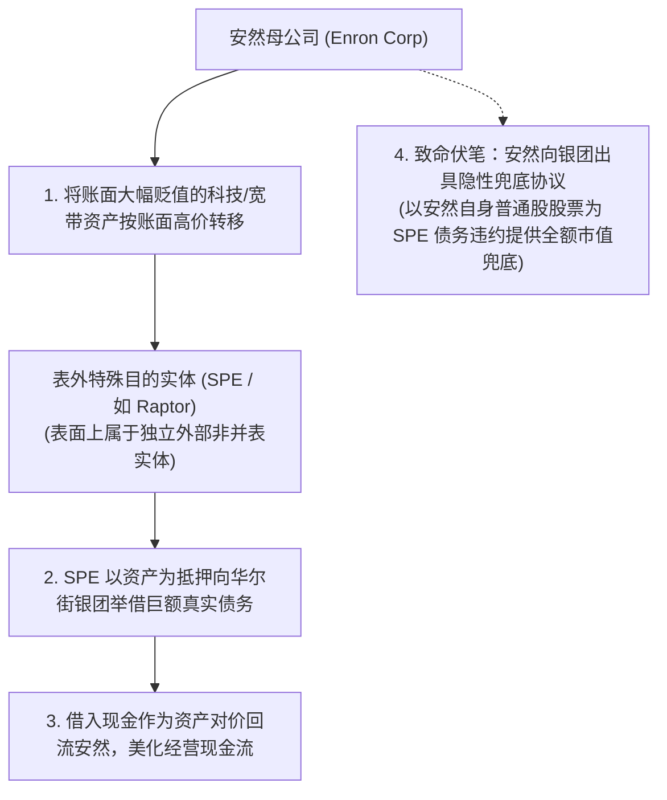
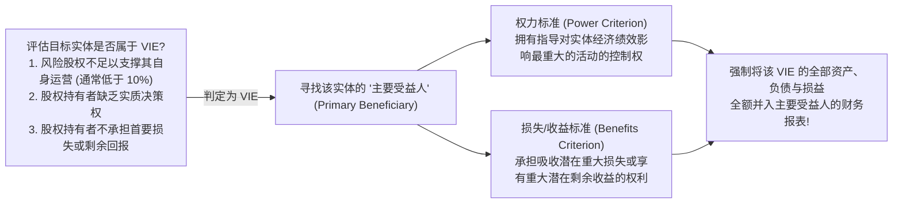
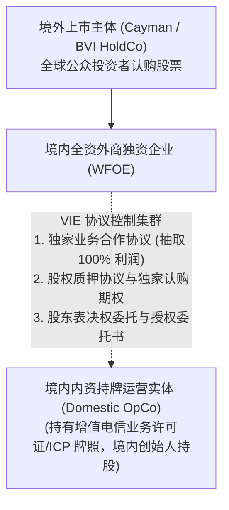

# Lec 16 表外融资与特殊目的实体全景解构 (Off-Balance-Sheet Financing, SPEs and VIEs)

> MIT Sloan School of Management · 15.535 Business Analysis Using Financial Statements · 讲义 16

## TL;DR

- 表外融资旨在通过剥离金融负债改善账面杠杆率、规避借款契约红线并粉饰资产回报率。
- 特殊目的实体（SPE）曾利用 3% 外部股权独立性漏洞，沦为安然藏匿巨额负债与亏损的白手套。
- FIN 46R 与 ASC 810 确立了可变利益实体（VIE）合并规则，以权力和经济利益取代法定表决权。
- 分析师必须穿透合并范围边界，将保理负债、合成租赁与兜底保证还原至资产负债表内。

## 表外融资的经济动因与监管博弈

在企业财务报告体系中，资产负债表是衡量企业偿债能力、杠杆风险与资本结构健康度的核心窗口。然而，在管理层薪酬激励、信用评级维护（避免下调至垃圾级）以及借贷契约（Debt Covenants）的多重压力下，企业具有极强的动机实施**表外融资（Off-Balance-Sheet Financing, OBSF）**。

表外融资的核心目的在于：**在真实获得外部资本注入或将重资产置于企业实际掌控之下的同时，通过精巧的法律合同设计，避免在法定资产负债表上确认为计息负债**。

在 2008 年次贷危机及安然事件之前，大量企业通过经营性租赁（Synthetic Operating Leases）、无追索应收账款保理（Factoring）、合资企业联营（50/50 Joint Ventures）以及特殊目的实体（Special Purpose Entities, SPE）在表外隐藏了高达数万亿美元的真实负债。

::: definition [表外融资 (Off-Balance-Sheet Financing)]
表外融资是指企业通过法律架构、非并表关联实体或复杂衍生品金融工具，融入运营资金或转移重度负债，从而无须在企业对外披露的资产负债表资产与负债栏目中体现该笔义务的财务操作。其实质是将原本属于企业的财务杠杆转移至报表盲区。
:::

## 特殊目的实体（SPE）与安然（Enron）丑闻全景解剖

2001 年安然公司（Enron）的轰然倒塌，是会计学史上关于特殊目的实体滥用的最惨痛警示录。安然利用复杂的金融工程与名目繁多的 SPE（如 Chewco、LJM1、LJM2、Raptors 等），将价值数十亿美元的巨额债务与不良资产彻底移出合并报表。

### 3% 外部股权规则的制度漏洞

在当时 US GAAP 准则下，一个 SPE 只要满足以下两项极度宽松的标准即可**不予合并报表（Non-consolidation）**：
1. 外部独立第三方投资者至少持有该 SPE **3% 的股本权益（Equity at Risk）**；
2. 该第三方投资者拥有该实体的实质性控制权。

安然管理层通过极其隐秘的关联交易规避了这一准则：安然前首席财务官安德鲁·法斯托（Andrew Fastow）及其亲信亲自出任 SPE 的普通合伙人（GP），其所谓的“外部 3% 独立资本”，实际上是由安然通过向亲信控制的离岸空壳公司违规拆借提供的伪独立资金。

### 庞氏结构的内爆机理

安然为了防止 SPE 出现资产减值亏损而导致 3% 股本蒸发（进而触发强制并表），与 SPE 签署了巨额的“远期股票兜底互换”（Forward Contracts）。安然承诺：如果 SPE 购买的安然资产发生贬值，安然将无条件发行自身普通股补足差额。

这一设计在逻辑上构成了致命的死循环：
- 2001 年下半年，安然持有的宽带网络与能源衍生品资产全面暴跌，SPE 产生巨额亏损；
- SPE 依据兜底协议强制要求安然发行数千万股新股票填补窟窿；
- 大规模股本稀释导致安然股价暴跌，触发更多债务加速到期条款；
- 最终，评级机构将安然信用等级直接降至垃圾级，安然无法发行足够市值的股票偿债，数十个 SPE 触发强制并表，数百亿美元隐匿债务瞬间击穿资产负债表，安然走向破产清算。

## 现代可变利益实体（VIE / ASC 810）整合规则

安然丑闻爆发后，美国财务会计准则委员会（FASB）痛定思痛，迅速出台了 **FIN 46R（现编入 ASC 810《合并准则》）**，彻底废除了机械的 3% 法定股权标准，创立了革命性的**可变利益实体（Variable Interest Entity, VIE）**分析框架。

::: theorem [ASC 810 VIE 强制合并双重判定标准]
在现代会计准则下，合并范围的确定不再依赖企业是否拥有超过 50% 的法定投票权股份。当且仅当一个报告主体同时满足以下两项核心经济实质条件时，该主体被判定为该 VIE 的**主要受益人（Primary Beneficiary）**，必须将该实体进行全额并表：
1. **权力（Power）**：拥有指导对该 VIE 经济绩效产生最重大影响的业务活动（如日常运营、授信担保、资产处置）的实质权力；
2. **经济暴露（Losses / Returns）**：承担了吸收该实体可能发生的潜在重大损失的义务，或者有权享有从该实体获取潜在重大剩余收益的权利。
:::

根据 ASC 810，只要安然对 SPE 的亏损提供了母公司股票市值的兜底保证，安然就是无可争议的主要受益人，必须在第一天起全额并表，根本无法将债务移至表外。

## 中概股 VIE 协议控制架构的实务审视

VIE 架构不仅存在于结构化资产证券化中，更演变成为过去二十余年中国互联网与高科技企业（如阿里巴巴、腾讯、百度、京东）赴美赴港上市的标准法律桥梁。

在审视此类公司的财报时，分析师必须清醒认识到：**上市公司在法律所有权上根本不拥有境内运营实体的任何一分钱法定股权**。其之所以能够依据 ASC 810 将境内运营实体的营收与利润 100% 纳入合并报表，完全依赖于 WFOE 与创始人签署的一整套极其复杂的民事合同簇（VIE Agreements）。

::: pitfall [混淆“会计合并”与“法律资产所有权隔离”]
分析师容易落入的一个陷阱是将报表并表等同于具有直接资产支配权。在极端地缘政治变动或境内创始人违约撕毁协议的情境下，境外的上市公司投资者无法通过行使股东投票权直接清算境内实体资产，只能在境内法院提起漫长的合同法诉讼。因此，在评估该类企业时，必须在其资本成本中计入适当的制度性治理溢价。
:::

## 分析师表外负债穿透与报表重构

面对复杂的结构化融资，优秀的财务分析师绝不局限于主表，而应建立“表外负债回表重构”的标准流水线：

| 表外融资隐匿渠道 | 10-K 附注深挖线索 | 分析师资产负债表调平重构动作 |
| :--- | :--- | :--- |
| **应收账款保理 (Factoring)** | 附注中披露的“无追索权应收账款转移”条款，排查企业是否对回款迟延承担隐性利差补偿 | 将已终止确认的应收账款调回资产端；在流动负债中同等调增“短期借款” |
| **联营合资企业 (Equity Method)** | 附注披露对持股 20%-50% 的联营公司大额借款担保（Guarantees of Indebtedness） | 将被担保的合资企业外部银行负债按担保比例（或 100%）调增至母公司负债 |
| **供应链反向保理 (Reverse Factoring)** | 应付账款周转天数异常拉长至 180 天以上，合作银行提供平台贴现 | 将该部分“应付账款”从经营性流动负债剥离，重新归类为“金融付息债务” |
| **供应商最低提货承诺 (Take-or-Pay)** | 附注披露的不可撤销重大长期采购合约（Unconditional Purchase Obligations） | 将未来各期不可撤销刚性支付义务按借款利率贴现，计入资本性负债 |

## 我的理解

::: insight [表外融资的终极洞察：负债如同能量，绝不会在真空里湮灭]
财务工程史上最荒诞的一幕，莫过于一代又一代顶尖的投行家、律师与会计大师试图证明：**你可以拥有一笔资金的全部经济使用权，却不必承担任何法定的偿还责任**。

特殊目的实体（SPE）和表外金融工具的演变史，是一部不断被热力学第一定律无情打脸的历史——**财务杠杆如同物理学中的能量，它只能被转移、转化或暂时遮蔽，却绝不会在商业真空中凭空湮灭**。

当一家企业试图通过将厂房做成合成租赁、将应收账款打包出表、或者设立数十个离岸实体去隐藏债务时，它看似在资产负债表上实现了神乎其技的“瘦身”，但风险从不曾消散半刻。它只是以更阴暗、更隐蔽的“兜底承诺”、“维好协议”或“对赌条款”形式，静静潜伏在法律合同的细小脚注里。

一旦宏观流动性退潮，这些被刻意移出主表的幽灵负债，就会像深海潜伏的巨兽一样瞬间浮出水面，以摧枯拉朽之势将整个母体拖入深渊。作为商业报表分析师，你的核心使命不是去赞美那些巧夺天工的金融结构，而是要握紧解剖刀，穿透一切法律实体的伪装外衣，把每一分流淌在外的隐形债务强行拉回阳光之下。
:::
