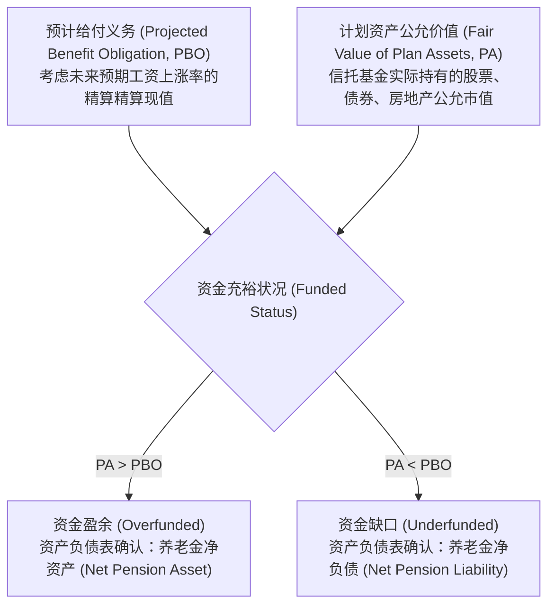
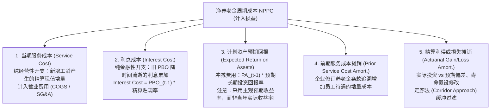
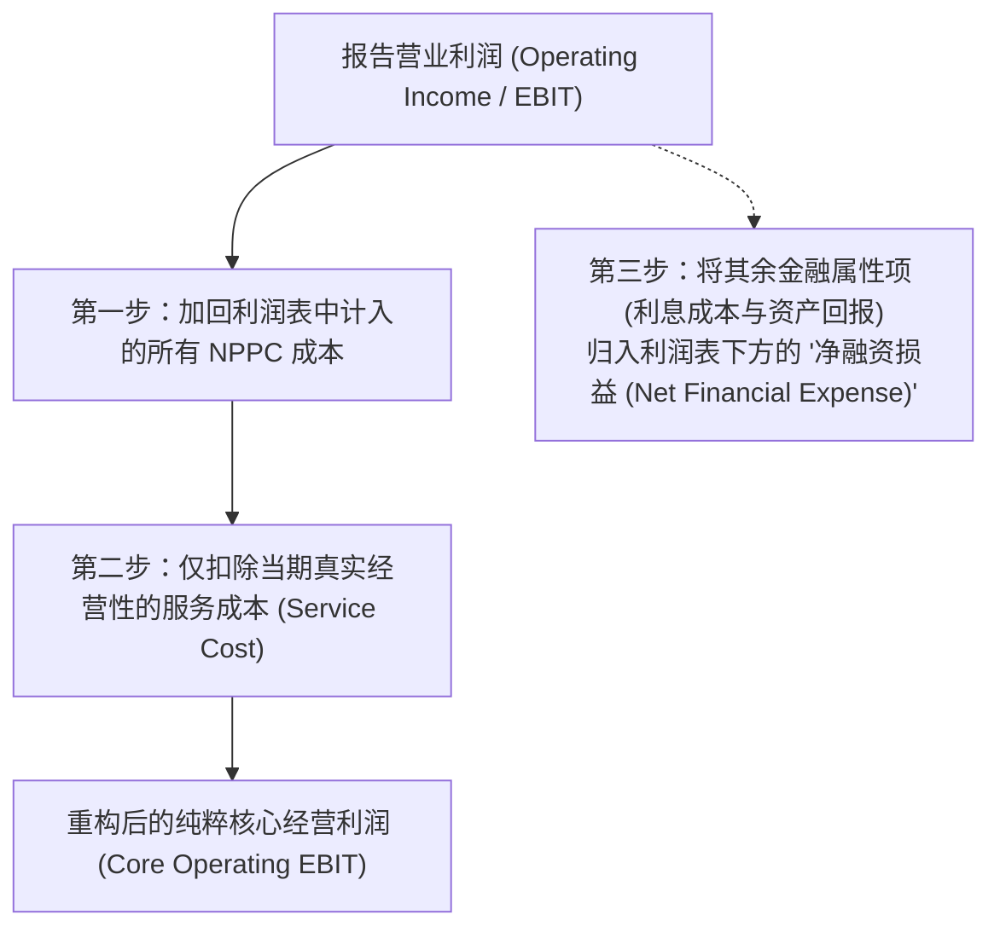

# Lec 17 养老金计划会计：企业隐形负债深水区 (Pension Accounting: Defined Benefit vs Defined Contribution)

> MIT Sloan School of Management · 15.535 Business Analysis Using Financial Statements · 讲义 17

## TL;DR

- 设定受益计划（DB）由企业承担全额精算与投资风险，其庞大的隐形缺口构成长周期资本杀手。
- 预计给付义务（PBO）与计划资产公允价值（PA）的差额直接决定了资产负债表的净负债确认。
- 净养老金周期成本（NPPC）交织了经营性的当期服务成本与金融性的利息支出及预期资产回报。
- 走廊法（Corridor Approach）延迟平滑了精算波动，分析师需主动校准激进的精算贴现率假设。

## 养老金计划的双重谱系：DC 计划 vs DB 计划

在考察重资产传统制造业、跨国航空公司以及老牌蓝筹企业（如通用汽车、波音、通用电气）的财务报表时，**养老金与雇后福利负债（Pension and Post-retirement Benefits）**往往构成了资产负债表与利润表中最复杂、精算假设最晦涩的深水区。

企业设立的员工退休养老计划主要划分为两大具有本质差异的制度类型：

由于 DB 计划承诺在未来数十年内向退休员工按月发放固定数额的退休金，企业必须独立设立养老金信托基金，通过投资股票、债券和另类资产来积累资产储备以备未来兑付。**企业在此过程中实质性承担了三大系统性风险：雇员寿命延长的长寿风险（Longevity Risk）、通货膨胀导致薪资攀升的工资风险（Wage Inflation Risk）、以及金融市场下行导致信托资产缩水的投资风险（Investment Risk）**。

::: definition [设定受益计划 (Defined Benefit Plan, DB)]
设定受益计划是指企业根据预先约定的精算公式（通常综合考量员工连续服务年限、退休前平均工资水平以及特定给付系数），向退休员工提供终身固定金额退休金承诺的雇后福利制度。无论信托投资收益如何，企业依法承担未来所有差额给付的最终无限兜底清偿责任。
:::

## 核心精算指标与资产负债表并表规则

要解构 DB 养老金的真实资产负债全貌，必须熟练掌握以下三个最核心的精算度量概念：

### 义务端的三大精算口径

1. **预计给付义务（Projected Benefit Obligation, PBO）**：
   以员工已提供的历史服务为基准，但在推算未来退休金基数时，**显式假定了员工未来直至退休期间的年均工资增长率（Future Salary Increases）**，并按当期高质量公司债收益率折现得出的现值。PBO 是 US GAAP（ASC 715）强制用于资产负债表确认的核心指标。
2. **累积给付义务（Accumulated Benefit Obligation, ABO）**：
   与 PBO 类似，但**完全不考虑未来的工资增长**，纯粹按员工当前的现有工资水平直接结算计算的精算现值。ABO 反映了假设企业在评估当日瞬间关闭计划清算时所需承担的法定义务。
3. **既得给付义务（Vested Benefit Obligation, VBO）**：
   仅计算员工已经满足法定归属期条件、即使次日立即离职也绝对有权领取的退休金现值。

### 资金充裕度（Funded Status）的上表革命（SFAS 158）

在 2006 年 SFAS 158（现 ASC 715）颁布前，企业可以通过复杂的账面过渡账户，将数十亿美元的养老金赤字隐匿在报表附注深处。新准则彻底破除了这一遮羞布，确立了**资金状况全额上表原则**：

::: theorem [养老金净头寸资产负债表确认恒等式]
在每一个会计期末，企业必须将计划资产公允价值（$PA$）与预计给付义务（$PBO$）的差额，全额作为单一行项目确认为资产或负债：
$$\text{Net Funded Status} = PA_t - PBO_t$$
- 若 $PA_t < PBO_t$：全额确认**养老金净负债（Net Pension Liability）**，直接列入非流动负债；
- 若 $PA_t > PBO_t$：确认**养老金净资产（Net Pension Asset）**，列入非流动资产。
:::

## 净养老金周期成本（NPPC）的五大微观拆解

尽管资产负债表上直接反映了资金净缺口，但在利润表端，每年计入当期损益的**净养老金周期成本（Net Periodic Pension Cost, NPPC）**并非简单的资产负债净变动，而是由五个性质截然不同的部分复合而成：

$$NPPC = \text{Service Cost} + \text{Interest Cost} - \text{Expected Return on Plan Assets} + \text{Amortization of Prior Service Cost} \pm \text{Amortization of Net Actuarial (Gains)/Losses}$$

### 走廊法（Corridor Approach）与平滑机制

精算假设（如贴现率变动、股市单年暴跌 20%）会引发 PBO 和 PA 的剧烈震荡。为了避免利润表每季度如同过山车般暴起暴跌，准则设计了**走廊法（Corridor Approach）**：
- 确立“走廊界限”：取期初 $PBO$ 与期初 $PA$ 较大者的 **10%** 作为安全走廊；
- 累计未确认精算利得或损失只有在**突破该 10% 走廊红线的部分**，才被允许在员工剩余预期服务年限内缓缓摊销计入各期 NPPC；
- 未突破走廊的波动，全部暂时储存在资产负债表股东权益的**其他综合收益（Accumulated Other Comprehensive Income, AOCI）**中，不触碰当期净利润。

## “造车的养老基金”：通用汽车（GM）经典案例解剖

在 2009 年走向破产重组前的十余年里，华尔街分析师常戏谑地将通用汽车（General Motors）描述为：**“一家附带卖点汽车副业的庞大医疗与养老对冲基金（A health care and pension fund that sells cars on the side）”**。

在 2000 年代初，GM 的汽车主营业务已经陷入微利甚至单车亏损，而其承担的 DB 养老金与退休医疗计划覆盖了数十万退休老工人：
- 2003 年，GM 的养老金资金缺口（PBO - PA）高达 **190 亿美元**，而当时 GM 的全部普通股总市值仅为 200 亿美元左右；
- GM 每生产一辆汽车，成本中就有超过 **1,500 美元**不是用于钢铁、发动机或电子芯片，而是用于支付已退休员工的养老金和医疗账单，相比之下丰田（Toyota）在美国工厂的该项成本不到 200 美元；
- 沉重的精算利息滚存与资产亏损彻底吸干了 GM 的研发与造车自由现金流，最终迫使这家百年汽车巨头在次贷危机后申请 Chapter 11 破产保护重组。

::: example
某老牌航空集团年初 $PBO = 100$ 亿美元，年初计划资产 $PA = 80$ 亿美元（资金缺口 20 亿美元）。
精算贴现率设定为 $5.0\%$，计划资产长期预期年化回报率（EROA）设定为 $7.0\%$。
当年实际发生指标如下：
1. 当期服务成本（员工新增工龄价值）：$Service Cost = 3.0$ 亿美元。
2. 利息成本：$Interest Cost = 100 \times 5.0\% = 5.0$ 亿美元。
3. 计划资产预期回报：$Expected Return = 80 \times 7.0\% = 5.6$ 亿美元。
4. 当年资本市场暴跌，计划资产实际仅获得回报 1.0 亿美元（较预期少赚了 4.6 亿美元）。
5. 年底贴现率下调至 4.5%，导致 PBO 精算逆向膨胀增加 8.0 亿美元。

计算当期利润表报告的 NPPC（忽略走廊法摊销）：
$$NPPC = 3.0 \text{ (服务)} + 5.0 \text{ (利息)} - 5.6 \text{ (预期回报)} = 2.4 \text{ 亿美元}$$
注意：尽管当年信托资产实际跑输预期 4.6 亿美元，且 PBO 恶化膨胀 8 亿美元（累计经济恶化 12.6 亿美元），但利润表中计入的养老金成本竟然只有区区 2.4 亿美元！差额全部被隐藏进入了 AOCI，掩盖了当期真实的经济失血。
:::

::: pitfall [管理层操纵 EROA 假设粉饰利润]
计划资产预期回报率（Expected Return on Plan Assets, EROA）是利润表中极少数直接由管理层“主观宣称”即可调减费用的参数。
在长期低利率环境中，如果企业将 EROA 顽固地维持在 8.0% 或 8.5% 的离奇高位（而实际资产全配置在低息国债与高等级信用债上），每提高 100 个基点，就能凭空虚增数亿美元的账面税前利润。分析师必须核查 10-K 附注中信托资产的实际股债配置，将虚高的 EROA 强制回调至保守的现实基准。
:::

## 分析师估值重构与营业利润净化

在构建 DCF 模型与计算真实经营 ROIC 时，分析师必须对报告的养老金数据执行**去金融化手术（Operating-Financing Separation）**：

在估值桥梁中，计算每股股权价值时，必须将期末资产负债表上显式的**养老金净负债（Net Pension Liability = PBO - PA）视同有息债务全额扣减**：

$$\text{Equity Value} = EV + \text{Cash} - \text{Financial Debt} - \text{Net Pension Liability}$$

## 我的理解

::: insight [养老金会计的哲学暗涌：跨越半个世纪的隐蔽负债契约]
在现代商业社会中，没有哪一个会计科目能够像设定受益养老金（DB Plan）一样，将**时间的不可逆性、人类对衰老的恐惧以及金融市场的极端波动性**如此残酷地交织在一起。

DB 养老金在本质上是企业与员工订立的一份长达半个世纪的跨代金融衍生品。在顺周期的繁荣岁月里，企业慷慨地许诺丰厚的退休金待遇，用纸面上的未来红利换取当下的工会和平与低现金工资支出。管理层将这一负债推向遥远的未来，认定未来的资本市场繁荣与生产力增长能够轻松化解这一承诺。

然而，精算现实是冷酷无情的。当人口老龄化不可逆转地降临，当贴现率随着宏观经济放缓而下行，每一个基点的贴现率下滑，都会在指数折现公式的作用下将 PBO 义务膨胀为天文数字。

更具讽刺意味的是会计准则中那套精巧的“平滑走廊法”与“预期回报率”——它们本意是维持利润表的平稳，却在客观上赋予了管理层长达数十年的掩耳盗铃特权。真正的商业透视大师，永远不会被“净周期成本”的平静水面所迷惑。只有潜入资产负债表下方深不见底的精算附注，称量真实资产与刚性退休承诺之间的质量差，你才能看清一家老牌巨头究竟是在披荆斩棘创造未来，还是在背负着历史的重壳缓慢沉沦。
:::
