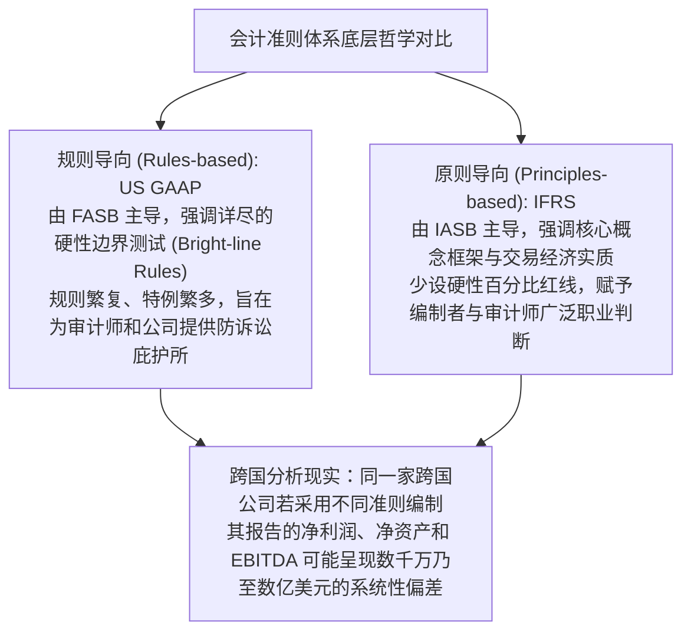
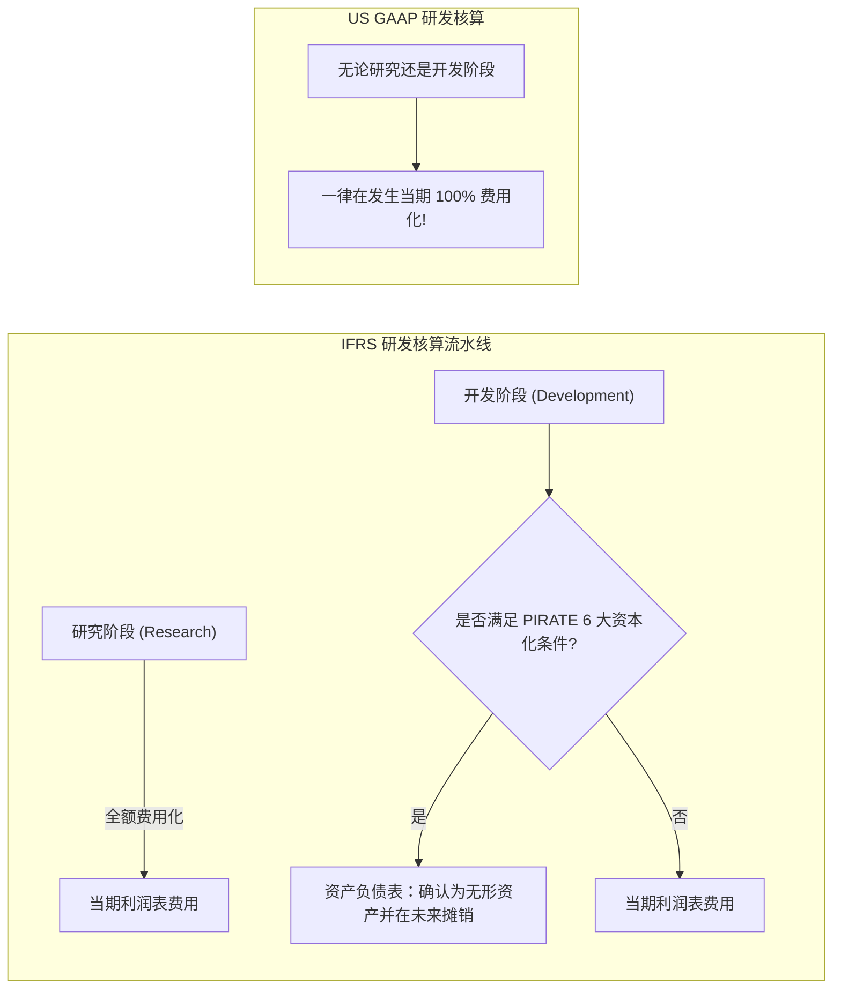
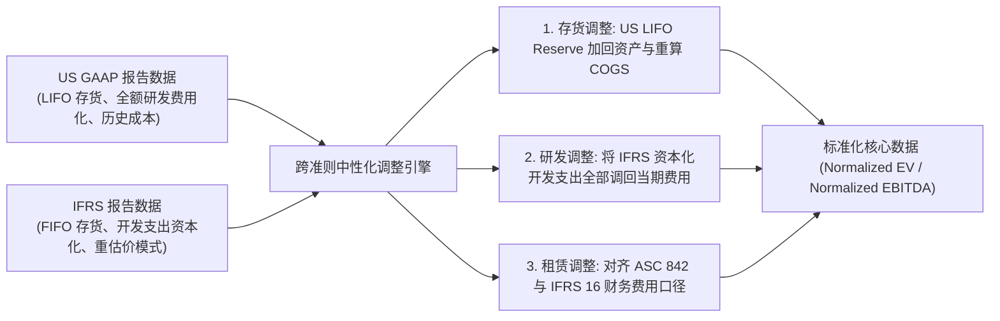

# Lec 18 国际财务分析与跨国会计准则差异 (International Financial Analysis: US GAAP vs IFRS)

> MIT Sloan School of Management · 15.535 Business Analysis Using Financial Statements · 讲义 18

## TL;DR

- 全球会计准则呈现美国“规则导向”（US GAAP）与国际“原则导向”（IFRS）的双轨竞争格局。
- 研发支出资本化、存货后进先出法（LIFO）与资产减值转回构成跨国财务可比性的三大鸿沟。
- 外币折算中现行汇率法将波动归入权益（OCI），而时态法则将非货币性折算直接穿透计入净利润。
- 跨国相对估值与跨境并购必须执行跨准则桥梁调整，消除因准则口径导致的估值乘数假象。

## 规则导向 vs 原则导向：全球双轨制的哲学分歧

在经济全球化与跨国资本流动的浪潮中，全球企业财务报告形成了两大核心阵营：一是主要由美国本土上市公司采用的**美国通用会计准则（US GAAP）**，二是欧洲、亚洲大部分主要经济体（包括英国、欧盟、日本、香港、新加坡等）以及全球 140 多个国家采用的**国际财务报告准则（IFRS）**。

这两大体系并存不仅是地缘政治的妥协，更是两种截然不同的法务与会计哲学博弈的体现：



对于全球资产配置的基金经理与跨国并购专业人士而言，如果不通晓两大准则的微观差异，仅仅机械地将美股公司的市盈率（P/E）或 EV/EBITDA 与欧洲同业可比公司进行并排对比，往往会得出完全失真的投资结论。

::: definition [规则导向 vs 原则导向]
- **规则导向（Rules-based）**：准则包含极为详细的操作指引、明确的数量门槛（如“持股满 50%”、“租赁期占寿命 75%”）以及大量针对特定行业的例外条款。其优点是合规操作高度确定，缺点是容易诱导企业通过“合规工程”精准设计合同绕过红线。
- **原则导向（Principles-based）**：准则仅阐明核心核算原则与经济实质要求，极少设定硬性数量边界。其优点是能够穿透表象直击商业实质，缺点是对会计师的专业素养与诚信要求极高，且可能导致不同企业的会计处理一致性下降。
:::

## 核心准则重大差异矩阵：从存货到长期资产

下表系统梳理了 US GAAP 与 IFRS 在日常财务分析中影响最深远、导致跨期与跨国偏差最显著的四大核心会计科目对比：

| 会计议题 | 美国通用会计准则 (US GAAP) | 国际财务报告准则 (IFRS) | 分析师重构与跨期对比调整指南 |
| :--- | :--- | :--- | :--- |
| **存货计价方法** | 允许使用**后进先出法（LIFO）**（受 LIFO 一致性规则税收驱动），亦允许 FIFO 和加权平均 | **严格禁止使用 LIFO**，仅允许使用先进先出法（FIFO）或加权平均成本法 | 对 US GAAP 下使用 LIFO 的公司，必须利用附注中的 **LIFO Reserve** 调回 FIFO 口径以实现同业可比 |
| **研发支出 (R&D)** | **研究与开发支出全额直接费用化**（除符合特定条件的拟对外销售/内部使用软件开发成本） | **严密区分研究与开发阶段**：研究支出费用化；一旦满足技术可行性等 6 大条件，开发支出**强制资本化** | IFRS 企业的净利润与 EBITDA 往往被开发资本化推高；分析师应将资本化研发费用调回费用化口径 |
| **长期资产重估** | **严格采用历史成本法**，严禁对厂房、土地或设备根据公允价值向上重估 | 允许在成本模式与**重估价模式（Revaluation Model）**中选择，允许按公允价值向上重估（计入 OCI） | IFRS 企业资产负债表中土地与厂房若经过重估，其账面净资产（Book Value）显著膨胀，导致 P/B 偏低 |
| **长期资产减值转回** | 采用**两步法减值测试**；一旦确认为资产减值损失，在未来期间**绝对严禁转回（No Reversal）** | 采用**单步法减值测试**；除商誉外，若减值迹象消失，**允许在原计提范围内全额转回**计入利润表 | IFRS 企业在周期复苏时可通过减值转回释放巨额纸面利润；US GAAP 企业的历史减值成为永久沉没成本 |



::: pitfall [将 IFRS 开发支出资本化误判为“高盈利与高利润率”]
在欧洲制药与汽车制造巨头（如罗氏、大众）中，每年有数亿欧元的临床开发或新车型工程开发支出被合规资本化沉淀为无形资产，从而大幅调减了当期损益表中的研发费用。与美国同业（如辉瑞、福特）相比，欧洲企业的报告净利润、EBITDA 与毛利率看起来显著更高。
分析师必须在可比估值中执行**标准化调整（Normalization）**：将 IFRS 资产负债表新增的开发无形资产扣除，将摊销费用还原为当期研发费用，以建立统一的苹果与苹果对比（Apples-to-Apples Comparison）。
:::

## 外币折算会计（ASC 830 / IAS 21）：现行汇率法 vs 时态法

跨国企业拥有遍布全球的海外子公司，其日常交易通常以当地货币计价。在期末将境外子公司的外币财务报表合并至母公司的报告货币（如美元或人民币）时，准则确立了两种截然不同的折算范式：**现行汇率法（Current Rate Method）**与**时态法（Temporal Method）**。

折算方法的选择严格取决于该境外实体的**功能货币（Functional Currency）**判定：

```mermaid
flowchart TD
    Sub["境外独立子公司 (Foreign Subsidiary)"] --> CheckFunc{"判定该实体的主要经济运营环境<br/>功能货币 (Functional Currency) 是什么?"}
    CheckFunc -->|当地货币 (经营独立自负盈亏)| CurrentMethod["现行汇率法 (Current Rate Method)"]
    CheckFunc -->|母公司报告货币 (或恶性通胀经济体)| TemporalMethod["时态法 (Temporal Method)"]
    
    CurrentMethod --> B_All["资产与负债一律按期末现行即期汇率折算"]
    CurrentMethod --> P_Avg["利润表收入与费用按全期加权平均汇率折算"]
    CurrentMethod --> CTA["折算差额避开利润表：计入股东权益的 OCI 外币折算储备 (CTA)"]
    
    TemporalMethod --> B_Monetary["货币性资产与负债 (现金、应收、应付) 按期末现行汇率折算"]
    TemporalMethod --> B_NonMonetary["非货币性资产 (存货、固定资产) 按原始取得历史汇率折算"]
    TemporalMethod --> PnL_FX["折算损益直接作为未实现汇兑损益计入当期净利润 (Net Income)!"]
```

### 两种折算方法对财务比率的重大扭曲

::: theorem [外币折算对利润与杠杆的非对称影响]
1. **现行汇率法**：由于所有资产与负债均乘以相同的期末即期汇率，资产负债表原币种的结构比例（如流动比率、资产负债率）在折算后得到完美保留。汇率波动引起的未实现折算损益全部汇入资产负债表底部的**累计其他综合收益（Cumulative Translation Adjustment, CTA）**，对当期报告净利润没有任何直接冲击。
2. **时态法**：由于货币性资产按即期汇率折算，而存货与固定资产按历史汇率折算，原本的资产负债比例被汇率彻底打乱。更致命的是，**时态法产生的折算差额直接穿透进入当期利润表**，当海外实体处于汇率剧烈贬值的国家时，母公司合并净利润将面临巨大的非经营性汇兑波动冲击。
:::

::: example
某美国跨国制造集团在德国拥有一家全资子公司，其功能货币为欧元（EUR）。年初与年末欧元对美元即期汇率分别为 $1.00$ 与 $1.10$（欧元升值 10%），当年全期平均汇率为 $1.05$。
该子公司年初与年末均拥有 1 亿欧元固定资产原值，当年实现营业收入 5,000 万欧元，实现净利润 1,000 万欧元。
- 采用**现行汇率法**折算进入美国母公司报表：
  - 年末固定资产折算为：$1.0 \text{ 亿欧元} \times 1.10 = 1.10 \text{ 亿美元}$（资产端膨胀 10%）；
  - 净利润按平均汇率折算为：$1,000 \text{ 万欧元} \times 1.05 = 1,050 \text{ 万美元}$；
  - 欧元升值带来的 1,000 万美元资产重估利得全额计入股东权益的 CTA，当期报告 EPS 不受任何意外干扰。
- 若该子公司由于高度依赖母公司采购，功能货币被判定为美元，则必须采用**时态法**：
  - 固定资产仍按历史汇率 $1.00$ 锁定为 1.0 亿美元；
  - 货币性净资产的升值必须计算未实现折算利得，直接加计进入合并利润表的“汇兑损益”科目，导致合并净利润被动暴增，掩盖了真实的底层经营趋势。
:::

## 跨国估值多因子清洗与可比性重构

在跨国并购与全球股票横向定价中，专业分析师必须建立系统性的“跨准则清洗矩阵”，将关键财务指标拉平至同一准绳，避免因会计制度分歧得出扭曲的倍数结论。



### 三大核心跨国清洗调账实务

1. **存货口径统合（LIFO to FIFO Reconciliation）**：
   对于采用 US GAAP 的美国制造或能源企业，若其采用 LIFO，分析师必须从报表附注中提取 LIFO 准备金（LIFO Reserve, $LR$）。资产端：将存货总额调增 $LR$，以反映现行重置成本；利润端：当期营业成本调减 $\Delta LR$（$COGS_{\text{FIFO}} = COGS_{\text{LIFO}} - \Delta LR$）。这一调整消除了跨国通胀环境下美国企业毛利率与周转率被系统性压低的伪象。
2. **研发资本化对齐（R&D Expense Alignment）**：
   对于遵循 IFRS 的欧洲或亚洲科技、医药企业，必须穿透无形资产变动表，识别当期合规计入“资本化开发支出”的金额。在横向对比 EV/EBITDA 时，必须将该增量资本化研发支出从无形资产投资中剥离，直接计入当期经营费用；同时从折旧摊销中扣除历史研发摊销，使欧美同业的 EBITDA 与经营利润处于完全等同的“全额费用化”基准线上。
3. **租赁与融资分类调平（Lease Classification True-Up）**：
   IFRS 16 将几乎所有租赁全额确认为使用权资产和租赁负债，利润表全额体现为折旧与利息，从而天然推高了 EBITDA；而 US GAAP 针对经营租赁在利润表中仍体现为单一行租金费用（直接冲减 EBITDA）。在跨国可比估值中，必须将 US GAAP 经营租赁按 IFRS 口径拆解为隐含利息与折旧，使跨国 EBITDA 真正具备横向可比性。

## 我的理解

::: insight [国际会计的巴别塔：在制度语境中审视商业真理]
圣经故事中，人类因试图建造通往天堂的巴别塔而被上帝打乱了语言，从此陷入相互误解的隔阂。在现代商业世界中，US GAAP 与 IFRS 正是两套不同语系搭建的“会计巴别塔”。

许多初级分析师容易将某一准则奉为绝对的“客观真理”，抱怨另一套体系“充满漏洞”。然而，深入考察两者的起源就会明白：**没有任何一套会计准则是纯粹中立的技术工具，它们是各自国家法律体系、商业诉讼文化、税收制度与资本市场结构的直接映射**。

美国强推“全额研发费用化”，源于硅谷科技繁荣背后极其惨烈的失败率，以及美国发达的股东集体诉讼制度对防止管理层吹捧研发资产的严酷要求；而欧洲准则倡导“开发资本化”与“重估价模式”，则深深植根于欧洲大陆法系对企业资产真实重置价值的尊重与跨期平稳诉求。

卓越的全球投资分析师，永远不应该被准则的表象代码所束缚。精通跨国会计差异的终极境界，是学会在这两门商业语言之间自由穿梭——在脑海中随手抹平存货与研发的核算口径，透过纷繁复杂的折算迷雾，直接凝视跨国企业底层商业模式在全球产业链中的真实创造力。
:::
