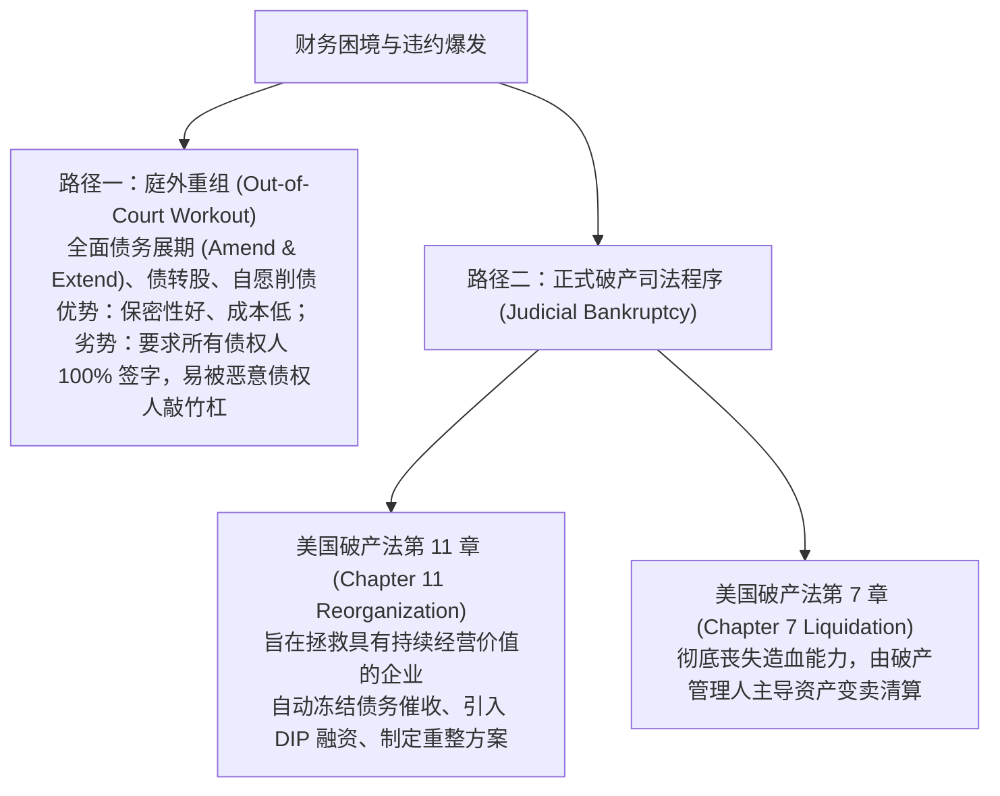
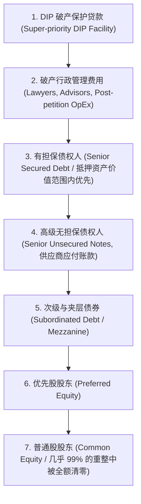
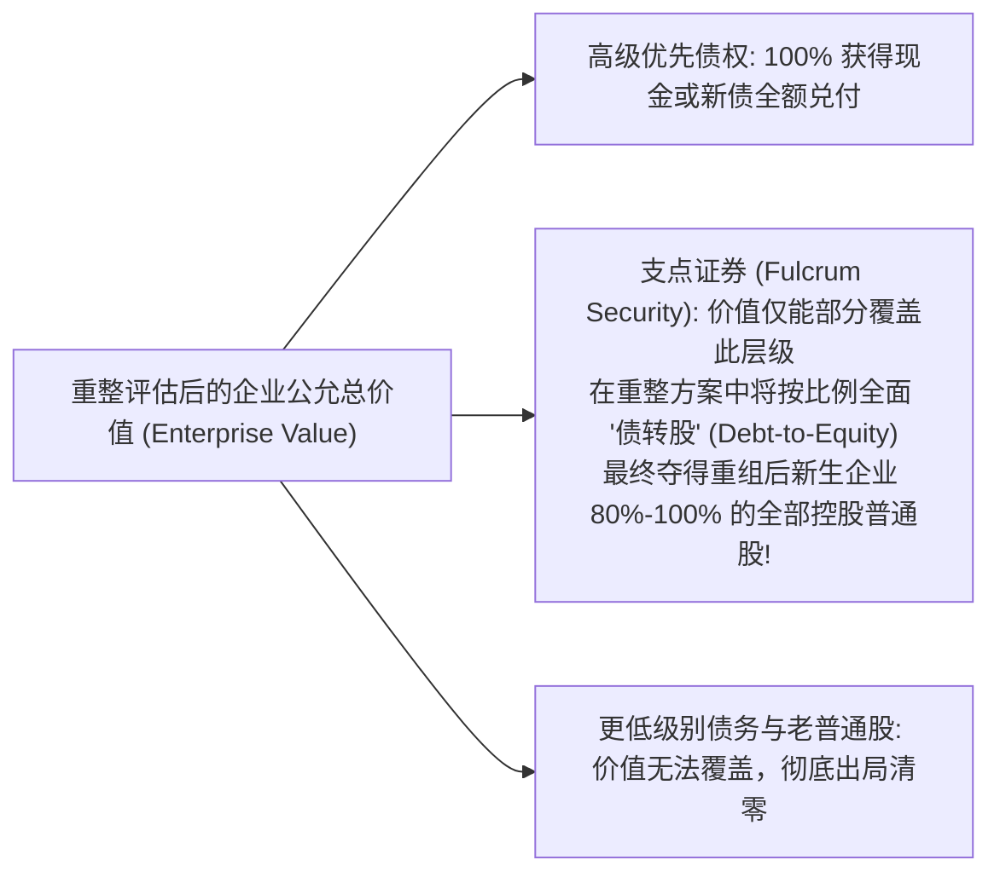
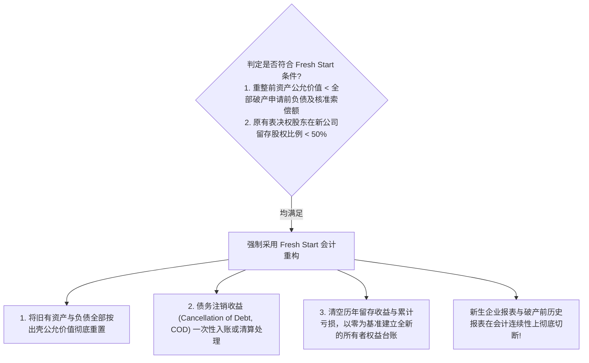

# Lec 19 困境企业重组、不良资产与清算估值 (Distressed Debt, Restructuring and Liquidation Valuation)

> MIT Sloan School of Management · 15.535 Business Analysis Using Financial Statements · 讲义 19

## TL;DR

- 困境企业重组横跨庭外协商与破产司法程序，绝对优先权原则（APR）决定了清偿受偿位序。
- 支点证券（Fulcrum Security）是不良资产投资的核心锚点，其持有者将在债转股后接管新公司控制权。
- 清算估值依清算周期分为有序清算价值（OLV）与快速拍卖价值（FLV），专用资产面临极高折价。
- 新生开始会计（Fresh Start Reporting）要求破产重整出壳企业按公允价值彻底重置资产负债表。

## 困境企业的生命周期：从流动性枯竭到破产法庭

当企业的自由现金流持续无法覆盖利息与刚性资本支出，或债务到期遭遇再融资冰冻时，企业便步入**财务困境（Financial Distress）**周期。在现代商业法务框架下，困境企业的化险演进呈现阶梯式的博弈轨迹：

在 Chapter 11 破产重组程序中，法律赋予了困境企业极具威力的保护工具：
1. **自动冻结保护（Automatic Stay）**：自企业向法院递交破产申请的一秒起，所有债权人针对债务人的诉讼、查封、冻结银行账户或强行处置抵押品的行为立即被法律强制叫停。
2. **破产保护管理贷款（DIP Financing）**：为了维持重组期间供应链不中断并按时支付员工薪水，法庭允许外部金融机构向债务人注入增量流动性，并赋予其**超级优先清偿权（Super-priority Status）**，其受偿顺序凌驾于破产前的一切无担保甚至部分担保债权之上。

::: definition [财务困境 (Financial Distress)]
财务困境是指企业由于经营性现金造血功能衰竭或杠杆债务结构极度错配，导致其无法履行对债权人承诺的本息支付义务，或突破了具有法律效力的财务限制性契约红线，从而面临被强行清算或被迫进行全面资本重组的状态。
:::

## 绝对优先权原则（APR）与清偿受偿瀑布

破产法理的核心基石是**绝对优先权原则（Absolute Priority Rule, APR）**。该原则规定：在清算或重整方案中，**资产变现价值或重整企业新价值的分配，必须严格按照法律确立的求偿权位序从高到低逐级清偿；只有当上一级债权人获得 100% 全额偿付后，下一级受偿人才有权分得哪怕一美元的资产**。

::: theorem [绝对优先权受偿方程]
设破产企业经重整评估的总价值（或清算资产总额）为 $V$。
各级债权总额依次为 $D_1, D_2, \dots, D_k$：
- 若 $V \le D_1$：第一级债权人受偿率（Recovery Rate）为 $V / D_1$，后续所有级别债权人受偿率全额为 0。
- 若 $\sum_{i=1}^{k-1} D_i < V < \sum_{i=1}^{k} D_i$：前 $k-1$ 级债权人获得 100% 全额受偿；第 $k$ 级债权人获得部分剩余清偿，受偿率为 $\frac{V - \sum_{i=1}^{k-1} D_i}{D_k}$；第 $k+1$ 级及更低位序（包括全部普通股股东）受偿率严格为 0。
:::

在极少数情况下，为了换取阻碍重组方案推进的特定债权人或工会的合作，各方在重整计划中会达成妥协，给予低位序利益方少量微薄的“赠予对价（Gifting）”，但 APR 依然是法庭强行批准方案（Cramdown）不可动摇的底线。

## 秃鹰投资策略：寻找“支点证券”（The Fulcrum Security）

在不良资产对冲基金（Distressed Debt Hedge Funds，常被称为“秃鹰投资人”）的实操体系中，核心投资逻辑并非简单的破产清盘收回零钱，而是通过**“以贷收企”（Loan-to-Own）**策略夺取企业的控制权。

这一策略的胜负手完全取决于能否精准定位并折价吸纳**支点证券（Fulcrum Security）**：

::: definition [支点证券 (Fulcrum Security)]
支点证券是指在困境企业资本结构受偿瀑布中，其索偿权**刚好没有被企业重整内在价值全额覆盖、而只能获得部分受偿的特定债务层级**。由于它处于价值切断的“支点”位置，在法庭批准的破产重组计划中，该层级债务人通常被赋予将债权转化为重组后新生企业绝大部分普通股权的法定权利，成为新企业的实际控股股东。
:::

::: example
某大型连锁医院由于过度举债申请 Chapter 11 破产保护。经独立投行重整评估，该企业摆脱历史包袱后的持续经营企业价值（Enterprise Value）为 8 亿美元。
其破产前的资本结构负债如下：
1. 第一留置权高级银行抵押借款：3 亿美元；
2. 第二留置权高级无担保债券：7 亿美元；
3. 次级债券：4 亿美元；
4. 老普通股：账面净资产为负。

应用受偿瀑布与支点证券分析：
- 高级银行借款（3 亿美元）获得 100% 全额受偿（以新发行的 3 亿美元优先抵押债券置换）。
- 剩余企业价值：$8.0 - 3.0 = 5.0$ 亿美元。
- 此时第二留置权无担保债券总额为 7 亿美元，但剩余资产价值仅有 5 亿美元，**第二留置权债券即为无可争议的“支点证券”**！
- 次级债券（4 亿美元）与老普通股由于位序在后，受偿价值为 0，权益彻底注销清零。
- 重组方案落地：7 亿美元的第二留置权债券持有者，将按比例瓜分新生医院集团 100% 的全新普通股（每 1 美元面值债券置换价值约 0.71 美元的全新股票）。
- 秃鹰基金若在破产恐慌抛售潮中以面值的 30%（即 0.30 美元）吸纳该第二留置权债券，通过重整债转股将斩获高达 **136% 的惊人投资净回报**（0.71 / 0.30 - 1）。
:::

## 清算价值估值法（Liquidation Valuation）与资产折扣矩阵

当企业主营业务丧失持续造血前景，无法通过 Chapter 11 恢复生机时，破产法庭将转入 Chapter 7 进行清算。在测算底层安全边际时，分析师必须采用**清算价值估值法**。

清算估值严格区分两种时间维度的清偿场景：
1. **有序清算价值（Orderly Liquidation Value, OLV）**：假设清算人在市场上拥有 6 到 12 个月的合理推销与谈判窗口，寻找特定行业潜在买家并分批竞价出售资产的预期可实现净现值。
2. **强制快速拍卖价值（Forced Liquidation Value, FLV）**：在法院强制规定的极短时间（通常 30 到 60 天内），在破产拍卖现场即时锤敲出脱所能收回的悲观极值。

下表给出了华尔街破产重组中通用的资产负债表各科目标准折扣打折率（Haircut Matrix）：

| 资产负债表科目 | 账面原值特征与流动性约束 | 有序清算回收率 (OLV) | 强制清算回收率 (FLV) |
| :--- | :--- | :--- | :--- |
| **现金及等价物** | 法定主权货币，无资产减值折价 | **100%** | **100%** |
| **应收账款** | 客户得知企业清算后往往故意拒付或拖延索赔 | **60% - 80%** | **40% - 60%** |
| **原材料存货** | 标准化钢材、塑料颗粒等大宗通用原材料 | **60% - 75%** | **40% - 50%** |
| **在制品存货 (WIP)** | 处于半组装半加工状态，外部买家无法直接使用 | **10% - 30%** | **0% - 10%** |
| **产成品存货** | 具有保质期限制或特定品牌标识的制成品 | **40% - 60%** | **20% - 40%** |
| **工业通用土地厂房** | 处于核心物流枢纽的标准化仓库与厂区 | **70% - 85%** | **50% - 65%** |
| **专用定制机器设备** | 针对特定淘汰生产工艺定制，重置与运输成本极高 | **15% - 35%** | **5% - 15%** |
| **商誉及特许无形资产** | 企业破产后组织资本彻底瓦解，商誉毫无剩余价值 | **0%** | **0%** |

::: pitfall [将“账面净资产”误判为“破产清偿底线”]
在企业面临破产清算时，资产负债表上的“所有者权益账面价值”毫无参考价值。
即使一家企业的账面净资产显示仍有 5 亿元，但如果其资产端包含 3 亿元商誉、1 亿元专用研发模具以及 2 亿元未完工半成品，在清算拍卖锤击之下，这 6 亿元资产的实际回收现金可能不足 3,000 万元，根本无法覆盖流动负债。
:::

## 新生开始会计（Fresh Start Accounting, ASC 852）

当困境企业成功与债权人就 Chapter 11 重整计划达成一致并获法院正式核准执行后，企业将正式“脱困出壳（Emerge from Bankruptcy）”。在会计核算上，准则要求采用具有颠覆性质的**新生开始会计（Fresh Start Reporting, ASC 852）**。

### 新生开始会计的三大核心重构支柱

1. **出壳重整价值全面公允分摊（Reorganization Value Allocation）**：
   企业必须聘请独立估值专家测算脱困当日的企业整体经营价值（Reorganization Enterprise Value）。该价值按类似并购购买法（PPA）的逻辑分摊至各项可辨认有形资产与无形资产，彻底抹去历史账面折余价值。若企业价值超过可辨认净资产公允价值，超出部分确认为全新的“重整商誉”。
2. **债务注销收益（Cancellation of Debt, COD Income）与税收属性冲减**：
   债权人自愿或按重整计划减免的大额债务本息（例如原本应偿付 10 亿美元，实际仅清偿 4 亿美元新股票），其 6 亿美元的差额确认为债务重组利得。根据税法破产免税条款，该所得虽然通常免征企业所得税，但必须强制同等核销冲减企业原先积累的净营业亏损结转（NOL）等税收属性资产。
3. **权益台账归零与历史会计连续性彻底斩断**：
   破产前累积的数十亿美元留存收益（Retained Earnings）赤字被法律指令彻底清零。新生企业以全新发行的普通股股本与资本公积为起点重新建账。在对外披露的 10-K 年报中，破产出壳前后的财务数据被粗黑竖线严格隔离，标志着新法人在会计意义上的“再世为人”。

实施新生开始会计的企业，其历史资产折旧包袱被全额出清，负债利息显著降低，往往在出壳后的首个财年呈现出极其亮眼的利润率与资本回报率反弹，为战略投资人提供了绝佳的业绩释放窗口。

## 我的理解

::: insight [困境投资的真谛：在废墟上称量商业文明的残值]
在资本市场的晴空万里下，人人都乐于谈论复利、颠覆式创新与指数级增长；然而，只有当潮水彻底退去、狂风暴雨将企业撕成碎片时，商业报表分析才迎来其最冷酷、也最神圣的试炼——**困境企业破产重组**。

破产法庭不是财富的焚化炉，而是现代金融法律文明为了防止资源死锁而设计的一台极其精密的“外科再造手术台”。

绝对优先权原则（APR）的受偿瀑布，展现了法律对契约精神最坚定的捍卫——借钱给企业的债权人，其权利永远优先于享有暴利红利的普通股股东。而“支点证券”与“秃鹰投资”的精妙机理，更是彻底颠覆了“买股票才是当股东”的思维惯性：**在资产负债表坍塌的断层带，手握高级债券的猎手往往能在法槌落下的瞬间，以三折的成本完成对企业全部核心商业资产的降维夺取**。

清算估值是一面最诚实的透镜。它无情地将一切虚浮的无形资产与纸面商誉瞬间清零，逼迫你直视一台生锈的数控机床、一堆未完工的塑料废料究竟能在现实世界中换回几张现钞。学会在繁荣期审视清算底线，在绝望的废墟中计算支点资产的浴火重生概率，这正是顶级商业分析师超越周期宿命的终极力量。
:::
