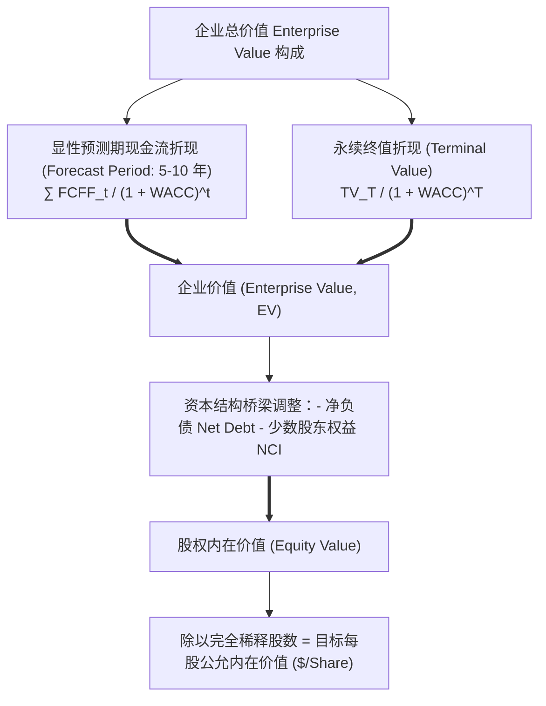
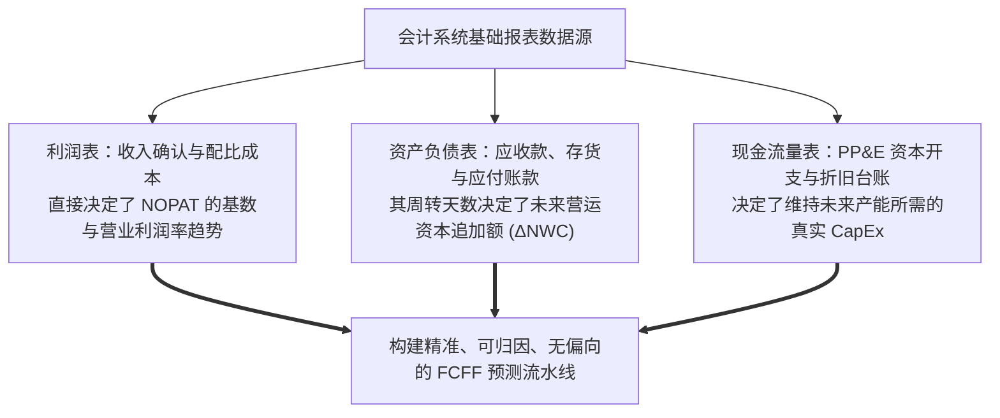

# Lec 02 现金流折现（DCF）基础与会计信息角色 (The Basics of Company Valuation: DCF Foundations & Accounting Roles)

> MIT Sloan School of Management · 15.535 Business Analysis Using Financial Statements · 讲义 02

## TL;DR

- 现金流折现（DCF）将企业内在公允价值确立为未来可自由支配现金流的加权平均资本成本折现和。
- 公司自由现金流（FCFF）与股权自由现金流（FCFE）分别对应全投资人企业价值与纯股权价值。
- 终值（Terminal Value）在模型中常占总估值的 60%-80%，受永续增长率与折现率极度敏感支配。
- 会计信息并非 DCF 的替代品，而是提炼税后经营利润、营运资本变动与资本开支预测的唯一数据基石。

## 现金流折现模型（DCF）数学架构与企业价值公理

在现代公司金融与证券估值理论中，**现金流折现模型（Discounted Cash Flow, DCF）**享有至高无上的基准地位。无论是沃伦·巴菲特（Warren Buffett）的内在价值哲学，还是华尔街投行针对数十亿美元跨国并购的公平性意见书（Fairness Opinion），其终极估值公理均一以贯之：**任何商业资产的内在经济价值，严格等于其在存续寿命内预期所能产生的一切未来自由现金流经由风险调整贴现率折现后的总和**。



在数学上，全投资人视角的**企业价值（Enterprise Value, EV）**展开方程为：

$$\text{EV} = \sum_{t=1}^{T} \frac{\text{FCFF}_t}{(1 + \text{WACC})^t} + \frac{\text{Terminal Value}_T}{(1 + \text{WACC})^T}$$

通过资本结构桥梁转换为归属于普通股股东的**股权价值（Equity Value）**：

$$\text{Equity Value} = \text{Enterprise Value} - \text{有息金融负债总额} + \text{超额闲置货币资金} - \text{少数股东权益} - \text{优先股账面价值}$$

$$\text{目标每股公允价值} = \frac{\text{Equity Value}}{\text{完全稀释流通在外普通股数 (Diluted Shares)}}$$

## 自由现金流：FCFF vs. FCFE 两大切分体系

在构建 DCF 模型时，分析师必须首先做出清晰的方法论抉择：是测算全口径的**公司自由现金流（FCFF）**，还是直接测算归属于股东的**股权自由现金流（FCFE）**：

```mermaid
flowchart LR
    subgraph FCFF_Model [公司自由现金流 FCFF (无杠杆现金流 Unlevered FCF)]
        direction TB
        F1["税后净经营利润 NOPAT (EBIT × [1 - 税率])"]
        F2["+ 非现金折旧与摊销 (D&A)"]
        F3["- 经营性营运资本净变动 (ΔNWC)"]
        F4["- 维持与扩张性资本开支 (CapEx)"]
        F1 --- F2 --- F3 --- F4 ==> FCFF_Sum["FCFF 现金流池"]
        FCFF_Sum --> WACC_Discount["按加权平均资本成本 WACC 折现得出 Enterprise Value"]
    end

    subgraph FCFE_Model [股权自由现金流 FCFE (有杠杆现金流 Levered FCF)]
        direction TB
        E1["普通股股东净利润 Net Income"]
        E2["+ 非现金折旧与摊销 (D&A)"]
        E3["- 经营性营运资本净变动 (ΔNWC)"]
        E4["- 维持与扩张性资本开支 (CapEx)"]
        E5["+ 新增有息债务本金 - 偿还到期债务本金 (Net Borrowing)"]
        E1 --- E2 --- E3 --- E4 --- E5 ==> FCFE_Sum["FCFE 现金流池"]
        FCFE_Sum --> Re_Discount["按股权资本成本 r_e 折现直接得出 Equity Value"]
    end
```

| 现金流体系 | 理论定义与归属出资人 | 匹配的折现率 (Discount Rate) | 核心适用场景与模型优劣 |
| :--- | :--- | :--- | :--- |
| **公司自由现金流 (FCFF)** | 企业在支付了经营费用与再投资需求后，**可同时向股权投资者与债权投资人**分配的现金池 | **加权平均资本成本 (WACC)**<br/>综合反映股权与债务加权成本 | **全球华尔街主流默认模型**！资本结构处于动态变动中的企业首选，彻底隔离债务利息变动噪音。 |
| **股权自由现金流 (FCFE)** | 企业在扣除了所有经营开支、资本再投资以及**支付了所有到期债务本息净流出后**，完全属于股东的现金 | **股权资本成本 ($r_e$)**<br/>通常由 CAPM 模型测算得出 | 仅适用于资本结构保持刚性恒定比例（Debt/Equity 固定）的成熟企业，或商业银行等金融实体。 |

## 终值测算的两大估算范式与敏感性陷阱

在大多数 DCF 实操中，显性详细预测期通常设定为 5 至 10 年（因为人类无法可靠预测 15 年后的微观订单）。因此，在第 $T$ 年底，必须对企业此后直至永续的全部剩余价值进行总括估算，即**终值（Terminal Value, TV）**。

### 1. 戈登永续增长模型 (Gordon Growth Model)
假设从第 $T+1$ 年开始，企业进入完全成熟的稳态阶段，现金流以固定的年化增长率 $g$ 永续递增：

$$\text{Terminal Value}_T = \frac{\text{FCFF}_{T+1}}{\text{WACC} - g} = \frac{\text{FCFF}_T \times (1 + g)}{\text{WACC} - g}$$

::: theorem 永续增长率天花板公理
**模型中设定的永续增长率 $g$ 绝对不允许超越该企业所在主权国家的长期宏观名义 GDP 增长率（通常设定在 $2\%-3\%$ 之间）**！
如果在数学上设定 $g > \text{GDP 增长率}$，在拉普拉斯无限时间积分下，该企业最终在数学上将会吞噬整个地球的全部经济体量，这在经济现实中是绝对荒谬的。
:::

### 2. 退出乘数法 (Exit Multiple Method)
假设企业在显性期末被同业并购或以公允市价出售，以第 $T$ 年的标准化经营指标乘以行业基准可比倍数：
$$\text{Terminal Value}_T = \text{EBITDA}_T \times (\text{行业目标 EV / EBITDA 交易乘数})$$

::: pitfall 终值黑洞与敏感性分析
在绝大多数 10 年期 DCF 模型中，**终值折现后的现值往往占据了最终企业总估值的 $60\%$ 至 $85\%$**！
这意味着整个精密模型的最终产出，极度脆弱地取决于两个主观参数：加权平均资本成本 WACC 与永续增长率 $g$。
- WACC 轻微下调 $0.5\%$、或者 $g$ 轻微上调 $0.5\%$，测算出的每股股票公允估值就能暴增 $30\%-50\%$；
- 卓越的分析师绝对不能给出一个单一的孤立数字，必须随附**双变量敏感性测试矩阵（Two-Variable Sensitivity Matrix）**，向决策者揭示宏观利率变动下的估值安全边际（Margin of Safety）。
:::

## 会计信息在 DCF 估值中的核心锚定角色

金融学界曾流行一种偏激的偏见——“既然 DCF 只看自由现金流，那么权责发生制的会计报表就可以被完全扔进废纸篓”。这种观点割裂了会计与金融的血肉联系。

**现实中，没有任何真实的自由现金流能够脱离会计信息体系而凭空产生**：



如果一家企业的管理层通过激进的坏账计提或虚构收入美化了利润表，这种会计噪音会直接通过高估 NOPAT 注入预测期，导致 DCF 模型得出一个严重高估的泡沫估值（即经典的“垃圾进，垃圾出 Garbage In, Garbage Out”）。只有经过深度会计质量审计清洗后的报表指标，才能为 DCF 模型提供坚不可摧的现实锚点。

## 我的理解

::: insight DCF 是眺望未来的望远镜，会计分析是校准镜片的精密微调螺栓
审视现金流折现与会计信息的关系，可以获得超越数字的认知升维：
1. **警惕“数学精确”掩盖下的“逻辑虚妄”**：在投行分析师的 Excel 表格里，折现公式可以精确到小数点后第四位，每一个宏单元格都闪烁着优雅的代数光泽。然而，这种数学上的精致常常让人产生一种“我们已经精准掌握了未来”的虚妄掌控感。未来十年的全球宏观地缘、技术突变与客户偏好是充满混沌扰动的。DCF 模型的价值不在于告诉你这家公司的股票明天到底值 82.5 美元还是 83.2 美元，而在于它为你提供了一个严谨的思维脚手架，让你清楚看到当前 100 美元的市场股价背后，究竟隐含了对未来收入增速（是否需要达到不可思议的 40%）和利润率何等严苛的乐观假设。
2. **会计信息是唯一有据可查的历史重力**：未来是无法被直接观测的，我们对未来的一切理性预测，其唯一合理的推导起点永远是企业在过去数个商业周期中所展现出的真实经营足迹。它的存货周转率到底能不能突破物理极限？它的毛利率是不是靠延迟计提资产减值强撑出来的？这些关键答案全藏在过去的资产负债表与附注之中。会计分析不是留恋过去的后视镜，而是为了在把望远镜对准星空之前，先用最坚硬的现实重力校准我们的认知视界。
:::
