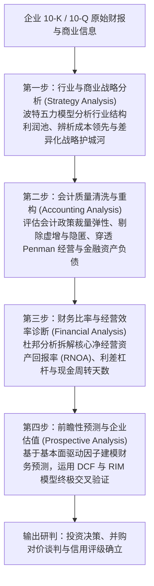
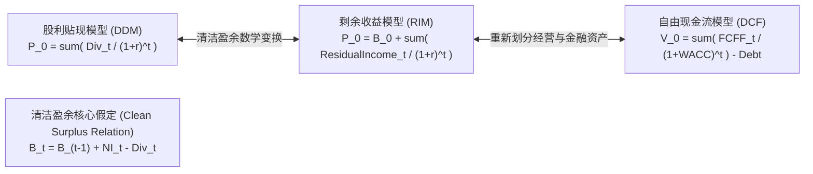
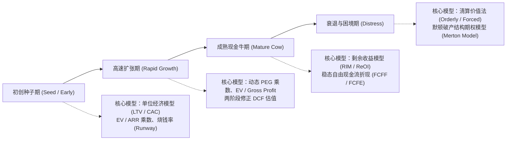
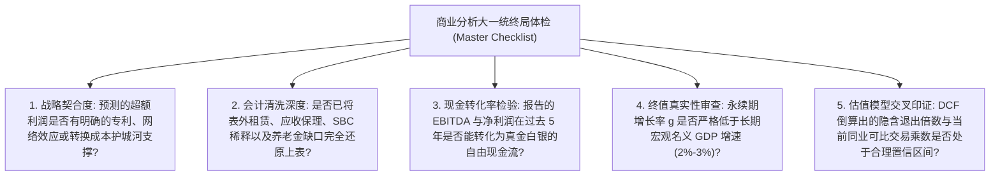

# Lec 20 前沿专题与商业报表分析大一统框架 (Synthesis: Integrated Business Analysis and Valuation)

> MIT Sloan School of Management · 15.535 Business Analysis Using Financial Statements · 讲义 20

## TL;DR

- 佩勒普-希利四步框架将战略定性、会计清洗、比率诊断与前瞻估值统一为有机整体。
- 在清洁盈余假定下，股利贴现模型、自由现金流折现（DCF）与剩余收益模型（RIM）数学严格等价。
- 剩余收益模型将绝大部分价值锚定于当期账面净资产，极大降低了对遥远终值（TV）的投机敏感度。
- 估值工具箱必须适配企业生命周期，从初创期单位经济模型向衰退期清算期权灵活演进。

## 商业分析四步大一统范式（Palepu-Healy Framework）

经过整整二十讲对财务会计微观准则、法务审计、计量模型与资本市场定价机制的深入解剖，我们最终来到了商业分析与企业估值的集大成圣殿。

由哈佛商学院 Krishna Palepu、Paul Healy 与密歇根大学 Victor Bernard 共同奠定的**商业分析与估值四步范式（Palepu-Healy-Bernard Framework）**，为跨越从“原始报表数字”到“企业公允内在价值”的认知鸿沟提供了最坚实的工程化流水线。

这四大步骤构成紧密的逻辑闭环，任何脱离前序步骤的机械计算都将导致严重的估值灾难：
1. **战略分析决定财务常模**：如果不理解行业进入壁垒与客户粘性，就无法对 ROIC 是否具有长周期均值回归特征做出合理解释；
2. **会计分析保护分析底线**：未经应计质量清洗的报表直接代入财务模型，只能得到“垃圾进、垃圾出（Garbage in, Garbage out）”的虚妄结论；
3. **财务比率揭示历史轨迹**：比率不是孤立的数学公式，而是将管理层战略执行效率量化沉淀为时间序列趋势；
4. **前瞻估值实现经济闭环**：将历史表现与战略判断无缝映射为未来的现金流与超额剩余收益，为资本配置提供最终的定价标尺。

::: definition [商业分析四步框架]
商业分析四步框架是一种将定性商业战略逻辑与定量会计数据深度融合的系统化分析方法体系。它要求分析师依次穿透企业所处行业竞争格局（战略）、识别并校准报告盈余中的会计扭曲（会计）、解构盈利驱动动因与杠杆效率（财务），并以此为基石构建可验证的前瞻预测与估值模型（前景分析）。
:::

## 三大核心估值模型的大一统等价性证明（Ohlson 1995）

在证券分析实务中，分析师常常困惑于不同估值模型计算结果的差异：采用**股利贴现模型（DDM）**、**企业自由现金流模型（FCFF）**以及**剩余收益模型（RIM）**，在同一份 Excel 底稿中往往算出三个大相径庭的数字。

然而，哥伦比亚大学会计学大师 James Ohlson 于 1995 年发表的划时代论文《盈余、账面价值与股利在权益估值中的角色》（*Earnings, Book Values, and Dividends in Equity Valuation*）从数学上无懈可击地证明：**在清洁盈余关系（Clean Surplus Relation）成立的条件下，三大估值模型在理论上完全等价！**

### 清洁盈余假定下的严密数学证明

::: theorem [Ohlson 模型三大估值等价性定理]
**清洁盈余关系（Clean Surplus Relation, CSR）**假定所有影响股东权益账面价值的损益项目全部经过利润表，除股东分红与资本注入外，期末账面权益等于期初权益加上当期净利润减去分红：
$$B_t = B_{t-1} + NI_t - Div_t \iff Div_t = NI_t - (B_t - B_{t-1})$$

根据经典股利贴现模型（DDM）：
$$P_0 = \sum_{t=1}^{\infty} \frac{Div_t}{(1 + r)^t}$$

将清洁盈余关系代入分红项：
$$P_0 = \sum_{t=1}^{\infty} \frac{NI_t - (B_t - B_{t-1})}{(1 + r)^t}$$

由于 $B_{t-1} - \frac{B_t}{1 + r} = \frac{(1 + r) B_{t-1} - B_t}{1 + r} = B_{t-1} + \frac{r B_{t-1} - B_t}{1 + r}$，通过代数裂项级数展开并在满足无套利跨期横截面边界条件（$\lim_{T \to \infty} \frac{B_T}{(1 + r)^T} = 0$）下，方程精确转化为：
$$P_0 = B_0 + \sum_{t=1}^{\infty} \frac{NI_t - r \cdot B_{t-1}}{(1 + r)^t} = B_0 + \sum_{t=1}^{\infty} \frac{RI_t}{(1 + r)^t}$$
其中 $RI_t = NI_t - r \cdot B_{t-1}$ 即为当期的**剩余收益（Residual Income）**。
:::

### 为什么在实践中分析师更偏爱剩余收益模型（RIM）？

尽管三大模型在无限期时间序列上严格等价，但在现实有限预测期（如 5 到 10 年）的实操中，**剩余收益模型（RIM）展现出远超传统 DCF 模型的结构稳健性**：

| 模型对比维度 | 传统自由现金流模型 (DCF) | 剩余收益模型 (RIM) |
| :--- | :--- | :--- |
| **价值锚点分布** | 早期现金流常因高资本开支而为负；**70% 到 90% 的企业总价值堆积在第 10 年后的永续终值（Terminal Value）** | **50% 到 80% 的企业价值直接由当期已审计的账面净资产（$B_0$）锁定**，无需预测 |
| **对贴现率与终值增长率敏感度** | 终值对 WACC 和永续增长率 $g$ 极其敏感，贴现率变动 0.5% 会导致估值暴涨暴跌 40% | 由于剩余收益具有长周期向零均值回归的经济学特性，**终值在总价值中占比通常低于 20%**，抗扰动极强 |
| **与竞争战略的契合度** | 假定现金流可以永久按某速率无限增长，违反产业组织竞争法则 | 显式内嵌了经济租金假定：超额 ROE 必将因竞争进入而逐步收敛于资本成本（$RI \to 0$） |

::: pitfall [忽视“脏盈余（Dirty Surplus）”对 RIM 的侵蚀]
清洁盈余假设的核心是所有价值变动进入净利润。然而在现实 GAAP/IFRS 下，外币折算储备（CTA）、可供出售金融资产公允价值变动、养老金精算利得等均直接计入**其他综合收益（OCI）**而绕过了利润表，构成“脏盈余”。分析师在使用 RIM 时，必须采用综合收益（Comprehensive Income）替代报告净利润，以确保清洁盈余恒等式严格成立。
:::

## 估值工具箱与企业生命周期选型矩阵

没有任何一种估值模型适用于所有企业。卓越的分析师懂得根据标的企业在**生命周期（Corporate Life Cycle）**中所处的发展阶段，动态调配合适的估值利器。

::: example
某跨国软件巨头拆分为两大独立上市实体：
- 实体 A：云原生 SaaS 高成长业务，当前由于大额研发费用化和获客销售佣金导致报告净利润为负，但年经常性收入（ARR）同比增长 60%，客户净留存率（NDR）高达 130%。
- 实体 B：传统本地化部署数据库业务，营收年增 2%，经营性现金流丰沛，账面净资产庞大且稳定派发股息。

若机械套用 P/E 乘数，实体 A 无法估值（P/E 为负），实体 B 估值极低。
正确的分析框架应实施差异化选型：
- 对实体 A：采用客户终身价值（LTV）与获客成本（CAC）的单位经济模型，结合 EV/ARR 乘数与前瞻 DCF 测算其规模效应跨越盈亏平衡点后的终局现金流；
- 对实体 B：直接采用剩余经营收益模型（ReOI）与股利贴现模型，聚焦其护城河抵御技术颠覆的衰退半衰期，测算其稳健高息资本分红的现值。
:::

## 商业分析终局体检表：投研备忘录审查清单

在最终定稿企业价值评估报告或向投委会递交并购决策备忘录前，专业分析师必须对照以下**大一统终局审查清单（The Master Valuation Checklist）**逐项排查，确保商业逻辑、会计清洗与财务估值各环节严密自洽。

### 五大终局维度的核查要义

1. **战略契合度与竞争护城河（Competitive Advantage Horizon）**：
   预测模型中假设的超越行业均值的超额资本回报率（$ROIC > WACC$），在商业现实中是否有明确的排他性知识产权、网络外部性或不可替代的高转换成本支撑。任何缺乏战略护城河支撑的企业，其预测期后期的 ROIC 必须强制向资本成本平滑收敛。
2. **会计清洗深度与隐形负债穿透（Accounting Normalization Rigor）**：
   核验是否已将表外经营性租赁、供应链反向保理、股权激励（SBC）真实稀释成本以及设定受益养老金（DB）精算赤字全额折现并入总负债；是否已剔除非经常性政府补贴与一次性诉讼和解收益。
3. **真实现金流转化率检验（Cash Conversion Quality）**：
   回溯历史 3 至 5 年的经营现金流对净利润的比率（$CFO / NI$）以及自由现金流对 EBITDA 的比率。若长期存在利润增长而经营现金流净额停滞，模型必须对未来营运资金占用（NWC）与维护性资本开支（Maintenance Capex）施加更严厉的扣减假设。
4. **终值合理性与宏观经济学边界（Terminal Value Sanity Check）**：
   在永续增长模型中，永续增长率 $g$ 绝不能超过该经济体长期潜在名义 GDP 增长率（成熟市场通常锁定在 2% 至 3% 之间），且必须与永续再投资率（$Reinvestment Rate = g / ROIC$）在数学上保持严格动态匹配。
5. **多模型独立交叉印证（Multi-Model Triangulation）**：
   对比 DCF 模型、剩余收益模型（RIM）与前瞻可比交易乘数（Forward EV/EBITDA）的三重估值结果。若 DCF 估值显著偏离可比交易中位数，分析师必须逆向反推其隐含的退出倍数，查明关键差异究竟来自对未来基本面的先见之明，还是单纯来自过于激进的贴现率微调。

## 我的理解

::: insight [财务报表分析的终极境界：从数字工匠到商业文明的见证者]
当我们走完这二十讲波澜壮阔的研习旅程，回望初见财报时的困惑与迷茫，一个最深刻的感悟便是在心头升起：**财务报表从来不仅仅是一组由借贷记账法排布出的冰冷阿拉伯数字，它是人类商业文明史上最伟大、最精密的“全息投影片”**。

在资产负债表的资产端，镌刻着人类最前沿的算力芯片、远洋货轮与实验室专利；在负债与权益端，凝聚着千万投资者、债权人与创业者对未来的信任、契约与利益博弈。每一张利润表，都是成千上万员工挥洒汗水与智慧换来的商业价值答卷；每一张现金流量表，都是企业在这场没有终点的生存战役中滚烫搏动的生命血液。

从安然与世通的惊天谎言，到斯隆与奥尔森在故纸堆中挖掘出的量化异象；从复杂的购买价格分摊（PPA），到跨国会计巴别塔的制度碰撞——这门学科的迷人之处，恰恰在于它始终处于**严密的数学逻辑与深邃的人性贪婪交汇的锋刃之上**。

成为一名卓越的商业分析师，意味着你不再是一个被动接受管理层华丽叙事的“数字打工人”，而是成为了一名手握逻辑手术刀的“商业侦探”。你拥有了一双透视眼，能够刺破盈余操纵的浓雾、抚平时间与汇率的褶皱，在最嘈杂的资本喧嚣中称量企业真实的经济价值。

愿这套大一统的商业分析框架，化作你穿行在波诡云谲的商业汪洋中最可靠的罗盘与灯塔；在纷繁复杂的现代经济世界中，守卫理性、洞悉真实、创造恒久的商业价值。
:::
