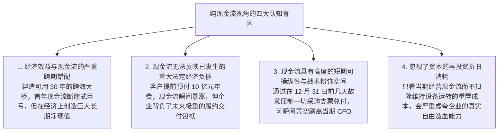
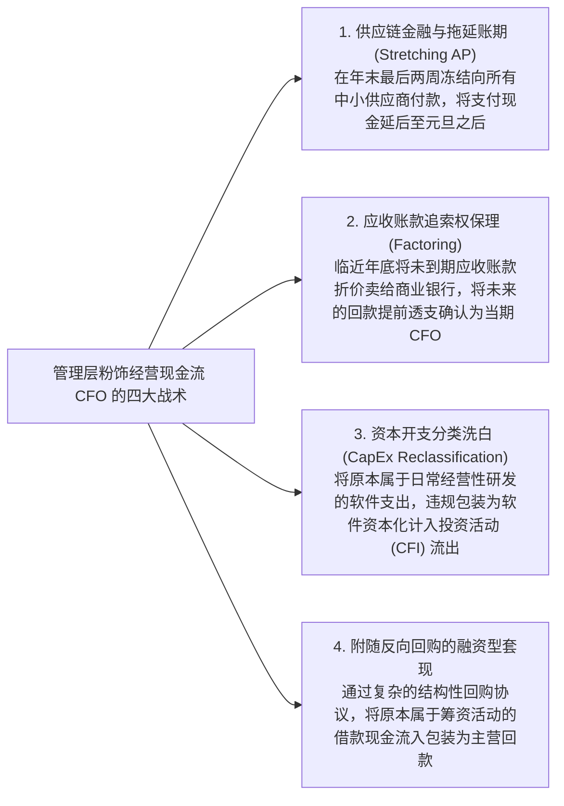
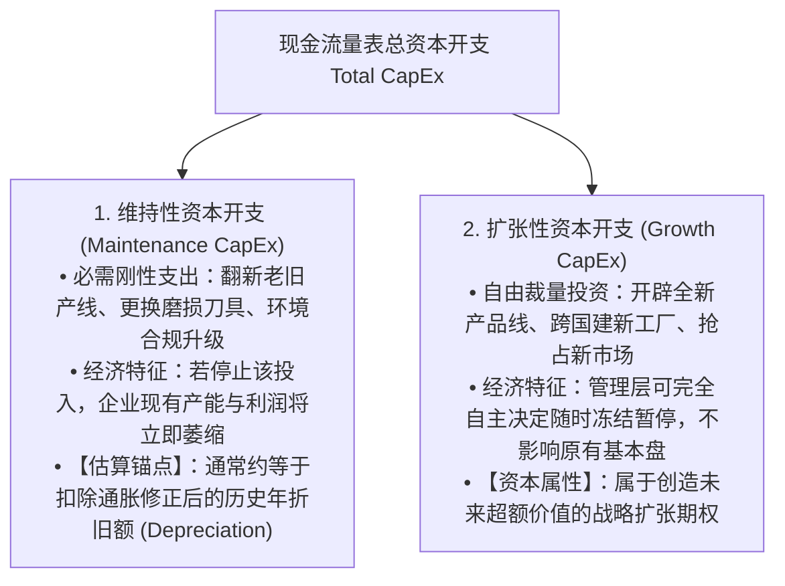

# Lec 03 现金流分析与“现金为王”之辩 (Cash Flow Analysis: Is Cash King?)

> MIT Sloan School of Management · 15.535 Business Analysis Using Financial Statements · 讲义 03

## TL;DR

- “现金为王”打破了权责发生制下的会计粉饰幻象，但纯现金流同样受制于严重的跨期错配与战术操纵。
- 管理层可通过恶意拖欠供应商货款、应收账款保理贴现与削减必要资本开支短期人为拔高经营现金流。
- 真正衡量股东价值的“所有者盈余”必须将总资本开支严格解耦为维持性资本开支与扩张性资本开支。
- 卓越的商业分析绝不孤立膜拜现金或净利润，而是审视二者长期是否能同频收敛并驱动资本复利。

## “现金为王”教条的合理性与认识论局限

在资本市场流行语中，**“现金为王（Cash is King）”**被无数价值投资者奉为圭臬。这一信仰的合理性源于对权责发生制会计主观脆弱性的天然防御——在利润表中，净利润可以被收入确认准则、坏账准备比例与折旧年限随意揉捏修饰；但银行账户里的真实货币资金流水，被视为客观刚性、无法抵赖的坚固事实。

然而在麻省理工 15.535 课程的深入剖析下，“纯现金流至上主义”暴露出严重的**认识论局限与分析盲区**：

::: theorem 现金流与经济价值创造的脱钩定理
**在任何单一会计期间内，真金白银的经营现金流（CFO）既不能证明企业创造了经济价值，亦不能否认企业的卓越竞争力**：
- 一家即将破产清算的企业，可以通过贱卖核心存货、催收历史应收账款并在当期完全停止采购原材料，报告出极其惊艳的正经营现金流（回光返照假象）；
- 一家处于爆发式扩张初期的半导体先锋，因源源不断采购高精机床、向战略供应商锁定关键晶圆产能，当期经营现金流可能深陷巨额赤字，但这恰恰是其构筑十倍产业护城河的黄金起点。
:::

## 经营现金流（CFO）操纵手法的全景侦测

许多初级分析师误以为“只要核查现金流量表，管理层就无法造假”。但精明的财务工程团队早已开发出一整套成熟的**“经营现金流（CFO）定向美化工具箱”**：

::: pitfall 格林希尔资本（Greensill Capital）供应链金融暴雷启示
跨国巨头曾广泛使用所谓“反向保理（Reverse Factoring）”或供应链金融平台：
- 企业通过让第三方金融机构（如格林希尔）替自己向供应商提前垫付货款，而自身则获得长达 180 天的超长还款期；
- 在财报编制中，企业并未将这项对金融机构的欠款列为“银行短期借款（筹资活动）”，而是**继续将其伪装成普通的“应付账款（经营活动）”**；
- 这种财技不仅隐匿了数百亿元的实际银行负债，更在报表上制造出“通过日常商业信誉源源不断从供应商手中沉淀出巨额经营现金流”的荒谬神话，直至流动性挤兑引爆世纪破产。
:::

## 自由现金流重构与资本开支性质解耦

为了还原企业能够真正不受限制分发给股东的现金，沃伦·巴菲特在 1986 年伯克希尔·哈撒韦致股东信中提出了划时代的**“所有者盈余（Owner Earnings）”**概念：

::: definition 所有者盈余 (Owner Earnings)
$$\text{Owner Earnings} = \text{报告净利润} + \text{折旧与摊销 (D\&A)} + \text{其他非现金应计调整} - \mathbf{\text{年均维持性资本开支 (Maintenance CapEx)}}$$
所有者盈余是企业为了能够**完全维持其原有的长期竞争壁垒、市场份额与物理单位产出能力**，在扣除了必须持续追加的维持性资本再投资后，股东能够完全抽离消费的终极真金白银。
:::

然而在现行的 GAAP 财务报告中，存在一个极其痛苦的信息缺口：**现金流量表只披露一个统揽的“资本开支总额（Total CapEx）”，绝对不会在表内向公众拆分哪一部分是维持性开支、哪一部分是扩张性开支**！

分析师必须通过行业工程模型对资本开支实施**正交解耦（Decoupling CapEx）**：

如果一家高科技企业全年的经营现金流为 10 亿元，总资本开支为 9 亿元，粗看其自由现金流仅有区区 1 亿元。但如果深度审计后发现，这 9 亿元中有 8 亿元是管理层为了进军下一代人工智能芯片而前瞻性采购的算力集群（纯 Growth CapEx），而维持现有老业务运转每年只需 1 亿元（Maintenance CapEx）：
- 那么该企业的**真实所有者盈余实际上高达整整 9 亿元**！
- 那些看似被吞噬的资金，本质上是企业自主行使战略选择权、将现金转化为高回报资产的自愿资本配置行为。

## 商业实战推演：高成长科技公司现金流透视

在 15.535 课程中，分析师通过研读**亚马逊（Amazon.com）早期长达十余年的财务报表**，解构了世界商业史上最经典的“负营运资本飞轮”：

::: example 亚马逊无息现金流扩张飞轮
在 2000 年代初期，亚马逊在利润表上几乎年年微亏或微利，每股收益在零轴附近徘徊，遭到华尔街传统价值派分析师的疯狂看空。
然而，翻开亚马逊的现金流量表，却展现出令人震撼的现金洪流：
1. **负营运资本周期（Negative CCC）**：亚马逊从消费者下单那一秒就通过信用卡实时刷走现金（DSO 趋近于零）；其仓储周转极快，图书与数码产品几天就能出库（DSI 极短）；但凭借庞大的采购规模，亚马逊向出版社与硬件供应商争取到了长达 60 至 90 天的免息账期（DPO 极长）；
2. **净营运资本为负（$\Delta \text{NWC} < 0$）**：这意味着随着亚马逊销售规模每扩大 10 亿元，其账上就会自动凭空沉淀出数亿元**由供应商无偿提供的沉淀现金流**；
3. **自我造血驱动飞轮**：亚马逊将这些通过负营运资本源源不断涌入的庞大经营现金流（CFO），毫不犹豫地全额砸入建设覆盖全美的自动化物流仓储履约中心和 AWS 云计算数据中心（CapEx）；
4. **终极结局**：亚马逊在长达十年不需要向银行借款、亦不需要频繁增发稀释股权的奇迹下，完全依靠内部现金流闭环实现了规模的指数级自繁衍。
:::

## 我的理解

::: insight 现金流是血液，净利润是肌肉，唯有二者有机统一才构成健康的生命体
反思“现金为王”与“利润至上”的世纪争论，可以获得透视商业生命力的最高公理：
1. **脱离净利润的现金流是无源之水**：你可以通过变卖设备、压榨供应商账期在短时间内制造出惊人的现金流喷涌，但如果没有健康的净经营利润率（NOPAT Margin）作为内生源泉，这种现金流终究会随着商业信用的透支而彻底干涸。现金流就像人体的血液，没有血液人会立刻休克猝死；但如果一个人只有充足的血液而全身肌肉（核心盈利资产）长期萎缩坏死，他也绝不可能在残酷的市场竞争中存活。
2. **卓越的投资洞察永远建立在“质量对齐”之上**：平庸的分析师在净利润和现金流之间二选一，卓越的商业分析师则像猎鹰一样盯紧二者的**收敛速率与剪刀差**。如果一家企业的净利润常年高速增长，但经营现金流始终落后、且差距被巨大的应收账款和无形资产资本化持续拉大，这就是最确凿无疑的造假信号；相反，当一家企业在利润表上看似平淡无奇，但附注里的自由现金流与预收合同负债如同地下涌泉般不可遏制地喷薄而出时，你往往正在见证一个伟大商业帝国的破晓黎明。
:::
