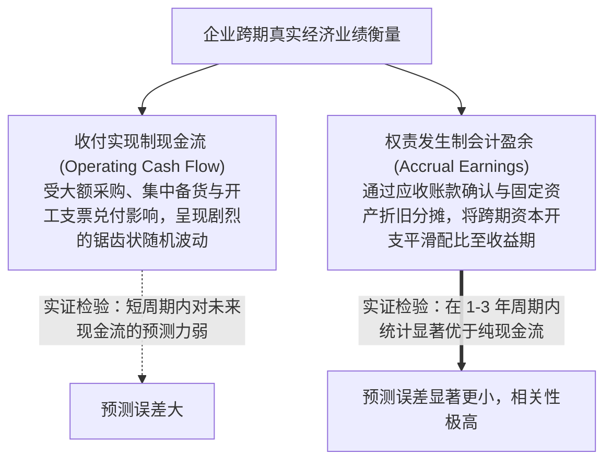
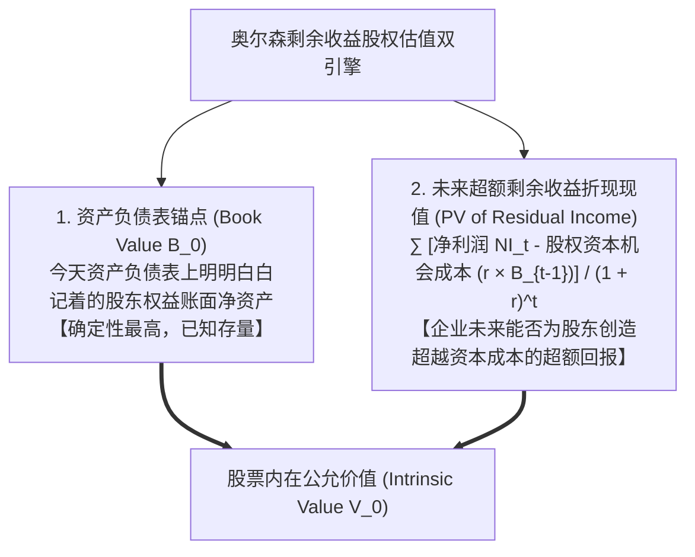
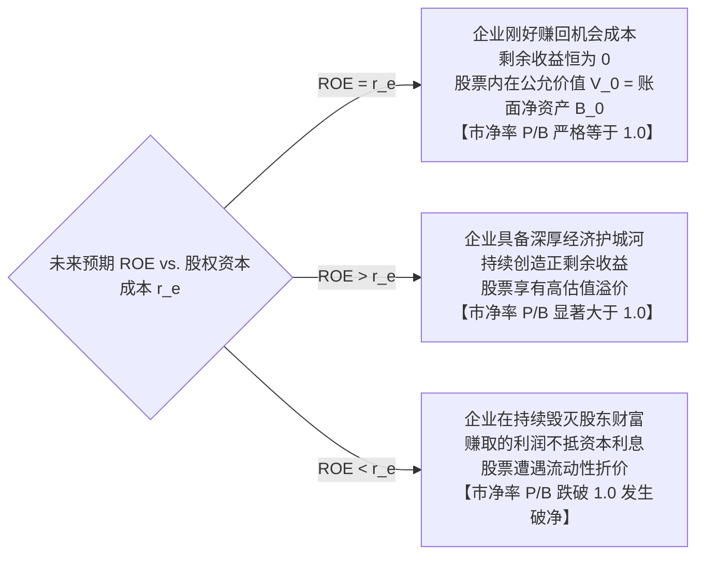

# Lec 04 基于会计盈余的估值：剩余收益模型 (Using Accounting Earnings for Valuation: Residual Income / Ohlson Model)

> MIT Sloan School of Management · 15.535 Business Analysis Using Financial Statements · 讲义 04

## TL;DR

- 权责发生制通过配比原则平滑了短期现金投资的剧烈脉冲，实证表明会计盈余对未来业绩的预测力优于当期现金流。
- 清洁盈余关系（Clean Surplus Relation）确立了账面净资产、净利润与股利分红之间的严密动态代数闭环。
- 奥尔森（Ohlson）剩余收益模型证明：股权价值严格等于当前资产负债表账面净资产加上未来预期剩余收益的折现现值。
- 市净率（P/B）的高低本质上取决于企业未来净资产收益率（ROE）能否超越股权资本成本（$r_e$）创造超额利差。

## 为什么估值可以使用会计盈余？权责发生制的信息优势

在现代金融估值学界，曾长期存在一个教条式的争论：既然企业的终极目标是向股东分配现金股利，为什么我们在估值中不仅不能抛弃会计盈余（Earnings / Net Income），反而将其作为核心输入变量？

著名实证会计学家帕特里夏·迪乔（Patricia Dechow，1994）在其里程碑式的实证论文中给出了令人信服的统计证据：

在短期（季度与年度）跨度内，**权责发生制会计盈余对企业未来长期实际现金创造能力的预测精度，统计学上显著优于当期的经营活动现金流（CFO）**！
- 如果仅看现金流，一家高科技企业在投入 10 亿元研发并建设下一代芯片产线的年份，现金流会被瞬间砸出一个深坑；
- 权责发生制通过将产线资本化为固定资产并在未来 8 年内均匀折旧，精准还原了企业每一年在生产经营中的真实资本消耗节拍。会计盈余通过消除现金流时间错配的噪音，为估值提供了平滑且忠实反映经济实质的基础锚点。

## 清洁盈余关系（Clean Surplus Relation）公理

要将传统的会计账簿数字直接引入公司金融严格的无套利定价模型中，会计系统必须服从一条神圣的公理——**清洁盈余关系（Clean Surplus Relation, CSR）**：

::: theorem 清洁盈余关系 (Clean Surplus Relation, CSR)
企业在第 $t$ 期末的所有者权益账面净资产（$B_t$），必须严格等于第 $t-1$ 期末账面净资产加上第 $t$ 期报告的全部综合净利润，再减去向股东分配的全部现金股利与股份净回购：
$$B_t = B_{t-1} + \text{Net Income}_t - \text{Dividends}_t$$
**其经济学核心要求**：除股东直接注入或抽回的资本交易（增发新股、回购注销、分红）外，**所有能够改变企业净资产权益价值的商业损益，必须 $100\%$ 无一遗漏地全部流经利润表**！
:::

在现实准则中，存在破坏清洁盈余关系的**“脏盈余（Dirty Surplus Items）”**：
- 例如可供出售金融资产（AFS）的公允价值浮动、外币报表折算差额，曾被允许直接绕过利润表塞入其他综合收益（OCI）；
- 分析师在调用剩余收益估值模型时，**必须首先对“脏盈余”实施标准化清洗**，将所有 OCI 变动强制全额重分类并入“全口径综合净利润（Comprehensive Income）”，以严格捍卫清洁盈余公理的代数闭环。

## 奥尔森（Ohlson 1995）剩余收益估值模型完整推导

哥伦比亚大学詹姆斯·奥尔森（James Ohlson，1995）在《当代会计研究》上发表了一篇划时代的学术论文。他从最基础的经典**股利折现模型（Dividend Discount Model, DDM）**出发，在清洁盈余假定下完成了一场震撼金融界的纯数学代数重构：

### 1. 经典股利折现模型起点
$$V_0 = \sum_{t=1}^{\infty} \frac{D_t}{(1 + r)^t}$$
其中 $D_t$ 为第 $t$ 期的股利分红，$r$ 为股权资本成本。

### 2. 利用清洁盈余公理代数代换
根据清洁盈余关系：$D_t = B_{t-1} + NI_t - B_t$，将其代入分子：
$$V_0 = \sum_{t=1}^{\infty} \frac{B_{t-1} + NI_t - B_t}{(1 + r)^t}$$

将分子各项拆解重组并利用差分求和技巧展开：
$$V_0 = \frac{B_0 + NI_1 - B_1}{1 + r} + \frac{B_1 + NI_2 - B_2}{(1 + r)^2} + \frac{B_2 + NI_3 - B_3}{(1 + r)^3} + \dots$$

经过严格的无穷级数裂项相消（Telescoping Sum）化简，最终推导出享誉世界的**奥尔森剩余收益估值方程（The Edwards-Bell-Ohlson Model）**：

$$\mathbf{V_0} = \mathbf{B_0} + \sum_{t=1}^{\infty} \frac{\mathbf{NI_t - (r \times B_{t-1})}}{(1 + r)^t} = \mathbf{B_0} + \sum_{t=1}^{\infty} \frac{\mathbf{\text{Residual Income}_t}}{(1 + r)^t}$$

::: definition 剩余收益 (Residual Income / Economic Profit)
$$\text{Residual Income}_t = \text{净利润}_t - (r_e \times B_{t-1}) = (\text{ROE}_t - r_e) \times B_{t-1}$$
剩余收益是指企业在赚取的当期会计净利润中，扣除了所有股权投资者所要求的最低机会成本报酬（股权资本成本 $\times$ 期初投入净资产）后，为股东带来的**纯绝对超额经济价值（Alpha）**。
:::

## 剩余收益模型对传统 DCF 的革命性超越

在华尔街投行估值实战中，剩余收益模型相比于传统 DCF 模型展现出压倒性的**模型稳定性优势**：

| 估值方法比较 | 传统现金流折现模型 (DCF) | 现代奥尔森剩余收益模型 (RIM) |
| :--- | :--- | :--- |
| **价值重心的时序分布** | **严重后置**！显性预测期现金流现值通常只占 $20\%-30\%$，模型总估值的 **$70\%-85\%$ 寄托于遥远的第 10 年终值**。 | **高度前置**！当前资产负债表确定的账面净资产 $B_0$ 直接构成了总价值的 **$50\%-80\%$**，剩余收益仅负责解释增量溢价。 |
| **对贴现率与永续增长率敏感度** | **极度脆弱脆弱**。永续增长率 $g$ 轻微调整 $0.5\%$ 会导致股价估值剧烈震荡 $30\%$ 以上。 | **极其稳健钝化**。由于剩余收益随着市场竞争必然趋于均值回归归零，终值占比较小，估值结果对宏观参数波动具备极强韧性。 |
| **与财务报表的内在契合度** | 必须将全套权责发生制报表逐一逆向剥离为纯现金流，容易在转换中丢失关键信息。 | **原生兼容**！直接提取资产负债表股东权益与利润表净利润，完全保留权责发生制的商业配比价值。 |

## 市净率（P/B）与 ROE 的经济映射规律

奥尔森模型为证券市场中最基础的估值乘数——**市净率（Price-to-Book Ratio, P/B）**提供了无懈可击的微观经济学解构：

$$\frac{V_0}{B_0} = 1 + \sum_{t=1}^{\infty} \frac{(\text{ROE}_t - r_e) \times \left( \frac{B_{t-1}}{B_0} \right)}{(1 + r_e)^t}$$

这一数学方程确立了全市场价值创造的三大基本法：

这彻底解释了为什么某些重工业钢铁企业市净率常年在 0.6 倍“破净”徘徊（因为其 ROE 仅有 4%，远低于 8% 的资本成本，每多投资一块钱都在毁灭价值）；而顶尖消费或软件巨头市净率能高达 15 倍（因为其凭借品牌溢价实现了 35% 的惊人 ROE，源源不断地喷薄出巨额剩余收益）。

## 我的理解

::: insight 剩余收益模型是连接会计学与金融学的“罗塞塔石碑”
深入品味奥尔森模型的数学优雅性，可以体悟到现代商学理论的最美统合：
1. **打破“现金 vs 利润”百年冷战的代数桥梁**：在奥尔森之前，会计学教授坚称“净利润与资产负债表才反映真实经营”，而公司金融教授则傲慢嘲讽“利润只是会计师的魔术，唯有现金流才有价值”。奥尔森用纯粹的代数推导给出了终极裁决：**在清洁盈余关系下，现金流折现与会计盈余折现从第一原理上就是完全等价的同一个方程**！会计师通过权责发生制所做的平滑，与金融学家通过现金流折现所做的测算，只是同一座宏伟商业山峰在两个不同坐标系下的投影。
2. **资本成本是衡量商业道德的唯一真理尺度**：奥尔森模型对所有管理者发出了最冷峻的灵魂拷问——一家企业报告了 1 亿元净利润，它真的在为股东创造财富吗？如果这家企业动用了 20 亿元的股东净资产，在 8% 的资本成本下，股东的机会成本利息高达 1.6 亿元。**这家看似盈利 1 亿元的企业，实际上在当年为人类社会净毁灭了整整 6,000 万元的经济剩余**！唯有将资本成本作为刚性扣减项的剩余收益思维，才能把管理者从“追求表面会计利润虚胖”的盲目狂热中拯救出来，真正蜕变为理性配置资本、守护社会财富的商业受托人。
:::
