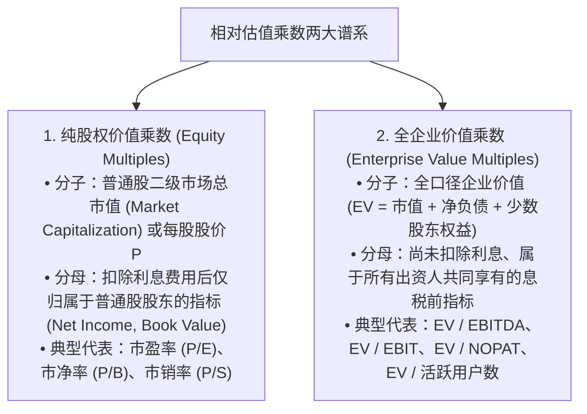
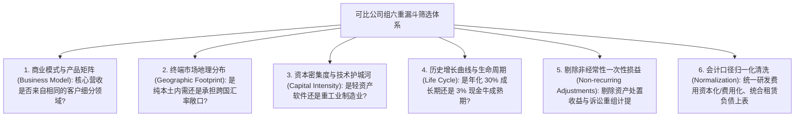

# Lec 05 证券分析师商业分析与行业可比公司估值 (Comparative Analysis: Multiples, Peer Groups & Analyst Practices)

> MIT Sloan School of Management · 15.535 Business Analysis Using Financial Statements · 讲义 05

## TL;DR

- 相对估值乘数法以一价定律为基石，通过标准化倍数实现跨越体量规模差异的横向定价对标。
- 估值乘数构建必须严格遵循资本范围一致性匹配公理（股权乘数匹配税后、企业价值乘数匹配息前）。
- 企业价值倍数（EV/EBITDA）有效隔离了资本结构杠杆与会计折旧政策差异，是并购重组首选乘数。
- 卖方分析师普遍存在投行业务利益冲突与业绩预期向下引导博弈，需对共识预测实施批判性去噪。

## 相对估值乘数法的理论基础与适用边界

在华尔街投行与二级市场买方基金的日常决策中，相比于复杂的现金流折现（DCF）模型，应用最广泛、报价最迅捷的工具是**相对估值乘数法（Comparable Company Analysis / Multiples Approach）**。

相对估值法的底层经济学基石是**微观一价定律（Law of One Price）**：在充分竞争且具备深度的资本市场上，具有相似业务模式、增长潜能、资本结构与现金流风险特征的同类资产，应当在交易中享有相近的标准化市场相对价格。



::: theorem 估值乘数构建的一致性匹配公理 (Consistency Rule)
**乘数的分子与分母在资本索偿权的权利范围上，必须保持严格的一一对应与数学对称**！
- **严重错误示例 1：$\frac{\text{企业价值 EV}}{\text{净利润 Net Income}}$**（分子包含了债权人的资金，分母却早已把债权人利息扣得干干净净，属于分子大分母小的错配）；
- **严重错误示例 2：$\frac{\text{股票价格 Price}}{\text{息税折旧前利润 EBITDA}}$**（分子只属于股东，分母却包含了债权人的份额，属于分子小分母大的错配）。
:::

## 核心乘数深度推导与经济动因解构

任何一个表面看似简单的乘数，在公司金融的代数推导下，本质上都是**现金流折现模型的微积分压缩包**：

### 1. 市盈率（P/E Ratio）的微观解构
根据戈登增长模型，如果企业将净利润按固定股利支付率 $p$ 进行分红：
$$P_0 = \frac{D_1}{r_e - g} = \frac{E_1 \times p}{r_e - g}$$
两端同除以预期下期每股收益 $E_1$，推导出**前瞻市盈率（Forward P/E）的理论决定模型**：

$$\frac{P_0}{E_1} = \frac{\text{股利支付率 } p}{\text{股权资本成本 } r_e - \text{永续增长率 } g}$$

由此证明，一家企业的市盈率高低，完全由三大微观经济变量正交支配：
1. **未来成长增速 $g$（正向驱动）**：预期利润增速越高，市场给予的市盈率估值溢价越高；
2. **股权资本成本 $r_e$（反向抑制）**：宏观无风险利率跳升或企业经营 Beta 风险越大，市盈率倍数遭受刚性杀估值；
3. **新增投资资本回报率（RONIC）**：高留存再投资只有在资本回报率超越资金成本时，才能有效推高市盈率。

::: definition PEG 指标 (Price/Earnings-to-Growth Ratio)
由传奇基金经理彼得·林奇（Peter Lynch）推广的 **PEG 指标** 定义为市盈率与预期未来净利润复合年化增长率（$G$，去掉百分号的整数）的比值：
$$\text{PEG} = \frac{\text{P/E}}{G}$$
- **经典经验法则**：$\text{PEG} \approx 1.0$ 被视为估值合理；$\text{PEG} < 0.5$ 被视为被严重低估的安全边际；$\text{PEG} > 2.0$ 提示高成长透支风险。
- **局限性警示**：PEG 假设估值与增速呈绝对线性关系，但在现实中，当企业增速从 40% 跌落至 20% 时，其估值往往会发生非线性的崩塌。
:::

### 2. 企业价值倍数（EV / EBITDA）的实务霸权
在跨国兼并收购（M&A）与私募股权杠杆收购（LBO）中，**EV / EBITDA 是全华尔街绝对统治性的首选乘数**：
- **资本结构中性（Capital-Structure Neutral）**：无论目标企业采用 $10\%$ 的极低负债率还是 $80\%$ 的高杠杆，其 EV 和 EBITDA 均不会受到债务利息的直接扭曲，保证了不同负债结构同行之间的可比性；
- **折旧政策中性（Depreciation-Policy Neutral）**：完全剔除了企业采用直线法还是加速折旧法、折旧年限长短的主观会计估计噪音，聚焦于纯粹的底层现金生产效率。

## 可比对标同行（Peer Group）筛选与口径标准化清洗

在应用乘数法时，最容易犯下的致命错误是**“可比公司根本不可比（Comparing Apples to Oranges）”**。如果仅仅依赖软件终端中粗糙的行业分类代码（如 SIC 或 GICS 分类），将两家商业实质截然相反的企业生硬打包在一起对标，算出的估值将毫无经济意义。

构建一个高质量的可比公司样本池（Peer Group），必须经受六重严密的漏斗筛选与标准化清洗：



在确立对标样本后，分析师必须推进深度的**会计口径归一化清洗工程（Accounting Normalization）**：
1. **统一核心会计政策口径**：如果样本池中部分企业采用 LIFO 存货计价，而其他企业采用 FIFO，必须首先利用附注中的 LIFO 准备金（LIFO Reserve）将全行业存货与销货成本统一还原至 FIFO 基础；对于新旧准则过渡期的不可撤销租赁合同，必须按统一折现率将表外经营租赁全量资本化还原上表；
2. **清洗非经常性与偶发性扰动**：将各家企业利润表中偶发发生的资产处置利得、厂房拆迁补偿、政府一次性特许补贴、未决诉讼和解支出以及商誉大幅减值，从当期营业利润中全额剔除，计算出最纯净的**核心可持续经营利润（Core Sustainable Earnings）**；
3. **统计度量的抗偏态处理**：分析师在计算行业可比乘数时，**严禁简单取算术平均数（Arithmetic Mean）**（极易被某一家因利润微薄导致 P/E 畸高至 800 倍的异常公司严重拉偏），必须强制采用**中位数（Median）或剔除最高最低 $10\%$ 极值后的修剪平均数（Trimmed Mean）**作为估值标杆。

## 卖方证券分析师行为偏差与利益冲突

在利用卖方证券分析师（Sell-side Equity Analysts）出具的研报与财务预测数据时，买方专业投资人必须时刻对**分析师的行为学偏差与制度性利益冲突**保持清醒的审计目光：

```mermaid
flowchart LR
    BankIBD[投行投资银行部 (IBD)] -->|巨额 IPO 与并购承销佣金| ResearchDept[股票研究部 (Equity Research)]
    ResearchDept --> PushBias["买入评级膨胀偏差 (Optimism Bias)<br/>市场上 90% 以上研报全为'买入/增持'<br/>极少有分析师敢出具'卖出'以免激怒拟融资上市公司"]
    
    CorporateIR[上市公司投资者关系部 (IR)] -->|掌控电话会与高管独家调研通道| ResearchDept
    CorporateIR --> GamePlay["预期管理低开高走博弈 (Sandbagging Consensus)<br/>季报前诱导分析师下调盈利预期，为季报发布制造'超预期盈利惊喜'"]
```

::: pitfall “耳语数字（Whisper Numbers）”与业绩惊喜陷阱
在华尔街实务中，上市公司管理层常在业绩发布前数周，通过隐秘的非正式渠道向大机构分析师传递保守悲观信号，推动全市场的公开共识预期（Consensus Estimate）大幅下调：
- 随后在财报发布日，公司报告了一个仅仅超越该悲观共识 1 美分的每股收益（EPS Beat）；
- 财经媒体立即大肆报道“业绩超预期暴增”，推动股价跳空高开；
- 如果缺乏对历史预测偏差的量化跟踪，普通投资者极易被这种人工制造的“虚假超预期惊喜”诱多套牢。
:::

## 我的理解

::: insight 相对估值乘数不是 DCF 的替代品，而是将全部复杂假设压缩进一个分母的简写代码
深入解构相对估值法的运作，可以拨开资本市场上最大的认知幻象：
1. **乘数法是最容易被滥用、也是最容易伪造的估值工具**：在很多粗糙的商业路演中，投行人员只要随手挑出几家高市盈率的明星公司拼凑成一个所谓的“可比组”，就能在一分钟之内“论证”出任何一家垃圾企业值 100 亿元。这种脱离商业护城河与资本回报率支撑的乘数套用，本质上是在用别人的泡沫来给自己的投机寻找借口。
2. **每一个倍数背后都潜伏着一个完整的 DCF 模型**：当你随口说出“这家公司合理市盈率应当是 25 倍”时，你在数学上就已经暗中锁定了一组关于其未来长期增长率（$g = 12\%$）、股利支付率（$p = 40\%$）与贴现率（$r = 9.5\%$）的硬性假设。卓越的商业分析师从不会把乘数看作孤立的静态切片，而是具备瞬间将倍数反向解码为底层经营假设的透视力——唯有看清倍数分母深处所要求的现金流兑现难度，你才能在市场的喧嚣中精准判定一项资产究竟是真正的估值洼地，还是包藏祸心的价值陷阱。
:::
