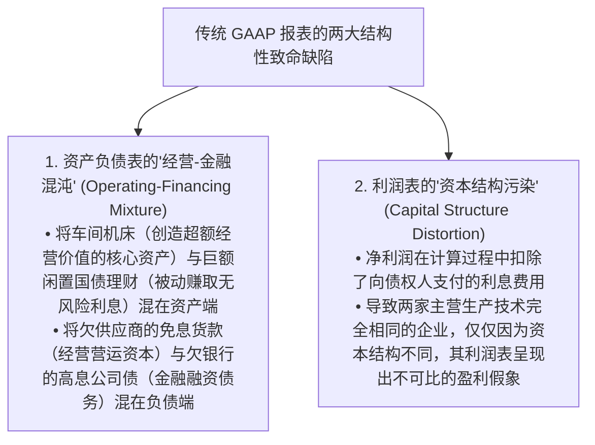
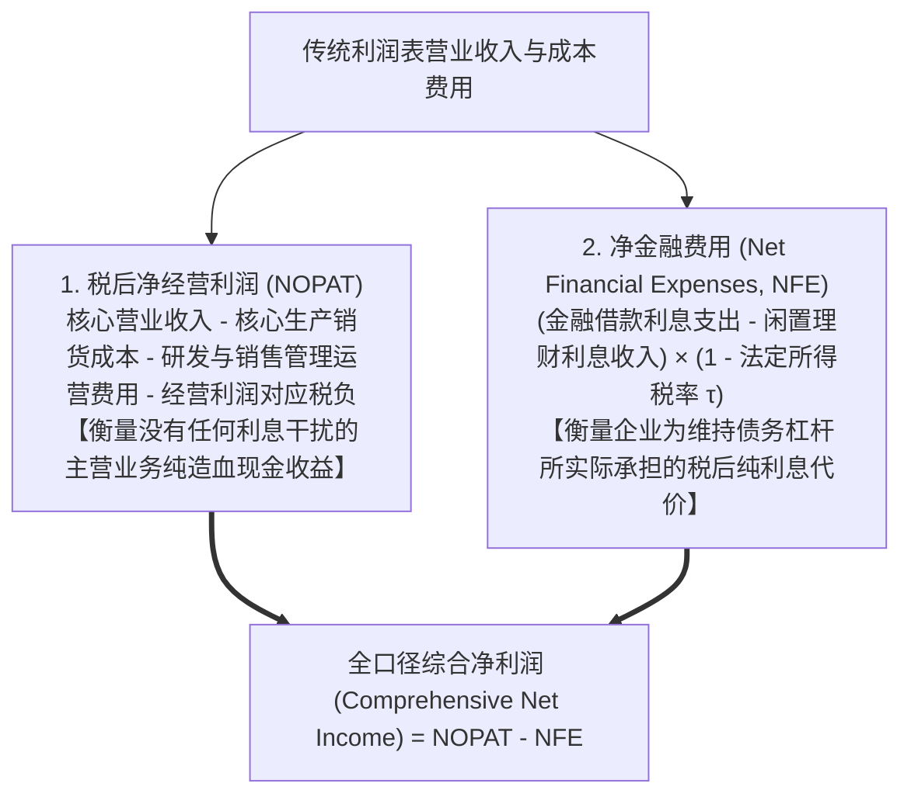

# Lec 06 极速会计重温：穿透式财报阅读与重构 (Turbo Accounting: Critical Reading & Financial Statement Reformulation)

> MIT Sloan School of Management · 15.535 Business Analysis Using Financial Statements · 讲义 06

## TL;DR

- 穿透式财务报表重构（Reformulation）打破了 GAAP 资产负债表与利润表混淆经营与金融活动的结构缺陷。
- 净经营资产（NOA）与净金融负债（NFO）构成了重构资产负债表的刚性资金来源与运用闭环。
- 税后净经营利润（NOPAT）剔除了债务资本结构与利息税盾干扰，纯粹度量主营业务资产的实体造血效率。
- 进阶杜邦利差展开方程证明：财务杠杆只有在经营收益率跑赢净借贷利差（SPREAD > 0）时才能创造股东价值。

## 穿透式财报阅读的哲学：从合规视角跃迁至分析师视角

在公认会计准则（GAAP）的制度设计中，资产负债表与利润表的编制主要服务于外部审计合规、满足商业借贷合同与向税务机关报税。然而，对于承担着真金白银资源配置使命的证券分析师、私募基金投资人与企业战略管理者而言，未经清洗重构的原始 GAAP 报表往往充满了**严重的结构性信息遮蔽**：

为了彻底破除这一迷雾，哥伦比亚大学佩恩曼（Stephen Penman）教授与麻省理工斯隆管理学院团队构建了**穿透式财务报表重构分析体系（Turbo Accounting & Reformulation）**。其核心哲学是一句不可动摇的公理：**企业存在唯一的价值创造引擎——核心经营实体业务；金融融资活动在本质上只是负责资金调配与流动性过桥，其净现值在有效市场中期望为零**。

## 资产负债表重构核心模型：NOA 与 NFO 代数统一

在重构框架下，分析师必须拿起手术刀，对资产负债表的每一个独立会计科目进行严格的**二分属性裁决**：

```mermaid
flowchart LR
    subgraph BalanceSheet_L [资产端重构]
        Assets[全部表内资产] --> OA["经营性资产 Operating Assets (OA)<br/>• 核心存货、应收账款原值<br/>• 厂房设备 PP&E、专利技术、核心商誉"]
        Assets --> FA["金融性资产 Financial Assets (FA)<br/>• 超额闲置货币资金、短期有价证券理财<br/>• 持有至到期债券、衍生金融套期资产"]
    end

    subgraph BalanceSheet_R [负债端重构]
        Liabilities[全部表内负债] --> OL["经营性负债 Operating Liabilities (OL)<br/>• 无息商业信用：应付账款、预收合同负债<br/>• 应付职工薪酬、应计质保准备金"]
        Liabilities --> FO["金融性负债 Financial Obligations (FO)<br/>• 银行长短期借款、应付公司债券<br/>• 上表租赁负债、贴现借款本金"]
    end
```

通过跨表对冲，推导出重构资产负债表的两大核心概念：
1. **净经营资产（Net Operating Assets, NOA）**：
   $$\mathbf{\text{NOA}} = \text{经营性资产 (OA)} - \text{经营性负债 (OL)}$$
   NOA 衡量了企业为了维系其现有主营业务生产运转，所必须实际沉淀并占用的**纯实体经营资本净规模**；
2. **净金融负债（Net Financial Obligations, NFO）**：
   $$\mathbf{\text{NFO}} = \text{金融性负债 (FO)} - \text{金融性资产与闲置现金 (FA)}$$
   NFO 衡量了企业在扣除所有可随时变现的闲置现金后，对外部纯资本市场（银行与债券人）所背负的**真实现金净债务敞口**。

由此推导出**重构资产负债表守恒终极公理**：

$$\mathbf{\text{净经营资产 (NOA)}} = \mathbf{\text{净金融负债 (NFO)}} + \mathbf{\text{普通股股东权益账面净资产 (Common Equity)}}$$

::: definition 闲置现金的“负债务”属性
在传统报表中，“现金”被神圣地列在资产第一行；但在重构分析体系中，**除维持日常开门营业所必需的极少量周转备用金（通常界定为营收的 1%~2% 作为经营资产）外，所有多余的闲置现金与银行存款，在经济实质上全部属于“负债务（Negative Debt）”**！
因为这笔钱可以随时随地被管理层一键用于偿还银行到期贷款。将闲置现金从资产端剥离并直接冲减金融负债计算 NFO，才能真实还原企业面临的真实财务债务杠杆。
:::

## 利润表重构核心模型：NOPAT 与 NFE 纯净分离

伴随资产负债表的重构，利润表也必须同步实现**经营损益与金融损益的物理隔离**：

- **税后净经营利润（NOPAT）**：
  $$\text{NOPAT} = \text{息税前营业利润 (EBIT)} \times (1 - \text{所得税税率 } \tau)$$
  无论企业是 $100\%$ 股权融资还是 $90\%$ 负债融资，其 NOPAT 保持绝对恒定不变，为横向对标不同资本结构同行的真实生产力提供了无偏基准；
- **净金融费用（NFE）**：
  $$\text{NFE} = \text{税后利息支出} = (\text{财务利息支出} - \text{金融资产利息收入}) \times (1 - \tau)$$
  充分考虑了利息费用在税法上税前抵扣所产生的**利息税盾（Interest Tax Shield）**红利。

## 进阶杜邦利差展开方程：ROE 驱动引擎解构

在完成资产负债表与利润表重构后，衡量股东财富终极回报率的**净资产收益率（ROE）**，被升维推导为具有划时代意义的**进阶杜邦利差方程**：

$$\mathbf{\text{ROE}} = \frac{\text{Net Income}}{\text{Equity}} = \mathbf{\text{RNOA}} + \left[ \mathbf{\text{FLEV}} \times \mathbf{\text{SPREAD}} \right]$$

其微观因果参数体系如下：
1. **净经营资产收益率（RNOA）**：
   $$\text{RNOA} = \frac{\text{NOPAT}}{\text{平均净经营资产 NOA}} = \left( \frac{\text{NOPAT}}{\text{营业收入 Sales}} \right) \times \left( \frac{\text{营业收入 Sales}}{\text{平均 NOA}} \right) = \text{经营利润率} \times \text{净经营资产周转率}$$
   这是整个企业商业模式的核心内生驱动力，反映了团队在实体要素市场上配置技术、产品与供应链的真正商业智慧；
2. **净借贷利率（Net Borrowing Cost, NBC）**：
   $$\text{NBC} = \frac{\text{净金融费用 NFE}}{\text{平均净金融负债 NFO}}$$
   衡量企业向外部债权人借入每一元净债务所实际承担的综合税后资本成本；
3. **经营利差（SPREAD）**：
   $$\text{SPREAD} = \text{RNOA} - \text{NBC}$$
   衡量主营业务资本回报率与外部借款利率之间的**净超额阿尔法利差**；
4. **净财务杠杆乘数（Financial Leverage, FLEV）**：
   $$\text{FLEV} = \frac{\text{平均净金融负债 NFO}}{\text{平均普通股股东权益 Equity}}$$
   衡量企业利用债权人资金放大股东收益的激进度。

::: example 进阶杜邦利差展开实战推演
某工业装备公司重构报表数据如下：
- 平均净经营资产 $\text{NOA} = 10,000$ 万元，实现 $\text{NOPAT} = 1,500$ 万元；
- 平均净金融负债 $\text{NFO} = 4,000$ 万元，股东权益 $\text{Equity} = 6,000$ 万元（$\text{NOA} = \text{NFO} + \text{Equity} = 10,000$ 万）；
- 支付税后净金融费用 $\text{NFE} = 200$ 万元；
- 最终归属于股东的净利润为：$\text{Net Income} = 1,500 - 200 = 1,300$ 万元。

**传统报表视角**：
$$\text{ROE} = \frac{1,300}{6,000} \approx 21.67\%$$
初级分析师仅能看出 21.67% 的高收益，但无法识别其安全边际。

**重构框架深度透视**：
1. **主营业务纯内生回报率**：$\text{RNOA} = \frac{1,500}{10,000} = 15.0\%$；
2. **综合借贷税后利率**：$\text{NBC} = \frac{200}{4,000} = 5.0\%$；
3. **核心经营利差**：$\text{SPREAD} = \text{RNOA} - \text{NBC} = 15.0\% - 5.0\% = +10.0\%$；
4. **净财务杠杆乘数**：$\text{FLEV} = \frac{4,000}{6,000} \approx 0.667$；
5. **杜邦利差方程完美闭环校验**：
   $$\text{ROE} = \text{RNOA} + (\text{FLEV} \times \text{SPREAD}) = 15.0\% + (0.667 \times 10.0\%) = 15.0\% + 6.67\% = \mathbf{21.67\%}$$

**战略管理结论**：
该企业的 21.67% 高收益中，有整整 **$15.0\%$ 来自主营业务实打实的经营护城河**，另外的 **$6.67\%$ 来自利用 $5\%$ 的低成本借款撬动 $15\%$ 优质资产所赚取的安全财务杠杆利差红利。企业增长极度扎实强韧。
:::

## 资产与负债分类判定实战矩阵

在重构实务中，分析师最常遇到的模糊灰色科目裁决标准如下表所示：

| 资产负债表争议科目 | 推荐重构归属裁决 | 底层经济实质与准则依据 |
| :--- | :--- | :--- |
| **超额货币资金与短期理财** | **金融性资产 (FA)** | 超出日常周转所需的闲置资金，本质上是赚取低息的流动性储备，直接抵冲金融负债。 |
| **递延所得税资产 (DTA)** | **经营性资产 (OA)** | 源自产品质保预提、坏账准备等主营业务暂时性差异，属于未来可抵扣经营税款的权利。 |
| **递延所得税负债 (DTL)** | **经营性负债 (OL)** | 源自机器设备加速折旧等生产要素形成的税务递延，属于日常主营业务派生的免息负债。 |
| **经营租赁使用权资产 (ROU)** | **经营性资产 (OA)** | 企业为了生产或开店而控制的实体物理空间使用权，属于核心经营要素。 |
| **租赁负债 (Lease Liability)** | **金融性负债 (FO)** | 伴随使用权资产产生的不可撤销还本付息刚性债务，按约定利率计息，属于金融负债。 |
| **员工离职后退休金赤字 (PBO Deficit)** | **金融性负债 (FO)** | 类似向员工发行的长期不计息债券，包含庞大的精算利息贴现累加，属于长期融资范畴。 |

## 我的理解

::: insight 财务重构是分析师的认知消毒水，它洗净了一切资本结构的欺骗性脂粉
深入理解穿透式财报重构的威力，可以获得降维打击般的专业洞见：
1. **脱离 RNOA 的杠杆狂欢是自杀的前戏**：在很多牛市周期中，一些平庸的企业通过疯狂借入高达 80% 的负债，强行把原本平庸的 8% RNOA 放大到了 30% 的惊人 ROE。外行投资者蜂拥而至，误以为发现了一只百年不遇的成长股。然而，进阶利差方程冷酷地提示我们：**只要宏观信贷紧缩导致借款利率 NBC 从 5% 飙升至 9%，利差 SPREAD 瞬间由正转负（$8\% - 9\% = -1\%$），原本的杠杆放大器就会在顷刻间逆转为催命符**，将 30% 的 ROE 瞬间砸成深度巨亏。
2. **只有把经营与金融分开，估值才拥有坚实的物理底座**：传统估值模型之所以经常得出荒谬的结论，根源就在于输入了被利息和理财混淆的脏数据。当你把企业重构成“一台纯粹的实体印钞机（NOA 产生 NOPAT）”加上“一个独立的资本蓄水池（NFO 与 Equity 进行清算对冲）”后，整个企业的资本结构、利差安全垫与破产边界瞬间变得如水晶般通透清澈。这种穿透表象、直击本质的分析力，正是每一个顶级商业分析师的立身之本。
:::
