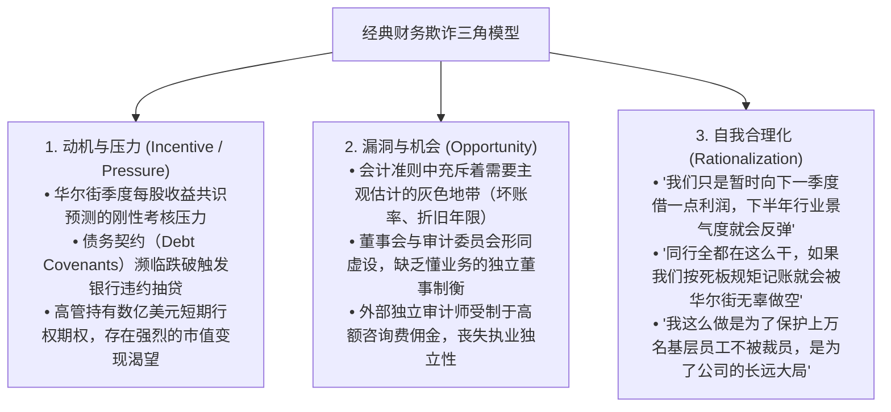
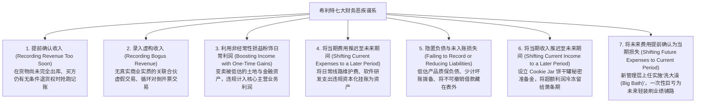

# Lec 07 财报操纵手法大观：从虚构收入到费用资本化 (How Companies Cook the Books: Red Flags & Fraud Taxonomy)

> MIT Sloan School of Management · 15.535 Business Analysis Using Financial Statements · 讲义 07

## TL;DR

- 财务造假三角理论（压力、机会、合理化）揭示了管理层滑向会计舞弊深渊的制度与心理根源。
- 霍华德·希利特七大财务恶疾体系系统解构了从提前确认收入、虚构利润到费用违规资本化的操纵路径。
- 经典案例表明：太阳鸟的开票待运、废品管理的垃圾车折旧造假与世通的线路费用资本化是典型模式。
- 建立以应收账款周转天数异动、存货积压剪刀差与现金流脱节为核心的法证会计排雷预警网络。

## 财务欺诈的动因三角：压力、机会与自我合理化

在剖析任何具体的财务造假技巧之前，法证会计学家与证券分析师必须首先理解管理层实施财务操纵的社会心理学与组织动力学机制。犯罪学家唐纳德·克雷西（Donald Cressey）提出的**欺诈三角理论（The Fraud Triangle）**为理解“企业为何烹饪账簿（Cook the Books）”提供了经典框架：

欺诈三角的三大要素在组织内部互为因果、深度咬合：
- **压力（Pressure）通常是外生的催化剂**：上市公司高管面临着极度残酷的资本市场短视考核。如果某季度的每股收益（EPS）比华尔街卖方共识预期哪怕仅仅低了区区 1 美分，公司的市值就可能在开盘几分钟内瞬间蒸发数百亿美元，引爆董事会弹劾与信用评级连环下调；
- **机会（Opportunity）则是内控与制度的坍塌**：当首席执行官在公司内部拥有不受制约的绝对权威，且会计准则中存在大量依赖主观判断的估值模型时，舞弊的技术通道被彻底敞开；
- **自我合理化（Rationalization）完成了道德防线的最后失守**：绝大多数触目惊心的世纪财务造假案，在最初爆发时往往并不是一个精心策划的恶意犯罪阴谋，而只是管理层为了应付某个季度的业绩微弱不及预期，所采取的一个“微小的权宜之计”；但由于真实的商业现实持续恶化，这个微小的会计窟窿在未来季度必须通过越来越庞大的虚构交易去掩盖，最终如同滚雪球般失控引爆。

## 霍华德·希利特七大财务恶疾谱系

美国著名法证会计权威霍华德·希利特（Howard Schilit）在其传世名著《财务诡计》（*Financial Shenanigans*）中，系统提炼了全美上市公司最常采用的**七大经典财务操纵恶疾谱系**：

这七大恶疾在会计技术路径上覆盖了利润表与资产负债表的每一个维度：
1. **收入端激进提前确认**：将尚未满足履约义务、客户仍拥有完全退货选择权的大额订单提前确认为本期收入，人为造成应收账款原值暴增；
2. **凭空录入虚构交易**：通过控制没有实体业务的关联方壳公司，进行“左右手互倒”的循环开票或虚假服务采购，制造没有真实货物流动的假账流水；
3. **主营业务收益混淆**：把偶发性的变卖闲置厂房、土地溢价或证券投资浮盈，巧妙包装为“主营业务收入”列示，掩盖核心经营利润率的断崖暴跌；
4. **费用恶意资本化**：将本应在当期全额冲销的消耗性日常运营支出，强行作为长期资产资本化并在未来长达十数年内分摊，瞬间把当期现金亏损粉饰为纸面盈利；
5. **隐匿负债与准备金不足**：故意对正在恶化的客户欠款少提坏账准备，对大规模产品缺陷隐匿召回维修负债，使资产负债表看起来健康轻盈；
6. **蓄水池平滑盈余**：在行业暴利繁荣大年，故意推迟确认部分收入并多提准备金，将超额利润存入秘密“饼干罐”，以备在未来的萧条年份悄悄释放刷分；
7. **大扫除式一次性洗大澡**：新任高管上台的第一时间，将过去累积的所有潜在坏账和未来数年的开支，以“重组与资产减值损失”的名义一次性全额计提巨亏，既能把历史责任全额推给前任，又能让企业在未来轻装上阵、轻松呈现惊人的“业绩反转神话”。

## 经典商业欺诈案例深度解剖

通过解构全美证券史上最典型的实证案例，能够清晰看清上述操纵手法在物理世界的微观落地：

### 1. 太阳鸟公司（Sunbeam）与“电锯阿兰”的开票待运欺诈
20 世纪 90 年代末，被誉为“企业重组屠夫”的首席执行官阿兰·邓拉普（Al Dunlap）执掌小家电巨头太阳鸟公司（Sunbeam）。为了在年末强行达成暴利的利润指标：
- **开票待运（Bill-and-Hold）与反季节渠道塞货**：在寒冷的 11 月和 12 月，太阳鸟向全美零售商强行发运了数十万台户外烧烤架（Gas Grills），并开具全额销售发票确认数千万美元收入；
- **秘密抽屉协议**：太阳鸟向零售商私下签署抽屉协议，承诺零售商**不仅在春季之前不需要付一分钱货款，货物可以无限期免费堆在太阳鸟租用的第三方仓库中，而且如果在春季卖不出去可以无条件全额退货，甚至由太阳鸟向其补贴仓储保管费**！
- 这一操作完全违背了收入确认准则中的“风险与报酬转移”铁律，在次年春季引发了雪崩般的集中退货潮，彻底引爆了欺诈丑闻。

### 2. 废品管理公司（Waste Management）的机队折旧寿命魔法
全美最大的垃圾回收运输巨头废品管理公司（Waste Management）：
- **篡改会计估计**：公司账面上拥有数万辆垃圾运输卡车。管理层在没有任何工程技术依据的前提下，通过行政命令将所有卡车的折旧服役年限从原来的 8 年强行延长至 14 年，同时将报废残值从零大幅上调至不可思议的高位；
- **财务后果**：年化折旧开支被硬生生压缩了数亿美元，掩盖了日常垃圾填埋场运营成本的急剧失控。随后 SEC 介入审查，公司被迫一次性追溯调减巨额虚假利润 **17 亿美元**，成为当时美股历史上规模最大的会计重述惨案。

### 3. 世通公司（WorldCom）的线路费用资本化
世通公司的高管面临电信网络使用费（Line Costs，即借用其他电信运营商光纤管道的日常租用过桥费）飙升的绝境：
- 按照会计准则，这些网络租金属于最纯粹的当期日常经营性营业成本（COGS）；
- 世通财务总监指令会计人员编制数以百计的手工转账凭证，**将 38.5 亿美元的租金费用从利润表中抹掉，直接作为“资本开支（CapEx）”计入资产负债表上的固定资产与在建工程**；
- 这一荒谬造假将原本巨额现金亏损的重度危机，伪装成了高达数十亿美元的经营暴利，最终催生了 1,070 亿美元的世纪破产案。

## 法证会计排雷：十二大定量红旗预警系统

专业法证会计分析师（Forensic Accountants）通过交叉比对资产负债表与利润表的动态偏离，构建了精准的**财务舞弊红旗预警指标库（Fraud Red Flags）**：

| 红旗监测维度 | 预警定量异动特征 | 潜在底层财务诡计与操纵风险诊断 |
| :--- | :--- | :--- |
| **1. 营收与应收款脱节** | 应收账款周转天数（DSO）连续 3 季单调拉长，增幅超营收 15% | 实施渠道塞货、向濒临破产客户滥放账期、虚构未开票应收账款 |
| **2. 产销率与存货倒挂** | 存货周转天数（DSI）大幅飙升，存货增速远超主营业务成本 | 盲目超量生产以稀释固定制造费用（虚增利润），或隐瞒存货跌价坏账 |
| **3. 现金流与净利润剪刀差** | 净利润连创新高，但经营现金流（CFO）持续为负或长期大幅落后 | 典型的劣质应计盈余，账面利润全部由未变现的纸面白条支撑 |
| **4. 资本开支激进飙升** | 资产负债表在建工程与无形资产狂飙，但产能利用率极其低迷 | 涉嫌将日常研发费用、销售维护开支违规资本化（世通式造假） |
| **5. 坏账准备比例异常跳水** | 应收账款逾期账龄结构恶化，但坏账准备计提率却反常下调 | 通过主观调低备抵拨备直接虚夸当期净利润（Cookie Jar 反向操作） |
| **6. 频繁计提巨额重组洗大澡** | 每逢换届或低谷期频繁出现“非经常性一次性资产减值与重组” | 将未来经营成本打包砸入当期，制造“困境反转”暴利假象 |
| **7. 财税所得额严重背离** | 账面税前利润暴增，但实际向税务局缴纳的现金所得税长期低迷 | 财务报表确认了大量税务局根本不予承认的虚假或存疑收入 |
| **8. 毛利率逆势反常飙升** | 在全行业深陷价格战、同行毛利暴跌时，公司毛利率奇迹般攀升 | 涉嫌低估期末存货成本出库额，或通过虚开发票虚构终端出厂售价 |
| **9. 复杂的关联方暗渠交易** | 存在大量向未并表关联企业、离岸空壳公司的资金拆借与大宗采购 | 利用关联方作为通道实施资产高位接盘或资金占用利益输送 |
| **10. 核心高管与审计师异常离职** | 首席财务官（CFO）、审计委员会主席或独立会计师事务所突然辞职 | 内部人在知晓财务造假即将失控时选择紧急跳船跳槽自保 |

## 我的理解

::: insight 财务造假从来不是数学的胜利，而是对商业常识的公开背叛
深入解构企业操纵账簿的病理学，可以获得关于人性与制度最深刻的顿悟：
1. **反常识的奇迹往往就是骗局的代名词**：在商业世界中，资本回报率最终都会受到行业竞争壁垒的物理约束。当你看到一家身处充分竞争红海市场的公司，既没有颠覆性的芯片专利，也没有革命性的商业模式，却能连续五年在财报上维持比行业龙头高出三倍的毛利率和零坏账率时，不要惊叹于管理层的经营奇迹。在 99% 的情况下，你所看到的“奇迹”，只是管理层在深夜的办公室里用借贷平衡分录手工调配出来的蜃楼。
2. **法证审计的终极防线是常识性交叉验证**：高明的造假者可以伪造银行对账单、伪造客户签收单，但他们**绝对无法伪造物理世界的物质守恒定律**。如果一家化工企业宣称其产量翻了五倍并报告了数十亿利润，但其工厂每月的生产用水用电量、物流公路货车出入频次以及上游采购的基础化学原料在物理量上完全没有增加，那么它的财报就 $100\%$ 是彻底的谎言。优秀的商业分析师不仅要精通会计准则，更要走出空调办公室去查验车间的电表、港口的集装箱和渠道货架上的灰尘。只有当纸面数字与物理世界的质能守恒严丝合缝时，财务数据才配赢得资本的信任。
:::
